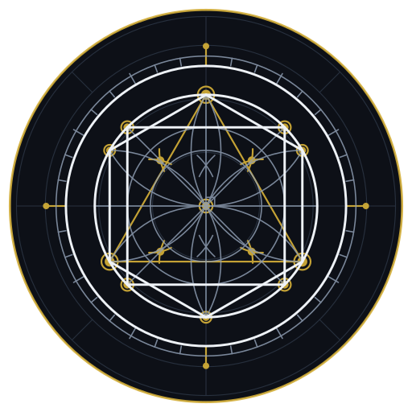

:site_title: Geometric Fundamentals

.. container:: author-overline

   semantic digital archive • mathematical catalog

======================
Geometric Fundamentals
======================

**Geometric Fundamentals** preserves and formalizes the constructive geometry archive of **Fred W. Seelig**, spanning 55 axiomatic and projective studies across 353 handwritten manuscript folios and 59 computational worksheets. From elementary compass-and-straightedge constructions and circle pencils to harmonic conjugates, pole-and-polar duality, and barycentric triangle loci, every topic pairs Seelig's original notebook pages with exact SymPy derivations and interactive vector diagrams.

Codex & Computational Workbooks
-------------------------------

.. container:: home-book-hero

   .. container:: home-book-thumb

      .. image:: topics/f-01/f-01.svg
         :alt: F.1 Albert's Parabola Interactive Construction Diagram
         :target: topics/index.html

   .. container:: home-book-body

      .. rubric:: 3-Track Book Codex · F.1–F.55 · 353 Manuscript Folios

      **Fundamentals of Constructive Geometry** — Explore all 55 foundational topics organized across three synchronized tracks: *Synthesis* (formal enunciations, constructive signatures, and calibrated SVG diagrams), *Folios* (high-resolution scans ``0001.jpg``–``0353.jpg`` with diplomatic transcriptions), and *Code* (executable ``geometor.model`` scripts).

      .. container:: home-actions

         * :doc:`Browse Topics F.1–F.55 → <topics/index>`
         * :doc:`Start at F.1 (Albert's Parabola) → <topics/f-01/index>`
         * :doc:`Using This Edition → <usage/index>`

.. container:: home-book-hero no-thumb

   .. container:: home-book-body

      .. rubric:: OpenDocument Workbooks · 59 Worksheets · Canonical (5, 6, 7) Triangle

      **Computational Spreadsheets & Barycentric Workbooks** — Inspect Fred Seelig's *Triangles and Circles.ods* and companion workbooks verifying homogeneous barycentric coordinates, Conway triangle notation, coaxial circles, and harmonic divisions on the canonical :math:`(a, b, c) = (5, 6, 7)` reference triangle.

      .. container:: home-actions

         * :doc:`Explore All 59 Worksheets → <spreadsheets/index>`

Key Features
------------

.. container:: home-feature-grid

   .. container:: home-feature-card

      **Synchronized Synthesis, Folios & Code**

      Read every topic in modern formal synthesis, view the original handwritten manuscript scan side-by-side, or inspect the standalone SymPy ``model.py`` script.

   .. container:: home-feature-card

      **353 Archival Manuscript Pages**

      Monotonic folio provenance across ``0001.jpg``–``0353.jpg`` preserves Seelig's pencil-and-ink drawings, marginal derivations, and notebook sequence.

   .. container:: home-feature-card

      **Verified Triangle & Projective Loci**

      Every topic ties classical synthetic proofs to exact algebraic invariants over the canonical :math:`(5, 6, 7)` triangle and Graphviz dependency graphs.

Reference & Project
-------------------

.. container:: home-columns

   .. container:: home-col

      .. rubric:: Scholarly Apparatus

      * :doc:`People <people/index>` — Profiles of Fred W. Seelig, John Horton Conway, Clark Kimberling, Nathan Altshiller-Court, Paul Yiu, and C. Stanley Ogilvy
      * :doc:`Bibliography <bibliography>` — Archival notebooks, OpenDocument workbooks, and classical geometry references
      * :doc:`Glossary <glossary>` — Definitions of barycentric coordinates, harmonic conjugates, coaxial pencils, and invariants

   .. container:: home-col

      .. rubric:: About This Project

      * :doc:`About This Edition <about/index>` — Archival scope, provenance, and exact symbolic methodology
      * :doc:`Using This Edition <usage/index>` — Reader guide to interactive vector plates, folio viewer, and Python API
      * :doc:`Research Log <log/index>` & :doc:`Python Modules <modules/index>` — Compilation notes, :doc:`Changelog <changelog>`, and :doc:`Connect <connect>`

.. toctree::
   :maxdepth: 2
   :hidden:

   about/index
   topics/index
   spreadsheets/index
   usage/index
   glossary
   people/index
   bibliography
   log/index
   modules/index
   todos/index
   connect
   changelog
