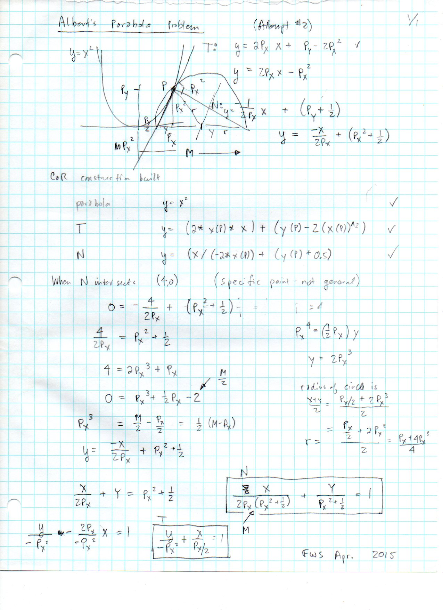
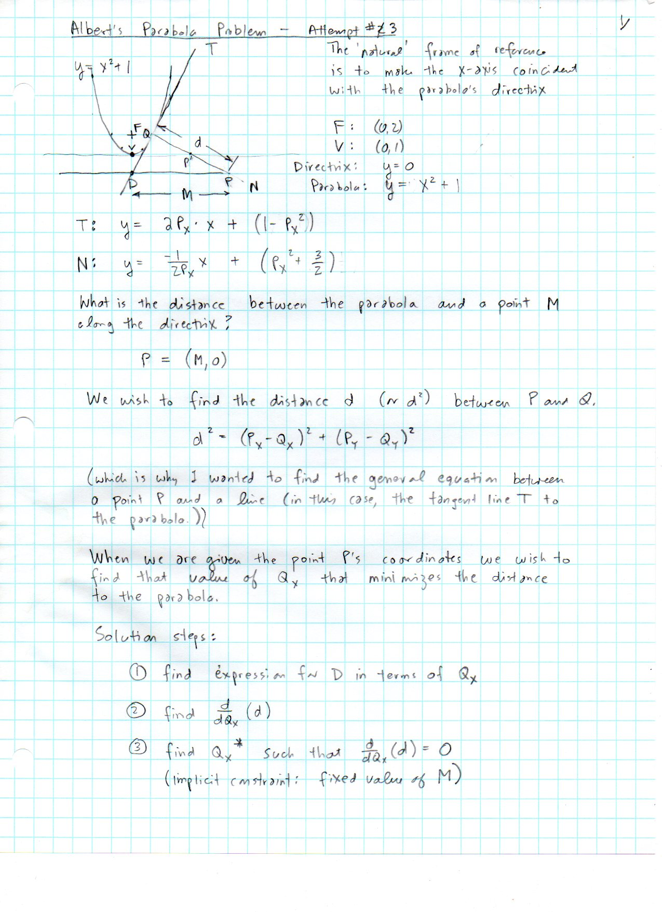

==============================
F.1 Albert's Parabola — Folios
==============================

Archival manuscript scans and diplomatic transcriptions from :person:`seelig`'s
notebooks for **F.1 (Albert's Parabola)** (:cite:`SeeligNotebooks`).

Folio 0001 (Page 1 of 2): Albert's Parabola Problem (Attempt #2, FWS Apr. 2015)
-------------------------------------------------------------------------------

.. folio:: 0001

   Folio ``0001`` (original scan ``0001.jpg``) from ``resources/seelig/01_alberts-parabola``.

**Diplomatic Mathematical & Geometric Transcription**

**Diplomatic Transcription — Folio 0001** (``0001.jpg``, Sheet 1 of 2):

Derives slope-intercept and double-intercept equations for tangent :math:`T` and normal :math:`N` to :math:`y = x^2`, records C.a.R. expressions, and reduces the normal intercept condition at :math:`(M,0)` (tested at :math:`M=4`) to the depressed cubic :math:`P_x^3 + \frac{1}{2}P_x - 2 = 0`.

.. math::

   T:\; y = 2 P_x x - P_x^2, \qquad N:\; y = -\frac{x}{2 P_x} + \left(P_x^2 + \frac{1}{2}\right)

.. admonition:: Editorial & Symbolic Notes

   Archival scan ``0001.jpg`` from Fred W. Seelig's notebook dossier on **F.1 Albert's Parabola** (Page 1 of 2). Companion OpenDocument worksheet(s): ``General Reference``. Classical Euclidean foundations: :ref:`I.11`, :ref:`I.12`.

Folio 0002 (Page 2 of 2): Albert's Parabola Problem — Attempt #3 (Directrix Frame)
----------------------------------------------------------------------------------

.. folio:: 0002

   Folio ``0002`` (original scan ``0002.jpg``) from ``resources/seelig/01_alberts-parabola``.

**Diplomatic Mathematical & Geometric Transcription**

**Diplomatic Transcription — Folio 0002** (``0002.jpg``, Sheet 2 of 2):

Shifts the parabola to :math:`y = x^2 + 1` with directrix :math:`y = 0`, vertex :math:`V(0,1)`, and focus :math:`F(0,2)`, and formulates the 3-step calculus minimization of :math:`d^2 = (P_x - Q_x)^2 + (P_y - Q_y)^2`.

.. math::

   P_x^3 + \frac{1}{2} P_x - \frac{M}{2} = 0, \qquad r = \frac{P_x + 4 P_x^3}{4}

.. admonition:: Editorial & Symbolic Notes

   Archival scan ``0002.jpg`` from Fred W. Seelig's notebook dossier on **F.1 Albert's Parabola** (Page 2 of 2). Companion OpenDocument worksheet(s): ``General Reference``. Classical Euclidean foundations: :ref:`I.11`, :ref:`I.12`.
