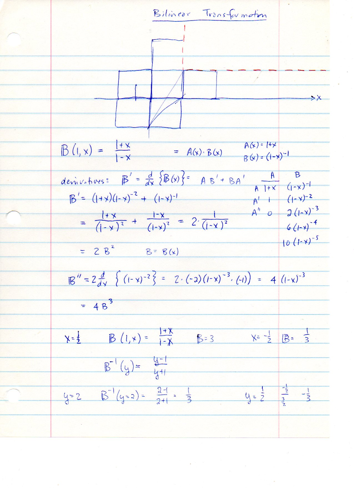
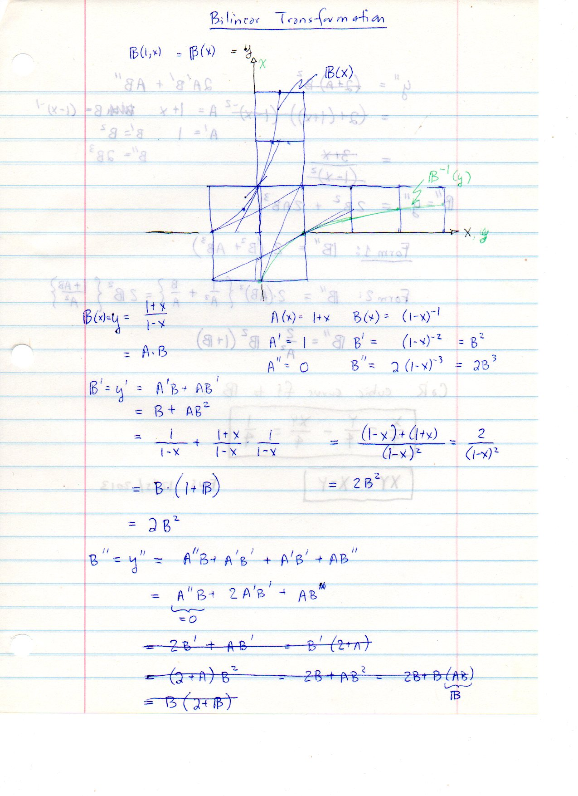
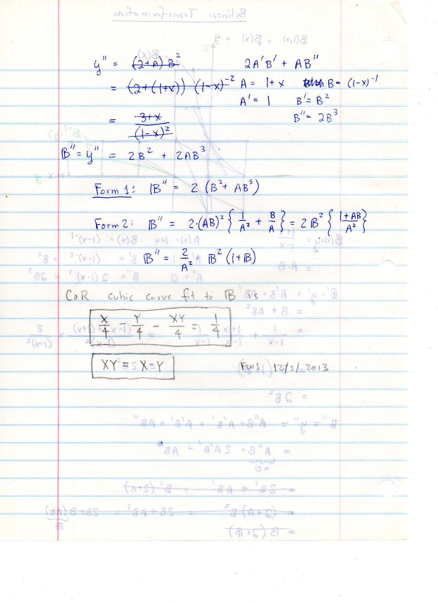
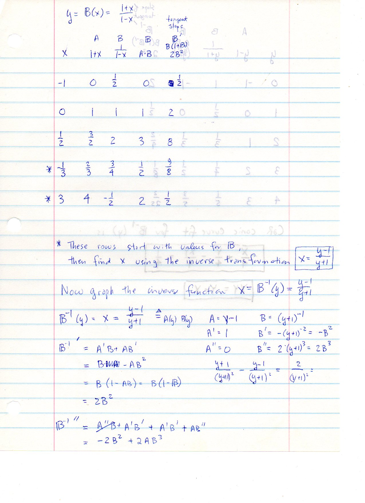
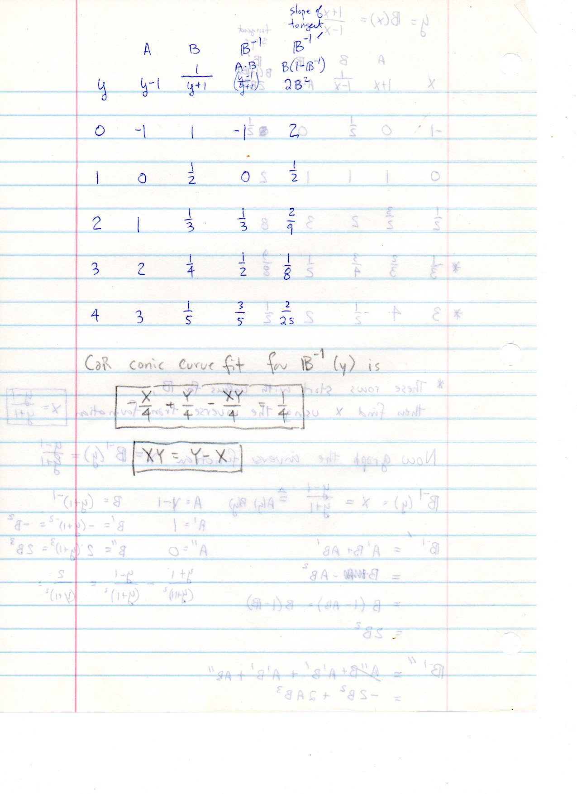
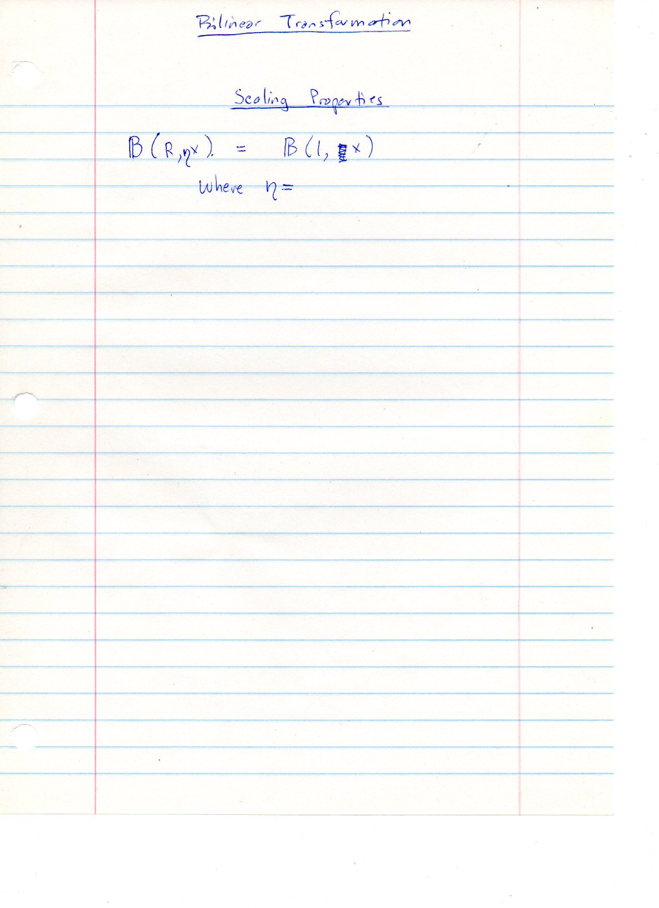
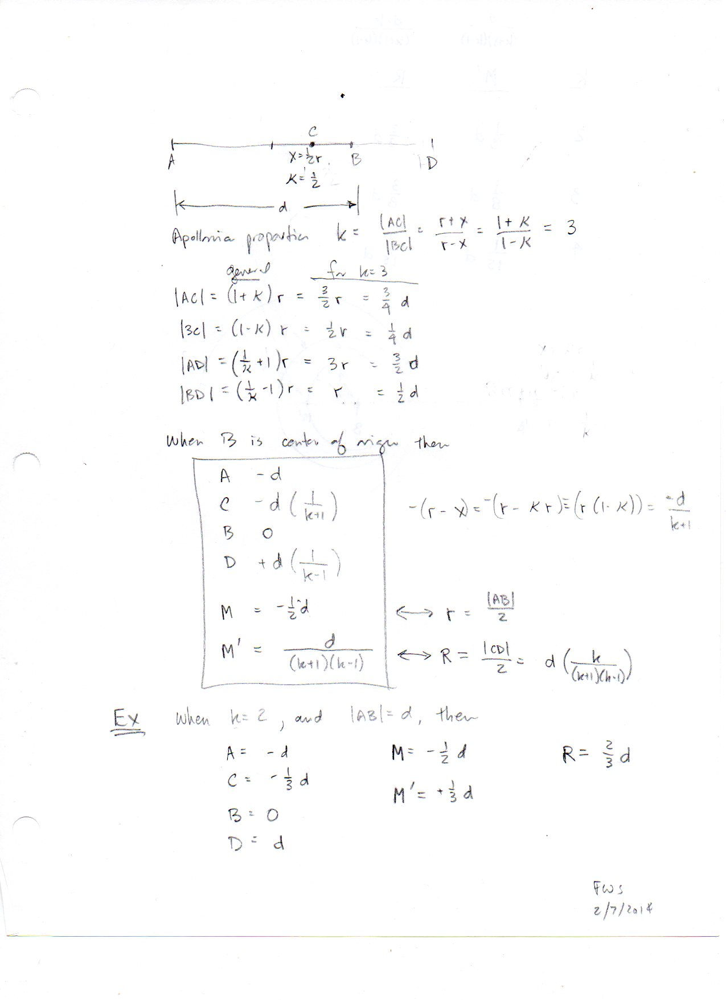
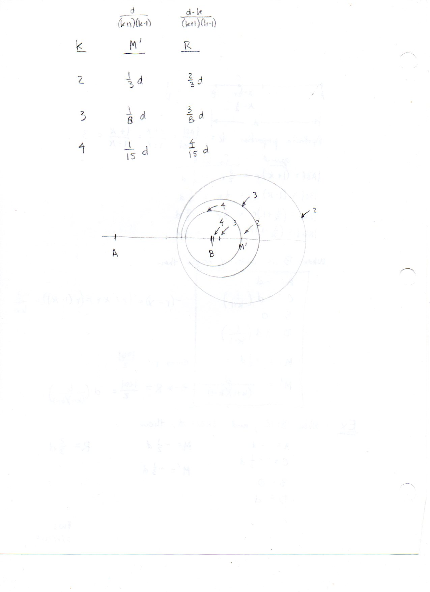

=====================================
F.2 Bilinear Transformations — Folios
=====================================

Archival manuscript scans and diplomatic transcriptions from :person:`seelig`'s
notebooks for **F.2 (Bilinear Transformations)** (:cite:`SeeligNotebooks`).

Folio 0003 (Page 1 of 8): Bilinear Transformation & Derivatives
---------------------------------------------------------------

.. folio:: 0003

   Folio ``0003`` (original scan ``0003.jpg``) from ``resources/seelig/02_bilinear-transformations``.

**Diplomatic Mathematical & Geometric Transcription**

**Diplomatic Transcription — Folio 0003** (``0003.jpg``, Sheet 1 of 8):

Defines :math:`\mathbb{B}(1,x) = \frac{1+x}{1-x} = A(x)B(x)`, derives :math:`\mathbb{B}' = 2B^2` and :math:`\mathbb{B}'' = 4B^3`, and plots the hyperbola with vertical asymptote :math:`x = 1`.

.. math::

   \mathbb{B}(x) = \frac{1 + x}{1 - x}, \qquad \mathbb{B}^{-1}(y) = \frac{y - 1}{y + 1}, \qquad \mathbb{B}'(x) = \frac{2}{(1 - x)^2} = 2 B^2

.. admonition:: Editorial & Symbolic Notes

   Archival scan ``0003.jpg`` from Fred W. Seelig's notebook dossier on **F.2 Bilinear Transformations** (Page 1 of 8). Companion OpenDocument worksheet(s): ``Harmonic Conjugates``, ``Apollonian Circles``, ``HC Tables``. Classical Euclidean foundations: :ref:`VI.3`.

Folio 0004 (Page 2 of 8): Inverse Transformation & Unit Square Grid
-------------------------------------------------------------------

.. folio:: 0004

   Folio ``0004`` (original scan ``0004.jpg``) from ``resources/seelig/02_bilinear-transformations``.

**Diplomatic Mathematical & Geometric Transcription**

**Diplomatic Transcription — Folio 0004** (``0004.jpg``, Sheet 2 of 8):

Plots :math:`\mathbb{B}(x)` and :math:`\mathbb{B}^{-1}(y) = \frac{y-1}{y+1}` on a unit-square grid and re-verifies :math:`\mathbb{B}' = B(1+\mathbb{B}) = 2B^2`.

.. math::

   k = \frac{|AC|}{|BC|} = \frac{1 + \kappa}{1 - \kappa} \iff \kappa = \frac{k - 1}{k + 1}, \qquad M' = \frac{d}{k^2 - 1}, \qquad R = \frac{d k}{k^2 - 1}

.. admonition:: Editorial & Symbolic Notes

   Archival scan ``0004.jpg`` from Fred W. Seelig's notebook dossier on **F.2 Bilinear Transformations** (Page 2 of 8). Companion OpenDocument worksheet(s): ``Harmonic Conjugates``, ``Apollonian Circles``, ``HC Tables``. Classical Euclidean foundations: :ref:`VI.3`.

Folio 0005 (Page 3 of 8): Second Derivative Forms & C.a.R. Conic Fit (FWS 12/5/2013)
------------------------------------------------------------------------------------

.. folio:: 0005

   Folio ``0005`` (original scan ``0005.jpg``) from ``resources/seelig/02_bilinear-transformations``.

**Diplomatic Mathematical & Geometric Transcription**

**Diplomatic Transcription — Folio 0005** (``0005.jpg``, Sheet 3 of 8):

Expresses :math:`\mathbb{B}''` in two algebraic forms and derives the C.a.R. conic curve equation :math:`x/4 - y/4 - xy/4 = 1/4`.

.. math::

   \mathbb{B}(x) = \frac{1 + x}{1 - x}, \qquad \mathbb{B}^{-1}(y) = \frac{y - 1}{y + 1}, \qquad \mathbb{B}'(x) = \frac{2}{(1 - x)^2} = 2 B^2

.. admonition:: Editorial & Symbolic Notes

   Archival scan ``0005.jpg`` from Fred W. Seelig's notebook dossier on **F.2 Bilinear Transformations** (Page 3 of 8). Companion OpenDocument worksheet(s): ``Harmonic Conjugates``, ``Apollonian Circles``, ``HC Tables``. Classical Euclidean foundations: :ref:`VI.3`.

Folio 0006 (Page 4 of 8): Table 1 for B(x) & Inverse Derivatives
----------------------------------------------------------------

.. folio:: 0006

   Folio ``0006`` (original scan ``0006.jpg``) from ``resources/seelig/02_bilinear-transformations``.

**Diplomatic Mathematical & Geometric Transcription**

**Diplomatic Transcription — Folio 0006** (``0006.jpg``, Sheet 4 of 8):

Tabulates :math:`x, A, B, \mathbb{B}, \mathbb{B}'` for :math:`x \in \{-1, 0, 1/2, -1/3, 3\}` and differentiates :math:`\mathbb{B}^{-1}(y)`.

.. math::

   k = \frac{|AC|}{|BC|} = \frac{1 + \kappa}{1 - \kappa} \iff \kappa = \frac{k - 1}{k + 1}, \qquad M' = \frac{d}{k^2 - 1}, \qquad R = \frac{d k}{k^2 - 1}

.. admonition:: Editorial & Symbolic Notes

   Archival scan ``0006.jpg`` from Fred W. Seelig's notebook dossier on **F.2 Bilinear Transformations** (Page 4 of 8). Companion OpenDocument worksheet(s): ``Harmonic Conjugates``, ``Apollonian Circles``, ``HC Tables``. Classical Euclidean foundations: :ref:`VI.3`.

Folio 0007 (Page 5 of 8): Table 2 for B^{-1}(y) & Conic Fit
-----------------------------------------------------------

.. folio:: 0007

   Folio ``0007`` (original scan ``0007.jpg``) from ``resources/seelig/02_bilinear-transformations``.

**Diplomatic Mathematical & Geometric Transcription**

**Diplomatic Transcription — Folio 0007** (``0007.jpg``, Sheet 5 of 8):

Tabulates :math:`y, A, B, \mathbb{B}^{-1}, {\mathbb{B}^{-1}}'` for :math:`y \in \{0, 1, 2, 3, 4\}` and records the C.a.R. conic equation :math:`-x/4 + y/4 - xy/4 = 1/4`.

.. math::

   \mathbb{B}(x) = \frac{1 + x}{1 - x}, \qquad \mathbb{B}^{-1}(y) = \frac{y - 1}{y + 1}, \qquad \mathbb{B}'(x) = \frac{2}{(1 - x)^2} = 2 B^2

.. admonition:: Editorial & Symbolic Notes

   Archival scan ``0007.jpg`` from Fred W. Seelig's notebook dossier on **F.2 Bilinear Transformations** (Page 5 of 8). Companion OpenDocument worksheet(s): ``Harmonic Conjugates``, ``Apollonian Circles``, ``HC Tables``. Classical Euclidean foundations: :ref:`VI.3`.

Folio 0008 (Page 6 of 8): Bilinear Transformation — Scaling Properties
----------------------------------------------------------------------

.. folio:: 0008

   Folio ``0008`` (original scan ``0008.jpg``) from ``resources/seelig/02_bilinear-transformations``.

**Diplomatic Mathematical & Geometric Transcription**

**Diplomatic Transcription — Folio 0008** (``0008.jpg``, Sheet 6 of 8):

Sets up the scaling relation :math:`\mathbb{B}(R, \eta x) = \mathbb{B}(1, x)`.

.. math::

   k = \frac{|AC|}{|BC|} = \frac{1 + \kappa}{1 - \kappa} \iff \kappa = \frac{k - 1}{k + 1}, \qquad M' = \frac{d}{k^2 - 1}, \qquad R = \frac{d k}{k^2 - 1}

.. admonition:: Editorial & Symbolic Notes

   Archival scan ``0008.jpg`` from Fred W. Seelig's notebook dossier on **F.2 Bilinear Transformations** (Page 6 of 8). Companion OpenDocument worksheet(s): ``Harmonic Conjugates``, ``Apollonian Circles``, ``HC Tables``. Classical Euclidean foundations: :ref:`VI.3`.

Folio 0009 (Page 7 of 8): Apollonian Proportion (FWS 2/7/2014)
--------------------------------------------------------------

.. folio:: 0009

   Folio ``0009`` (original scan ``0009.jpg``) from ``resources/seelig/02_bilinear-transformations``.

**Diplomatic Mathematical & Geometric Transcription**

**Diplomatic Transcription — Folio 0009** (``0009.jpg``, Sheet 7 of 8):

Applies :math:`k = \frac{1+\kappa}{1-\kappa}` to harmonic points :math:`A, C, B, D` with :math:`B=0, A=-d`, deriving :math:`C = -d/(k+1), D = d/(k-1), M' = d/(k^2-1)`, and :math:`R = dk/(k^2-1)`.

.. math::

   \mathbb{B}(x) = \frac{1 + x}{1 - x}, \qquad \mathbb{B}^{-1}(y) = \frac{y - 1}{y + 1}, \qquad \mathbb{B}'(x) = \frac{2}{(1 - x)^2} = 2 B^2

.. admonition:: Editorial & Symbolic Notes

   Archival scan ``0009.jpg`` from Fred W. Seelig's notebook dossier on **F.2 Bilinear Transformations** (Page 7 of 8). Companion OpenDocument worksheet(s): ``Harmonic Conjugates``, ``Apollonian Circles``, ``HC Tables``. Classical Euclidean foundations: :ref:`VI.3`.

Folio 0010 (Page 8 of 8): Apollonian Circles for k = 2, 3, 4
------------------------------------------------------------

.. folio:: 0010

   Folio ``0010`` (original scan ``0010.jpg``) from ``resources/seelig/02_bilinear-transformations``.

**Diplomatic Mathematical & Geometric Transcription**

**Diplomatic Transcription — Folio 0010** (``0010.jpg``, Sheet 8 of 8):

Tabulates and sketches the nested Apollonian circles with :math:`(M', R) = (\frac{1}{3}d, \frac{2}{3}d), (\frac{1}{8}d, \frac{3}{8}d), (\frac{1}{15}d, \frac{4}{15}d)`.

.. math::

   k = \frac{|AC|}{|BC|} = \frac{1 + \kappa}{1 - \kappa} \iff \kappa = \frac{k - 1}{k + 1}, \qquad M' = \frac{d}{k^2 - 1}, \qquad R = \frac{d k}{k^2 - 1}

.. admonition:: Editorial & Symbolic Notes

   Archival scan ``0010.jpg`` from Fred W. Seelig's notebook dossier on **F.2 Bilinear Transformations** (Page 8 of 8). Companion OpenDocument worksheet(s): ``Harmonic Conjugates``, ``Apollonian Circles``, ``HC Tables``. Classical Euclidean foundations: :ref:`VI.3`.
