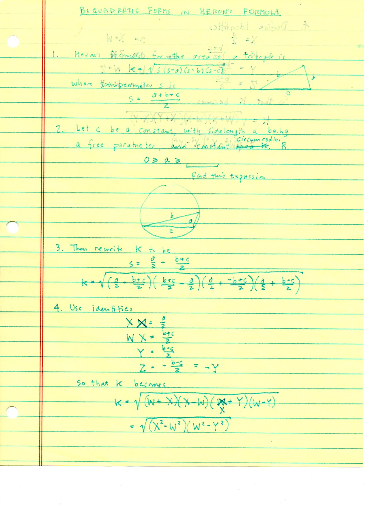
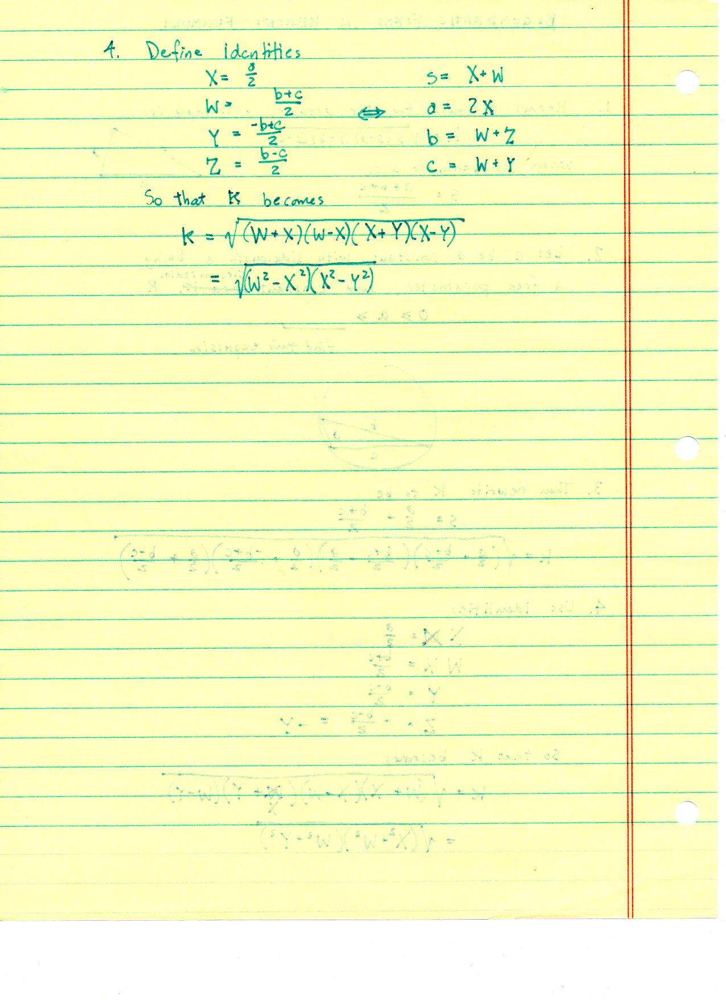
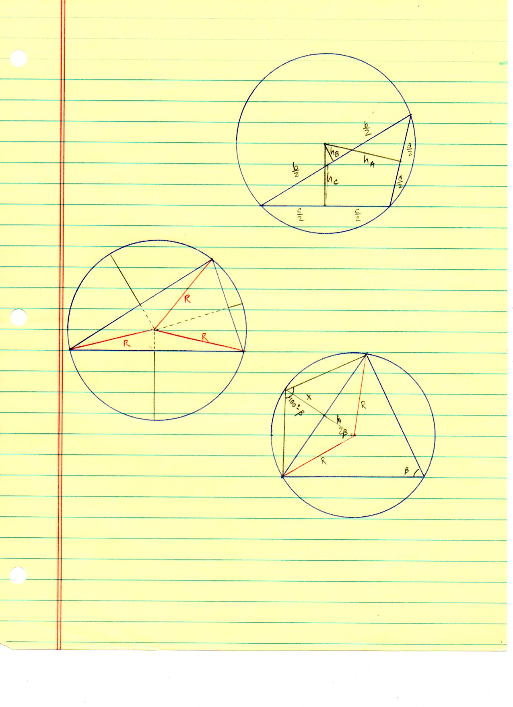
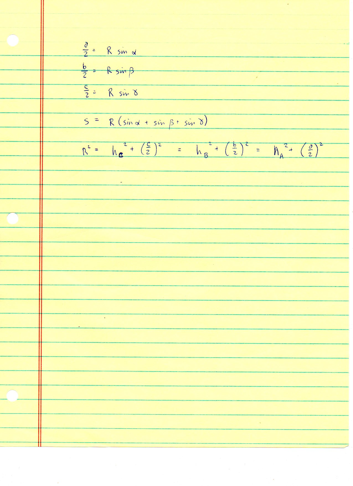
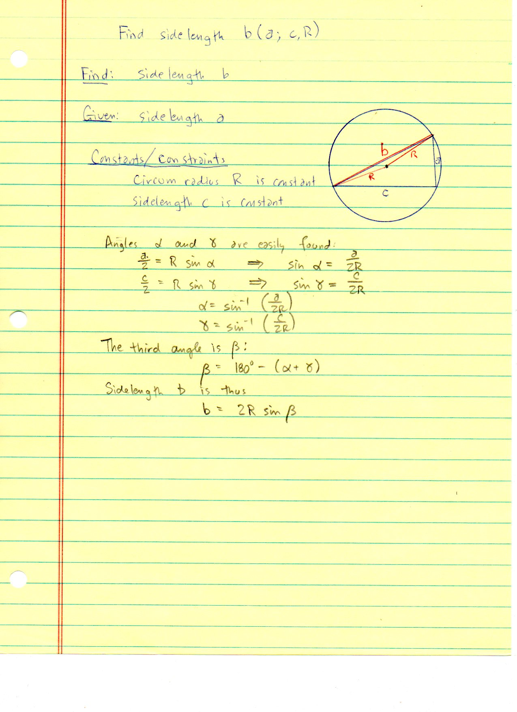
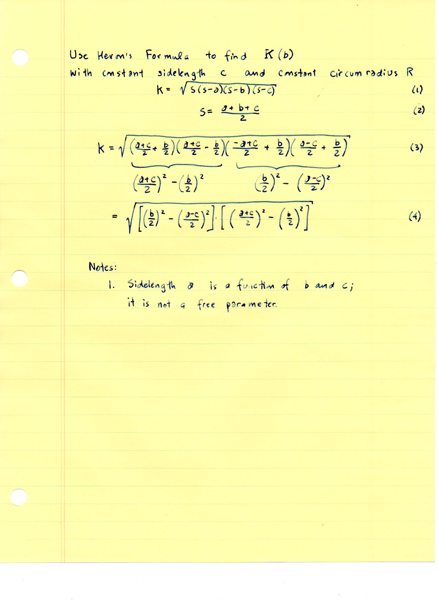
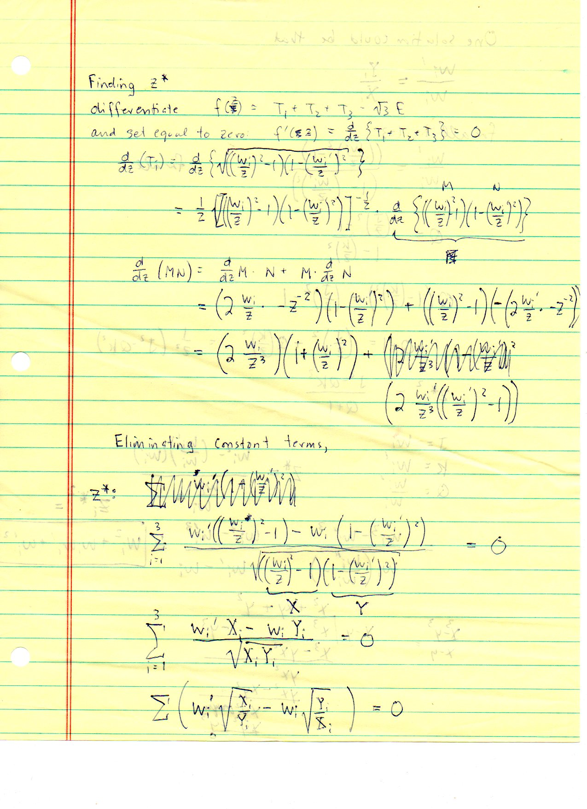
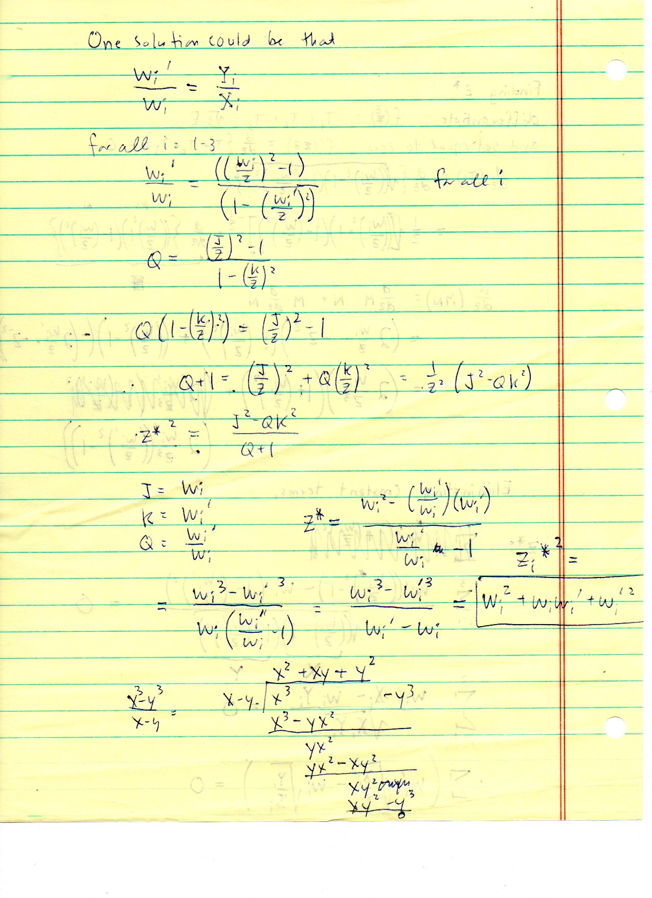
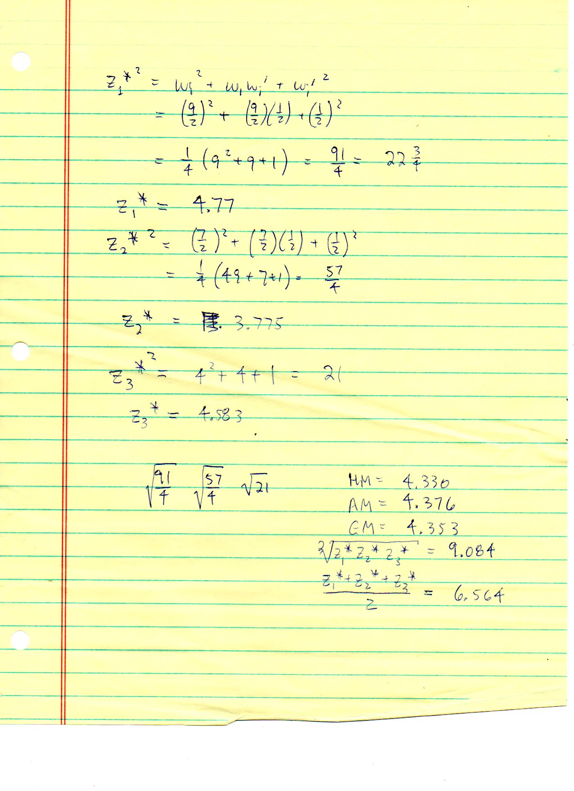

=================================================
F.3 Biquadratic Forms in Heron's Formula — Folios
=================================================

Archival manuscript scans and diplomatic transcriptions from :person:`seelig`'s
notebooks for **F.3 (Biquadratic Forms in Heron's Formula)** (:cite:`SeeligNotebooks`).

Folio 0011 (Page 1 of 9): Biquadratic Forms in Heron's Formula
--------------------------------------------------------------

.. folio:: 0011

   Folio ``0011`` (original scan ``0011.jpg``) from ``resources/seelig/03_biquadratic-forms-in-herons-formula``.

**Diplomatic Mathematical & Geometric Transcription**

**Diplomatic Transcription — Folio 0011** (``0011.jpg``, Sheet 1 of 9):

Introduces :math:`K = \sqrt{s(s-a)(s-b)(s-c)}` for a triangle inscribed in a circle of radius :math:`R` with constant :math:`c` and varying :math:`a`.

.. math::

   X = \frac{a}{2}, \quad W = \frac{b + c}{2}, \quad Y = \frac{c - b}{2} \implies K = \sqrt{(W^2 - X^2)(X^2 - Y^2)}

.. admonition:: Editorial & Symbolic Notes

   Archival scan ``0011.jpg`` from Fred W. Seelig's notebook dossier on **F.3 Biquadratic Forms in Heron's Formula** (Page 1 of 9). Companion OpenDocument worksheet(s): ``General Reference``, ``5-6-7 A,B,C``, ``Biquadratic Heron``, ``Circumcircle Solver``. Classical Euclidean foundations: :ref:`I.47`, :ref:`II.12`, :ref:`II.13`. Kimberling *Encyclopedia of Triangle Centers* loci: :ref:`X(1)`, :ref:`X(3)`, :ref:`X(4)`.

Folio 0012 (Page 2 of 9): Symmetric Substitutions W, X, Y, Z
------------------------------------------------------------

.. folio:: 0012

   Folio ``0012`` (original scan ``0012.jpg``) from ``resources/seelig/03_biquadratic-forms-in-herons-formula``.

**Diplomatic Mathematical & Geometric Transcription**

**Diplomatic Transcription — Folio 0012** (``0012.jpg``, Sheet 2 of 9):

Defines :math:`X = a/2, W = (b+c)/2, Y = (-b+c)/2, Z = (b-c)/2` to reduce Heron's formula to :math:`K = \sqrt{(W^2 - X^2)(X^2 - Y^2)}`.

.. math::

   16 K^2 = 2 a^2 b^2 + 2 b^2 c^2 + 2 c^2 a^2 - a^4 - b^4 - c^4, \qquad {z_i^*}^2 = w_i^2 + w_i w_i' + {w_i'}^2

.. admonition:: Editorial & Symbolic Notes

   Archival scan ``0012.jpg`` from Fred W. Seelig's notebook dossier on **F.3 Biquadratic Forms in Heron's Formula** (Page 2 of 9). Companion OpenDocument worksheet(s): ``General Reference``, ``5-6-7 A,B,C``, ``Biquadratic Heron``, ``Circumcircle Solver``. Classical Euclidean foundations: :ref:`I.47`, :ref:`II.12`, :ref:`II.13`. Kimberling *Encyclopedia of Triangle Centers* loci: :ref:`X(1)`, :ref:`X(3)`, :ref:`X(4)`.

Folio 0013 (Page 3 of 9): Three Circumcircle Diagrams
-----------------------------------------------------

.. folio:: 0013

   Folio ``0013`` (original scan ``0013.jpg``) from ``resources/seelig/03_biquadratic-forms-in-herons-formula``.

**Diplomatic Mathematical & Geometric Transcription**

**Diplomatic Transcription — Folio 0013** (``0013.jpg``, Sheet 3 of 9):

Compass-and-straightedge constructions showing perpendicular bisector distances :math:`h_A, h_B, h_C`, circumradii :math:`R`, and central angle :math:`2\beta`.

.. math::

   X = \frac{a}{2}, \quad W = \frac{b + c}{2}, \quad Y = \frac{c - b}{2} \implies K = \sqrt{(W^2 - X^2)(X^2 - Y^2)}

.. admonition:: Editorial & Symbolic Notes

   Archival scan ``0013.jpg`` from Fred W. Seelig's notebook dossier on **F.3 Biquadratic Forms in Heron's Formula** (Page 3 of 9). Companion OpenDocument worksheet(s): ``General Reference``, ``5-6-7 A,B,C``, ``Biquadratic Heron``, ``Circumcircle Solver``. Classical Euclidean foundations: :ref:`I.47`, :ref:`II.12`, :ref:`II.13`. Kimberling *Encyclopedia of Triangle Centers* loci: :ref:`X(1)`, :ref:`X(3)`, :ref:`X(4)`.

Folio 0014 (Page 4 of 9): Circumcircle Trigonometry & Law of Sines
------------------------------------------------------------------

.. folio:: 0014

   Folio ``0014`` (original scan ``0014.jpg``) from ``resources/seelig/03_biquadratic-forms-in-herons-formula``.

**Diplomatic Mathematical & Geometric Transcription**

**Diplomatic Transcription — Folio 0014** (``0014.jpg``, Sheet 4 of 9):

Records :math:`a/2 = R\sin\alpha, b/2 = R\sin\beta, c/2 = R\sin\gamma` and :math:`R^2 = h_C^2 + (c/2)^2`.

.. math::

   16 K^2 = 2 a^2 b^2 + 2 b^2 c^2 + 2 c^2 a^2 - a^4 - b^4 - c^4, \qquad {z_i^*}^2 = w_i^2 + w_i w_i' + {w_i'}^2

.. admonition:: Editorial & Symbolic Notes

   Archival scan ``0014.jpg`` from Fred W. Seelig's notebook dossier on **F.3 Biquadratic Forms in Heron's Formula** (Page 4 of 9). Companion OpenDocument worksheet(s): ``General Reference``, ``5-6-7 A,B,C``, ``Biquadratic Heron``, ``Circumcircle Solver``. Classical Euclidean foundations: :ref:`I.47`, :ref:`II.12`, :ref:`II.13`. Kimberling *Encyclopedia of Triangle Centers* loci: :ref:`X(1)`, :ref:`X(3)`, :ref:`X(4)`.

Folio 0015 (Page 5 of 9): Finding Sidelength b(a; c, R)
-------------------------------------------------------

.. folio:: 0015

   Folio ``0015`` (original scan ``0015.jpg``) from ``resources/seelig/03_biquadratic-forms-in-herons-formula``.

**Diplomatic Mathematical & Geometric Transcription**

**Diplomatic Transcription — Folio 0015** (``0015.jpg``, Sheet 5 of 9):

Derives :math:`b = 2R\sin(180^\circ - (\sin^{-1}\frac{a}{2R} + \sin^{-1}\frac{c}{2R}))` for fixed chord :math:`c` and circumradius :math:`R`.

.. math::

   X = \frac{a}{2}, \quad W = \frac{b + c}{2}, \quad Y = \frac{c - b}{2} \implies K = \sqrt{(W^2 - X^2)(X^2 - Y^2)}

.. admonition:: Editorial & Symbolic Notes

   Archival scan ``0015.jpg`` from Fred W. Seelig's notebook dossier on **F.3 Biquadratic Forms in Heron's Formula** (Page 5 of 9). Companion OpenDocument worksheet(s): ``General Reference``, ``5-6-7 A,B,C``, ``Biquadratic Heron``, ``Circumcircle Solver``. Classical Euclidean foundations: :ref:`I.47`, :ref:`II.12`, :ref:`II.13`. Kimberling *Encyclopedia of Triangle Centers* loci: :ref:`X(1)`, :ref:`X(3)`, :ref:`X(4)`.

Folio 0016 (Page 6 of 9): Heron's Formula Grouped Around b/2
------------------------------------------------------------

.. folio:: 0016

   Folio ``0016`` (original scan ``0016.jpg``) from ``resources/seelig/03_biquadratic-forms-in-herons-formula``.

**Diplomatic Mathematical & Geometric Transcription**

**Diplomatic Transcription — Folio 0016** (``0016.jpg``, Sheet 6 of 9):

Factors :math:`K = \sqrt{[(b/2)^2 - ((a-c)/2)^2][((a+c)/2)^2 - (b/2)^2]}`.

.. math::

   16 K^2 = 2 a^2 b^2 + 2 b^2 c^2 + 2 c^2 a^2 - a^4 - b^4 - c^4, \qquad {z_i^*}^2 = w_i^2 + w_i w_i' + {w_i'}^2

.. admonition:: Editorial & Symbolic Notes

   Archival scan ``0016.jpg`` from Fred W. Seelig's notebook dossier on **F.3 Biquadratic Forms in Heron's Formula** (Page 6 of 9). Companion OpenDocument worksheet(s): ``General Reference``, ``5-6-7 A,B,C``, ``Biquadratic Heron``, ``Circumcircle Solver``. Classical Euclidean foundations: :ref:`I.47`, :ref:`II.12`, :ref:`II.13`. Kimberling *Encyclopedia of Triangle Centers* loci: :ref:`X(1)`, :ref:`X(3)`, :ref:`X(4)`.

Folio 0017 (Page 7 of 9): Differentiation for Critical Value z*
---------------------------------------------------------------

.. folio:: 0017

   Folio ``0017`` (original scan ``0017.jpg``) from ``resources/seelig/03_biquadratic-forms-in-herons-formula``.

**Diplomatic Mathematical & Geometric Transcription**

**Diplomatic Transcription — Folio 0017** (``0017.jpg``, Sheet 7 of 9):

Differentiates :math:`f(z) = T_1 + T_2 + T_3 - \sqrt{3}E` where :math:`T_i = \sqrt{((w_i/z)^2 - 1)(1 - (w_i'/z)^2)}`.

.. math::

   X = \frac{a}{2}, \quad W = \frac{b + c}{2}, \quad Y = \frac{c - b}{2} \implies K = \sqrt{(W^2 - X^2)(X^2 - Y^2)}

.. admonition:: Editorial & Symbolic Notes

   Archival scan ``0017.jpg`` from Fred W. Seelig's notebook dossier on **F.3 Biquadratic Forms in Heron's Formula** (Page 7 of 9). Companion OpenDocument worksheet(s): ``General Reference``, ``5-6-7 A,B,C``, ``Biquadratic Heron``, ``Circumcircle Solver``. Classical Euclidean foundations: :ref:`I.47`, :ref:`II.12`, :ref:`II.13`. Kimberling *Encyclopedia of Triangle Centers* loci: :ref:`X(1)`, :ref:`X(3)`, :ref:`X(4)`.

Folio 0018 (Page 8 of 9): Polynomial Division & Closed Form for z*
------------------------------------------------------------------

.. folio:: 0018

   Folio ``0018`` (original scan ``0018.jpg``) from ``resources/seelig/03_biquadratic-forms-in-herons-formula``.

**Diplomatic Mathematical & Geometric Transcription**

**Diplomatic Transcription — Folio 0018** (``0018.jpg``, Sheet 8 of 9):

Uses :math:`(x^3 - y^3)/(x - y) = x^2 + xy + y^2` to prove :math:`{z_i^*}^2 = w_i^2 + w_i w_i' + {w_i'}^2`.

.. math::

   16 K^2 = 2 a^2 b^2 + 2 b^2 c^2 + 2 c^2 a^2 - a^4 - b^4 - c^4, \qquad {z_i^*}^2 = w_i^2 + w_i w_i' + {w_i'}^2

.. admonition:: Editorial & Symbolic Notes

   Archival scan ``0018.jpg`` from Fred W. Seelig's notebook dossier on **F.3 Biquadratic Forms in Heron's Formula** (Page 8 of 9). Companion OpenDocument worksheet(s): ``General Reference``, ``5-6-7 A,B,C``, ``Biquadratic Heron``, ``Circumcircle Solver``. Classical Euclidean foundations: :ref:`I.47`, :ref:`II.12`, :ref:`II.13`. Kimberling *Encyclopedia of Triangle Centers* loci: :ref:`X(1)`, :ref:`X(3)`, :ref:`X(4)`.

Folio 0019 (Page 9 of 9): Numerical Evaluation & Means of z_1*, z_2*, z_3*
--------------------------------------------------------------------------

.. folio:: 0019

   Folio ``0019`` (original scan ``0019.jpg``) from ``resources/seelig/03_biquadratic-forms-in-herons-formula``.

**Diplomatic Mathematical & Geometric Transcription**

**Diplomatic Transcription — Folio 0019** (``0019.jpg``, Sheet 9 of 9):

Computes :math:`z_1^* = \sqrt{91/4} \approx 4.77, z_2^* = \sqrt{57/4} \approx 3.775, z_3^* = \sqrt{21} \approx 4.583` and compares their harmonic ($4.330$), geometric ($4.353$), and arithmetic ($4.376$) means.

.. math::

   X = \frac{a}{2}, \quad W = \frac{b + c}{2}, \quad Y = \frac{c - b}{2} \implies K = \sqrt{(W^2 - X^2)(X^2 - Y^2)}

.. admonition:: Editorial & Symbolic Notes

   Archival scan ``0019.jpg`` from Fred W. Seelig's notebook dossier on **F.3 Biquadratic Forms in Heron's Formula** (Page 9 of 9). Companion OpenDocument worksheet(s): ``General Reference``, ``5-6-7 A,B,C``, ``Biquadratic Heron``, ``Circumcircle Solver``. Classical Euclidean foundations: :ref:`I.47`, :ref:`II.12`, :ref:`II.13`. Kimberling *Encyclopedia of Triangle Centers* loci: :ref:`X(1)`, :ref:`X(3)`, :ref:`X(4)`.
