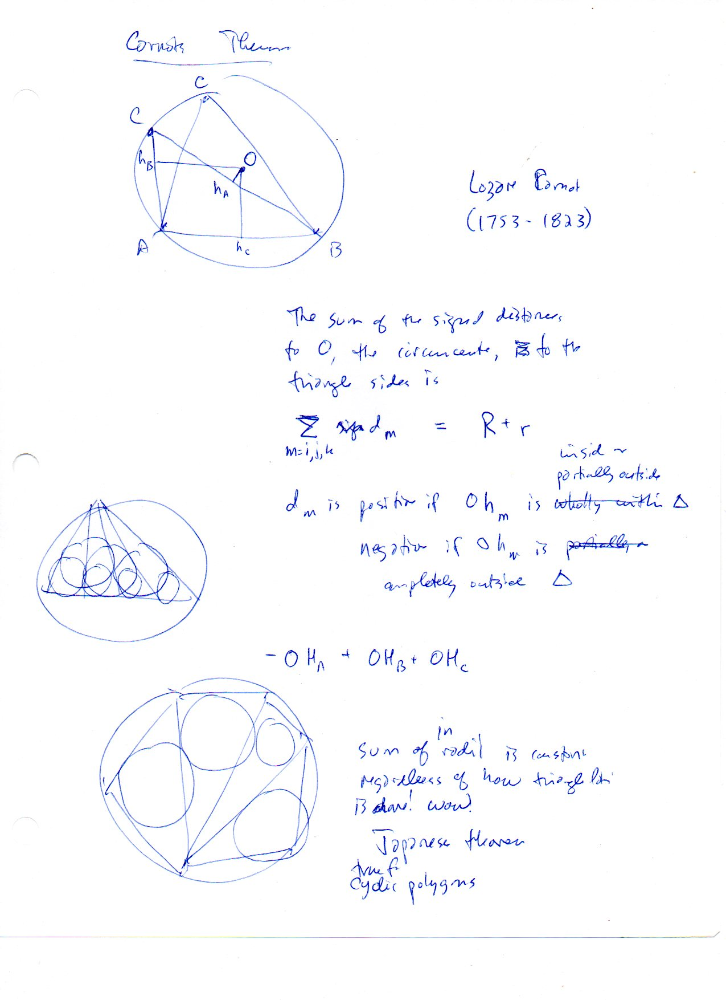

=============================
F.4 Carnot's Theorem — Folios
=============================

Archival manuscript scans and diplomatic transcriptions from :person:`seelig`'s
notebooks for **F.4 (Carnot's Theorem)** (:cite:`SeeligNotebooks`).

Folio 0020 (Page 1 of 1): Carnot's Theorem & The Japanese Theorem
-----------------------------------------------------------------

.. folio:: 0020

   Folio ``0020`` (original scan ``0020.jpg``) from ``resources/seelig/04_carnots-theorem``.

**Diplomatic Mathematical & Geometric Transcription**

**Diplomatic Transcription — Folio 0020** (``0020.jpg``, Sheet 1 of 1):

States Lazare Carnot's signed-distance relation :math:`\sum d_m = R + r` with an obtuse-triangle circumcircle diagram (:math:`-OH_A + OH_B + OH_C = R + r`) and two triangulated cyclic polygon diagrams illustrating the invariance of the sum of inradii.

.. math::

   \sum_{m \in \{A, B, C\}} d_m = d_a + d_b + d_c = R(\cos\alpha + \cos\beta + \cos\gamma) = R + r

.. admonition:: Editorial & Symbolic Notes

   Archival scan ``0020.jpg`` from Fred W. Seelig's notebook dossier on **F.4 Carnot's Theorem** (Page 1 of 1). Companion OpenDocument worksheet(s): ``General Reference``, ``Circumcircle-Circumcenter``, ``Incircle-Incenter``. Classical Euclidean foundations: :ref:`III.20`, :ref:`IV.4`, :ref:`IV.5`. Kimberling *Encyclopedia of Triangle Centers* loci: :ref:`X(1)`, :ref:`X(3)`.
