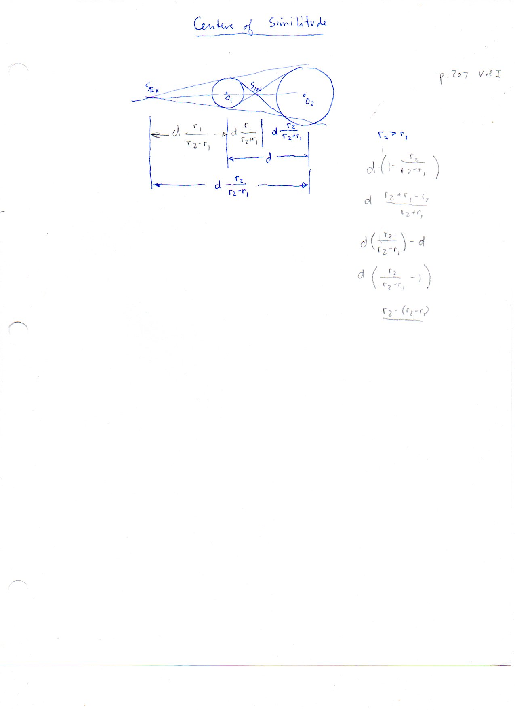

==================================
F.5 Centers of Similitude — Folios
==================================

Archival manuscript scans and diplomatic transcriptions from :person:`seelig`'s
notebooks for **F.5 (Centers of Similitude)** (:cite:`SeeligNotebooks`).

Folio 0021 (Page 1 of 1): Centers of Similitude (Vol. I, p. 207)
----------------------------------------------------------------

.. folio:: 0021

   Folio ``0021`` (original scan ``0021.jpg``) from ``resources/seelig/05_centers-of-similitude``.

**Diplomatic Mathematical & Geometric Transcription**

**Diplomatic Transcription — Folio 0021** (``0021.jpg``, Sheet 1 of 1):

Dimensioned construction of circles :math:`(O_1, r_1)` and :math:`(O_2, r_2)` with common internal tangents meeting at :math:`S_{IN}` and common external tangents meeting at :math:`S_{EX}`, deriving the four exact distance formulas in terms of :math:`d, r_1, r_2`.

.. math::

   |O_1 S_{IN}| = d \frac{r_1}{r_2 + r_1}, \qquad |S_{IN} O_2| = d \frac{r_2}{r_2 + r_1}

.. admonition:: Editorial & Symbolic Notes

   Archival scan ``0021.jpg`` from Fred W. Seelig's notebook dossier on **F.5 Centers of Similitude** (Page 1 of 1). Companion OpenDocument worksheet(s): ``Centers of Similitude``. Classical Euclidean foundations: :ref:`VI.2`, :ref:`VI.4`. Kimberling *Encyclopedia of Triangle Centers* loci: :ref:`X(55)`, :ref:`X(56)`.
