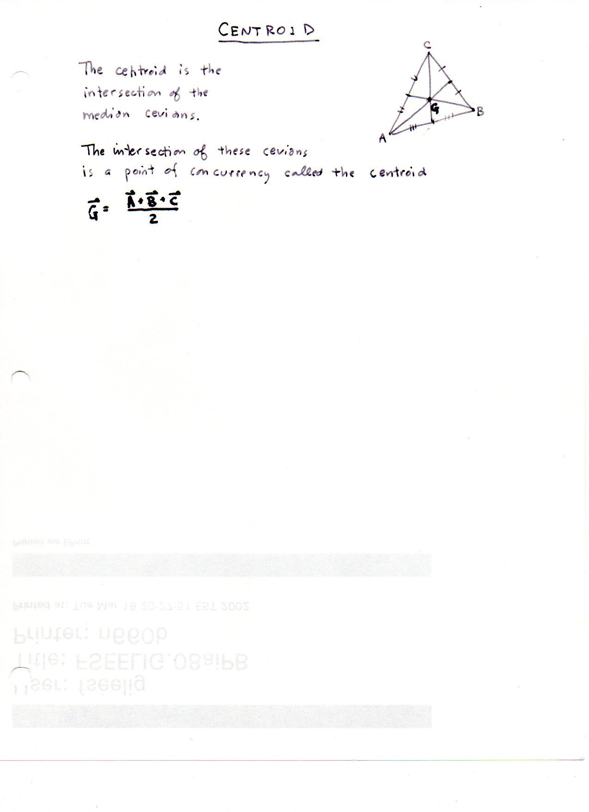
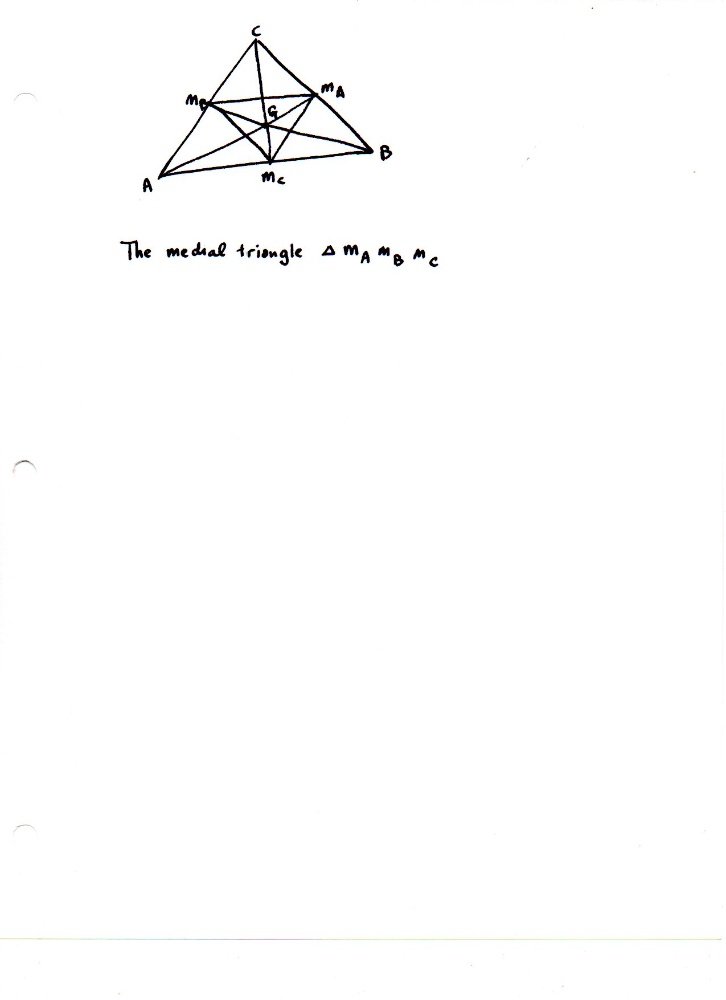

=====================
F.6 Centroid — Folios
=====================

Archival manuscript scans and diplomatic transcriptions from :person:`seelig`'s
notebooks for **F.6 (Centroid)** (:cite:`SeeligNotebooks`).

Folio 0022 (Page 1 of 2): Centroid Definition & Vector Average
--------------------------------------------------------------

.. folio:: 0022

   Folio ``0022`` (original scan ``0022.jpg``) from ``resources/seelig/06_centroid``.

**Diplomatic Mathematical & Geometric Transcription**

**Diplomatic Transcription — Folio 0022** (``0022.jpg``, Sheet 1 of 2):

Draws :math:`\triangle ABC` with congruent-tick-marked midpoints and medians concurring at :math:`G`, defining the centroid as the concurrency of median cevians.

.. math::

   \vec{G} = \frac{\vec{A} + \vec{B} + \vec{C}}{3}, \qquad G = (1 : 1 : 1) \text{ in homogeneous barycentrics}

.. admonition:: Editorial & Symbolic Notes

   Archival scan ``0022.jpg`` from Fred W. Seelig's notebook dossier on **F.6 Centroid** (Page 1 of 2). Companion OpenDocument worksheet(s): ``General Reference``, ``Centroid``, ``5-6-7 A,B,C``. Classical Euclidean foundations: :ref:`I.10`, :ref:`VI.2`. Kimberling *Encyclopedia of Triangle Centers* loci: :ref:`X(2)`.

Folio 0023 (Page 2 of 2): The Medial Triangle M_A M_B M_C
---------------------------------------------------------

.. folio:: 0023

   Folio ``0023`` (original scan ``0023.jpg``) from ``resources/seelig/06_centroid``.

**Diplomatic Mathematical & Geometric Transcription**

**Diplomatic Transcription — Folio 0023** (``0023.jpg``, Sheet 2 of 2):

Constructs the medial triangle :math:`\triangle M_A M_B M_C` inscribed in :math:`\triangle ABC` together with medians meeting at :math:`G`.

.. math::

   m_a^2 = \frac{2 b^2 + 2 c^2 - a^2}{4}, \qquad m_b^2 = \frac{2 c^2 + 2 a^2 - b^2}{4}, \qquad m_c^2 = \frac{2 a^2 + 2 b^2 - c^2}{4}

.. admonition:: Editorial & Symbolic Notes

   Archival scan ``0023.jpg`` from Fred W. Seelig's notebook dossier on **F.6 Centroid** (Page 2 of 2). Companion OpenDocument worksheet(s): ``General Reference``, ``Centroid``, ``5-6-7 A,B,C``. Classical Euclidean foundations: :ref:`I.10`, :ref:`VI.2`. Kimberling *Encyclopedia of Triangle Centers* loci: :ref:`X(2)`.
