==============================
F.7 Ceva and Menelaus — Folios
==============================

Archival manuscript scans and diplomatic transcriptions from :person:`seelig`'s
notebooks for **F.7 (Ceva and Menelaus)** (:cite:`SeeligNotebooks`).

Folio 0024 (Page 1 of 26): Gergonne Point Concurrency via Ceva's Theorem (FWS 2011/11/07)
-----------------------------------------------------------------------------------------

.. folio:: 0024

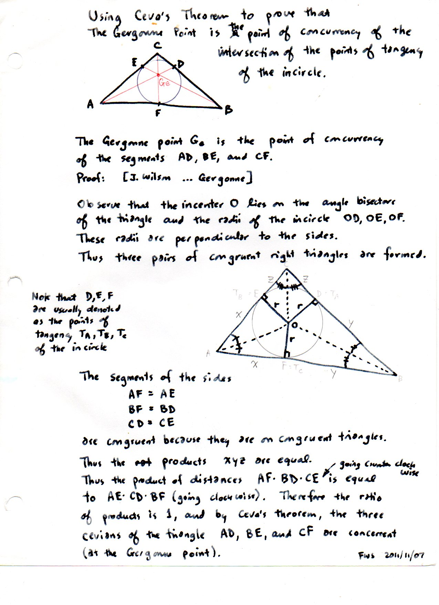

   Folio ``0024`` (original scan ``0024.jpg``) from ``resources/seelig/07_ceva-and-menelaus``.

**Diplomatic Mathematical & Geometric Transcription**

**Diplomatic Transcription — Folio 0024** (``0024.jpg``, Sheet 1 of 26):

Proves that the cevians to the incircle touchpoints :math:`D=T_A, E=T_B, F=T_C` concur at the Gergonne point :math:`G_e = X(7)` using equal tangent lengths :math:`x, y, z`.

.. math::

   \frac{AF}{FB} \cdot \frac{BD}{DC} \cdot \frac{CE}{EA} = +1 \quad (\text{Ceva}), \qquad \frac{AF'}{F'B} \cdot \frac{BD}{DC} \cdot \frac{CE}{EA} = -1 \quad (\text{Menelaus})

.. admonition:: Editorial & Symbolic Notes

   Archival scan ``0024.jpg`` from Fred W. Seelig's notebook dossier on **F.7 Ceva and Menelaus** (Page 1 of 26). Companion OpenDocument worksheet(s): ``Ceva & Menelaus``, ``Ceva``, ``Menelaus``, ``Ceva Compare``, ``6-9-13 Cevian``. Classical Euclidean foundations: :ref:`VI.2`. Kimberling *Encyclopedia of Triangle Centers* loci: :ref:`X(1)`, :ref:`X(2)`, :ref:`X(7)`, :ref:`X(8)`.

Folio 0025 (Page 2 of 26): Ceva's & Menelaus' Theorem — Integer Segments
------------------------------------------------------------------------

.. folio:: 0025

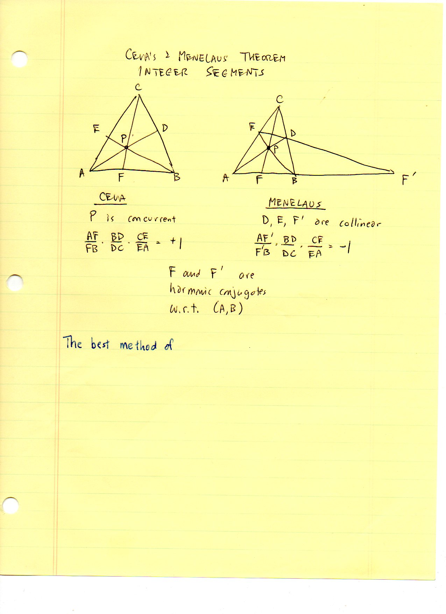

   Folio ``0025`` (original scan ``0025.jpg``) from ``resources/seelig/07_ceva-and-menelaus``.

**Diplomatic Mathematical & Geometric Transcription**

**Diplomatic Transcription — Folio 0025** (``0025.jpg``, Sheet 2 of 26):

Side-by-side comparison of Ceva (:math:`+1`) and Menelaus (:math:`-1`) showing that :math:`(A, B; F, F')` form a harmonic range.

.. math::

   D_x = \frac{M J P}{J P + (M - I) Q}, \qquad E_x = \frac{M I Q}{I Q + (M - P) J}, \qquad F_x = \frac{I Q - J P}{Q - J}

.. admonition:: Editorial & Symbolic Notes

   Archival scan ``0025.jpg`` from Fred W. Seelig's notebook dossier on **F.7 Ceva and Menelaus** (Page 2 of 26). Companion OpenDocument worksheet(s): ``Ceva & Menelaus``, ``Ceva``, ``Menelaus``, ``Ceva Compare``, ``6-9-13 Cevian``. Classical Euclidean foundations: :ref:`VI.2`. Kimberling *Encyclopedia of Triangle Centers* loci: :ref:`X(1)`, :ref:`X(2)`, :ref:`X(7)`, :ref:`X(8)`.

Folio 0026 (Page 3 of 26): MNIJ Coordinate Framework for Integer Cevians
------------------------------------------------------------------------

.. folio:: 0026

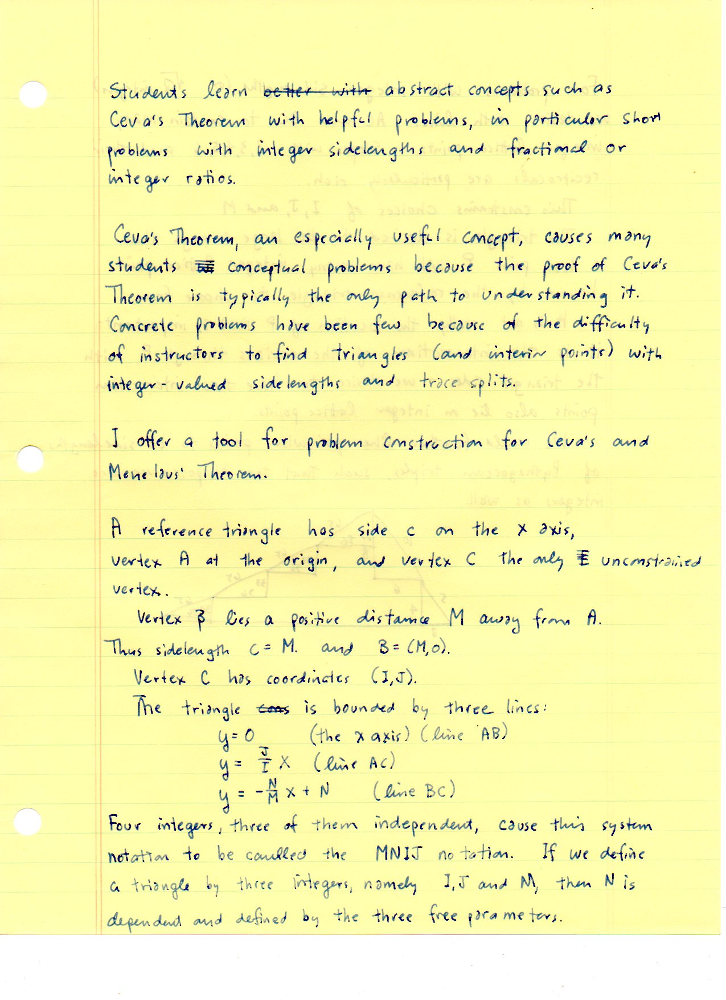

   Folio ``0026`` (original scan ``0026.jpg``) from ``resources/seelig/07_ceva-and-menelaus``.

**Diplomatic Mathematical & Geometric Transcription**

**Diplomatic Transcription — Folio 0026** (``0026.jpg``, Sheet 3 of 26):

Places :math:`A=(0,0), B=(M,0), C=(I,J)` with :math:`BC` intercept :math:`N = JM/(M-I)` to construct integer-segment Ceva configurations.

.. math::

   \frac{PD}{AD} + \frac{PE}{BE} + \frac{PF}{CF} = 1, \qquad \frac{AP}{AD} + \frac{BP}{BE} + \frac{CP}{CF} = 2

.. admonition:: Editorial & Symbolic Notes

   Archival scan ``0026.jpg`` from Fred W. Seelig's notebook dossier on **F.7 Ceva and Menelaus** (Page 3 of 26). Companion OpenDocument worksheet(s): ``Ceva & Menelaus``, ``Ceva``, ``Menelaus``, ``Ceva Compare``, ``6-9-13 Cevian``. Classical Euclidean foundations: :ref:`VI.2`. Kimberling *Encyclopedia of Triangle Centers* loci: :ref:`X(1)`, :ref:`X(2)`, :ref:`X(7)`, :ref:`X(8)`.

Folio 0027 (Page 4 of 26): Pythagorean Triple Gluing Table
----------------------------------------------------------

.. folio:: 0027

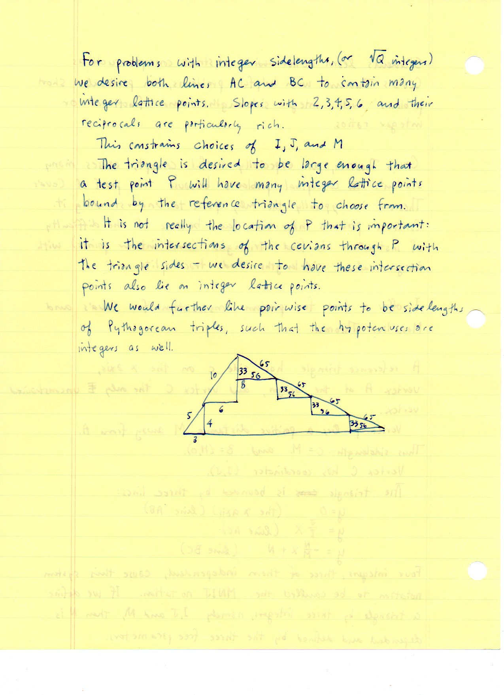

   Folio ``0027`` (original scan ``0027.jpg``) from ``resources/seelig/07_ceva-and-menelaus``.

**Diplomatic Mathematical & Geometric Transcription**

**Diplomatic Transcription — Folio 0027** (``0027.jpg``, Sheet 4 of 26):

Tabulates scaled Pythagorean right triangles (:math:`3\text{–}4\text{–}5, 6\text{–}8\text{–}10, 33\text{–}56\text{–}65`) sharing a common altitude :math:`J`.

.. math::

   \frac{AF}{FB} \cdot \frac{BD}{DC} \cdot \frac{CE}{EA} = +1 \quad (\text{Ceva}), \qquad \frac{AF'}{F'B} \cdot \frac{BD}{DC} \cdot \frac{CE}{EA} = -1 \quad (\text{Menelaus})

.. admonition:: Editorial & Symbolic Notes

   Archival scan ``0027.jpg`` from Fred W. Seelig's notebook dossier on **F.7 Ceva and Menelaus** (Page 4 of 26). Companion OpenDocument worksheet(s): ``Ceva & Menelaus``, ``Ceva``, ``Menelaus``, ``Ceva Compare``, ``6-9-13 Cevian``. Classical Euclidean foundations: :ref:`VI.2`. Kimberling *Encyclopedia of Triangle Centers* loci: :ref:`X(1)`, :ref:`X(2)`, :ref:`X(7)`, :ref:`X(8)`.

Folio 0028 (Page 5 of 26): Cut The Knot IMO Cevian Ratio Problem (FWS 2015/4/12)
--------------------------------------------------------------------------------

.. folio:: 0028

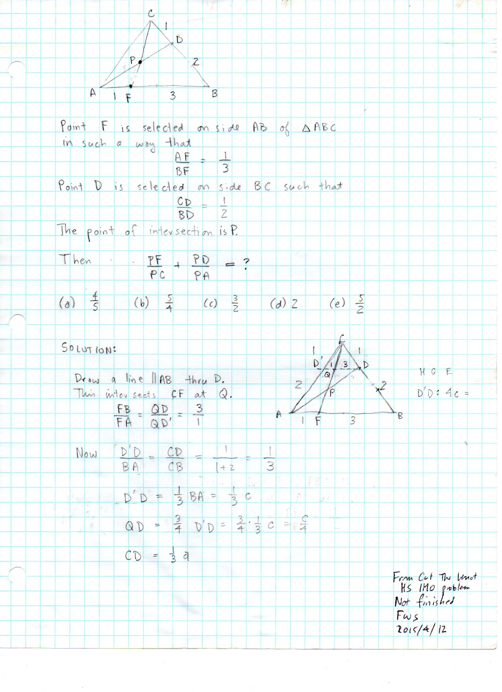

   Folio ``0028`` (original scan ``0028.jpg``) from ``resources/seelig/07_ceva-and-menelaus``.

**Diplomatic Mathematical & Geometric Transcription**

**Diplomatic Transcription — Folio 0028** (``0028.jpg``, Sheet 5 of 26):

Uses parallel lines and similar triangles to evaluate :math:`PF/PC + PD/PA` given :math:`AF/BF = 1/3` and :math:`CD/BD = 1/2`.

.. math::

   D_x = \frac{M J P}{J P + (M - I) Q}, \qquad E_x = \frac{M I Q}{I Q + (M - P) J}, \qquad F_x = \frac{I Q - J P}{Q - J}

.. admonition:: Editorial & Symbolic Notes

   Archival scan ``0028.jpg`` from Fred W. Seelig's notebook dossier on **F.7 Ceva and Menelaus** (Page 5 of 26). Companion OpenDocument worksheet(s): ``Ceva & Menelaus``, ``Ceva``, ``Menelaus``, ``Ceva Compare``, ``6-9-13 Cevian``. Classical Euclidean foundations: :ref:`VI.2`. Kimberling *Encyclopedia of Triangle Centers* loci: :ref:`X(1)`, :ref:`X(2)`, :ref:`X(7)`, :ref:`X(8)`.

Folio 0029 (Page 6 of 26): Length of Cevian to Intouch Point
------------------------------------------------------------

.. folio:: 0029

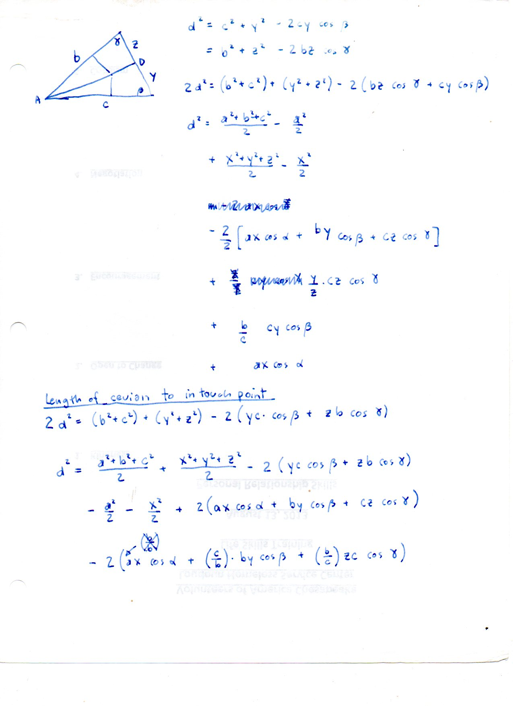

   Folio ``0029`` (original scan ``0029.jpg``) from ``resources/seelig/07_ceva-and-menelaus``.

**Diplomatic Mathematical & Geometric Transcription**

**Diplomatic Transcription — Folio 0029** (``0029.jpg``, Sheet 6 of 26):

Applies the Law of Cosines to compute the cevian lengths from vertices to the incircle touchpoints.

.. math::

   \frac{PD}{AD} + \frac{PE}{BE} + \frac{PF}{CF} = 1, \qquad \frac{AP}{AD} + \frac{BP}{BE} + \frac{CP}{CF} = 2

.. admonition:: Editorial & Symbolic Notes

   Archival scan ``0029.jpg`` from Fred W. Seelig's notebook dossier on **F.7 Ceva and Menelaus** (Page 6 of 26). Companion OpenDocument worksheet(s): ``Ceva & Menelaus``, ``Ceva``, ``Menelaus``, ``Ceva Compare``, ``6-9-13 Cevian``. Classical Euclidean foundations: :ref:`VI.2`. Kimberling *Encyclopedia of Triangle Centers* loci: :ref:`X(1)`, :ref:`X(2)`, :ref:`X(7)`, :ref:`X(8)`.

Folio 0030 (Page 7 of 26): Stewart's Theorem for Cevians d, e, f
----------------------------------------------------------------

.. folio:: 0030

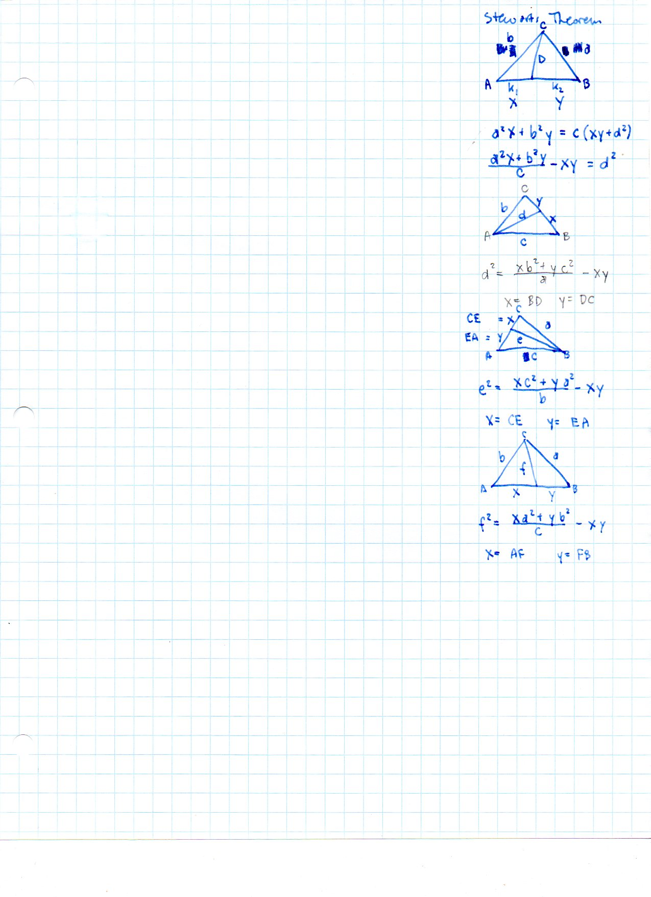

   Folio ``0030`` (original scan ``0030.jpg``) from ``resources/seelig/07_ceva-and-menelaus``.

**Diplomatic Mathematical & Geometric Transcription**

**Diplomatic Transcription — Folio 0030** (``0030.jpg``, Sheet 7 of 26):

Derives :math:`d^2 = \frac{x b^2 + y c^2}{a} - xy` for all three cevians in terms of side splits.

.. math::

   \frac{AF}{FB} \cdot \frac{BD}{DC} \cdot \frac{CE}{EA} = +1 \quad (\text{Ceva}), \qquad \frac{AF'}{F'B} \cdot \frac{BD}{DC} \cdot \frac{CE}{EA} = -1 \quad (\text{Menelaus})

.. admonition:: Editorial & Symbolic Notes

   Archival scan ``0030.jpg`` from Fred W. Seelig's notebook dossier on **F.7 Ceva and Menelaus** (Page 7 of 26). Companion OpenDocument worksheet(s): ``Ceva & Menelaus``, ``Ceva``, ``Menelaus``, ``Ceva Compare``, ``6-9-13 Cevian``. Classical Euclidean foundations: :ref:`VI.2`. Kimberling *Encyclopedia of Triangle Centers* loci: :ref:`X(1)`, :ref:`X(2)`, :ref:`X(7)`, :ref:`X(8)`.

Folio 0031 (Page 8 of 26): Lattice Triangle Example (I=8, J=8, M=24, P=(12,4))
------------------------------------------------------------------------------

.. folio:: 0031

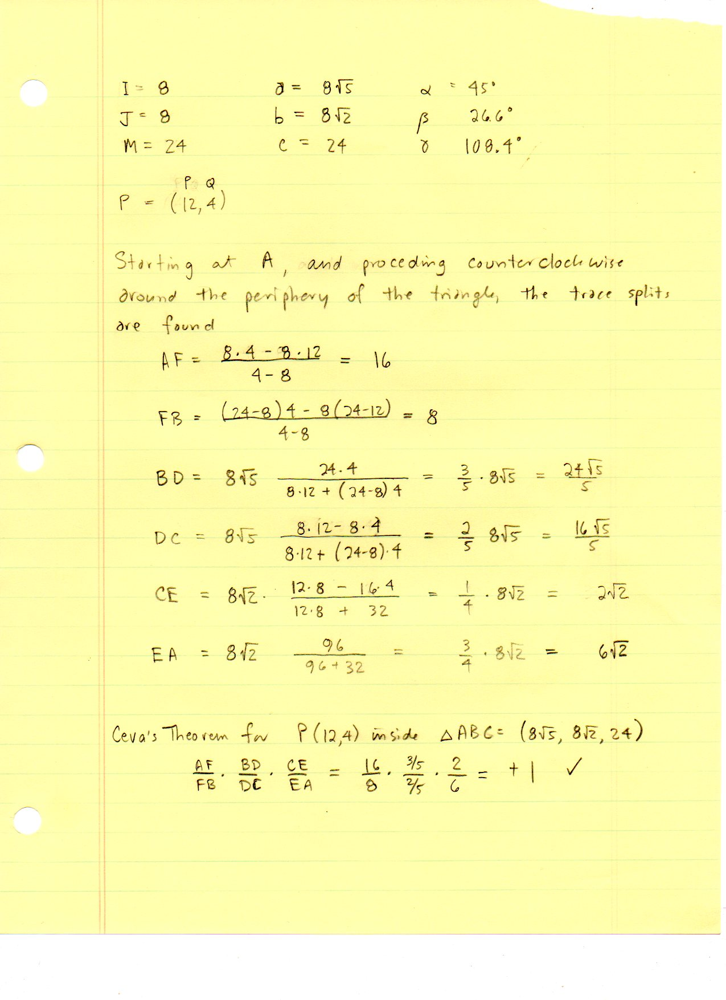

   Folio ``0031`` (original scan ``0031.jpg``) from ``resources/seelig/07_ceva-and-menelaus``.

**Diplomatic Mathematical & Geometric Transcription**

**Diplomatic Transcription — Folio 0031** (``0031.jpg``, Sheet 8 of 26):

Computes exact trace coordinates :math:`D, E, F` and verifies Ceva's product :math:`\frac{16}{8}\cdot\frac{3/5}{2/5}\cdot\frac{2}{6} = +1`.

.. math::

   D_x = \frac{M J P}{J P + (M - I) Q}, \qquad E_x = \frac{M I Q}{I Q + (M - P) J}, \qquad F_x = \frac{I Q - J P}{Q - J}

.. admonition:: Editorial & Symbolic Notes

   Archival scan ``0031.jpg`` from Fred W. Seelig's notebook dossier on **F.7 Ceva and Menelaus** (Page 8 of 26). Companion OpenDocument worksheet(s): ``Ceva & Menelaus``, ``Ceva``, ``Menelaus``, ``Ceva Compare``, ``6-9-13 Cevian``. Classical Euclidean foundations: :ref:`VI.2`. Kimberling *Encyclopedia of Triangle Centers* loci: :ref:`X(1)`, :ref:`X(2)`, :ref:`X(7)`, :ref:`X(8)`.

Folio 0032 (Page 9 of 26): Heronian 78-90-84 Triangle Problem (Facebook, April 14, 2015)
----------------------------------------------------------------------------------------

.. folio:: 0032

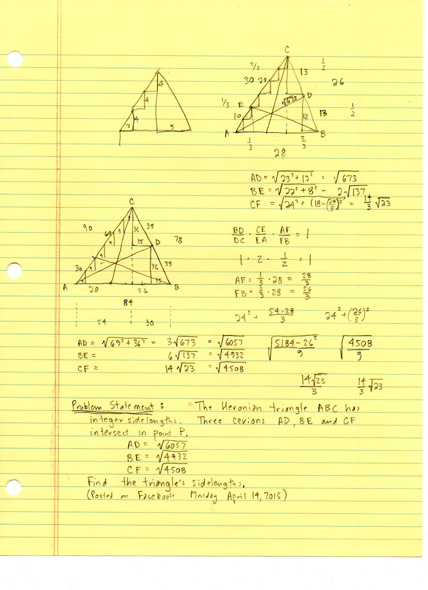

   Folio ``0032`` (original scan ``0032.jpg``) from ``resources/seelig/07_ceva-and-menelaus``.

**Diplomatic Mathematical & Geometric Transcription**

**Diplomatic Transcription — Folio 0032** (``0032.jpg``, Sheet 9 of 26):

Constructs the :math:`78\text{–}90\text{–}84` Heronian triangle with trace splits :math:`(28,56), (39,39), (60,30)` and exact cevian lengths :math:`3\sqrt{673}, 6\sqrt{137}, 14\sqrt{23}`.

.. math::

   \frac{PD}{AD} + \frac{PE}{BE} + \frac{PF}{CF} = 1, \qquad \frac{AP}{AD} + \frac{BP}{BE} + \frac{CP}{CF} = 2

.. admonition:: Editorial & Symbolic Notes

   Archival scan ``0032.jpg`` from Fred W. Seelig's notebook dossier on **F.7 Ceva and Menelaus** (Page 9 of 26). Companion OpenDocument worksheet(s): ``Ceva & Menelaus``, ``Ceva``, ``Menelaus``, ``Ceva Compare``, ``6-9-13 Cevian``. Classical Euclidean foundations: :ref:`VI.2`. Kimberling *Encyclopedia of Triangle Centers* loci: :ref:`X(1)`, :ref:`X(2)`, :ref:`X(7)`, :ref:`X(8)`.

Folio 0033 (Page 10 of 26): Continuation of Heronian Cevian Calculations
------------------------------------------------------------------------

.. folio:: 0033

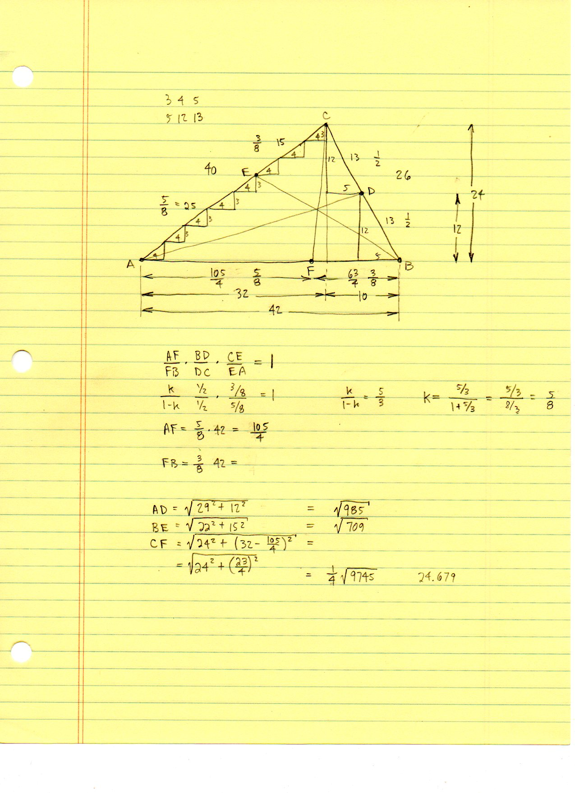

   Folio ``0033`` (original scan ``0033.jpg``) from ``resources/seelig/07_ceva-and-menelaus``.

**Diplomatic Mathematical & Geometric Transcription**

**Diplomatic Transcription — Folio 0033** (``0033.jpg``, Sheet 10 of 26):

Completes the Stewart's theorem verification for :math:`AD, BE, CF` on the :math:`78\text{–}90\text{–}84` triangle.

.. math::

   \frac{AF}{FB} \cdot \frac{BD}{DC} \cdot \frac{CE}{EA} = +1 \quad (\text{Ceva}), \qquad \frac{AF'}{F'B} \cdot \frac{BD}{DC} \cdot \frac{CE}{EA} = -1 \quad (\text{Menelaus})

.. admonition:: Editorial & Symbolic Notes

   Archival scan ``0033.jpg`` from Fred W. Seelig's notebook dossier on **F.7 Ceva and Menelaus** (Page 10 of 26). Companion OpenDocument worksheet(s): ``Ceva & Menelaus``, ``Ceva``, ``Menelaus``, ``Ceva Compare``, ``6-9-13 Cevian``. Classical Euclidean foundations: :ref:`VI.2`. Kimberling *Encyclopedia of Triangle Centers* loci: :ref:`X(1)`, :ref:`X(2)`, :ref:`X(7)`, :ref:`X(8)`.

Folio 0034 (Page 11 of 26): Cevian Triangle DEF Side Lengths & Area in Trilinears
---------------------------------------------------------------------------------

.. folio:: 0034

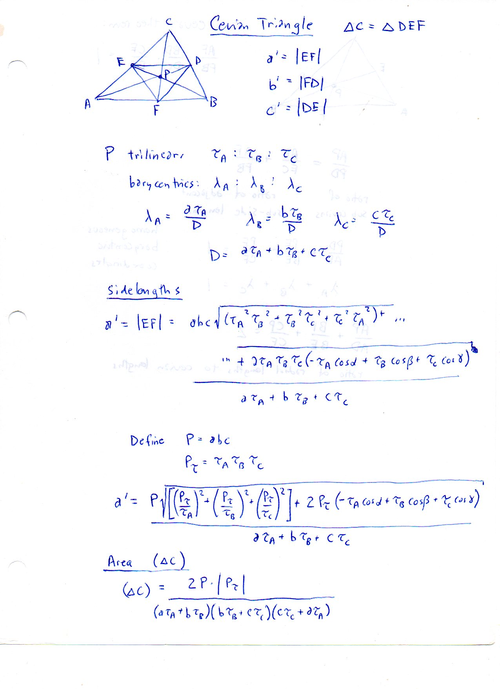

   Folio ``0034`` (original scan ``0034.jpg``) from ``resources/seelig/07_ceva-and-menelaus``.

**Diplomatic Mathematical & Geometric Transcription**

**Diplomatic Transcription — Folio 0034** (``0034.jpg``, Sheet 11 of 26):

Records exact formulas for :math:`|EF|, |FD|, |DE|` and :math:`\text{Area}(\triangle DEF)` in trilinear coordinates :math:`\tau_A : \tau_B : \tau_C`.

.. math::

   D_x = \frac{M J P}{J P + (M - I) Q}, \qquad E_x = \frac{M I Q}{I Q + (M - P) J}, \qquad F_x = \frac{I Q - J P}{Q - J}

.. admonition:: Editorial & Symbolic Notes

   Archival scan ``0034.jpg`` from Fred W. Seelig's notebook dossier on **F.7 Ceva and Menelaus** (Page 11 of 26). Companion OpenDocument worksheet(s): ``Ceva & Menelaus``, ``Ceva``, ``Menelaus``, ``Ceva Compare``, ``6-9-13 Cevian``. Classical Euclidean foundations: :ref:`VI.2`. Kimberling *Encyclopedia of Triangle Centers* loci: :ref:`X(1)`, :ref:`X(2)`, :ref:`X(7)`, :ref:`X(8)`.

Folio 0035 (Page 12 of 26): Sub-Cevian Harmonic & Barycentric Identities
------------------------------------------------------------------------

.. folio:: 0035

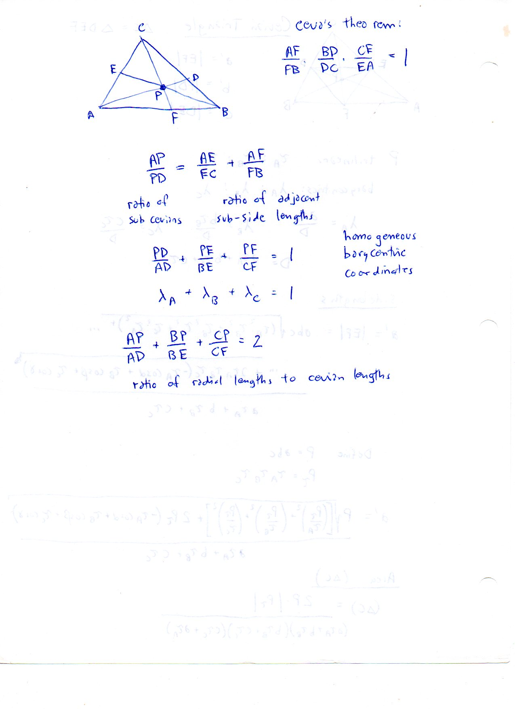

   Folio ``0035`` (original scan ``0035.jpg``) from ``resources/seelig/07_ceva-and-menelaus``.

**Diplomatic Mathematical & Geometric Transcription**

**Diplomatic Transcription — Folio 0035** (``0035.jpg``, Sheet 12 of 26):

Proves :math:`\frac{AP}{PD} = \frac{AE}{EC} + \frac{AF}{FB}`, :math:`\sum \frac{PD}{AD} = 1`, and :math:`\sum \frac{AP}{AD} = 2`.

.. math::

   \frac{PD}{AD} + \frac{PE}{BE} + \frac{PF}{CF} = 1, \qquad \frac{AP}{AD} + \frac{BP}{BE} + \frac{CP}{CF} = 2

.. admonition:: Editorial & Symbolic Notes

   Archival scan ``0035.jpg`` from Fred W. Seelig's notebook dossier on **F.7 Ceva and Menelaus** (Page 12 of 26). Companion OpenDocument worksheet(s): ``Ceva & Menelaus``, ``Ceva``, ``Menelaus``, ``Ceva Compare``, ``6-9-13 Cevian``. Classical Euclidean foundations: :ref:`VI.2`. Kimberling *Encyclopedia of Triangle Centers* loci: :ref:`X(1)`, :ref:`X(2)`, :ref:`X(7)`, :ref:`X(8)`.

Folio 0036 (Page 13 of 26): MNIJ Line Equations L_A, L_B, L_C, L_D, L_E, L_F
----------------------------------------------------------------------------

.. folio:: 0036

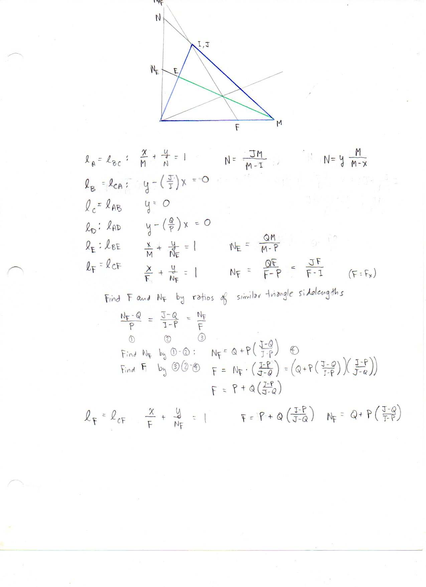

   Folio ``0036`` (original scan ``0036.jpg``) from ``resources/seelig/07_ceva-and-menelaus``.

**Diplomatic Mathematical & Geometric Transcription**

**Diplomatic Transcription — Folio 0036** (``0036.jpg``, Sheet 13 of 26):

Derives intercept equations for the three sidelines and three cevians through :math:`P(P, Q)`.

.. math::

   \frac{AF}{FB} \cdot \frac{BD}{DC} \cdot \frac{CE}{EA} = +1 \quad (\text{Ceva}), \qquad \frac{AF'}{F'B} \cdot \frac{BD}{DC} \cdot \frac{CE}{EA} = -1 \quad (\text{Menelaus})

.. admonition:: Editorial & Symbolic Notes

   Archival scan ``0036.jpg`` from Fred W. Seelig's notebook dossier on **F.7 Ceva and Menelaus** (Page 13 of 26). Companion OpenDocument worksheet(s): ``Ceva & Menelaus``, ``Ceva``, ``Menelaus``, ``Ceva Compare``, ``6-9-13 Cevian``. Classical Euclidean foundations: :ref:`VI.2`. Kimberling *Encyclopedia of Triangle Centers* loci: :ref:`X(1)`, :ref:`X(2)`, :ref:`X(7)`, :ref:`X(8)`.

Folio 0037 (Page 14 of 26): Exact Cartesian Coordinates of Traces D, E, F
-------------------------------------------------------------------------

.. folio:: 0037

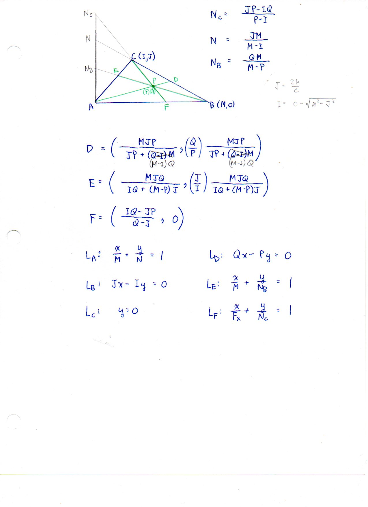

   Folio ``0037`` (original scan ``0037.jpg``) from ``resources/seelig/07_ceva-and-menelaus``.

**Diplomatic Mathematical & Geometric Transcription**

**Diplomatic Transcription — Folio 0037** (``0037.jpg``, Sheet 14 of 26):

Solves the :math:`2\times 2` linear intersections for :math:`D = L_D \cap L_A`, :math:`E = L_E \cap L_B`, and :math:`F = L_F \cap L_C`.

.. math::

   D_x = \frac{M J P}{J P + (M - I) Q}, \qquad E_x = \frac{M I Q}{I Q + (M - P) J}, \qquad F_x = \frac{I Q - J P}{Q - J}

.. admonition:: Editorial & Symbolic Notes

   Archival scan ``0037.jpg`` from Fred W. Seelig's notebook dossier on **F.7 Ceva and Menelaus** (Page 14 of 26). Companion OpenDocument worksheet(s): ``Ceva & Menelaus``, ``Ceva``, ``Menelaus``, ``Ceva Compare``, ``6-9-13 Cevian``. Classical Euclidean foundations: :ref:`VI.2`. Kimberling *Encyclopedia of Triangle Centers* loci: :ref:`X(1)`, :ref:`X(2)`, :ref:`X(7)`, :ref:`X(8)`.

Folio 0038 (Page 15 of 26): Cevian Lengths d, e, f in MNIJ Coordinates
----------------------------------------------------------------------

.. folio:: 0038

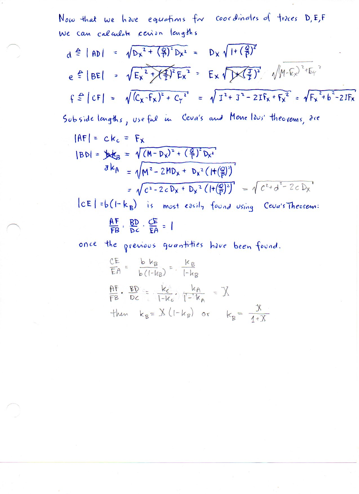

   Folio ``0038`` (original scan ``0038.jpg``) from ``resources/seelig/07_ceva-and-menelaus``.

**Diplomatic Mathematical & Geometric Transcription**

**Diplomatic Transcription — Folio 0038** (``0038.jpg``, Sheet 15 of 26):

Expresses :math:`d = |AD|, e = |BE|, f = |CF|` and vertex distances :math:`d_A, d_B, d_C` in terms of :math:`M, N, I, J, P, Q`.

.. math::

   \frac{PD}{AD} + \frac{PE}{BE} + \frac{PF}{CF} = 1, \qquad \frac{AP}{AD} + \frac{BP}{BE} + \frac{CP}{CF} = 2

.. admonition:: Editorial & Symbolic Notes

   Archival scan ``0038.jpg`` from Fred W. Seelig's notebook dossier on **F.7 Ceva and Menelaus** (Page 15 of 26). Companion OpenDocument worksheet(s): ``Ceva & Menelaus``, ``Ceva``, ``Menelaus``, ``Ceva Compare``, ``6-9-13 Cevian``. Classical Euclidean foundations: :ref:`VI.2`. Kimberling *Encyclopedia of Triangle Centers* loci: :ref:`X(1)`, :ref:`X(2)`, :ref:`X(7)`, :ref:`X(8)`.

Folio 0039 (Page 16 of 26): Subtriangle Areas & Side Splits
-----------------------------------------------------------

.. folio:: 0039

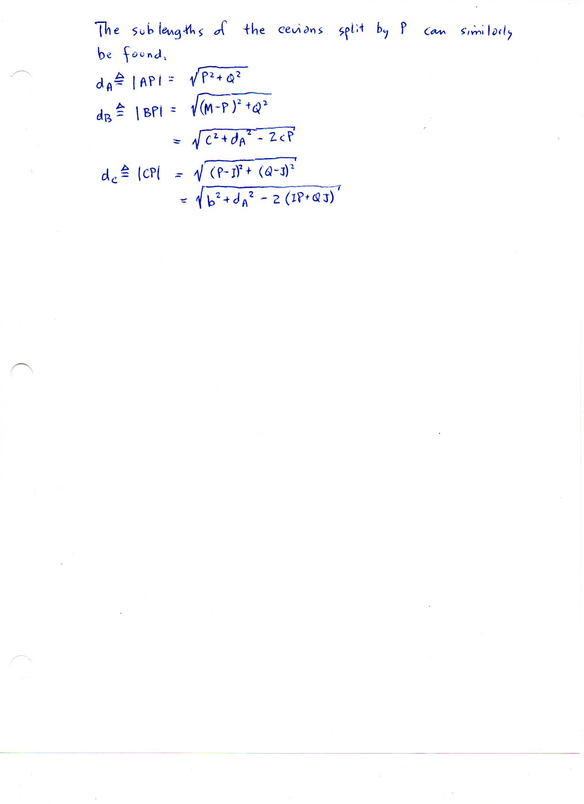

   Folio ``0039`` (original scan ``0039.jpg``) from ``resources/seelig/07_ceva-and-menelaus``.

**Diplomatic Mathematical & Geometric Transcription**

**Diplomatic Transcription — Folio 0039** (``0039.jpg``, Sheet 16 of 26):

Computes the six side segments and six subtriangle areas around interior point :math:`P`.

.. math::

   \frac{AF}{FB} \cdot \frac{BD}{DC} \cdot \frac{CE}{EA} = +1 \quad (\text{Ceva}), \qquad \frac{AF'}{F'B} \cdot \frac{BD}{DC} \cdot \frac{CE}{EA} = -1 \quad (\text{Menelaus})

.. admonition:: Editorial & Symbolic Notes

   Archival scan ``0039.jpg`` from Fred W. Seelig's notebook dossier on **F.7 Ceva and Menelaus** (Page 16 of 26). Companion OpenDocument worksheet(s): ``Ceva & Menelaus``, ``Ceva``, ``Menelaus``, ``Ceva Compare``, ``6-9-13 Cevian``. Classical Euclidean foundations: :ref:`VI.2`. Kimberling *Encyclopedia of Triangle Centers* loci: :ref:`X(1)`, :ref:`X(2)`, :ref:`X(7)`, :ref:`X(8)`.

Folio 0040 (Page 17 of 26): Summary of MNIJ Cevian Formulas
-----------------------------------------------------------

.. folio:: 0040

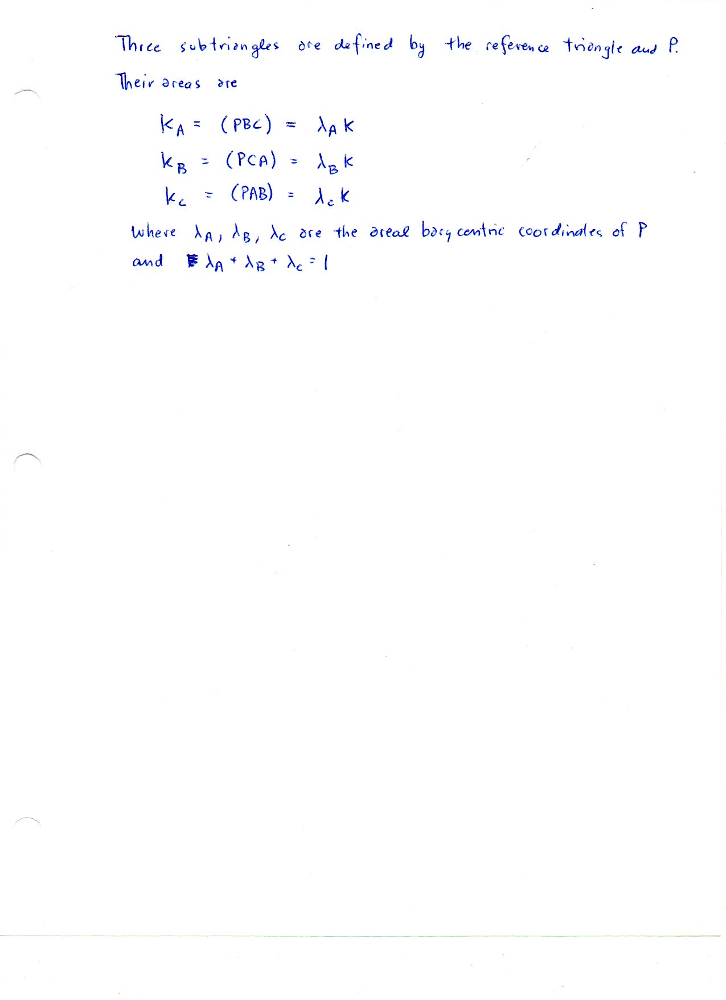

   Folio ``0040`` (original scan ``0040.jpg``) from ``resources/seelig/07_ceva-and-menelaus``.

**Diplomatic Mathematical & Geometric Transcription**

**Diplomatic Transcription — Folio 0040** (``0040.jpg``, Sheet 17 of 26):

Consolidates trace coordinates, lengths, and Ceva ratio checks onto a reference sheet.

.. math::

   D_x = \frac{M J P}{J P + (M - I) Q}, \qquad E_x = \frac{M I Q}{I Q + (M - P) J}, \qquad F_x = \frac{I Q - J P}{Q - J}

.. admonition:: Editorial & Symbolic Notes

   Archival scan ``0040.jpg`` from Fred W. Seelig's notebook dossier on **F.7 Ceva and Menelaus** (Page 17 of 26). Companion OpenDocument worksheet(s): ``Ceva & Menelaus``, ``Ceva``, ``Menelaus``, ``Ceva Compare``, ``6-9-13 Cevian``. Classical Euclidean foundations: :ref:`VI.2`. Kimberling *Encyclopedia of Triangle Centers* loci: :ref:`X(1)`, :ref:`X(2)`, :ref:`X(7)`, :ref:`X(8)`.

Folio 0041 (Page 18 of 26): Cevian HP-35s Program Specification (1/, FWS 8/25/2014)
-----------------------------------------------------------------------------------

.. folio:: 0041

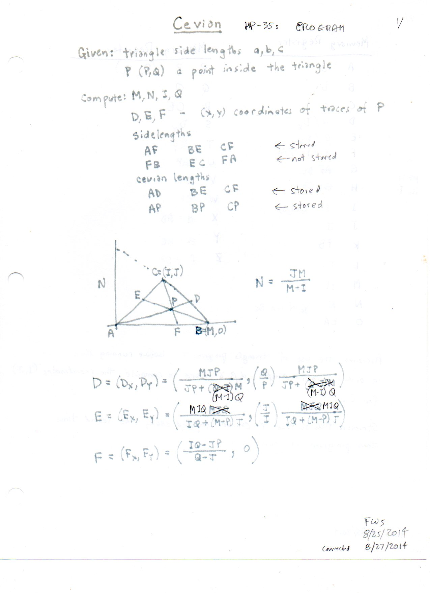

   Folio ``0041`` (original scan ``0041.jpg``) from ``resources/seelig/07_ceva-and-menelaus``.

**Diplomatic Mathematical & Geometric Transcription**

**Diplomatic Transcription — Folio 0041** (``0041.jpg``, Sheet 18 of 26):

Defines inputs, outputs, and equations for the HP-35s calculator program solving general cevians.

.. math::

   \frac{PD}{AD} + \frac{PE}{BE} + \frac{PF}{CF} = 1, \qquad \frac{AP}{AD} + \frac{BP}{BE} + \frac{CP}{CF} = 2

.. admonition:: Editorial & Symbolic Notes

   Archival scan ``0041.jpg`` from Fred W. Seelig's notebook dossier on **F.7 Ceva and Menelaus** (Page 18 of 26). Companion OpenDocument worksheet(s): ``Ceva & Menelaus``, ``Ceva``, ``Menelaus``, ``Ceva Compare``, ``6-9-13 Cevian``. Classical Euclidean foundations: :ref:`VI.2`. Kimberling *Encyclopedia of Triangle Centers* loci: :ref:`X(1)`, :ref:`X(2)`, :ref:`X(7)`, :ref:`X(8)`.

Folio 0042 (Page 19 of 26): HP-35s Memory Register Map A–Z (2/, FWS 8/25/2014)
------------------------------------------------------------------------------

.. folio:: 0042

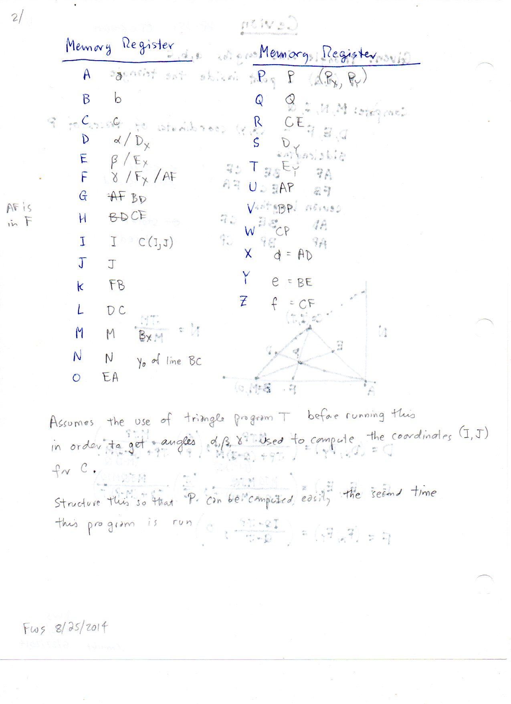

   Folio ``0042`` (original scan ``0042.jpg``) from ``resources/seelig/07_ceva-and-menelaus``.

**Diplomatic Mathematical & Geometric Transcription**

**Diplomatic Transcription — Folio 0042** (``0042.jpg``, Sheet 19 of 26):

Maps all 26 calculator registers `A`–`Z` to triangle and cevian parameters.

.. math::

   \frac{AF}{FB} \cdot \frac{BD}{DC} \cdot \frac{CE}{EA} = +1 \quad (\text{Ceva}), \qquad \frac{AF'}{F'B} \cdot \frac{BD}{DC} \cdot \frac{CE}{EA} = -1 \quad (\text{Menelaus})

.. admonition:: Editorial & Symbolic Notes

   Archival scan ``0042.jpg`` from Fred W. Seelig's notebook dossier on **F.7 Ceva and Menelaus** (Page 19 of 26). Companion OpenDocument worksheet(s): ``Ceva & Menelaus``, ``Ceva``, ``Menelaus``, ``Ceva Compare``, ``6-9-13 Cevian``. Classical Euclidean foundations: :ref:`VI.2`. Kimberling *Encyclopedia of Triangle Centers* loci: :ref:`X(1)`, :ref:`X(2)`, :ref:`X(7)`, :ref:`X(8)`.

Folio 0043 (Page 20 of 26): HP-35s Program Flow Diagram (3/)
------------------------------------------------------------

.. folio:: 0043

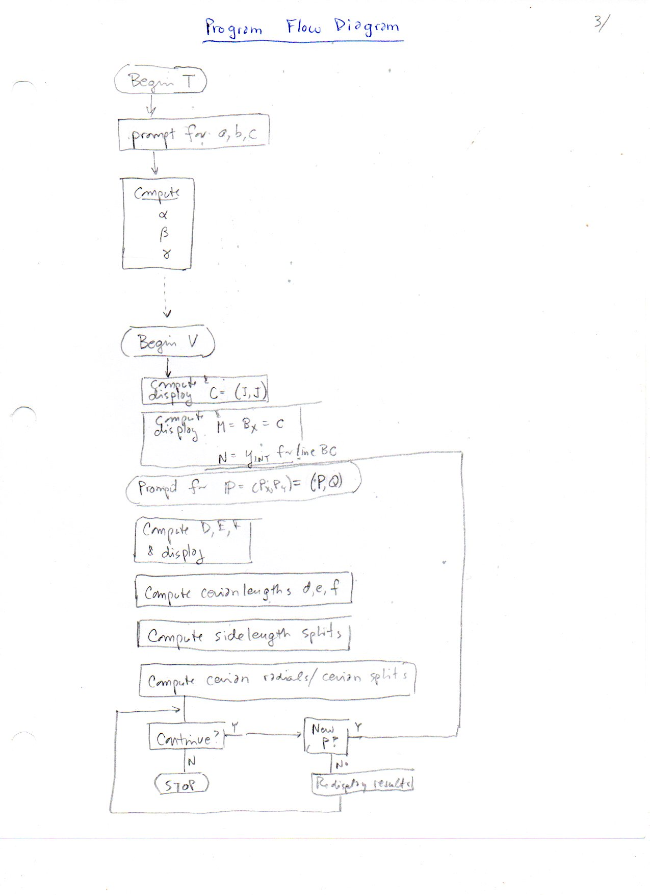

   Folio ``0043`` (original scan ``0043.jpg``) from ``resources/seelig/07_ceva-and-menelaus``.

**Diplomatic Mathematical & Geometric Transcription**

**Diplomatic Transcription — Folio 0043** (``0043.jpg``, Sheet 20 of 26):

Flowchart of subroutine branches for computing trace points and cevian lengths.

.. math::

   D_x = \frac{M J P}{J P + (M - I) Q}, \qquad E_x = \frac{M I Q}{I Q + (M - P) J}, \qquad F_x = \frac{I Q - J P}{Q - J}

.. admonition:: Editorial & Symbolic Notes

   Archival scan ``0043.jpg`` from Fred W. Seelig's notebook dossier on **F.7 Ceva and Menelaus** (Page 20 of 26). Companion OpenDocument worksheet(s): ``Ceva & Menelaus``, ``Ceva``, ``Menelaus``, ``Ceva Compare``, ``6-9-13 Cevian``. Classical Euclidean foundations: :ref:`VI.2`. Kimberling *Encyclopedia of Triangle Centers* loci: :ref:`X(1)`, :ref:`X(2)`, :ref:`X(7)`, :ref:`X(8)`.

Folio 0044 (Page 21 of 26): Worked Test Case: 6-9-13 Triangle with P=(9,1) (Part 1)
-----------------------------------------------------------------------------------

.. folio:: 0044

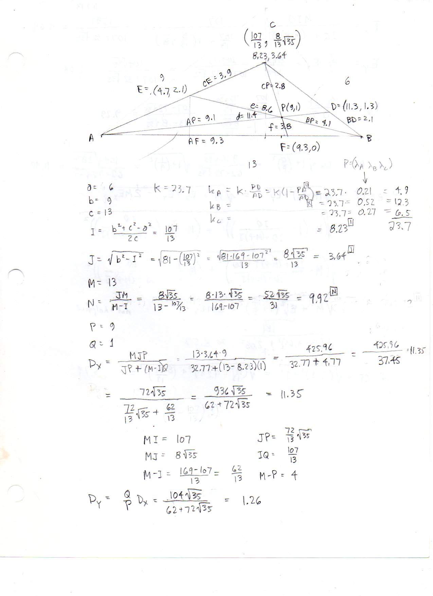

   Folio ``0044`` (original scan ``0044.jpg``) from ``resources/seelig/07_ceva-and-menelaus``.

**Diplomatic Mathematical & Geometric Transcription**

**Diplomatic Transcription — Folio 0044** (``0044.jpg``, Sheet 21 of 26):

Evaluates :math:`I = 107/13 \approx 8.23, J = 8\sqrt{35}/13 \approx 3.64, N \approx 9.92`, and trace coordinates :math:`D(11.35, 1.26), E(4.69, 2.08), F(9.29, 0)`.

.. math::

   \frac{PD}{AD} + \frac{PE}{BE} + \frac{PF}{CF} = 1, \qquad \frac{AP}{AD} + \frac{BP}{BE} + \frac{CP}{CF} = 2

.. admonition:: Editorial & Symbolic Notes

   Archival scan ``0044.jpg`` from Fred W. Seelig's notebook dossier on **F.7 Ceva and Menelaus** (Page 21 of 26). Companion OpenDocument worksheet(s): ``Ceva & Menelaus``, ``Ceva``, ``Menelaus``, ``Ceva Compare``, ``6-9-13 Cevian``. Classical Euclidean foundations: :ref:`VI.2`. Kimberling *Encyclopedia of Triangle Centers* loci: :ref:`X(1)`, :ref:`X(2)`, :ref:`X(7)`, :ref:`X(8)`.

Folio 0045 (Page 22 of 26): Worked Test Case: 6-9-13 Triangle (Part 2)
----------------------------------------------------------------------

.. folio:: 0045

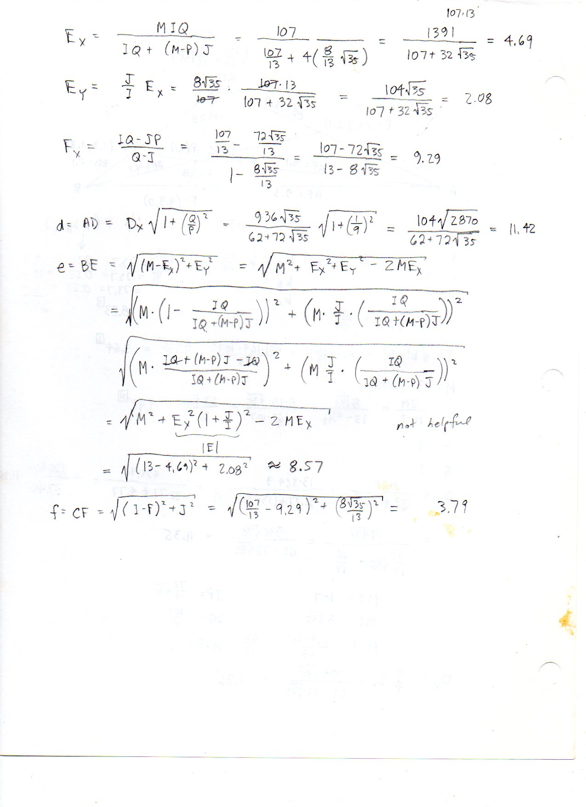

   Folio ``0045`` (original scan ``0045.jpg``) from ``resources/seelig/07_ceva-and-menelaus``.

**Diplomatic Mathematical & Geometric Transcription**

**Diplomatic Transcription — Folio 0045** (``0045.jpg``, Sheet 22 of 26):

Computes cevian lengths :math:`d = 11.42, e = 8.57, f = 3.79` and verifies Ceva's theorem.

.. math::

   \frac{AF}{FB} \cdot \frac{BD}{DC} \cdot \frac{CE}{EA} = +1 \quad (\text{Ceva}), \qquad \frac{AF'}{F'B} \cdot \frac{BD}{DC} \cdot \frac{CE}{EA} = -1 \quad (\text{Menelaus})

.. admonition:: Editorial & Symbolic Notes

   Archival scan ``0045.jpg`` from Fred W. Seelig's notebook dossier on **F.7 Ceva and Menelaus** (Page 22 of 26). Companion OpenDocument worksheet(s): ``Ceva & Menelaus``, ``Ceva``, ``Menelaus``, ``Ceva Compare``, ``6-9-13 Cevian``. Classical Euclidean foundations: :ref:`VI.2`. Kimberling *Encyclopedia of Triangle Centers* loci: :ref:`X(1)`, :ref:`X(2)`, :ref:`X(7)`, :ref:`X(8)`.

Folio 0046 (Page 23 of 26): Worked Test Case: 6-9-13 Triangle (Part 3)
----------------------------------------------------------------------

.. folio:: 0046

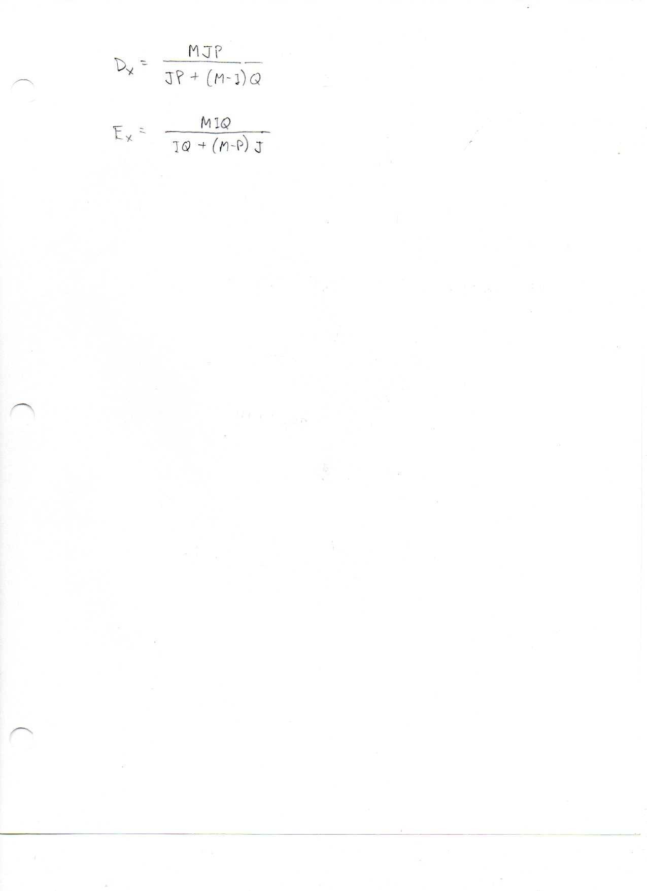

   Folio ``0046`` (original scan ``0046.jpg``) from ``resources/seelig/07_ceva-and-menelaus``.

**Diplomatic Mathematical & Geometric Transcription**

**Diplomatic Transcription — Folio 0046** (``0046.jpg``, Sheet 23 of 26):

Cross-checks sub-cevian ratios and subtriangle areas against the Excel workbook.

.. math::

   D_x = \frac{M J P}{J P + (M - I) Q}, \qquad E_x = \frac{M I Q}{I Q + (M - P) J}, \qquad F_x = \frac{I Q - J P}{Q - J}

.. admonition:: Editorial & Symbolic Notes

   Archival scan ``0046.jpg`` from Fred W. Seelig's notebook dossier on **F.7 Ceva and Menelaus** (Page 23 of 26). Companion OpenDocument worksheet(s): ``Ceva & Menelaus``, ``Ceva``, ``Menelaus``, ``Ceva Compare``, ``6-9-13 Cevian``. Classical Euclidean foundations: :ref:`VI.2`. Kimberling *Encyclopedia of Triangle Centers* loci: :ref:`X(1)`, :ref:`X(2)`, :ref:`X(7)`, :ref:`X(8)`.

Folio 0047 (Page 24 of 26): Menelaus Worked Example on 20-23-31 Triangle
------------------------------------------------------------------------

.. folio:: 0047

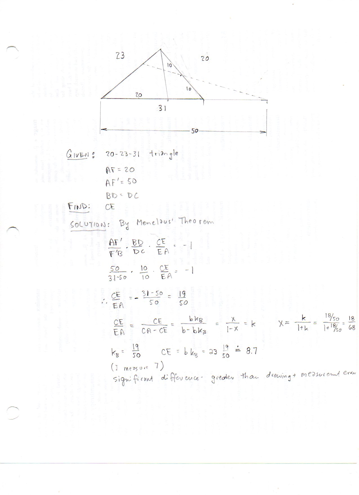

   Folio ``0047`` (original scan ``0047.jpg``) from ``resources/seelig/07_ceva-and-menelaus``.

**Diplomatic Mathematical & Geometric Transcription**

**Diplomatic Transcription — Folio 0047** (``0047.jpg``, Sheet 24 of 26):

Given :math:`AF = 20, AF' = 50, BD = DC = 10`, solves Menelaus's relation for :math:`CE/EA = 19/50` (:math:`CE \approx 8.74`).

.. math::

   \frac{PD}{AD} + \frac{PE}{BE} + \frac{PF}{CF} = 1, \qquad \frac{AP}{AD} + \frac{BP}{BE} + \frac{CP}{CF} = 2

.. admonition:: Editorial & Symbolic Notes

   Archival scan ``0047.jpg`` from Fred W. Seelig's notebook dossier on **F.7 Ceva and Menelaus** (Page 24 of 26). Companion OpenDocument worksheet(s): ``Ceva & Menelaus``, ``Ceva``, ``Menelaus``, ``Ceva Compare``, ``6-9-13 Cevian``. Classical Euclidean foundations: :ref:`VI.2`. Kimberling *Encyclopedia of Triangle Centers* loci: :ref:`X(1)`, :ref:`X(2)`, :ref:`X(7)`, :ref:`X(8)`.

Folio 0048 (Page 25 of 26): Circumcircles of Subtriangles APB, BPC, CPA
-----------------------------------------------------------------------

.. folio:: 0048

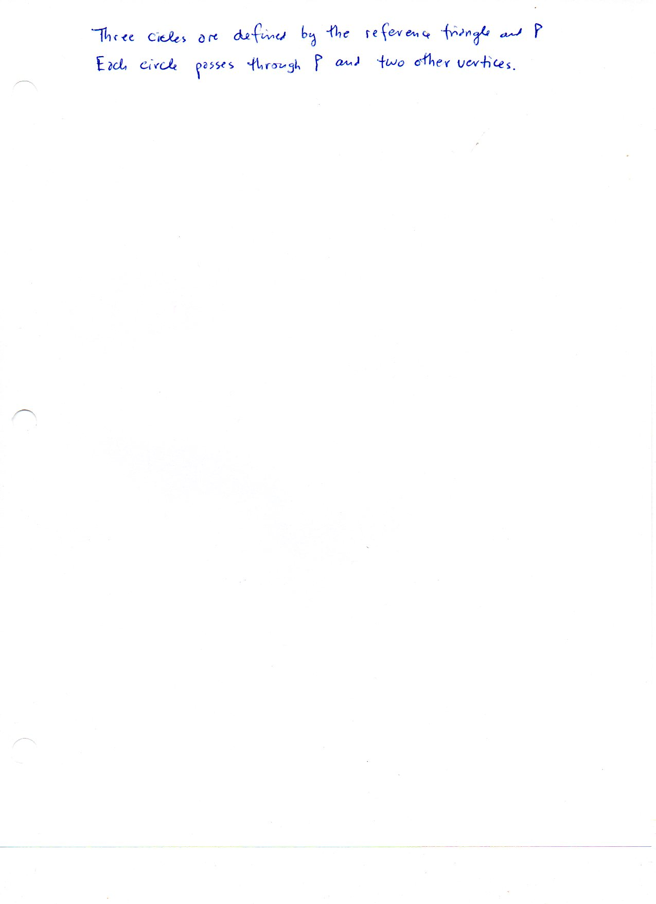

   Folio ``0048`` (original scan ``0048.jpg``) from ``resources/seelig/07_ceva-and-menelaus``.

**Diplomatic Mathematical & Geometric Transcription**

**Diplomatic Transcription — Folio 0048** (``0048.jpg``, Sheet 25 of 26):

Notes properties of the three circles passing through :math:`P` and pairs of triangle vertices.

.. math::

   \frac{AF}{FB} \cdot \frac{BD}{DC} \cdot \frac{CE}{EA} = +1 \quad (\text{Ceva}), \qquad \frac{AF'}{F'B} \cdot \frac{BD}{DC} \cdot \frac{CE}{EA} = -1 \quad (\text{Menelaus})

.. admonition:: Editorial & Symbolic Notes

   Archival scan ``0048.jpg`` from Fred W. Seelig's notebook dossier on **F.7 Ceva and Menelaus** (Page 25 of 26). Companion OpenDocument worksheet(s): ``Ceva & Menelaus``, ``Ceva``, ``Menelaus``, ``Ceva Compare``, ``6-9-13 Cevian``. Classical Euclidean foundations: :ref:`VI.2`. Kimberling *Encyclopedia of Triangle Centers* loci: :ref:`X(1)`, :ref:`X(2)`, :ref:`X(7)`, :ref:`X(8)`.

Folio 0049 (Page 26 of 26): Master Summary Sheet (Vol. 1, p. 128 & cevian analysis.xls)
---------------------------------------------------------------------------------------

.. folio:: 0049

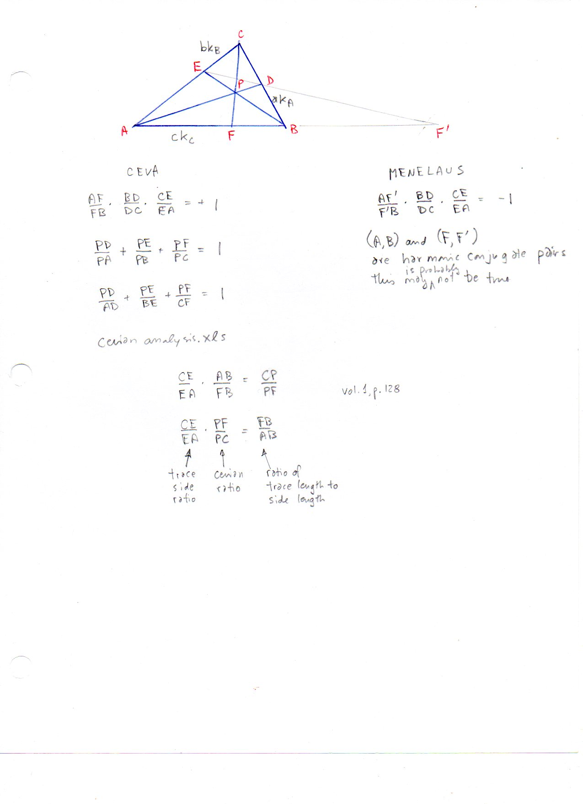

   Folio ``0049`` (original scan ``0049.jpg``) from ``resources/seelig/07_ceva-and-menelaus``.

**Diplomatic Mathematical & Geometric Transcription**

**Diplomatic Transcription — Folio 0049** (``0049.jpg``, Sheet 26 of 26):

Compiles Ceva, Menelaus, Van Aubel, and mass-point identities linked to `cevian analysis.xls`.

.. math::

   D_x = \frac{M J P}{J P + (M - I) Q}, \qquad E_x = \frac{M I Q}{I Q + (M - P) J}, \qquad F_x = \frac{I Q - J P}{Q - J}

.. admonition:: Editorial & Symbolic Notes

   Archival scan ``0049.jpg`` from Fred W. Seelig's notebook dossier on **F.7 Ceva and Menelaus** (Page 26 of 26). Companion OpenDocument worksheet(s): ``Ceva & Menelaus``, ``Ceva``, ``Menelaus``, ``Ceva Compare``, ``6-9-13 Cevian``. Classical Euclidean foundations: :ref:`VI.2`. Kimberling *Encyclopedia of Triangle Centers* loci: :ref:`X(1)`, :ref:`X(2)`, :ref:`X(7)`, :ref:`X(8)`.
