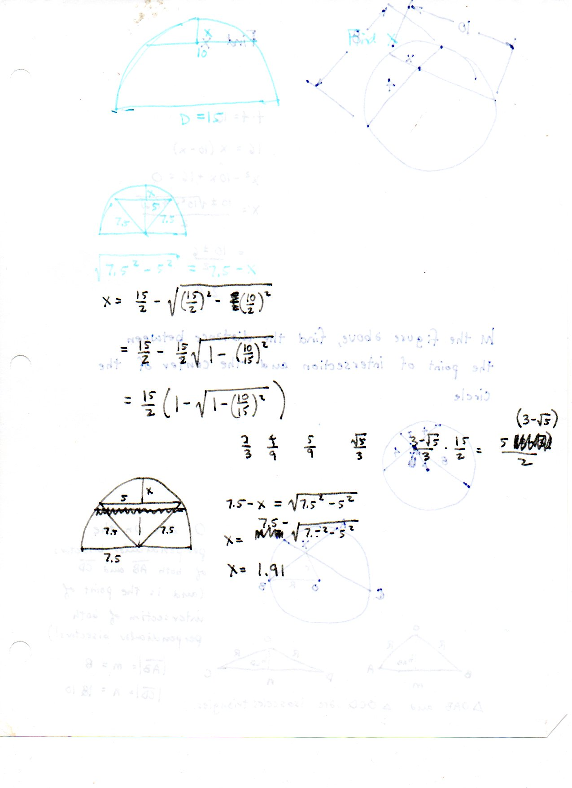
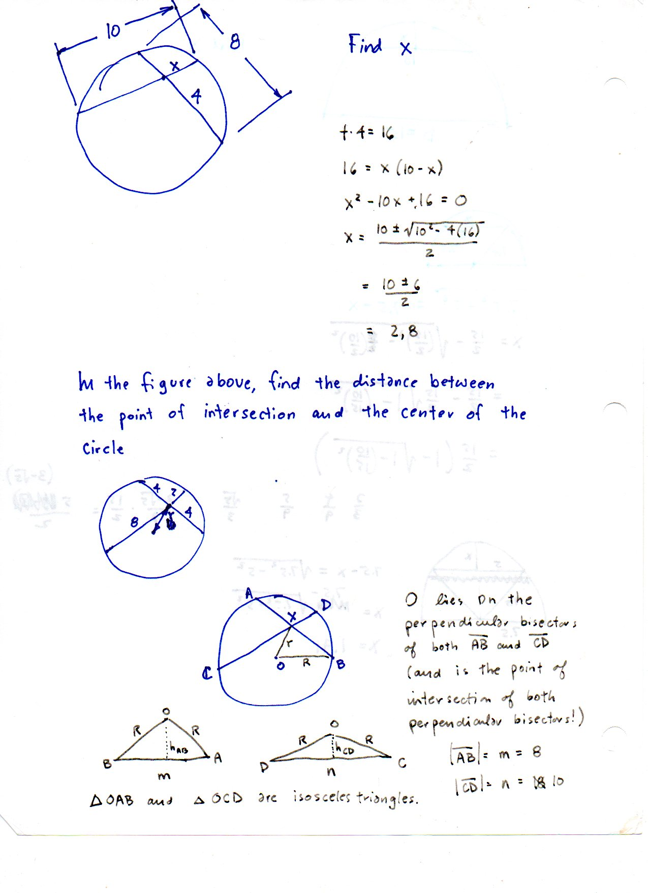
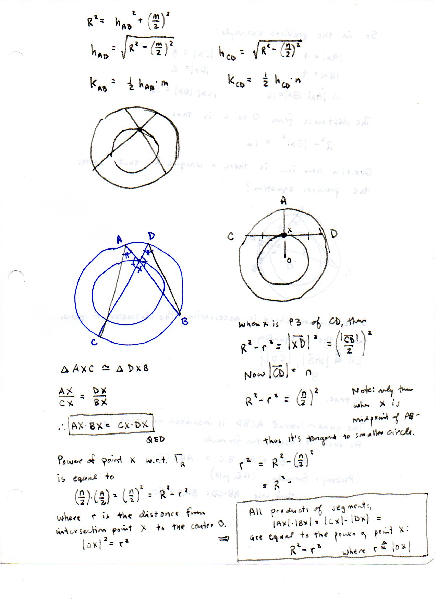
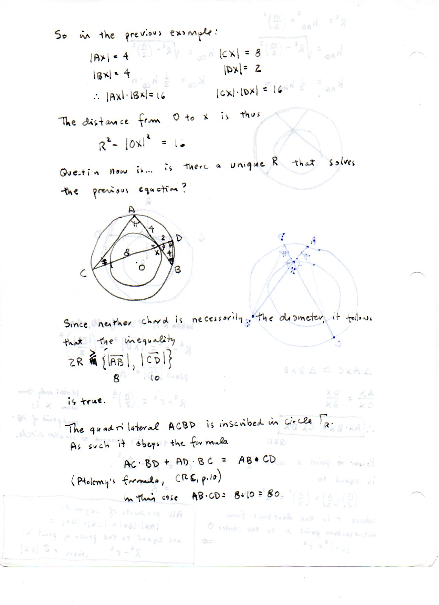

===============================
F.8 Chord Intersection — Folios
===============================

Archival manuscript scans and diplomatic transcriptions from :person:`seelig`'s
notebooks for **F.8 (Chord Intersection)** (:cite:`SeeligNotebooks`).

Folio 0050 (Page 1 of 4): Sagitta of a Chord in a Circle of Diameter 15
-----------------------------------------------------------------------

.. folio:: 0050

   Folio ``0050`` (original scan ``0050.jpg``) from ``resources/seelig/08_chord-intersection``.

**Diplomatic Mathematical & Geometric Transcription**

**Diplomatic Transcription — Folio 0050** (``0050.jpg``, Sheet 1 of 4):

Computes the sagitta :math:`x = \frac{15}{2} - \sqrt{(15/2)^2 - 5^2} = \frac{5(3-\sqrt{5})}{2} \approx 1.91` for a chord of length 10.

.. math::

   |AX| \cdot |BX| = |CX| \cdot |DX| = R^2 - |OX|^2, \qquad x_{\text{sagitta}} = R - \sqrt{R^2 - \left(\frac{c}{2}\right)^2}

.. admonition:: Editorial & Symbolic Notes

   Archival scan ``0050.jpg`` from Fred W. Seelig's notebook dossier on **F.8 Chord Intersection** (Page 1 of 4). Companion OpenDocument worksheet(s): ``Chord Intersection``. Classical Euclidean foundations: :ref:`III.35`, :ref:`III.36`.

Folio 0051 (Page 2 of 4): Intersecting Chords Problem (m = 8, n = 10)
---------------------------------------------------------------------

.. folio:: 0051

   Folio ``0051`` (original scan ``0051.jpg``) from ``resources/seelig/08_chord-intersection``.

**Diplomatic Mathematical & Geometric Transcription**

**Diplomatic Transcription — Folio 0051** (``0051.jpg``, Sheet 2 of 4):

Solves :math:`4\cdot 4 = x(10-x) \implies x = 2, 8` and sets up isosceles triangles :math:`\triangle OAB` and :math:`\triangle OCD` to find :math:`|OX| = r`.

.. math::

   |AX| \cdot |BX| = |CX| \cdot |DX| = R^2 - |OX|^2, \qquad x_{\text{sagitta}} = R - \sqrt{R^2 - \left(\frac{c}{2}\right)^2}

.. admonition:: Editorial & Symbolic Notes

   Archival scan ``0051.jpg`` from Fred W. Seelig's notebook dossier on **F.8 Chord Intersection** (Page 2 of 4). Companion OpenDocument worksheet(s): ``Chord Intersection``. Classical Euclidean foundations: :ref:`III.35`, :ref:`III.36`.

Folio 0052 (Page 3 of 4): Proof via Similar Triangles & Power of Point X
------------------------------------------------------------------------

.. folio:: 0052

   Folio ``0052`` (original scan ``0052.jpg``) from ``resources/seelig/08_chord-intersection``.

**Diplomatic Mathematical & Geometric Transcription**

**Diplomatic Transcription — Folio 0052** (``0052.jpg``, Sheet 3 of 4):

Proves :math:`AX\cdot BX = CX\cdot DX` from :math:`\triangle AXC \simeq \triangle DXB` and equates it to :math:`R^2 - |OX|^2`.

.. math::

   |AX| \cdot |BX| = |CX| \cdot |DX| = R^2 - |OX|^2, \qquad x_{\text{sagitta}} = R - \sqrt{R^2 - \left(\frac{c}{2}\right)^2}

.. admonition:: Editorial & Symbolic Notes

   Archival scan ``0052.jpg`` from Fred W. Seelig's notebook dossier on **F.8 Chord Intersection** (Page 3 of 4). Companion OpenDocument worksheet(s): ``Chord Intersection``. Classical Euclidean foundations: :ref:`III.35`, :ref:`III.36`.

Folio 0053 (Page 4 of 4): Concentric Circles & Ptolemy's Formula (CRC, p. 10)
-----------------------------------------------------------------------------

.. folio:: 0053

   Folio ``0053`` (original scan ``0053.jpg``) from ``resources/seelig/08_chord-intersection``.

**Diplomatic Mathematical & Geometric Transcription**

**Diplomatic Transcription — Folio 0053** (``0053.jpg``, Sheet 4 of 4):

Shows that :math:`R^2 - |OX|^2 = 16` with :math:`2R \ge 10` leaves one degree of freedom (the angle between chords) and applies Ptolemy's theorem :math:`AC\cdot BD + AD\cdot BC = 80`.

.. math::

   |AX| \cdot |BX| = |CX| \cdot |DX| = R^2 - |OX|^2, \qquad x_{\text{sagitta}} = R - \sqrt{R^2 - \left(\frac{c}{2}\right)^2}

.. admonition:: Editorial & Symbolic Notes

   Archival scan ``0053.jpg`` from Fred W. Seelig's notebook dossier on **F.8 Chord Intersection** (Page 4 of 4). Companion OpenDocument worksheet(s): ``Chord Intersection``. Classical Euclidean foundations: :ref:`III.35`, :ref:`III.36`.
