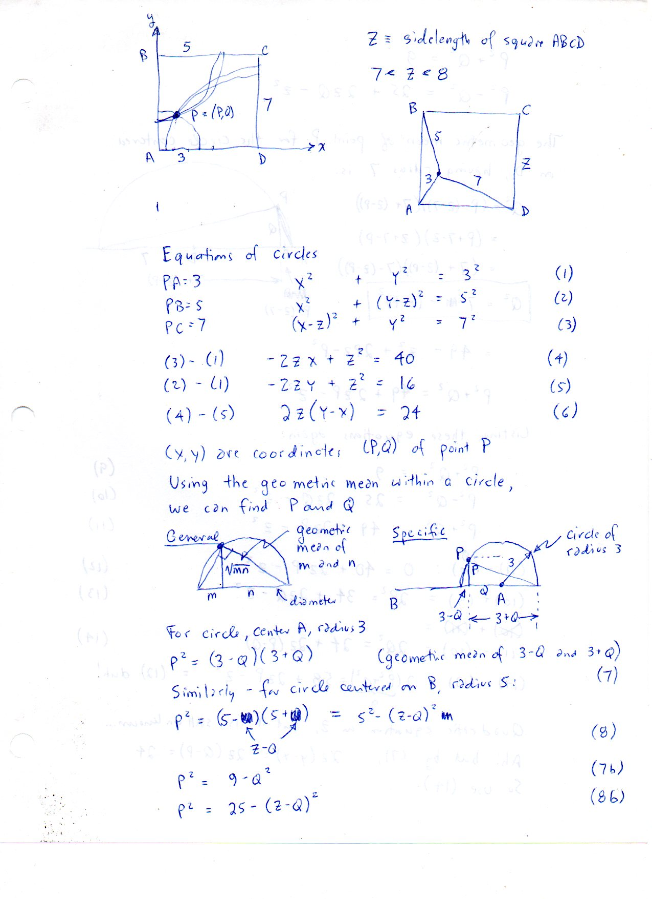
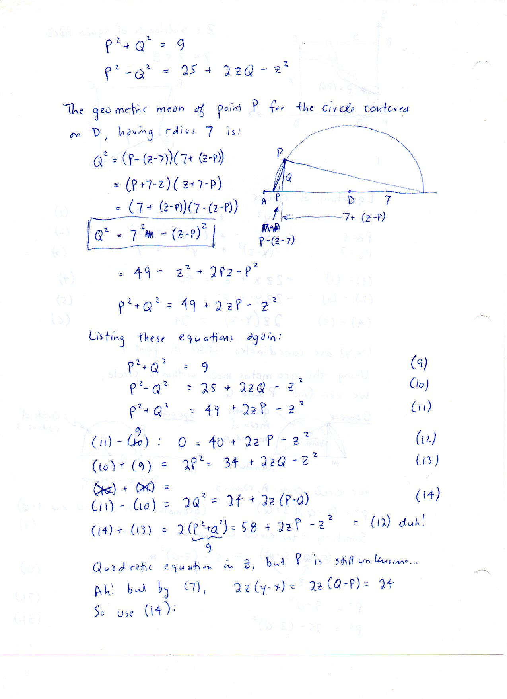
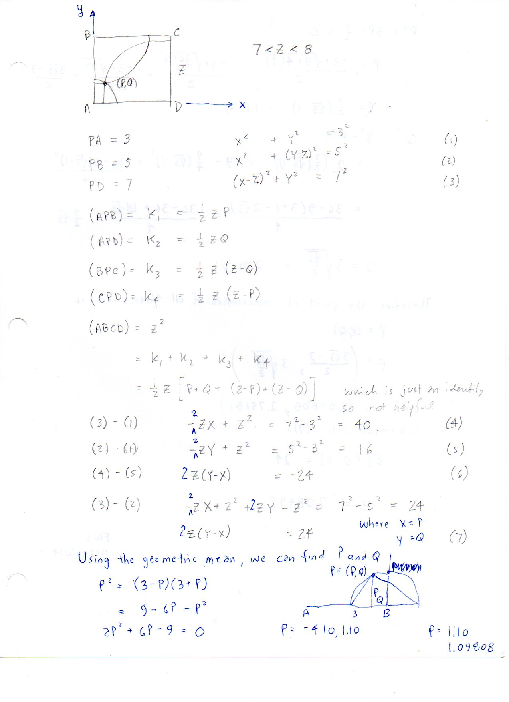
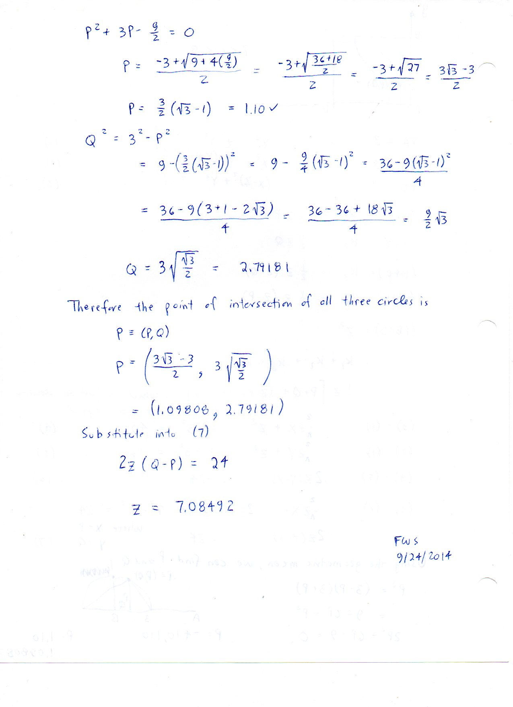
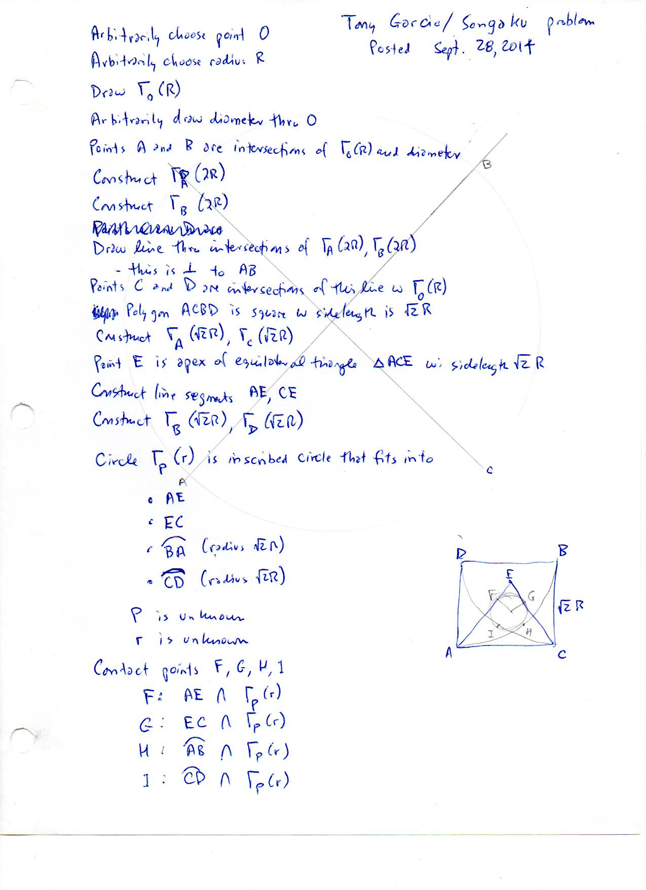
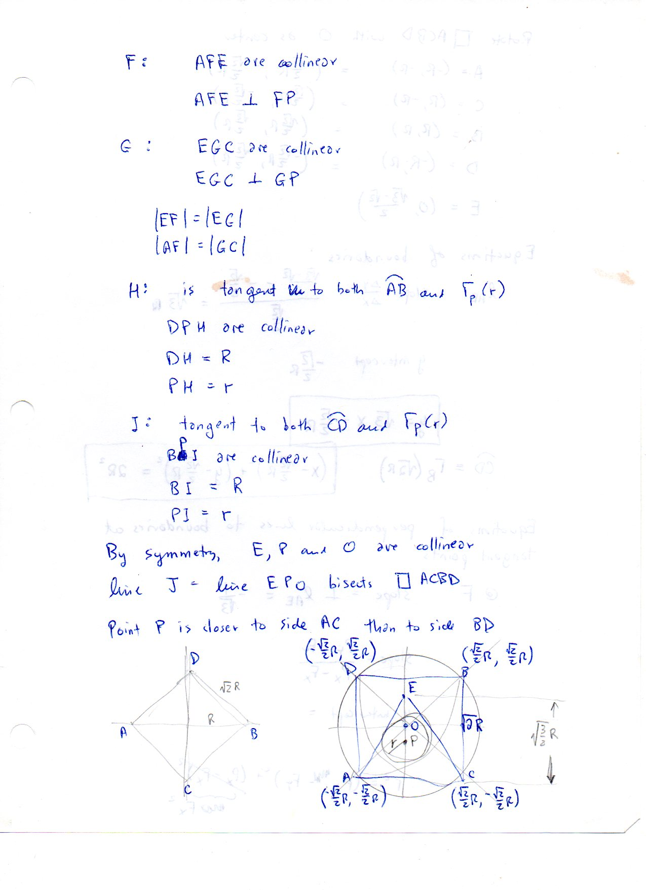
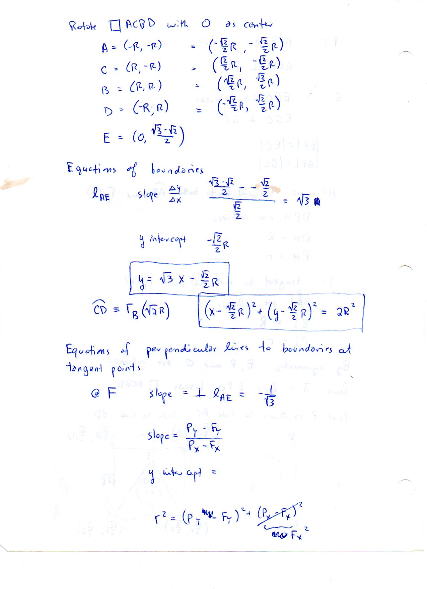
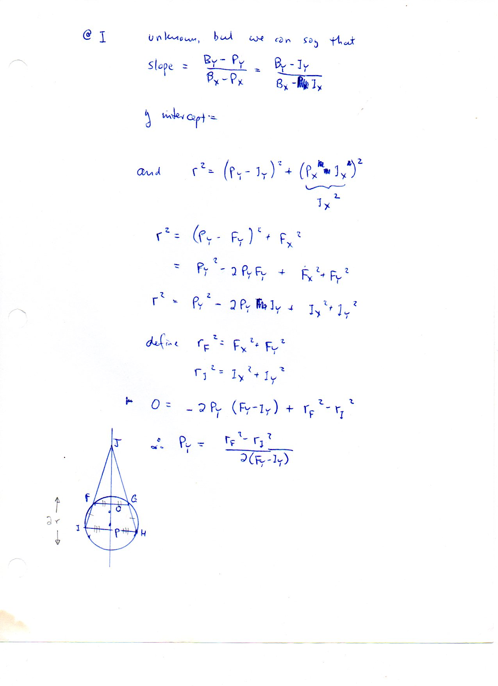

=============================
F.9 Circle Equations — Folios
=============================

Archival manuscript scans and diplomatic transcriptions from :person:`seelig`'s
notebooks for **F.9 (Circle Equations)** (:cite:`SeeligNotebooks`).

Folio 0054 (Page 1 of 8): Equations of Circles in a Square of Side Z (Part 1)
-----------------------------------------------------------------------------

.. folio:: 0054

   Folio ``0054`` (original scan ``0054.jpg``) from ``resources/seelig/09_circle-equations``.

**Diplomatic Mathematical & Geometric Transcription**

**Diplomatic Transcription — Folio 0054** (``0054.jpg``, Sheet 1 of 8):

Sets up :math:`x^2+y^2=9`, :math:`x^2+(y-Z)^2=25`, and :math:`(x-Z)^2+(y-Z)^2=49` for interior point :math:`P` in square :math:`ABCD`.

.. math::

   x^2 + y^2 = 9, \quad x^2 + (y - Z)^2 = 25, \quad (x - Z)^2 + y^2 = 49 \implies 2 Z (Q - P) = 24

.. admonition:: Editorial & Symbolic Notes

   Archival scan ``0054.jpg`` from Fred W. Seelig's notebook dossier on **F.9 Circle Equations** (Page 1 of 8). Companion OpenDocument worksheet(s): ``General Reference``, ``Radical Axes``. Classical Euclidean foundations: :ref:`I.47`, :ref:`III.35`.

Folio 0055 (Page 2 of 8): Semicircle Geometric Mean Representation (Part 2)
---------------------------------------------------------------------------

.. folio:: 0055

   Folio ``0055`` (original scan ``0055.jpg``) from ``resources/seelig/09_circle-equations``.

**Diplomatic Mathematical & Geometric Transcription**

**Diplomatic Transcription — Folio 0055** (``0055.jpg``, Sheet 2 of 8):

Represents :math:`P^2` and :math:`Q^2` as geometric mean altitudes in semicircles of radii 3, 5, and 7.

.. math::

   l_{AE}:\; y = \sqrt{3}x - \frac{\sqrt{2}}{2}R, \qquad P_y = \frac{r_F^2 - r_I^2}{2(F_y - I_y)}

.. admonition:: Editorial & Symbolic Notes

   Archival scan ``0055.jpg`` from Fred W. Seelig's notebook dossier on **F.9 Circle Equations** (Page 2 of 8). Companion OpenDocument worksheet(s): ``General Reference``, ``Radical Axes``. Classical Euclidean foundations: :ref:`I.47`, :ref:`III.35`.

Folio 0056 (Page 3 of 8): Pairwise Subtraction of Circle Equations (Part 3)
---------------------------------------------------------------------------

.. folio:: 0056

   Folio ``0056`` (original scan ``0056.jpg``) from ``resources/seelig/09_circle-equations``.

**Diplomatic Mathematical & Geometric Transcription**

**Diplomatic Transcription — Folio 0056** (``0056.jpg``, Sheet 3 of 8):

Subtracts the circle equations for :math:`PA=3, PB=5, PD=7` to obtain :math:`2Z(Q-P) = 24`.

.. math::

   x^2 + y^2 = 9, \quad x^2 + (y - Z)^2 = 25, \quad (x - Z)^2 + y^2 = 49 \implies 2 Z (Q - P) = 24

.. admonition:: Editorial & Symbolic Notes

   Archival scan ``0056.jpg`` from Fred W. Seelig's notebook dossier on **F.9 Circle Equations** (Page 3 of 8). Companion OpenDocument worksheet(s): ``General Reference``, ``Radical Axes``. Classical Euclidean foundations: :ref:`I.47`, :ref:`III.35`.

Folio 0057 (Page 4 of 8): Quadratic Solution for P, Q, and Z (FWS 9/24/2014)
----------------------------------------------------------------------------

.. folio:: 0057

   Folio ``0057`` (original scan ``0057.jpg``) from ``resources/seelig/09_circle-equations``.

**Diplomatic Mathematical & Geometric Transcription**

**Diplomatic Transcription — Folio 0057** (``0057.jpg``, Sheet 4 of 8):

Evaluates :math:`P = \frac{3}{2}(\sqrt{3}-1) \approx 1.09808, Q = 3\sqrt{\sqrt{3}/2} \approx 2.79181`, and :math:`Z = 7.08492`.

.. math::

   l_{AE}:\; y = \sqrt{3}x - \frac{\sqrt{2}}{2}R, \qquad P_y = \frac{r_F^2 - r_I^2}{2(F_y - I_y)}

.. admonition:: Editorial & Symbolic Notes

   Archival scan ``0057.jpg`` from Fred W. Seelig's notebook dossier on **F.9 Circle Equations** (Page 4 of 8). Companion OpenDocument worksheet(s): ``General Reference``, ``Radical Axes``. Classical Euclidean foundations: :ref:`I.47`, :ref:`III.35`.

Folio 0058 (Page 5 of 8): Tony Garcia / Sangaku Problem Setup (Posted Sept. 28, 2014)
-------------------------------------------------------------------------------------

.. folio:: 0058

   Folio ``0058`` (original scan ``0058.jpg``) from ``resources/seelig/09_circle-equations``.

**Diplomatic Mathematical & Geometric Transcription**

**Diplomatic Transcription — Folio 0058** (``0058.jpg``, Sheet 5 of 8):

Draws circle :math:`\Gamma_O(R)`, inscribed square :math:`ACBD` of side :math:`\sqrt{2}R`, equilateral triangle :math:`\triangle ACE`, and inscribed tangent circle :math:`\Gamma_P(r)`.

.. math::

   x^2 + y^2 = 9, \quad x^2 + (y - Z)^2 = 25, \quad (x - Z)^2 + y^2 = 49 \implies 2 Z (Q - P) = 24

.. admonition:: Editorial & Symbolic Notes

   Archival scan ``0058.jpg`` from Fred W. Seelig's notebook dossier on **F.9 Circle Equations** (Page 5 of 8). Companion OpenDocument worksheet(s): ``General Reference``, ``Radical Axes``. Classical Euclidean foundations: :ref:`I.47`, :ref:`III.35`.

Folio 0059 (Page 6 of 8): Line Equation for Side AE of Equilateral Triangle ACE
-------------------------------------------------------------------------------

.. folio:: 0059

   Folio ``0059`` (original scan ``0059.jpg``) from ``resources/seelig/09_circle-equations``.

**Diplomatic Mathematical & Geometric Transcription**

**Diplomatic Transcription — Folio 0059** (``0059.jpg``, Sheet 6 of 8):

Derives :math:`y = \sqrt{3}x - \frac{\sqrt{2}}{2}R` for side :math:`AE`.

.. math::

   l_{AE}:\; y = \sqrt{3}x - \frac{\sqrt{2}}{2}R, \qquad P_y = \frac{r_F^2 - r_I^2}{2(F_y - I_y)}

.. admonition:: Editorial & Symbolic Notes

   Archival scan ``0059.jpg`` from Fred W. Seelig's notebook dossier on **F.9 Circle Equations** (Page 6 of 8). Companion OpenDocument worksheet(s): ``General Reference``, ``Radical Axes``. Classical Euclidean foundations: :ref:`I.47`, :ref:`III.35`.

Folio 0060 (Page 7 of 8): Circle Equation for Arc CD Centered at B
------------------------------------------------------------------

.. folio:: 0060

   Folio ``0060`` (original scan ``0060.jpg``) from ``resources/seelig/09_circle-equations``.

**Diplomatic Mathematical & Geometric Transcription**

**Diplomatic Transcription — Folio 0060** (``0060.jpg``, Sheet 7 of 8):

Writes :math:`(x - \frac{\sqrt{2}}{2}R)^2 + (y - \frac{\sqrt{2}}{2}R)^2 = 2R^2` for arc :math:`\widehat{CD}`.

.. math::

   x^2 + y^2 = 9, \quad x^2 + (y - Z)^2 = 25, \quad (x - Z)^2 + y^2 = 49 \implies 2 Z (Q - P) = 24

.. admonition:: Editorial & Symbolic Notes

   Archival scan ``0060.jpg`` from Fred W. Seelig's notebook dossier on **F.9 Circle Equations** (Page 7 of 8). Companion OpenDocument worksheet(s): ``General Reference``, ``Radical Axes``. Classical Euclidean foundations: :ref:`I.47`, :ref:`III.35`.

Folio 0061 (Page 8 of 8): Equating r^2 at Tangent Points F and I
----------------------------------------------------------------

.. folio:: 0061

   Folio ``0061`` (original scan ``0061.jpg``) from ``resources/seelig/09_circle-equations``.

**Diplomatic Mathematical & Geometric Transcription**

**Diplomatic Transcription — Folio 0061** (``0061.jpg``, Sheet 8 of 8):

Solves for the Sangaku circle center ordinate :math:`P_y = \frac{r_F^2 - r_I^2}{2(F_y - I_y)}`.

.. math::

   l_{AE}:\; y = \sqrt{3}x - \frac{\sqrt{2}}{2}R, \qquad P_y = \frac{r_F^2 - r_I^2}{2(F_y - I_y)}

.. admonition:: Editorial & Symbolic Notes

   Archival scan ``0061.jpg`` from Fred W. Seelig's notebook dossier on **F.9 Circle Equations** (Page 8 of 8). Companion OpenDocument worksheet(s): ``General Reference``, ``Radical Axes``. Classical Euclidean foundations: :ref:`I.47`, :ref:`III.35`.
