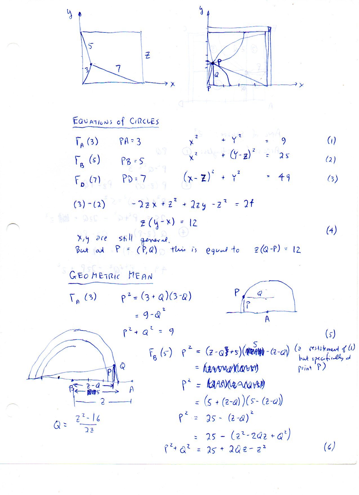
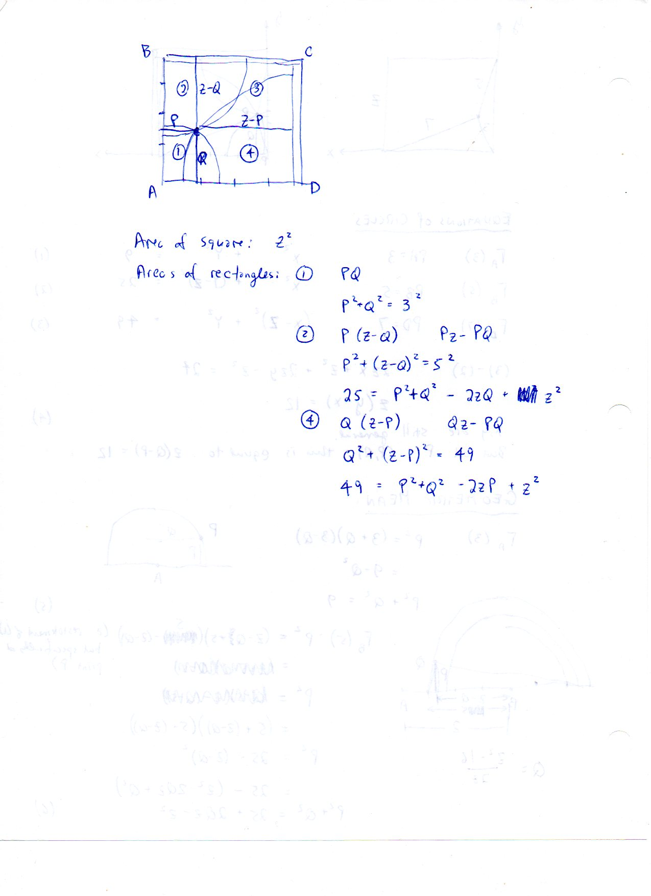
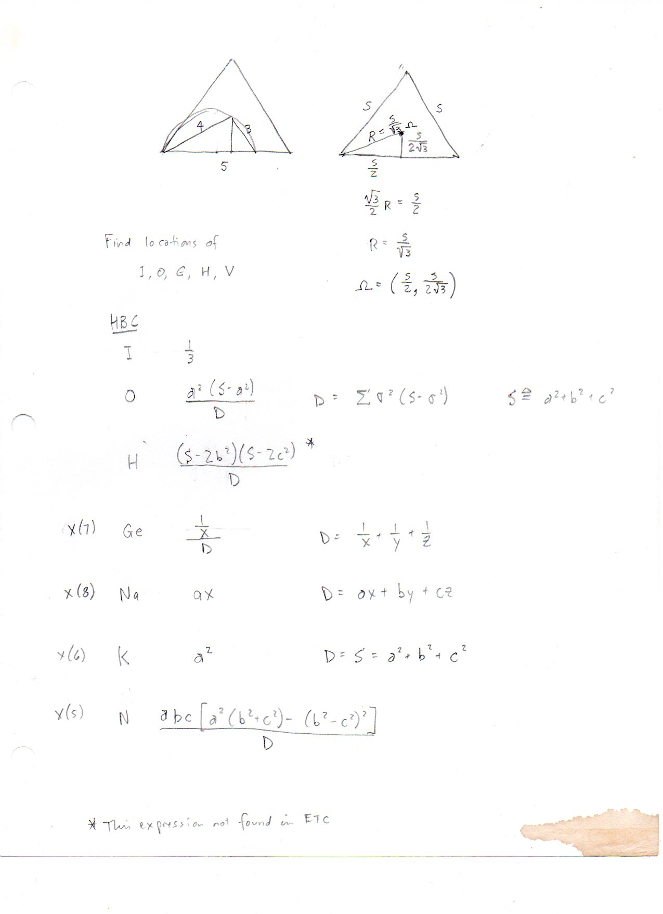
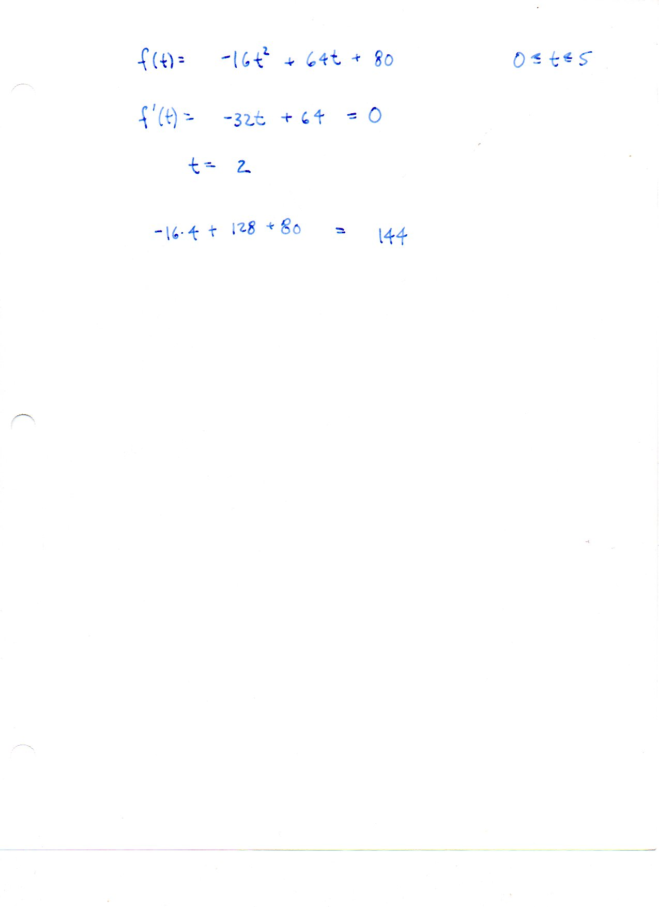

========================================
F.10 Circles and Geometric Mean — Folios
========================================

Archival manuscript scans and diplomatic transcriptions from :person:`seelig`'s
notebooks for **F.10 (Circles and Geometric Mean)** (:cite:`SeeligNotebooks`).

Folio 0062 (Page 1 of 4): Equations of Circles & Geometric Mean
---------------------------------------------------------------

.. folio:: 0062

   Folio ``0062`` (original scan ``0062.jpg``) from ``resources/seelig/10_circles-and-geometric-mean``.

**Diplomatic Mathematical & Geometric Transcription**

**Diplomatic Transcription — Folio 0062** (``0062.jpg``, Sheet 1 of 4):

Expresses :math:`P^2 = (3+Q)(3-Q)` and :math:`P^2 = (5+(Z-Q))(5-(Z-Q))` as semicircle geometric means and derives :math:`Z(Q-P) = 12` and :math:`Q = \frac{Z^2-16}{2Z}`.

.. math::

   G = |CH| = \sqrt{m n}, \qquad A_{\text{mean}} = |OC| = \frac{m + n}{2}, \qquad H_{\text{mean}} = |CK| = \frac{2 m n}{m + n}

.. admonition:: Editorial & Symbolic Notes

   Archival scan ``0062.jpg`` from Fred W. Seelig's notebook dossier on **F.10 Circles and Geometric Mean** (Page 1 of 4). Companion OpenDocument worksheet(s): ``General Reference``, ``Harmonic Conjugates``. Classical Euclidean foundations: :ref:`II.14`, :ref:`III.31`, :ref:`VI.8`, :ref:`VI.13`. Kimberling *Encyclopedia of Triangle Centers* loci: :ref:`X(1)`, :ref:`X(3)`, :ref:`X(4)`, :ref:`X(5)`, :ref:`X(6)`, :ref:`X(7)`, :ref:`X(8)`.

Folio 0063 (Page 2 of 4): Area Partition of Square ABCD into Four Rectangles
----------------------------------------------------------------------------

.. folio:: 0063

   Folio ``0063`` (original scan ``0063.jpg``) from ``resources/seelig/10_circles-and-geometric-mean``.

**Diplomatic Mathematical & Geometric Transcription**

**Diplomatic Transcription — Folio 0063** (``0063.jpg``, Sheet 2 of 4):

Partitions the square of area :math:`Z^2` around :math:`P(P, Q)` into four rectangles ①–④ and relates their dimensions to the circle equations.

.. math::

   G = |CH| = \sqrt{m n}, \qquad A_{\text{mean}} = |OC| = \frac{m + n}{2}, \qquad H_{\text{mean}} = |CK| = \frac{2 m n}{m + n}

.. admonition:: Editorial & Symbolic Notes

   Archival scan ``0063.jpg`` from Fred W. Seelig's notebook dossier on **F.10 Circles and Geometric Mean** (Page 2 of 4). Companion OpenDocument worksheet(s): ``General Reference``, ``Harmonic Conjugates``. Classical Euclidean foundations: :ref:`II.14`, :ref:`III.31`, :ref:`VI.8`, :ref:`VI.13`. Kimberling *Encyclopedia of Triangle Centers* loci: :ref:`X(1)`, :ref:`X(3)`, :ref:`X(4)`, :ref:`X(5)`, :ref:`X(6)`, :ref:`X(7)`, :ref:`X(8)`.

Folio 0064 (Page 3 of 4): Homogeneous Barycentric Coordinates Table for I, O, H, Ge, Na, K, N
---------------------------------------------------------------------------------------------

.. folio:: 0064

   Folio ``0064`` (original scan ``0064.jpg``) from ``resources/seelig/10_circles-and-geometric-mean``.

**Diplomatic Mathematical & Geometric Transcription**

**Diplomatic Transcription — Folio 0064** (``0064.jpg``, Sheet 3 of 4):

Lists normalized HBC formulas in terms of :math:`S = a^2+b^2+c^2` and :math:`x, y, z`, noting `* This expression not found in ETC` for :math:`H = (S-2b^2)(S-2c^2)/D`.

.. math::

   G = |CH| = \sqrt{m n}, \qquad A_{\text{mean}} = |OC| = \frac{m + n}{2}, \qquad H_{\text{mean}} = |CK| = \frac{2 m n}{m + n}

.. admonition:: Editorial & Symbolic Notes

   Archival scan ``0064.jpg`` from Fred W. Seelig's notebook dossier on **F.10 Circles and Geometric Mean** (Page 3 of 4). Companion OpenDocument worksheet(s): ``General Reference``, ``Harmonic Conjugates``. Classical Euclidean foundations: :ref:`II.14`, :ref:`III.31`, :ref:`VI.8`, :ref:`VI.13`. Kimberling *Encyclopedia of Triangle Centers* loci: :ref:`X(1)`, :ref:`X(3)`, :ref:`X(4)`, :ref:`X(5)`, :ref:`X(6)`, :ref:`X(7)`, :ref:`X(8)`.

Folio 0065 (Page 4 of 4): Quadratic Maximization Exercise
---------------------------------------------------------

.. folio:: 0065

   Folio ``0065`` (original scan ``0065.jpg``) from ``resources/seelig/10_circles-and-geometric-mean``.

**Diplomatic Mathematical & Geometric Transcription**

**Diplomatic Transcription — Folio 0065** (``0065.jpg``, Sheet 4 of 4):

Differentiates :math:`f(t) = -16t^2 + 64t + 80` to find its maximum :math:`f(2) = 144`.

.. math::

   G = |CH| = \sqrt{m n}, \qquad A_{\text{mean}} = |OC| = \frac{m + n}{2}, \qquad H_{\text{mean}} = |CK| = \frac{2 m n}{m + n}

.. admonition:: Editorial & Symbolic Notes

   Archival scan ``0065.jpg`` from Fred W. Seelig's notebook dossier on **F.10 Circles and Geometric Mean** (Page 4 of 4). Companion OpenDocument worksheet(s): ``General Reference``, ``Harmonic Conjugates``. Classical Euclidean foundations: :ref:`II.14`, :ref:`III.31`, :ref:`VI.8`, :ref:`VI.13`. Kimberling *Encyclopedia of Triangle Centers* loci: :ref:`X(1)`, :ref:`X(3)`, :ref:`X(4)`, :ref:`X(5)`, :ref:`X(6)`, :ref:`X(7)`, :ref:`X(8)`.
