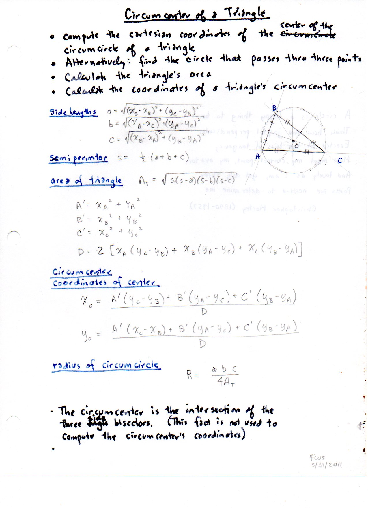
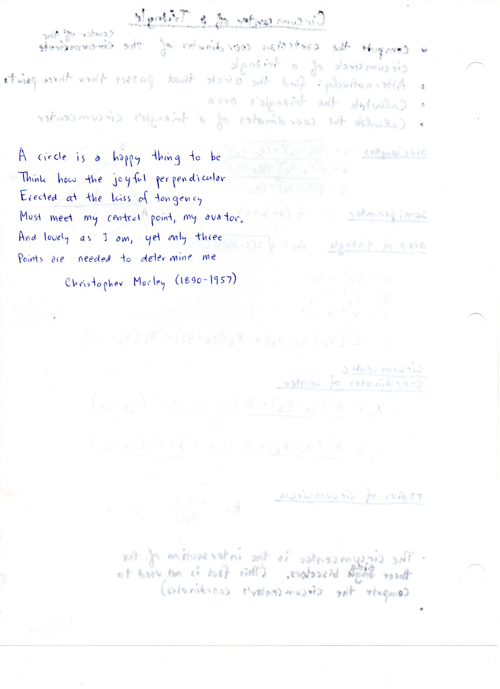
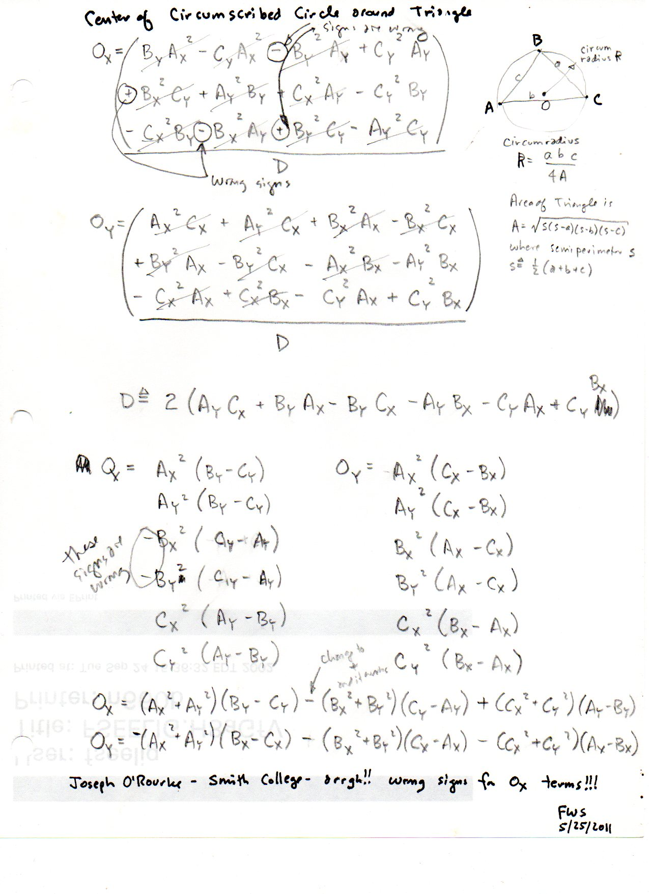
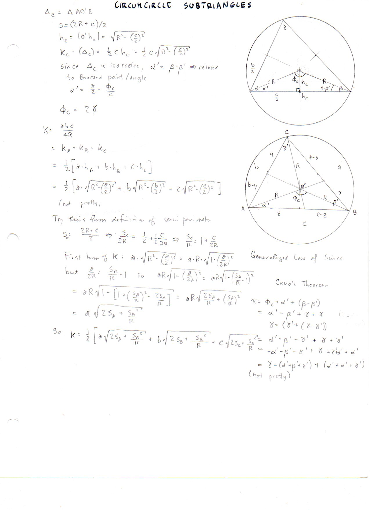
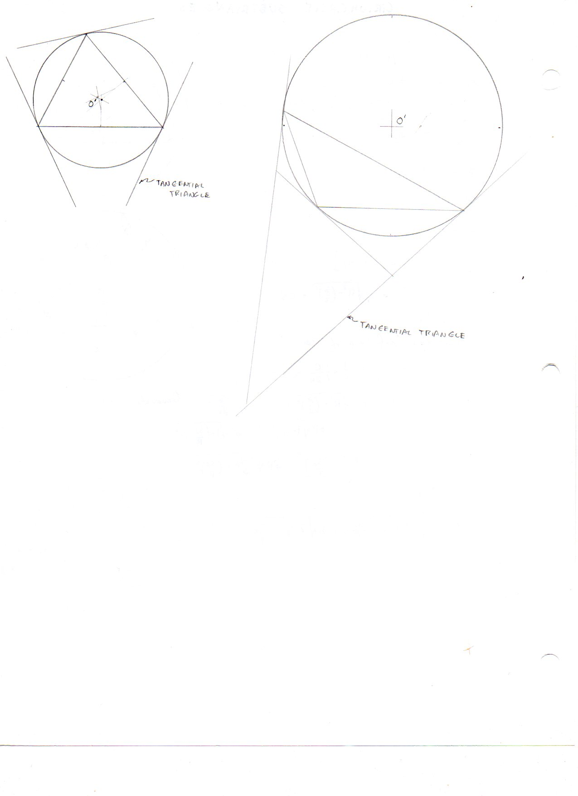
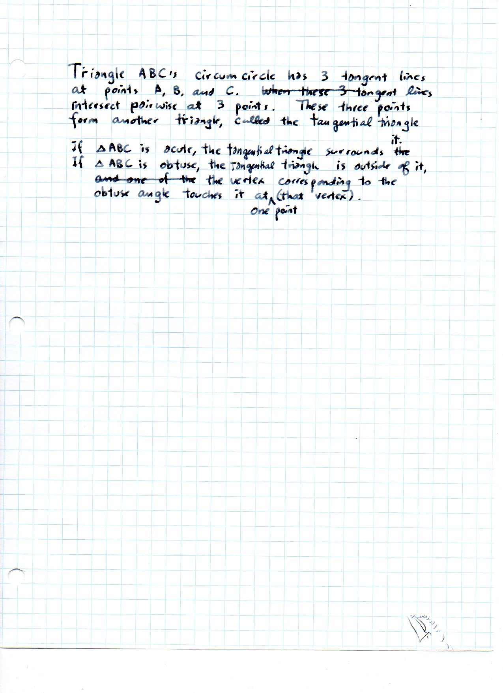

==========================
F.11 Circumcenter — Folios
==========================

Archival manuscript scans and diplomatic transcriptions from :person:`seelig`'s
notebooks for **F.11 (Circumcenter)** (:cite:`SeeligNotebooks`).

Folio 0066 (Page 1 of 6): Circumcenter of a Triangle (FWS 5/31/2011)
--------------------------------------------------------------------

.. folio:: 0066

   Folio ``0066`` (original scan ``0066.jpg``) from ``resources/seelig/11_circumcenter``.

**Diplomatic Mathematical & Geometric Transcription**

**Diplomatic Transcription — Folio 0066** (``0066.jpg``, Sheet 1 of 6):

Summary sheet with circumcircle diagram and Cartesian formulas for :math:`a, b, c, s, A_T, R = abc/(4A_T)`, and :math:`(x_0, y_0)`.

.. math::

   R = \frac{a b c}{4 K}, \qquad O = \left(a^2 S_A : b^2 S_B : c^2 S_C\right) = \left(\sin 2\alpha : \sin 2\beta : \sin 2\gamma\right)

.. admonition:: Editorial & Symbolic Notes

   Archival scan ``0066.jpg`` from Fred W. Seelig's notebook dossier on **F.11 Circumcenter** (Page 1 of 6). Companion OpenDocument worksheet(s): ``Circumcircle-Circumcenter``, ``Circumcircle Solver``, ``General Reference``. Classical Euclidean foundations: :ref:`III.1`, :ref:`IV.5`. Kimberling *Encyclopedia of Triangle Centers* loci: :ref:`X(3)`, :ref:`X(26)`.

Folio 0067 (Page 2 of 6): Poem by Christopher Morley (1890–1957)
----------------------------------------------------------------

.. folio:: 0067

   Folio ``0067`` (original scan ``0067.jpg``) from ``resources/seelig/11_circumcenter``.

**Diplomatic Mathematical & Geometric Transcription**

**Diplomatic Transcription — Folio 0067** (``0067.jpg``, Sheet 2 of 6):

Handwritten transcription of Morley's 6-line geometric poem *'A circle is a happy thing to be'*.

.. math::

   D = 2\left[x_A(y_C - y_B) + x_B(y_A - y_C) + x_C(y_B - y_A)\right], \qquad x_0 = \frac{\sum (x_A^2 + y_A^2)(y_C - y_B)}{D}

.. admonition:: Editorial & Symbolic Notes

   Archival scan ``0067.jpg`` from Fred W. Seelig's notebook dossier on **F.11 Circumcenter** (Page 2 of 6). Companion OpenDocument worksheet(s): ``Circumcircle-Circumcenter``, ``Circumcircle Solver``, ``General Reference``. Classical Euclidean foundations: :ref:`III.1`, :ref:`IV.5`. Kimberling *Encyclopedia of Triangle Centers* loci: :ref:`X(3)`, :ref:`X(26)`.

Folio 0068 (Page 3 of 6): Sign Correction of O'Rourke's Formula (FWS 5/25/2011)
-------------------------------------------------------------------------------

.. folio:: 0068

   Folio ``0068`` (original scan ``0068.jpg``) from ``resources/seelig/11_circumcenter``.

**Diplomatic Mathematical & Geometric Transcription**

**Diplomatic Transcription — Folio 0068** (``0068.jpg``, Sheet 3 of 6):

Derives :math:`(O_x, O_y)` from perpendicular bisector intersections and corrects the sign error in Joseph O'Rourke's formula.

.. math::

   R = \frac{a b c}{4 K}, \qquad O = \left(a^2 S_A : b^2 S_B : c^2 S_C\right) = \left(\sin 2\alpha : \sin 2\beta : \sin 2\gamma\right)

.. admonition:: Editorial & Symbolic Notes

   Archival scan ``0068.jpg`` from Fred W. Seelig's notebook dossier on **F.11 Circumcenter** (Page 3 of 6). Companion OpenDocument worksheet(s): ``Circumcircle-Circumcenter``, ``Circumcircle Solver``, ``General Reference``. Classical Euclidean foundations: :ref:`III.1`, :ref:`IV.5`. Kimberling *Encyclopedia of Triangle Centers* loci: :ref:`X(3)`, :ref:`X(26)`.

Folio 0069 (Page 4 of 6): Circumcircle Subtriangles
---------------------------------------------------

.. folio:: 0069

   Folio ``0069`` (original scan ``0069.jpg``) from ``resources/seelig/11_circumcenter``.

**Diplomatic Mathematical & Geometric Transcription**

**Diplomatic Transcription — Folio 0069** (``0069.jpg``, Sheet 4 of 6):

Decomposes :math:`K = K_A + K_B + K_C = \frac{1}{2}\sum a\sqrt{R^2 - (a/2)^2}` using central angles :math:`\Phi_C = 2\gamma` and subtriangle semiperimeters :math:`s_C = (2R+c)/2`.

.. math::

   D = 2\left[x_A(y_C - y_B) + x_B(y_A - y_C) + x_C(y_B - y_A)\right], \qquad x_0 = \frac{\sum (x_A^2 + y_A^2)(y_C - y_B)}{D}

.. admonition:: Editorial & Symbolic Notes

   Archival scan ``0069.jpg`` from Fred W. Seelig's notebook dossier on **F.11 Circumcenter** (Page 4 of 6). Companion OpenDocument worksheet(s): ``Circumcircle-Circumcenter``, ``Circumcircle Solver``, ``General Reference``. Classical Euclidean foundations: :ref:`III.1`, :ref:`IV.5`. Kimberling *Encyclopedia of Triangle Centers* loci: :ref:`X(3)`, :ref:`X(26)`.

Folio 0070 (Page 5 of 6): Tangential Triangle Drawings (Acute vs. Obtuse)
-------------------------------------------------------------------------

.. folio:: 0070

   Folio ``0070`` (original scan ``0070.jpg``) from ``resources/seelig/11_circumcenter``.

**Diplomatic Mathematical & Geometric Transcription**

**Diplomatic Transcription — Folio 0070** (``0070.jpg``, Sheet 5 of 6):

Side-by-side compass-and-straightedge constructions of the tangential triangle for an acute triangle and an obtuse triangle.

.. math::

   R = \frac{a b c}{4 K}, \qquad O = \left(a^2 S_A : b^2 S_B : c^2 S_C\right) = \left(\sin 2\alpha : \sin 2\beta : \sin 2\gamma\right)

.. admonition:: Editorial & Symbolic Notes

   Archival scan ``0070.jpg`` from Fred W. Seelig's notebook dossier on **F.11 Circumcenter** (Page 5 of 6). Companion OpenDocument worksheet(s): ``Circumcircle-Circumcenter``, ``Circumcircle Solver``, ``General Reference``. Classical Euclidean foundations: :ref:`III.1`, :ref:`IV.5`. Kimberling *Encyclopedia of Triangle Centers* loci: :ref:`X(3)`, :ref:`X(26)`.

Folio 0071 (Page 6 of 6): Properties of the Tangential Triangle
---------------------------------------------------------------

.. folio:: 0071

   Folio ``0071`` (original scan ``0071.jpg``) from ``resources/seelig/11_circumcenter``.

**Diplomatic Mathematical & Geometric Transcription**

**Diplomatic Transcription — Folio 0071** (``0071.jpg``, Sheet 6 of 6):

Explanatory notes defining the tangential triangle formed by the tangents to the circumcircle at :math:`A, B, C`.

.. math::

   D = 2\left[x_A(y_C - y_B) + x_B(y_A - y_C) + x_C(y_B - y_A)\right], \qquad x_0 = \frac{\sum (x_A^2 + y_A^2)(y_C - y_B)}{D}

.. admonition:: Editorial & Symbolic Notes

   Archival scan ``0071.jpg`` from Fred W. Seelig's notebook dossier on **F.11 Circumcenter** (Page 6 of 6). Companion OpenDocument worksheet(s): ``Circumcircle-Circumcenter``, ``Circumcircle Solver``, ``General Reference``. Classical Euclidean foundations: :ref:`III.1`, :ref:`IV.5`. Kimberling *Encyclopedia of Triangle Centers* loci: :ref:`X(3)`, :ref:`X(26)`.
