=============================
F.12 Coaxial Circles — Folios
=============================

Archival manuscript scans and diplomatic transcriptions from :person:`seelig`'s
notebooks for **F.12 (Coaxial Circles)** (:cite:`SeeligNotebooks`).

Folio 0072 (Page 1 of 12): Coaxal Circles & Electromagnetics Introduction
-------------------------------------------------------------------------

.. folio:: 0072

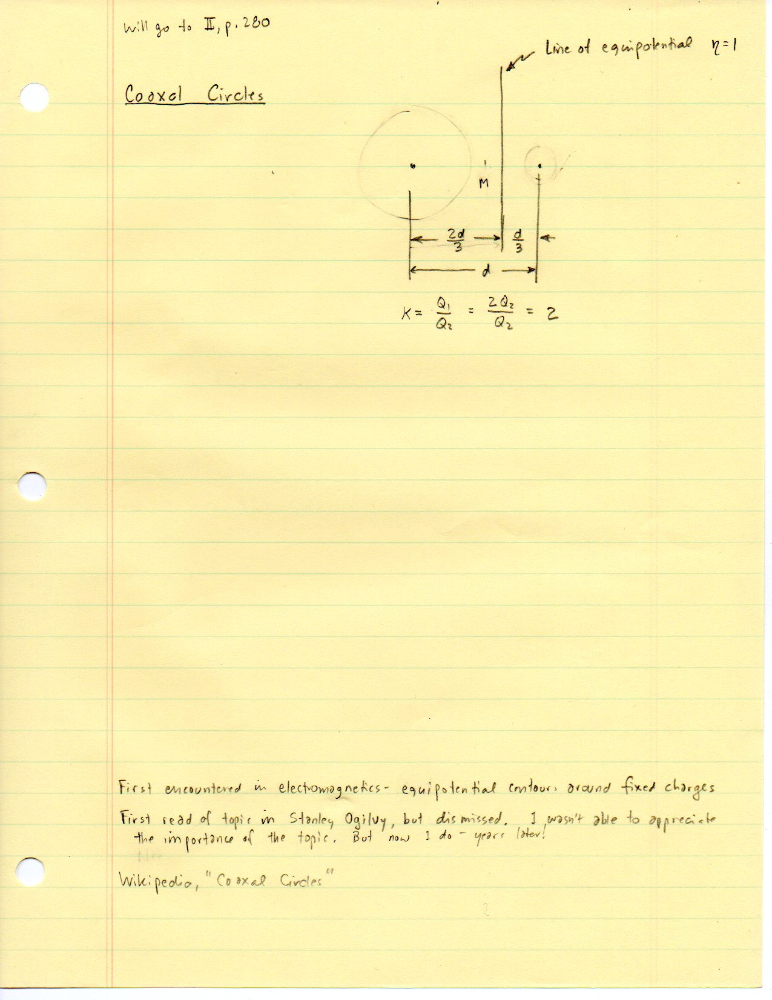

   Folio ``0072`` (original scan ``0072.jpg``) from ``resources/seelig/12_coaxial-circles``.

**Diplomatic Mathematical & Geometric Transcription**

**Diplomatic Transcription — Folio 0072** (``0072.jpg``, Sheet 1 of 12):

Introduces coaxal circles via equipotentials around two charges (:math:`K = Q_1/Q_2 = 2`), citing Stanley Ogilvy and Wikipedia, with radical axis :math:`\eta = 1`.

.. math::

   P_1 = \left(\frac{k - 1}{k + 1}r,\, 0\right), \qquad P_2 = \left(\frac{k + 1}{k - 1}r,\, 0\right), \qquad M' = \frac{k^2 + 1}{k^2 - 1}r, \qquad R = \frac{2 k}{k^2 - 1}r

.. admonition:: Editorial & Symbolic Notes

   Archival scan ``0072.jpg`` from Fred W. Seelig's notebook dossier on **F.12 Coaxial Circles** (Page 1 of 12). Companion OpenDocument worksheet(s): ``Coaxial Circles``, ``Coaxal Circle Table``, ``Apollonian Circles``, ``Radical Axes``. Classical Euclidean foundations: :ref:`III.35`, :ref:`III.36`.

Folio 0073 (Page 2 of 12): Template Table for K = 2
---------------------------------------------------

.. folio:: 0073

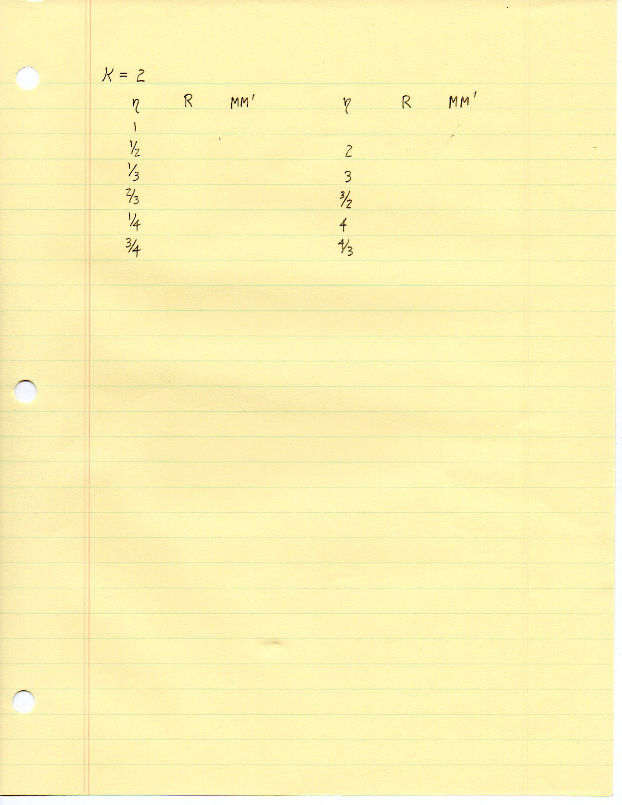

   Folio ``0073`` (original scan ``0073.jpg``) from ``resources/seelig/12_coaxial-circles``.

**Diplomatic Mathematical & Geometric Transcription**

**Diplomatic Transcription — Folio 0073** (``0073.jpg``, Sheet 2 of 12):

Sets up table columns :math:`\eta, R, MM'` for :math:`\eta \in \{1, 1/2, 1/3, 2/3, 1/4, 3/4\}` and their reciprocals.

.. math::

   x^2 + y^2 - 2 c_x x + r^2 = 0, \qquad E_{\text{TOT}} = k Q_1 \frac{x - x_1}{|x - x_1|^3} + k Q_2 \frac{x - x_2}{|x - x_2|^3} = 0

.. admonition:: Editorial & Symbolic Notes

   Archival scan ``0073.jpg`` from Fred W. Seelig's notebook dossier on **F.12 Coaxial Circles** (Page 2 of 12). Companion OpenDocument worksheet(s): ``Coaxial Circles``, ``Coaxal Circle Table``, ``Apollonian Circles``, ``Radical Axes``. Classical Euclidean foundations: :ref:`III.35`, :ref:`III.36`.

Folio 0074 (Page 3 of 12): Plan of Attack (Friday April 24, 2015)
-----------------------------------------------------------------

.. folio:: 0074

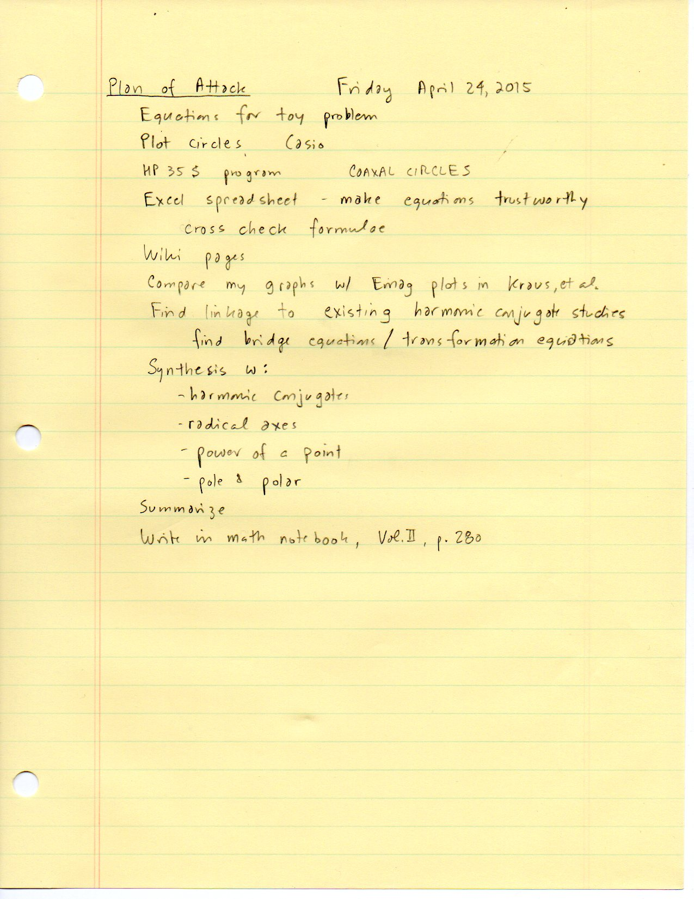

   Folio ``0074`` (original scan ``0074.jpg``) from ``resources/seelig/12_coaxial-circles``.

**Diplomatic Mathematical & Geometric Transcription**

**Diplomatic Transcription — Folio 0074** (``0074.jpg``, Sheet 3 of 12):

Outlines the HP-35s `COAXAL CIRCLES` program, Excel verification, Kraus EMag comparison, and synthesis with harmonic conjugates, radical axes, and pole-polar duality (for Vol. II, p. 280).

.. math::

   P_1 = \left(\frac{k - 1}{k + 1}r,\, 0\right), \qquad P_2 = \left(\frac{k + 1}{k - 1}r,\, 0\right), \qquad M' = \frac{k^2 + 1}{k^2 - 1}r, \qquad R = \frac{2 k}{k^2 - 1}r

.. admonition:: Editorial & Symbolic Notes

   Archival scan ``0074.jpg`` from Fred W. Seelig's notebook dossier on **F.12 Coaxial Circles** (Page 3 of 12). Companion OpenDocument worksheet(s): ``Coaxial Circles``, ``Coaxal Circle Table``, ``Apollonian Circles``, ``Radical Axes``. Classical Euclidean foundations: :ref:`III.35`, :ref:`III.36`.

Folio 0075 (Page 4 of 12): Numerical Table for k = 1/2, 1/3, 1/4
----------------------------------------------------------------

.. folio:: 0075

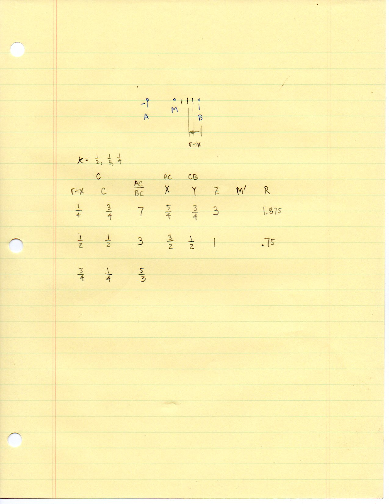

   Folio ``0075`` (original scan ``0075.jpg``) from ``resources/seelig/12_coaxial-circles``.

**Diplomatic Mathematical & Geometric Transcription**

**Diplomatic Transcription — Folio 0075** (``0075.jpg``, Sheet 4 of 12):

Computes :math:`r-x, C, AC/BC, X, Y, Z, M'`, and :math:`R` on segment :math:`AB`.

.. math::

   x^2 + y^2 - 2 c_x x + r^2 = 0, \qquad E_{\text{TOT}} = k Q_1 \frac{x - x_1}{|x - x_1|^3} + k Q_2 \frac{x - x_2}{|x - x_2|^3} = 0

.. admonition:: Editorial & Symbolic Notes

   Archival scan ``0075.jpg`` from Fred W. Seelig's notebook dossier on **F.12 Coaxial Circles** (Page 4 of 12). Companion OpenDocument worksheet(s): ``Coaxial Circles``, ``Coaxal Circle Table``, ``Apollonian Circles``, ``Radical Axes``. Classical Euclidean foundations: :ref:`III.35`, :ref:`III.36`.

Folio 0076 (Page 5 of 12): Six Landmark Points P_1..P_6 on the Equipotential Circle
-----------------------------------------------------------------------------------

.. folio:: 0076

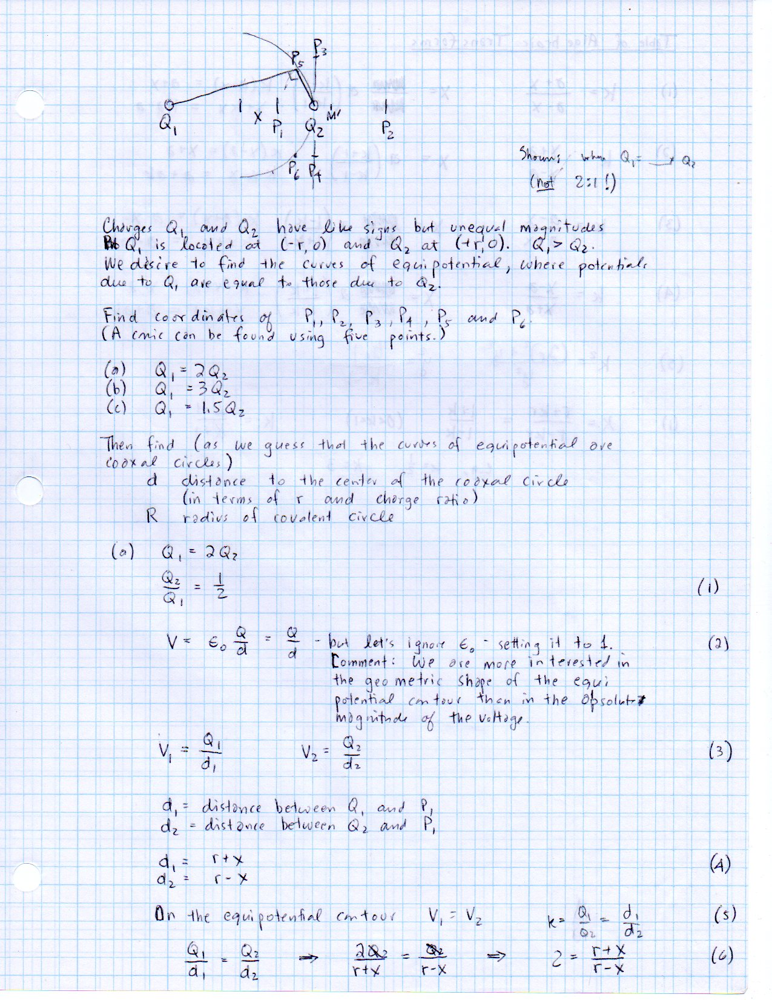

   Folio ``0076`` (original scan ``0076.jpg``) from ``resources/seelig/12_coaxial-circles``.

**Diplomatic Mathematical & Geometric Transcription**

**Diplomatic Transcription — Folio 0076** (``0076.jpg``, Sheet 5 of 12):

Defines :math:`P_1..P_6` around charges :math:`Q_1(-r,0)` and :math:`Q_2(+r,0)` on blue grid paper.

.. math::

   P_1 = \left(\frac{k - 1}{k + 1}r,\, 0\right), \qquad P_2 = \left(\frac{k + 1}{k - 1}r,\, 0\right), \qquad M' = \frac{k^2 + 1}{k^2 - 1}r, \qquad R = \frac{2 k}{k^2 - 1}r

.. admonition:: Editorial & Symbolic Notes

   Archival scan ``0076.jpg`` from Fred W. Seelig's notebook dossier on **F.12 Coaxial Circles** (Page 5 of 12). Companion OpenDocument worksheet(s): ``Coaxial Circles``, ``Coaxal Circle Table``, ``Apollonian Circles``, ``Radical Axes``. Classical Euclidean foundations: :ref:`III.35`, :ref:`III.36`.

Folio 0077 (Page 6 of 12): Table of Algebraic Transforms (1)–(5)
----------------------------------------------------------------

.. folio:: 0077

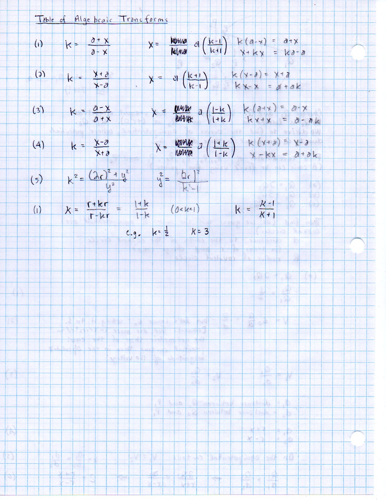

   Folio ``0077`` (original scan ``0077.jpg``) from ``resources/seelig/12_coaxial-circles``.

**Diplomatic Mathematical & Geometric Transcription**

**Diplomatic Transcription — Folio 0077** (``0077.jpg``, Sheet 6 of 12):

Catalogs the five fractional linear transforms relating :math:`k, a, x` and :math:`y^2 = (2r)^2/(k^2-1)`.

.. math::

   x^2 + y^2 - 2 c_x x + r^2 = 0, \qquad E_{\text{TOT}} = k Q_1 \frac{x - x_1}{|x - x_1|^3} + k Q_2 \frac{x - x_2}{|x - x_2|^3} = 0

.. admonition:: Editorial & Symbolic Notes

   Archival scan ``0077.jpg`` from Fred W. Seelig's notebook dossier on **F.12 Coaxial Circles** (Page 6 of 12). Companion OpenDocument worksheet(s): ``Coaxial Circles``, ``Coaxal Circle Table``, ``Apollonian Circles``, ``Radical Axes``. Classical Euclidean foundations: :ref:`III.35`, :ref:`III.36`.

Folio 0078 (Page 7 of 12): Exact Coordinates for k = 2 (P_1, P_2, M', R, P_3, P_4)
----------------------------------------------------------------------------------

.. folio:: 0078

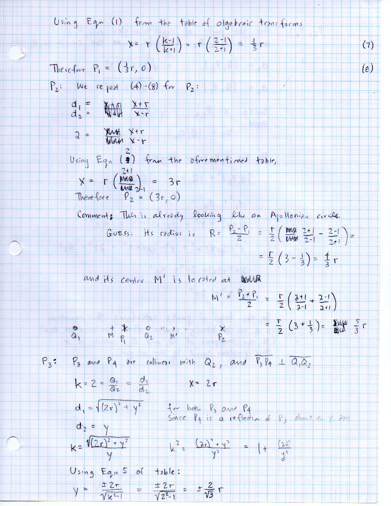

   Folio ``0078`` (original scan ``0078.jpg``) from ``resources/seelig/12_coaxial-circles``.

**Diplomatic Mathematical & Geometric Transcription**

**Diplomatic Transcription — Folio 0078** (``0078.jpg``, Sheet 7 of 12):

Derives :math:`P_1 = (\frac{1}{3}r, 0), P_2 = (3r, 0), R = \frac{4}{3}r, M' = \frac{5}{3}r`, and :math:`P_3, P_4 = (r, \pm \frac{2}{\sqrt{3}}r)`.

.. math::

   P_1 = \left(\frac{k - 1}{k + 1}r,\, 0\right), \qquad P_2 = \left(\frac{k + 1}{k - 1}r,\, 0\right), \qquad M' = \frac{k^2 + 1}{k^2 - 1}r, \qquad R = \frac{2 k}{k^2 - 1}r

.. admonition:: Editorial & Symbolic Notes

   Archival scan ``0078.jpg`` from Fred W. Seelig's notebook dossier on **F.12 Coaxial Circles** (Page 7 of 12). Companion OpenDocument worksheet(s): ``Coaxial Circles``, ``Coaxal Circle Table``, ``Apollonian Circles``, ``Radical Axes``. Classical Euclidean foundations: :ref:`III.35`, :ref:`III.36`.

Folio 0079 (Page 8 of 12): Right-Triangle Locus for P_5, P_6
------------------------------------------------------------

.. folio:: 0079

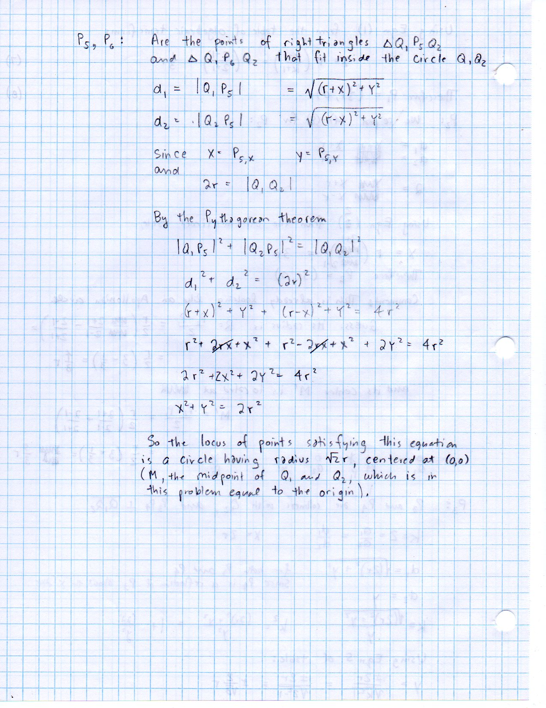

   Folio ``0079`` (original scan ``0079.jpg``) from ``resources/seelig/12_coaxial-circles``.

**Diplomatic Mathematical & Geometric Transcription**

**Diplomatic Transcription — Folio 0079** (``0079.jpg``, Sheet 8 of 12):

Proves that right triangles :math:`\triangle Q_1 P_5 Q_2` satisfy :math:`d_1^2 + d_2^2 = (2r)^2`, lying on the circle :math:`x^2 + y^2 = 2r^2` of radius :math:`\sqrt{2}r`.

.. math::

   x^2 + y^2 - 2 c_x x + r^2 = 0, \qquad E_{\text{TOT}} = k Q_1 \frac{x - x_1}{|x - x_1|^3} + k Q_2 \frac{x - x_2}{|x - x_2|^3} = 0

.. admonition:: Editorial & Symbolic Notes

   Archival scan ``0079.jpg`` from Fred W. Seelig's notebook dossier on **F.12 Coaxial Circles** (Page 8 of 12). Companion OpenDocument worksheet(s): ``Coaxial Circles``, ``Coaxal Circle Table``, ``Apollonian Circles``, ``Radical Axes``. Classical Euclidean foundations: :ref:`III.35`, :ref:`III.36`.

Folio 0080 (Page 9 of 12): 1D Collinear Electric Field Vector Formulation
-------------------------------------------------------------------------

.. folio:: 0080

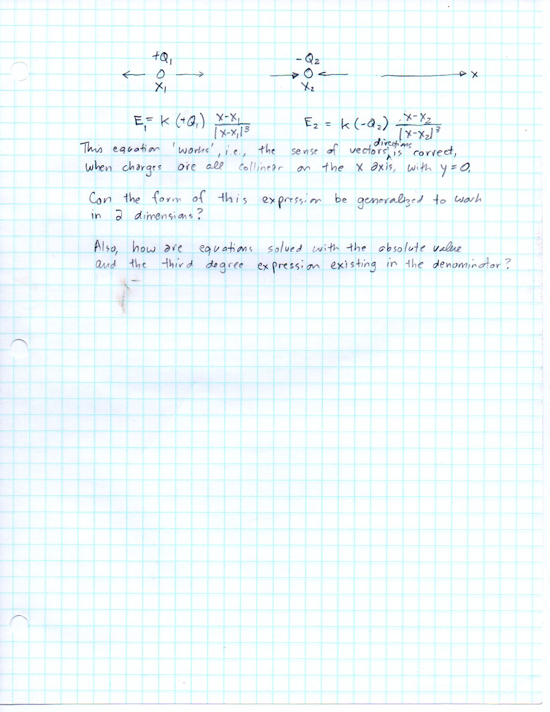

   Folio ``0080`` (original scan ``0080.jpg``) from ``resources/seelig/12_coaxial-circles``.

**Diplomatic Mathematical & Geometric Transcription**

**Diplomatic Transcription — Folio 0080** (``0080.jpg``, Sheet 9 of 12):

Writes :math:`E_i = k Q_i (x - x_i)/|x - x_i|^3` to preserve vector sign along the line of charges.

.. math::

   P_1 = \left(\frac{k - 1}{k + 1}r,\, 0\right), \qquad P_2 = \left(\frac{k + 1}{k - 1}r,\, 0\right), \qquad M' = \frac{k^2 + 1}{k^2 - 1}r, \qquad R = \frac{2 k}{k^2 - 1}r

.. admonition:: Editorial & Symbolic Notes

   Archival scan ``0080.jpg`` from Fred W. Seelig's notebook dossier on **F.12 Coaxial Circles** (Page 9 of 12). Companion OpenDocument worksheet(s): ``Coaxial Circles``, ``Coaxal Circle Table``, ``Apollonian Circles``, ``Radical Axes``. Classical Euclidean foundations: :ref:`III.35`, :ref:`III.36`.

Folio 0081 (Page 10 of 12): Zero-Field Point Between Like Charges
-----------------------------------------------------------------

.. folio:: 0081

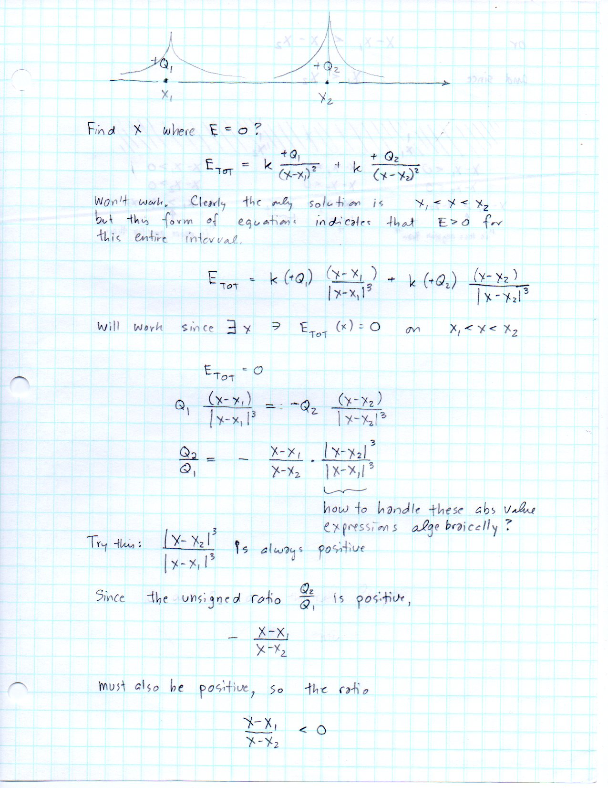

   Folio ``0081`` (original scan ``0081.jpg``) from ``resources/seelig/12_coaxial-circles``.

**Diplomatic Mathematical & Geometric Transcription**

**Diplomatic Transcription — Folio 0081** (``0081.jpg``, Sheet 10 of 12):

Sets :math:`E_{\text{TOT}} = 0` for :math:`+Q_1, +Q_2` and forms the cubic/absolute-value ratio.

.. math::

   x^2 + y^2 - 2 c_x x + r^2 = 0, \qquad E_{\text{TOT}} = k Q_1 \frac{x - x_1}{|x - x_1|^3} + k Q_2 \frac{x - x_2}{|x - x_2|^3} = 0

.. admonition:: Editorial & Symbolic Notes

   Archival scan ``0081.jpg`` from Fred W. Seelig's notebook dossier on **F.12 Coaxial Circles** (Page 10 of 12). Companion OpenDocument worksheet(s): ``Coaxial Circles``, ``Coaxal Circle Table``, ``Apollonian Circles``, ``Radical Axes``. Classical Euclidean foundations: :ref:`III.35`, :ref:`III.36`.

Folio 0082 (Page 11 of 12): Sign Interval Analysis for x_1 < x < x_2
--------------------------------------------------------------------

.. folio:: 0082

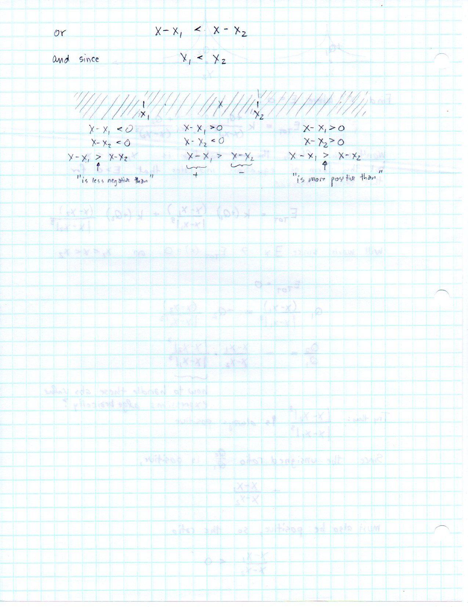

   Folio ``0082`` (original scan ``0082.jpg``) from ``resources/seelig/12_coaxial-circles``.

**Diplomatic Mathematical & Geometric Transcription**

**Diplomatic Transcription — Folio 0082** (``0082.jpg``, Sheet 11 of 12):

Tests sign cases of :math:`x - x_1` and :math:`x - x_2` across the three collinear intervals.

.. math::

   P_1 = \left(\frac{k - 1}{k + 1}r,\, 0\right), \qquad P_2 = \left(\frac{k + 1}{k - 1}r,\, 0\right), \qquad M' = \frac{k^2 + 1}{k^2 - 1}r, \qquad R = \frac{2 k}{k^2 - 1}r

.. admonition:: Editorial & Symbolic Notes

   Archival scan ``0082.jpg`` from Fred W. Seelig's notebook dossier on **F.12 Coaxial Circles** (Page 11 of 12). Companion OpenDocument worksheet(s): ``Coaxial Circles``, ``Coaxal Circle Table``, ``Apollonian Circles``, ``Radical Axes``. Classical Euclidean foundations: :ref:`III.35`, :ref:`III.36`.

Folio 0083 (Page 12 of 12): Alternative Coordinate Setup (-d/2, +d/2)
---------------------------------------------------------------------

.. folio:: 0083

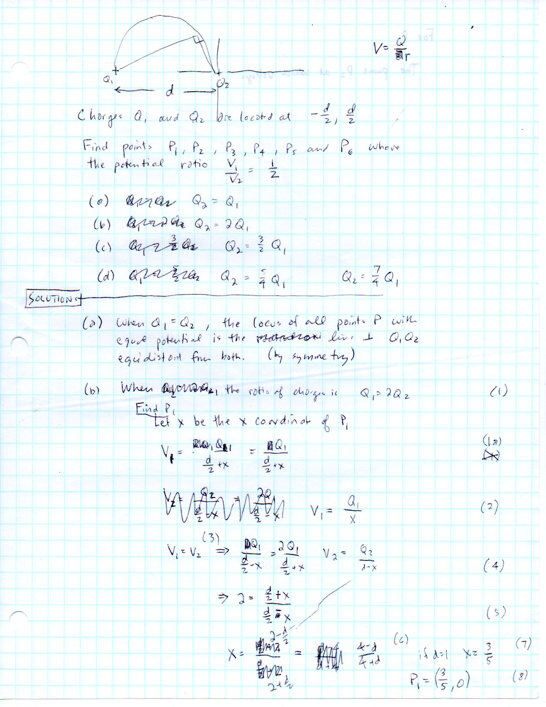

   Folio ``0083`` (original scan ``0083.jpg``) from ``resources/seelig/12_coaxial-circles``.

**Diplomatic Mathematical & Geometric Transcription**

**Diplomatic Transcription — Folio 0083** (``0083.jpg``, Sheet 12 of 12):

Solves for :math:`P_1` with charges at :math:`\pm d/2` and potential ratio :math:`V_1/V_2 = 1/2`.

.. math::

   x^2 + y^2 - 2 c_x x + r^2 = 0, \qquad E_{\text{TOT}} = k Q_1 \frac{x - x_1}{|x - x_1|^3} + k Q_2 \frac{x - x_2}{|x - x_2|^3} = 0

.. admonition:: Editorial & Symbolic Notes

   Archival scan ``0083.jpg`` from Fred W. Seelig's notebook dossier on **F.12 Coaxial Circles** (Page 12 of 12). Companion OpenDocument worksheet(s): ``Coaxial Circles``, ``Coaxal Circle Table``, ``Apollonian Circles``, ``Radical Axes``. Classical Euclidean foundations: :ref:`III.35`, :ref:`III.36`.
