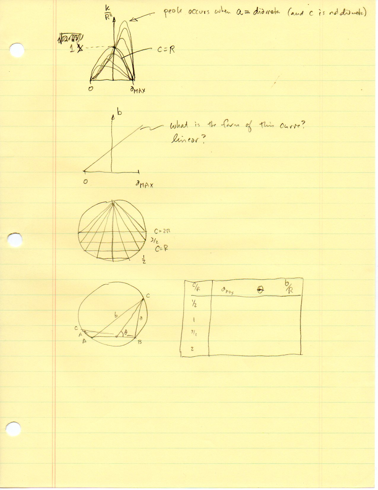
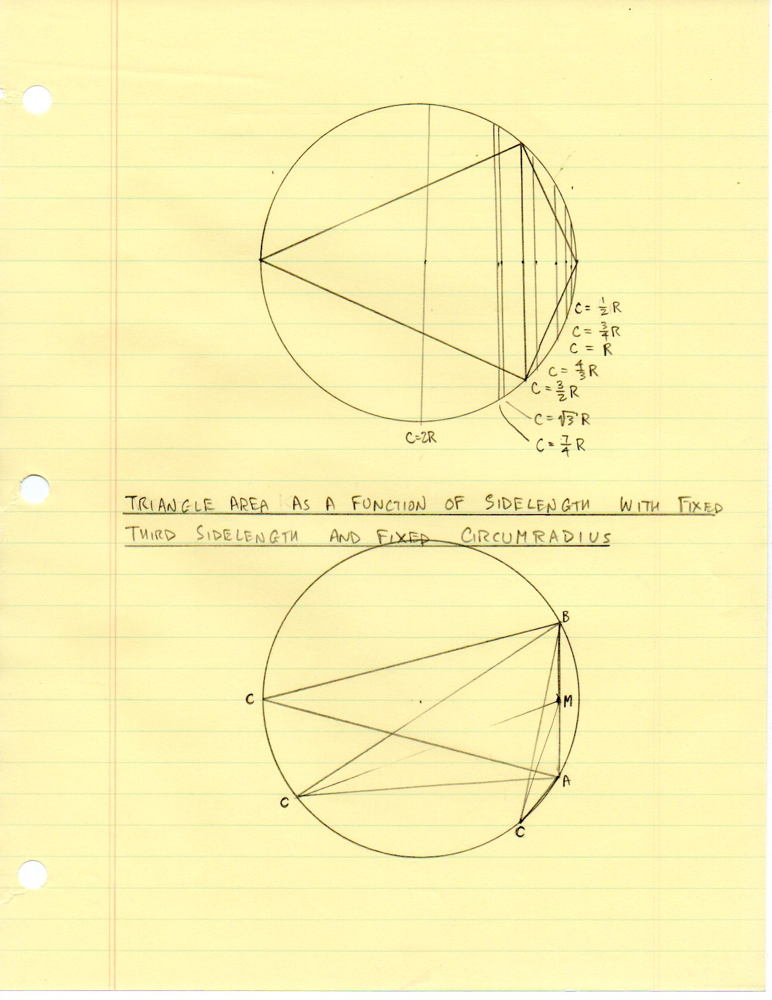
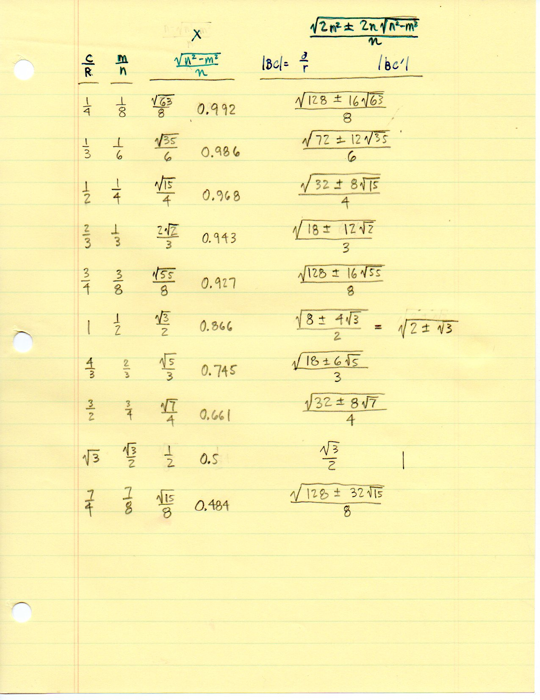
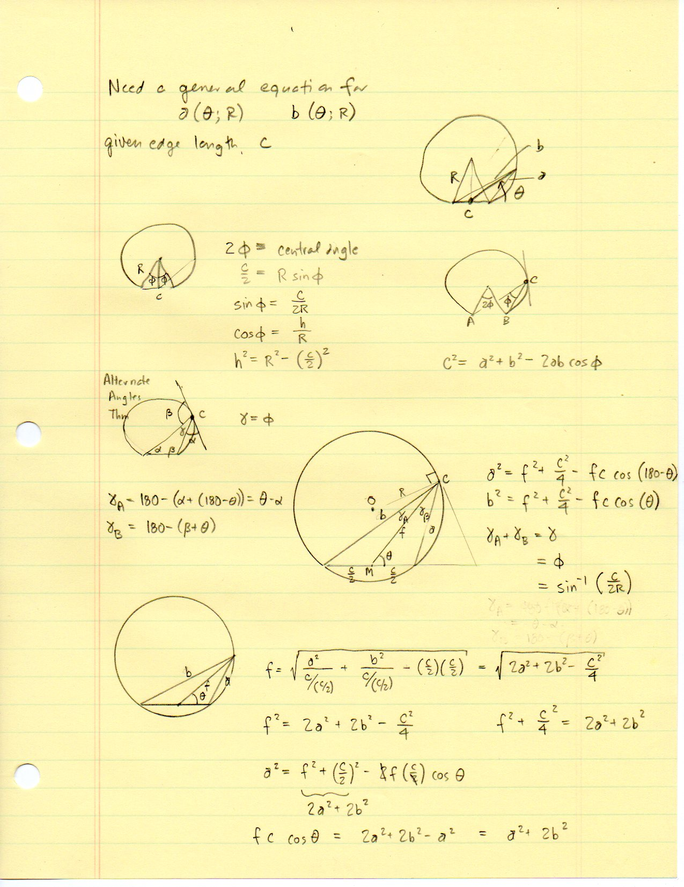
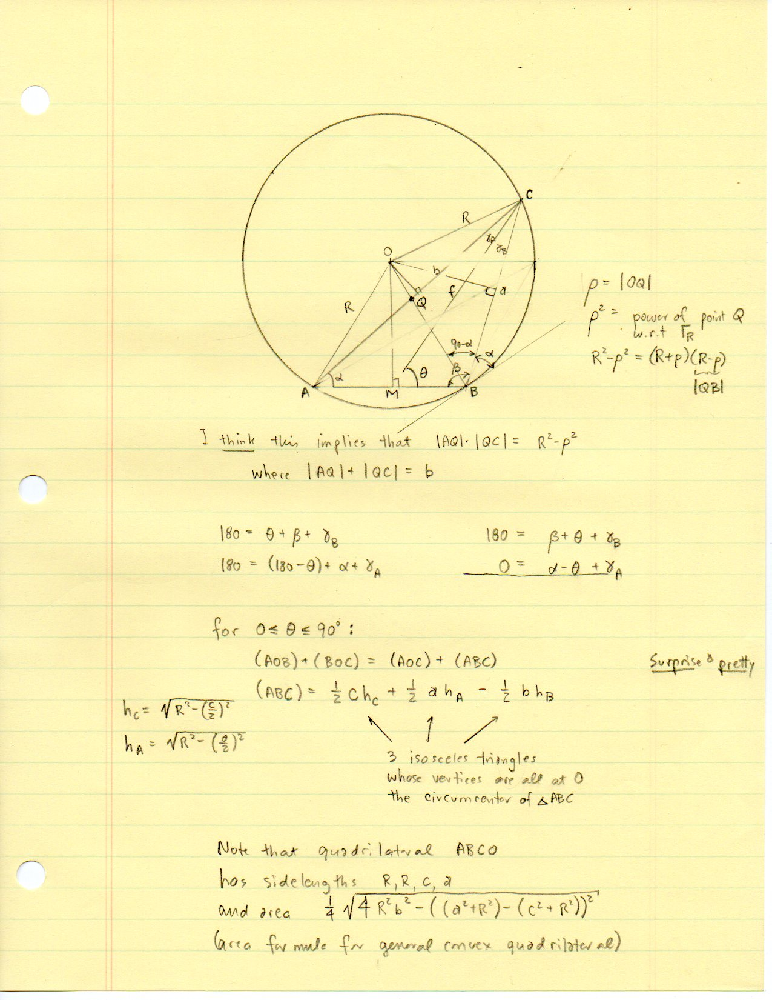
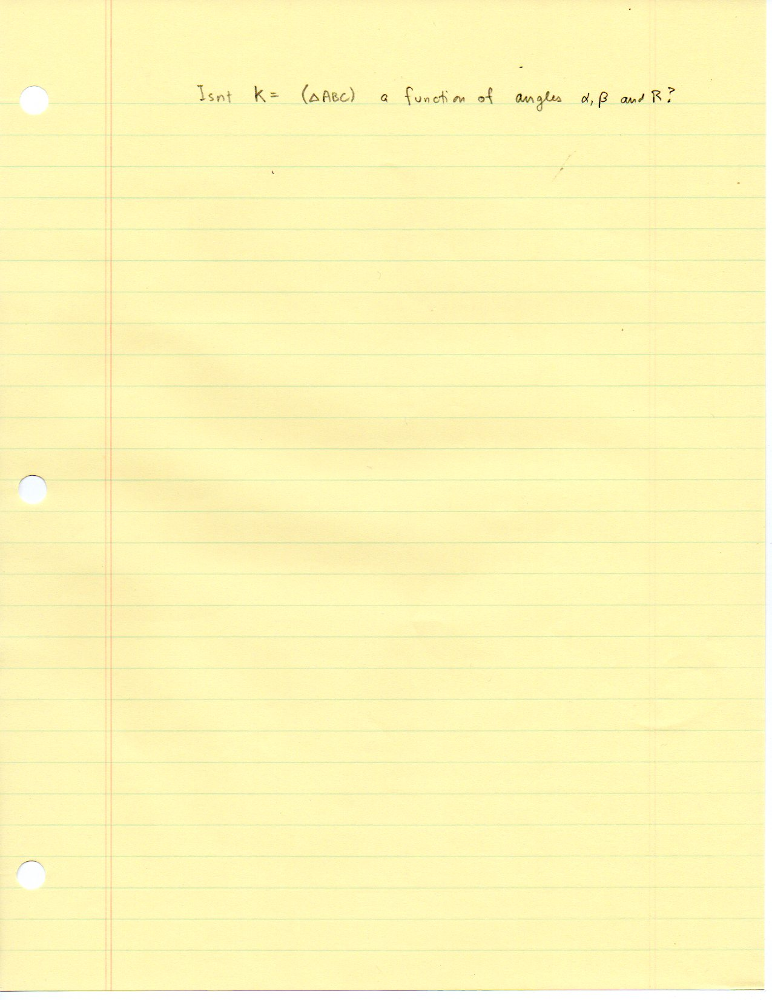
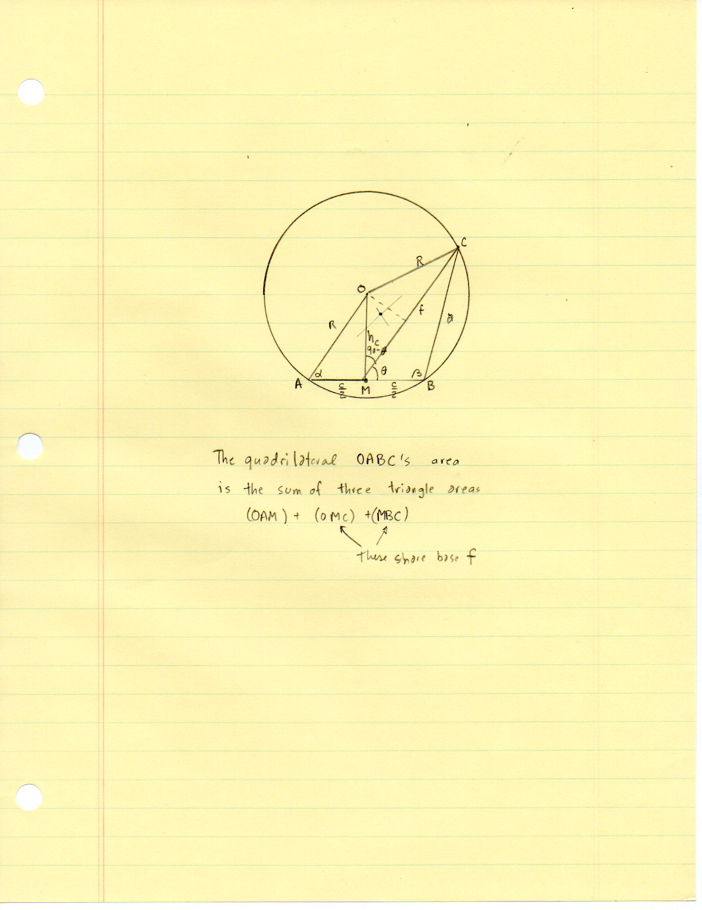
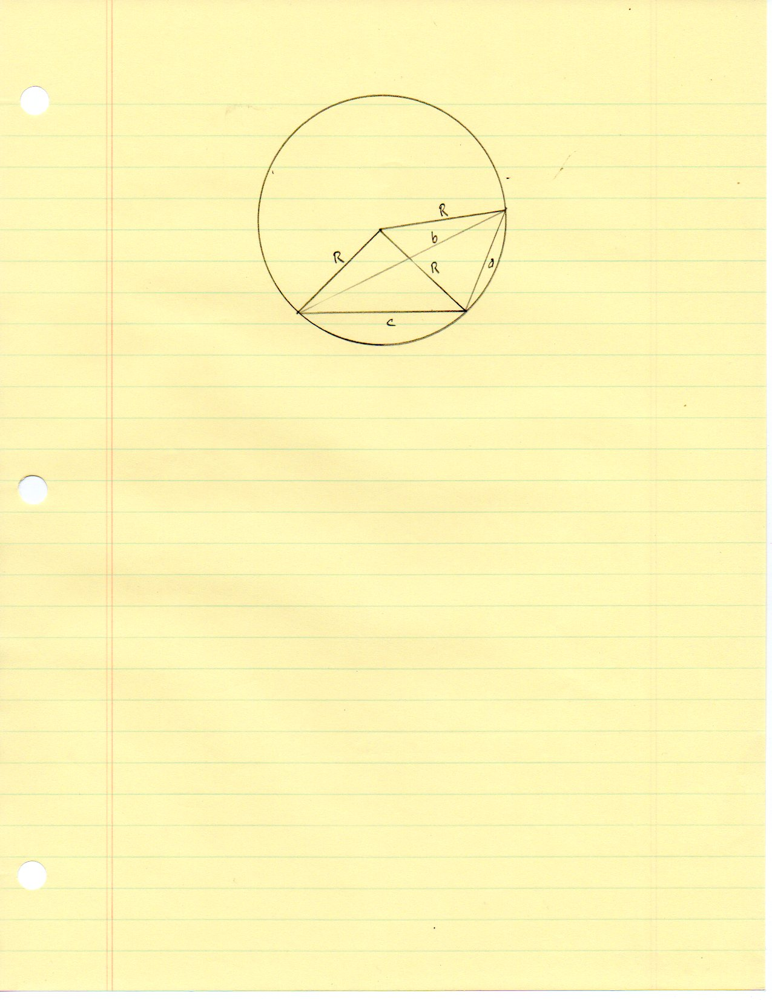

==========================================
F.13 Compare Triangles in Circles — Folios
==========================================

Archival manuscript scans and diplomatic transcriptions from :person:`seelig`'s
notebooks for **F.13 (Compare Triangles in Circles)** (:cite:`SeeligNotebooks`).

Folio 0084 (Page 1 of 8): Area K/R^2 vs. Sidelength a Curves
------------------------------------------------------------

.. folio:: 0084

   Folio ``0084`` (original scan ``0084.jpg``) from ``resources/seelig/13_compare-triangles-in-circles``.

**Diplomatic Mathematical & Geometric Transcription**

**Diplomatic Transcription — Folio 0084** (``0084.jpg``, Sheet 1 of 8):

Sketches qualitative plots of normalized area :math:`K/R^2` vs. :math:`a` (peaking when :math:`a` is a diameter) and :math:`b` vs. :math:`a`.

.. math::

   \sin\phi = \frac{c}{2 R}, \qquad h_c = \sqrt{R^2 - \left(\frac{c}{2}\right)^2}, \qquad (ABC) = \frac{1}{2} c h_c + \frac{1}{2} a h_a - \frac{1}{2} b h_b

.. admonition:: Editorial & Symbolic Notes

   Archival scan ``0084.jpg`` from Fred W. Seelig's notebook dossier on **F.13 Compare Triangles in Circles** (Page 1 of 8). Companion OpenDocument worksheet(s): ``Circumcircle Solver``, ``Circumcircle-Circumcenter``. Classical Euclidean foundations: :ref:`III.20`, :ref:`IV.5`. Kimberling *Encyclopedia of Triangle Centers* loci: :ref:`X(3)`.

Folio 0085 (Page 2 of 8): Compass Construction of Chord Families in Circle of Radius R
--------------------------------------------------------------------------------------

.. folio:: 0085

   Folio ``0085`` (original scan ``0085.jpg``) from ``resources/seelig/13_compare-triangles-in-circles``.

**Diplomatic Mathematical & Geometric Transcription**

**Diplomatic Transcription — Folio 0085** (``0085.jpg``, Sheet 2 of 8):

Draws vertical chords for :math:`c/R \in \{1/2, 3/4, 1, 4/3, 3/2, \sqrt{3}, 7/4, 2\}` and an inscribed triangle :math:`\triangle ABC`.

.. math::

   a^2 = f^2 + \frac{c^2}{4} + f c \cos\theta, \qquad b^2 = f^2 + \frac{c^2}{4} - f c \cos\theta

.. admonition:: Editorial & Symbolic Notes

   Archival scan ``0085.jpg`` from Fred W. Seelig's notebook dossier on **F.13 Compare Triangles in Circles** (Page 2 of 8). Companion OpenDocument worksheet(s): ``Circumcircle Solver``, ``Circumcircle-Circumcenter``. Classical Euclidean foundations: :ref:`III.20`, :ref:`IV.5`. Kimberling *Encyclopedia of Triangle Centers* loci: :ref:`X(3)`.

Folio 0086 (Page 3 of 8): Nested Radical Table for c/R from 1/4 to 7/4
----------------------------------------------------------------------

.. folio:: 0086

   Folio ``0086`` (original scan ``0086.jpg``) from ``resources/seelig/13_compare-triangles-in-circles``.

**Diplomatic Mathematical & Geometric Transcription**

**Diplomatic Transcription — Folio 0086** (``0086.jpg``, Sheet 3 of 8):

Tabulates :math:`c/R, m/n = c/(2R), \sqrt{n^2-m^2}/n`, and exact nested radicals for :math:`|BC|`.

.. math::

   \sin\phi = \frac{c}{2 R}, \qquad h_c = \sqrt{R^2 - \left(\frac{c}{2}\right)^2}, \qquad (ABC) = \frac{1}{2} c h_c + \frac{1}{2} a h_a - \frac{1}{2} b h_b

.. admonition:: Editorial & Symbolic Notes

   Archival scan ``0086.jpg`` from Fred W. Seelig's notebook dossier on **F.13 Compare Triangles in Circles** (Page 3 of 8). Companion OpenDocument worksheet(s): ``Circumcircle Solver``, ``Circumcircle-Circumcenter``. Classical Euclidean foundations: :ref:`III.20`, :ref:`IV.5`. Kimberling *Encyclopedia of Triangle Centers* loci: :ref:`X(3)`.

Folio 0087 (Page 4 of 8): Equations for a(theta; R) and b(theta; R) via Median f
--------------------------------------------------------------------------------

.. folio:: 0087

   Folio ``0087`` (original scan ``0087.jpg``) from ``resources/seelig/13_compare-triangles-in-circles``.

**Diplomatic Mathematical & Geometric Transcription**

**Diplomatic Transcription — Folio 0087** (``0087.jpg``, Sheet 4 of 8):

Uses median :math:`f = |MC|` at angle :math:`\theta` to :math:`AB` to express :math:`a^2` and :math:`b^2`.

.. math::

   a^2 = f^2 + \frac{c^2}{4} + f c \cos\theta, \qquad b^2 = f^2 + \frac{c^2}{4} - f c \cos\theta

.. admonition:: Editorial & Symbolic Notes

   Archival scan ``0087.jpg`` from Fred W. Seelig's notebook dossier on **F.13 Compare Triangles in Circles** (Page 4 of 8). Companion OpenDocument worksheet(s): ``Circumcircle Solver``, ``Circumcircle-Circumcenter``. Classical Euclidean foundations: :ref:`III.20`, :ref:`IV.5`. Kimberling *Encyclopedia of Triangle Centers* loci: :ref:`X(3)`.

Folio 0088 (Page 5 of 8): Isosceles Decomposition Around Circumcenter O ('Surprise & Pretty')
---------------------------------------------------------------------------------------------

.. folio:: 0088

   Folio ``0088`` (original scan ``0088.jpg``) from ``resources/seelig/13_compare-triangles-in-circles``.

**Diplomatic Mathematical & Geometric Transcription**

**Diplomatic Transcription — Folio 0088** (``0088.jpg``, Sheet 5 of 8):

Proves :math:`(ABC) = \frac{1}{2}ch_c + \frac{1}{2}ah_A - \frac{1}{2}bh_B` and writes the Bretschneider/Brahmagupta area of quadrilateral :math:`ABCO`.

.. math::

   \sin\phi = \frac{c}{2 R}, \qquad h_c = \sqrt{R^2 - \left(\frac{c}{2}\right)^2}, \qquad (ABC) = \frac{1}{2} c h_c + \frac{1}{2} a h_a - \frac{1}{2} b h_b

.. admonition:: Editorial & Symbolic Notes

   Archival scan ``0088.jpg`` from Fred W. Seelig's notebook dossier on **F.13 Compare Triangles in Circles** (Page 5 of 8). Companion OpenDocument worksheet(s): ``Circumcircle Solver``, ``Circumcircle-Circumcenter``. Classical Euclidean foundations: :ref:`III.20`, :ref:`IV.5`. Kimberling *Encyclopedia of Triangle Centers* loci: :ref:`X(3)`.

Folio 0089 (Page 6 of 8): Area as a Function of Angles alpha, beta and R
------------------------------------------------------------------------

.. folio:: 0089

   Folio ``0089`` (original scan ``0089.jpg``) from ``resources/seelig/13_compare-triangles-in-circles``.

**Diplomatic Mathematical & Geometric Transcription**

**Diplomatic Transcription — Folio 0089** (``0089.jpg``, Sheet 6 of 8):

Poses the question of expressing :math:`K = (\triangle ABC)` directly in terms of :math:`\alpha, \beta, R`.

.. math::

   a^2 = f^2 + \frac{c^2}{4} + f c \cos\theta, \qquad b^2 = f^2 + \frac{c^2}{4} - f c \cos\theta

.. admonition:: Editorial & Symbolic Notes

   Archival scan ``0089.jpg`` from Fred W. Seelig's notebook dossier on **F.13 Compare Triangles in Circles** (Page 6 of 8). Companion OpenDocument worksheet(s): ``Circumcircle Solver``, ``Circumcircle-Circumcenter``. Classical Euclidean foundations: :ref:`III.20`, :ref:`IV.5`. Kimberling *Encyclopedia of Triangle Centers* loci: :ref:`X(3)`.

Folio 0090 (Page 7 of 8): Quadrilateral OABC Partitioned by Median f
--------------------------------------------------------------------

.. folio:: 0090

   Folio ``0090`` (original scan ``0090.jpg``) from ``resources/seelig/13_compare-triangles-in-circles``.

**Diplomatic Mathematical & Geometric Transcription**

**Diplomatic Transcription — Folio 0090** (``0090.jpg``, Sheet 7 of 8):

Decomposes :math:`OABC` into :math:`(OAM) + (OMC) + (MBC)` sharing median base :math:`f = MC`.

.. math::

   \sin\phi = \frac{c}{2 R}, \qquad h_c = \sqrt{R^2 - \left(\frac{c}{2}\right)^2}, \qquad (ABC) = \frac{1}{2} c h_c + \frac{1}{2} a h_a - \frac{1}{2} b h_b

.. admonition:: Editorial & Symbolic Notes

   Archival scan ``0090.jpg`` from Fred W. Seelig's notebook dossier on **F.13 Compare Triangles in Circles** (Page 7 of 8). Companion OpenDocument worksheet(s): ``Circumcircle Solver``, ``Circumcircle-Circumcenter``. Classical Euclidean foundations: :ref:`III.20`, :ref:`IV.5`. Kimberling *Encyclopedia of Triangle Centers* loci: :ref:`X(3)`.

Folio 0091 (Page 8 of 8): Clean Compass Construction of Cyclic Quadrilateral ABCO
---------------------------------------------------------------------------------

.. folio:: 0091

   Folio ``0091`` (original scan ``0091.jpg``) from ``resources/seelig/13_compare-triangles-in-circles``.

**Diplomatic Mathematical & Geometric Transcription**

**Diplomatic Transcription — Folio 0091** (``0091.jpg``, Sheet 8 of 8):

Draws cyclic quadrilateral :math:`ABCO` with three equal sides :math:`R, R, R`, chords :math:`c, a`, and diagonal :math:`b`.

.. math::

   a^2 = f^2 + \frac{c^2}{4} + f c \cos\theta, \qquad b^2 = f^2 + \frac{c^2}{4} - f c \cos\theta

.. admonition:: Editorial & Symbolic Notes

   Archival scan ``0091.jpg`` from Fred W. Seelig's notebook dossier on **F.13 Compare Triangles in Circles** (Page 8 of 8). Companion OpenDocument worksheet(s): ``Circumcircle Solver``, ``Circumcircle-Circumcenter``. Classical Euclidean foundations: :ref:`III.20`, :ref:`IV.5`. Kimberling *Encyclopedia of Triangle Centers* loci: :ref:`X(3)`.
