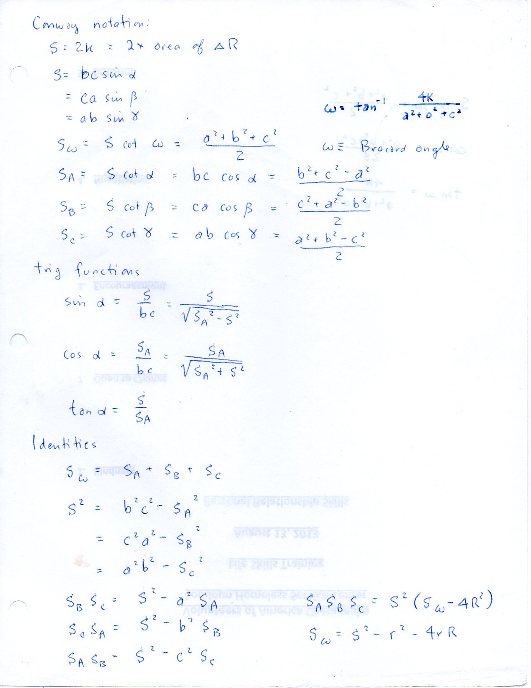
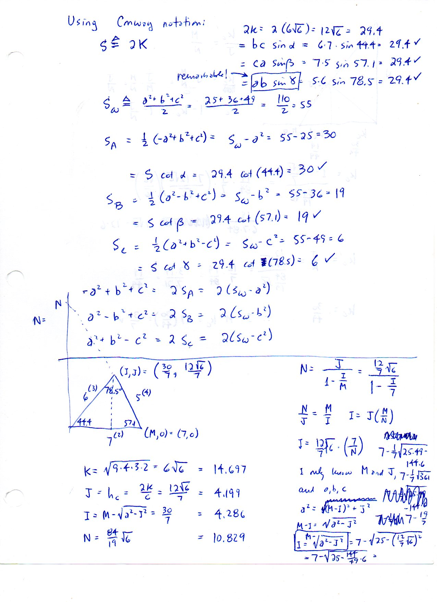
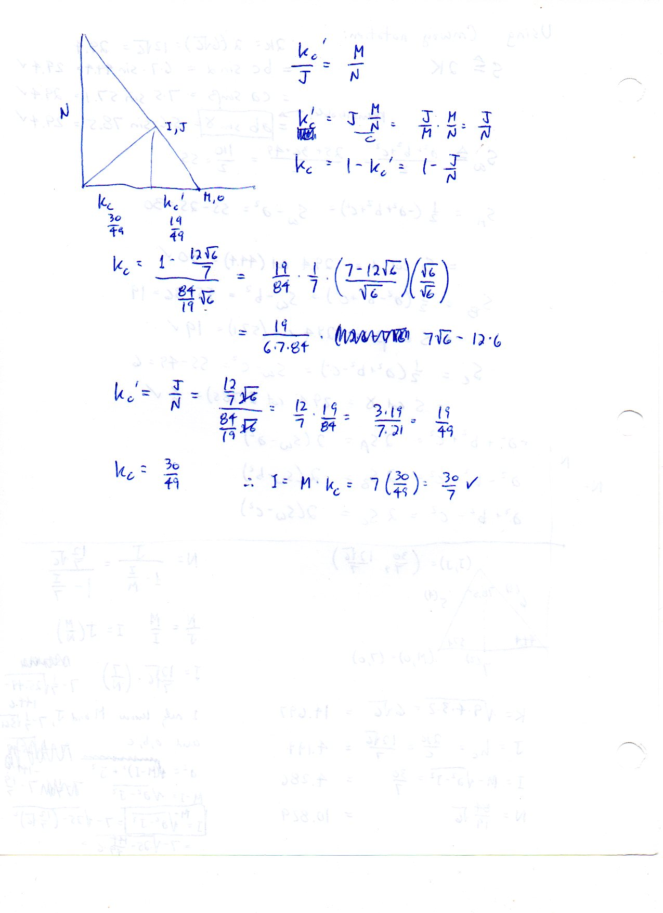
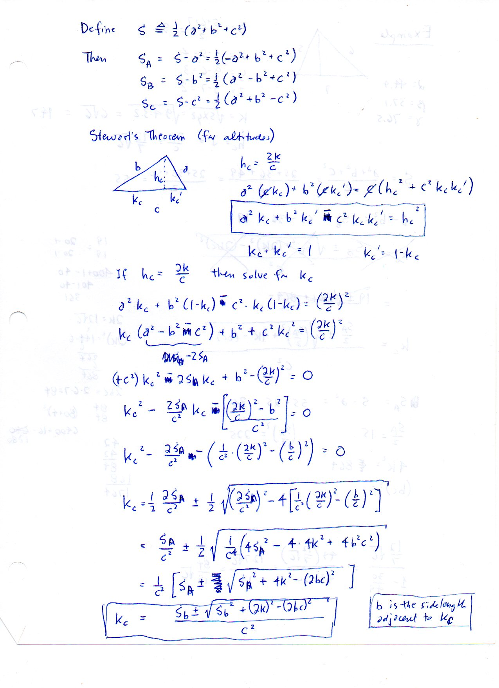
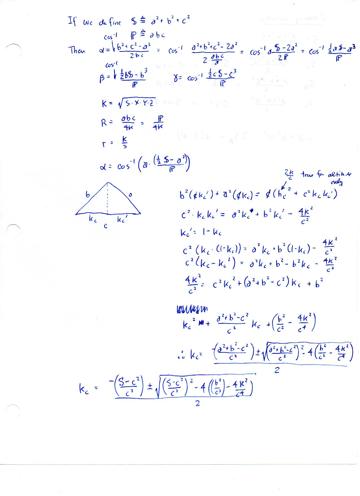
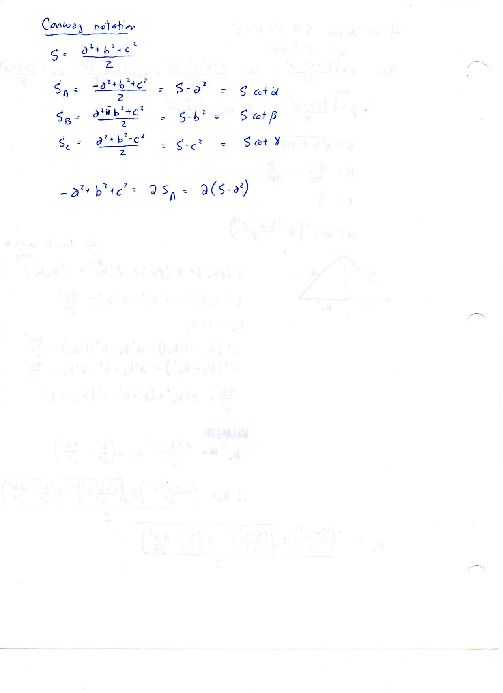

=============================
F.14 Conway Notation — Folios
=============================

Archival manuscript scans and diplomatic transcriptions from :person:`seelig`'s
notebooks for **F.14 (Conway Notation)** (:cite:`SeeligNotebooks`).

Folio 0092 (Page 1 of 6): Conway Notation Definitions, Trig Functions & Identities
----------------------------------------------------------------------------------

.. folio:: 0092

   Folio ``0092`` (original scan ``0092.jpg``) from ``resources/seelig/14_conway-notation``.

**Diplomatic Mathematical & Geometric Transcription**

**Diplomatic Transcription — Folio 0092** (``0092.jpg``, Sheet 1 of 6):

Defines :math:`S = 2K, S_\omega = S\cot\omega, S_A, S_B, S_C` and records the fundamental quadratic and cubic Conway identities.

.. math::

   S = 2 K, \qquad S_\omega = \frac{a^2 + b^2 + c^2}{2} = S \cot\omega, \qquad S_A = \frac{b^2 + c^2 - a^2}{2} = b c \cos\alpha

.. admonition:: Editorial & Symbolic Notes

   Archival scan ``0092.jpg`` from Fred W. Seelig's notebook dossier on **F.14 Conway Notation** (Page 1 of 6). Companion OpenDocument worksheet(s): ``General Reference``, ``Conway's Conversions``, ``5-6-7 A,B,C``, ``Barycentric``. Classical Euclidean foundations: :ref:`II.12`, :ref:`II.13`. Kimberling *Encyclopedia of Triangle Centers* loci: :ref:`X(2)`, :ref:`X(3)`, :ref:`X(4)`, :ref:`X(6)`.

Folio 0093 (Page 2 of 6): Worked Evaluation on the 5-6-7 Reference Triangle (Part 1)
------------------------------------------------------------------------------------

.. folio:: 0093

   Folio ``0093`` (original scan ``0093.jpg``) from ``resources/seelig/14_conway-notation``.

**Diplomatic Mathematical & Geometric Transcription**

**Diplomatic Transcription — Folio 0093** (``0093.jpg``, Sheet 2 of 6):

Computes :math:`K = 6\sqrt{6}, S = 12\sqrt{6}, S_\omega = 55, S_A = 30, S_B = 19, S_C = 6`, and vertex coordinates :math:`(I, J) = (30/7, 12\sqrt{6}/7)`.

.. math::

   S^2 = b^2 c^2 - S_A^2 = S_A S_B + S_B S_C + S_C S_A, \qquad S_A S_B S_C = S^2 (S_\omega - 4 R^2)

.. admonition:: Editorial & Symbolic Notes

   Archival scan ``0093.jpg`` from Fred W. Seelig's notebook dossier on **F.14 Conway Notation** (Page 2 of 6). Companion OpenDocument worksheet(s): ``General Reference``, ``Conway's Conversions``, ``5-6-7 A,B,C``, ``Barycentric``. Classical Euclidean foundations: :ref:`II.12`, :ref:`II.13`. Kimberling *Encyclopedia of Triangle Centers* loci: :ref:`X(2)`, :ref:`X(3)`, :ref:`X(4)`, :ref:`X(6)`.

Folio 0094 (Page 3 of 6): Intercept N and Altitude Splits on the 5-6-7 Triangle (Part 2)
----------------------------------------------------------------------------------------

.. folio:: 0094

   Folio ``0094`` (original scan ``0094.jpg``) from ``resources/seelig/14_conway-notation``.

**Diplomatic Mathematical & Geometric Transcription**

**Diplomatic Transcription — Folio 0094** (``0094.jpg``, Sheet 3 of 6):

Finds the :math:`y`-intercept :math:`N = \frac{84}{19}\sqrt{6} \approx 10.829` and altitude base fractions :math:`k_c = 30/49, k_c' = 19/49`.

.. math::

   S = 2 K, \qquad S_\omega = \frac{a^2 + b^2 + c^2}{2} = S \cot\omega, \qquad S_A = \frac{b^2 + c^2 - a^2}{2} = b c \cos\alpha

.. admonition:: Editorial & Symbolic Notes

   Archival scan ``0094.jpg`` from Fred W. Seelig's notebook dossier on **F.14 Conway Notation** (Page 3 of 6). Companion OpenDocument worksheet(s): ``General Reference``, ``Conway's Conversions``, ``5-6-7 A,B,C``, ``Barycentric``. Classical Euclidean foundations: :ref:`II.12`, :ref:`II.13`. Kimberling *Encyclopedia of Triangle Centers* loci: :ref:`X(2)`, :ref:`X(3)`, :ref:`X(4)`, :ref:`X(6)`.

Folio 0095 (Page 4 of 6): Stewart's Theorem for Altitudes in Conway Notation
----------------------------------------------------------------------------

.. folio:: 0095

   Folio ``0095`` (original scan ``0095.jpg``) from ``resources/seelig/14_conway-notation``.

**Diplomatic Mathematical & Geometric Transcription**

**Diplomatic Transcription — Folio 0095** (``0095.jpg``, Sheet 4 of 6):

Substitutes :math:`h_c = 2K/c` into :math:`a^2 k_c + b^2 k_c' - c^2 k_c k_c' = h_c^2` to solve for :math:`k_c`.

.. math::

   S^2 = b^2 c^2 - S_A^2 = S_A S_B + S_B S_C + S_C S_A, \qquad S_A S_B S_C = S^2 (S_\omega - 4 R^2)

.. admonition:: Editorial & Symbolic Notes

   Archival scan ``0095.jpg`` from Fred W. Seelig's notebook dossier on **F.14 Conway Notation** (Page 4 of 6). Companion OpenDocument worksheet(s): ``General Reference``, ``Conway's Conversions``, ``5-6-7 A,B,C``, ``Barycentric``. Classical Euclidean foundations: :ref:`II.12`, :ref:`II.13`. Kimberling *Encyclopedia of Triangle Centers* loci: :ref:`X(2)`, :ref:`X(3)`, :ref:`X(4)`, :ref:`X(6)`.

Folio 0096 (Page 5 of 6): Alternative Sum-of-Squares Notation (S = a^2 + b^2 + c^2)
-----------------------------------------------------------------------------------

.. folio:: 0096

   Folio ``0096`` (original scan ``0096.jpg``) from ``resources/seelig/14_conway-notation``.

**Diplomatic Mathematical & Geometric Transcription**

**Diplomatic Transcription — Folio 0096** (``0096.jpg``, Sheet 5 of 6):

Rewrites the cosine law and altitude quadratic using :math:`S \triangleq a^2+b^2+c^2` and :math:`P \triangleq abc`.

.. math::

   S = 2 K, \qquad S_\omega = \frac{a^2 + b^2 + c^2}{2} = S \cot\omega, \qquad S_A = \frac{b^2 + c^2 - a^2}{2} = b c \cos\alpha

.. admonition:: Editorial & Symbolic Notes

   Archival scan ``0096.jpg`` from Fred W. Seelig's notebook dossier on **F.14 Conway Notation** (Page 5 of 6). Companion OpenDocument worksheet(s): ``General Reference``, ``Conway's Conversions``, ``5-6-7 A,B,C``, ``Barycentric``. Classical Euclidean foundations: :ref:`II.12`, :ref:`II.13`. Kimberling *Encyclopedia of Triangle Centers* loci: :ref:`X(2)`, :ref:`X(3)`, :ref:`X(4)`, :ref:`X(6)`.

Folio 0097 (Page 6 of 6): Clean Reference Card for Conway Symbols
-----------------------------------------------------------------

.. folio:: 0097

   Folio ``0097`` (original scan ``0097.jpg``) from ``resources/seelig/14_conway-notation``.

**Diplomatic Mathematical & Geometric Transcription**

**Diplomatic Transcription — Folio 0097** (``0097.jpg``, Sheet 6 of 6):

Summarizes :math:`S_A, S_B, S_C` as offsets from :math:`(a^2+b^2+c^2)/2`.

.. math::

   S^2 = b^2 c^2 - S_A^2 = S_A S_B + S_B S_C + S_C S_A, \qquad S_A S_B S_C = S^2 (S_\omega - 4 R^2)

.. admonition:: Editorial & Symbolic Notes

   Archival scan ``0097.jpg`` from Fred W. Seelig's notebook dossier on **F.14 Conway Notation** (Page 6 of 6). Companion OpenDocument worksheet(s): ``General Reference``, ``Conway's Conversions``, ``5-6-7 A,B,C``, ``Barycentric``. Classical Euclidean foundations: :ref:`II.12`, :ref:`II.13`. Kimberling *Encyclopedia of Triangle Centers* loci: :ref:`X(2)`, :ref:`X(3)`, :ref:`X(4)`, :ref:`X(6)`.
