==================================
F.15 Cyclic Quadrilateral — Folios
==================================

Archival manuscript scans and diplomatic transcriptions from :person:`seelig`'s
notebooks for **F.15 (Cyclic Quadrilateral)** (:cite:`SeeligNotebooks`).

Folio 0098 (Page 1 of 16): Cyclic Quad with Angles theta, 2*theta, 3*theta, 4*theta (Cropped Copy, FWS 2015/4/9)
----------------------------------------------------------------------------------------------------------------

.. folio:: 0098

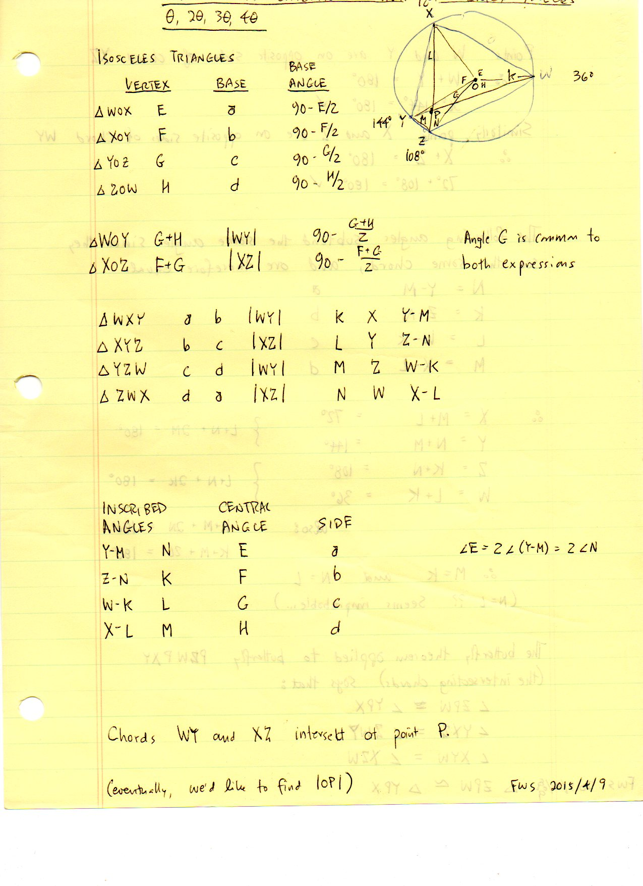

   Folio ``0098`` (original scan ``0098.jpg``) from ``resources/seelig/15_cyclic-quadrilateral``.

**Diplomatic Mathematical & Geometric Transcription**

**Diplomatic Transcription — Folio 0098** (``0098.jpg``, Sheet 1 of 16):

Tabulates the four central isosceles triangles :math:`\triangle WOX, \triangle XOY, \triangle YOZ, \triangle ZOW` and sets the goal of finding :math:`|OP|`.

.. math::

   \theta + 2\theta + 3\theta + 4\theta = 360^\circ \implies \theta = 36^\circ, \qquad f = |XZ| = 2\sin 36^\circ = \sqrt{3 - \phi}, \qquad e = |YW| = 2\sin 72^\circ = \phi\sqrt{3 - \phi}

.. admonition:: Editorial & Symbolic Notes

   Archival scan ``0098.jpg`` from Fred W. Seelig's notebook dossier on **F.15 Cyclic Quadrilateral** (Page 1 of 16). Companion OpenDocument worksheet(s): ``Cyclic Quad``, ``Chord Intersection``. Classical Euclidean foundations: :ref:`III.21`, :ref:`III.22`, :ref:`IV.11`.

Folio 0099 (Page 2 of 16): Cyclic Quad with Angles theta, 2*theta, 3*theta, 4*theta (Full Title, FWS 2015/4/9)
--------------------------------------------------------------------------------------------------------------

.. folio:: 0099

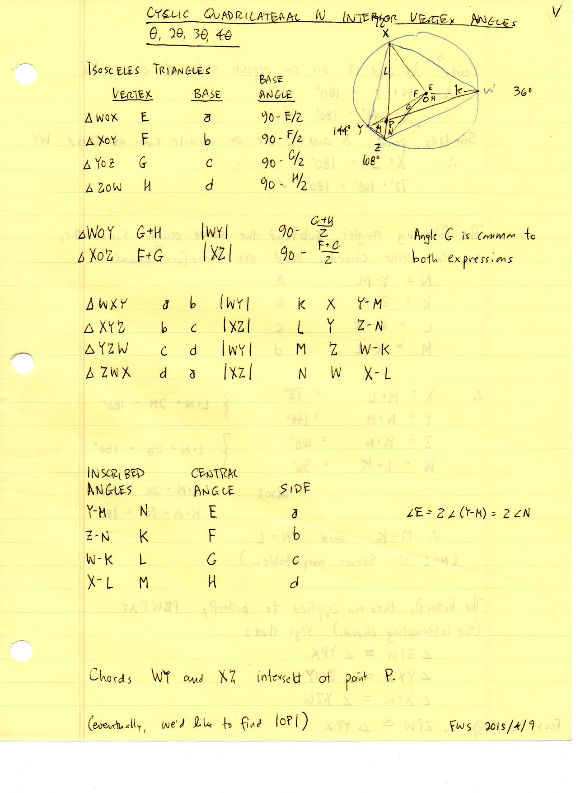

   Folio ``0099`` (original scan ``0099.jpg``) from ``resources/seelig/15_cyclic-quadrilateral``.

**Diplomatic Mathematical & Geometric Transcription**

**Diplomatic Transcription — Folio 0099** (``0099.jpg``, Sheet 2 of 16):

Uncropped master page showing full title and central/inscribed angle relations.

.. math::

   a c + b d = e f \quad (\text{Ptolemy}), \qquad (k^3 - k^2 + k - 1) = (k - 1)(k^2 + 1) = 0

.. admonition:: Editorial & Symbolic Notes

   Archival scan ``0099.jpg`` from Fred W. Seelig's notebook dossier on **F.15 Cyclic Quadrilateral** (Page 2 of 16). Companion OpenDocument worksheet(s): ``Cyclic Quad``, ``Chord Intersection``. Classical Euclidean foundations: :ref:`III.21`, :ref:`III.22`, :ref:`IV.11`.

Folio 0100 (Page 3 of 16): Base Angle Equalities M = K, N = L & Butterfly Similarity (Page 2)
---------------------------------------------------------------------------------------------

.. folio:: 0100

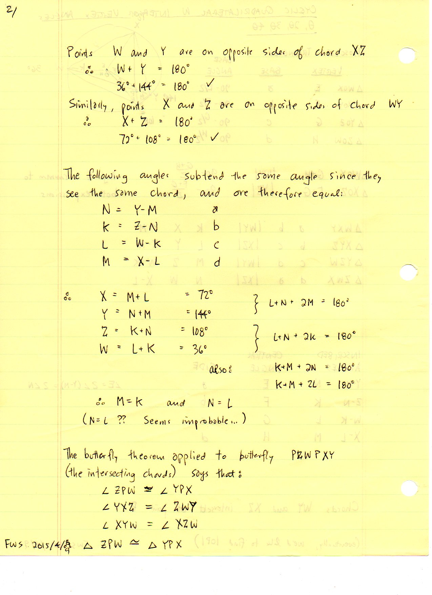

   Folio ``0100`` (original scan ``0100.jpg``) from ``resources/seelig/15_cyclic-quadrilateral``.

**Diplomatic Mathematical & Geometric Transcription**

**Diplomatic Transcription — Folio 0100** (``0100.jpg``, Sheet 3 of 16):

Deduces :math:`M = K` and :math:`N = L` and applies :math:`\triangle ZPW \simeq \triangle YPX`.

.. math::

   \theta + 2\theta + 3\theta + 4\theta = 360^\circ \implies \theta = 36^\circ, \qquad f = |XZ| = 2\sin 36^\circ = \sqrt{3 - \phi}, \qquad e = |YW| = 2\sin 72^\circ = \phi\sqrt{3 - \phi}

.. admonition:: Editorial & Symbolic Notes

   Archival scan ``0100.jpg`` from Fred W. Seelig's notebook dossier on **F.15 Cyclic Quadrilateral** (Page 3 of 16). Companion OpenDocument worksheet(s): ``Cyclic Quad``, ``Chord Intersection``. Classical Euclidean foundations: :ref:`III.21`, :ref:`III.22`, :ref:`IV.11`.

Folio 0101 (Page 4 of 16): Inscribed Angles 36, 72, 144, 108 in Unit Circle (FWS Begun April 6, 2015)
-----------------------------------------------------------------------------------------------------

.. folio:: 0101

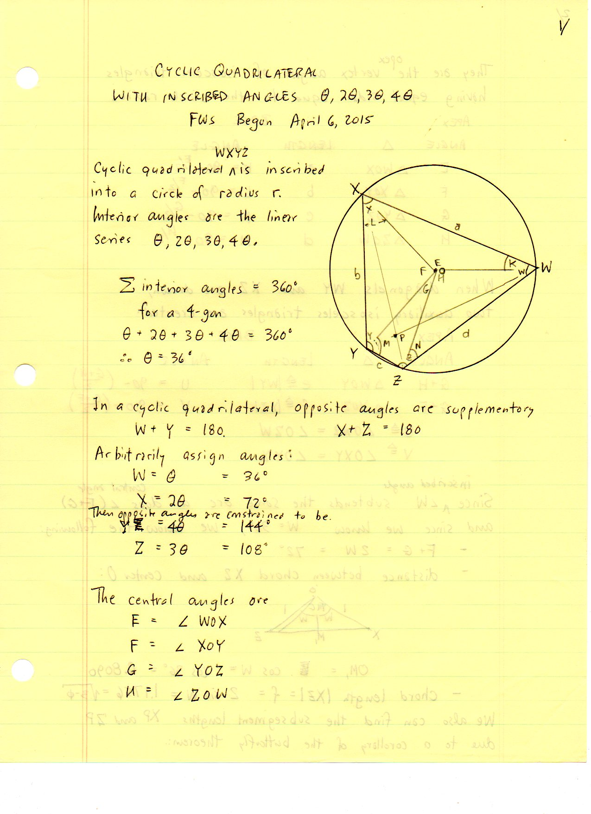

   Folio ``0101`` (original scan ``0101.jpg``) from ``resources/seelig/15_cyclic-quadrilateral``.

**Diplomatic Mathematical & Geometric Transcription**

**Diplomatic Transcription — Folio 0101** (``0101.jpg``, Sheet 4 of 16):

Establishes :math:`\theta = 36^\circ` and vertex ordering :math:`W=36^\circ, X=72^\circ, Y=144^\circ, Z=108^\circ` so opposite angles sum to :math:`180^\circ`.

.. math::

   a c + b d = e f \quad (\text{Ptolemy}), \qquad (k^3 - k^2 + k - 1) = (k - 1)(k^2 + 1) = 0

.. admonition:: Editorial & Symbolic Notes

   Archival scan ``0101.jpg`` from Fred W. Seelig's notebook dossier on **F.15 Cyclic Quadrilateral** (Page 4 of 16). Companion OpenDocument worksheet(s): ``Cyclic Quad``, ``Chord Intersection``. Classical Euclidean foundations: :ref:`III.21`, :ref:`III.22`, :ref:`IV.11`.

Folio 0102 (Page 5 of 16): Diagonal \|XZ\| = 2 sin 36 = sqrt(3 - phi) (Page 2)
------------------------------------------------------------------------------

.. folio:: 0102

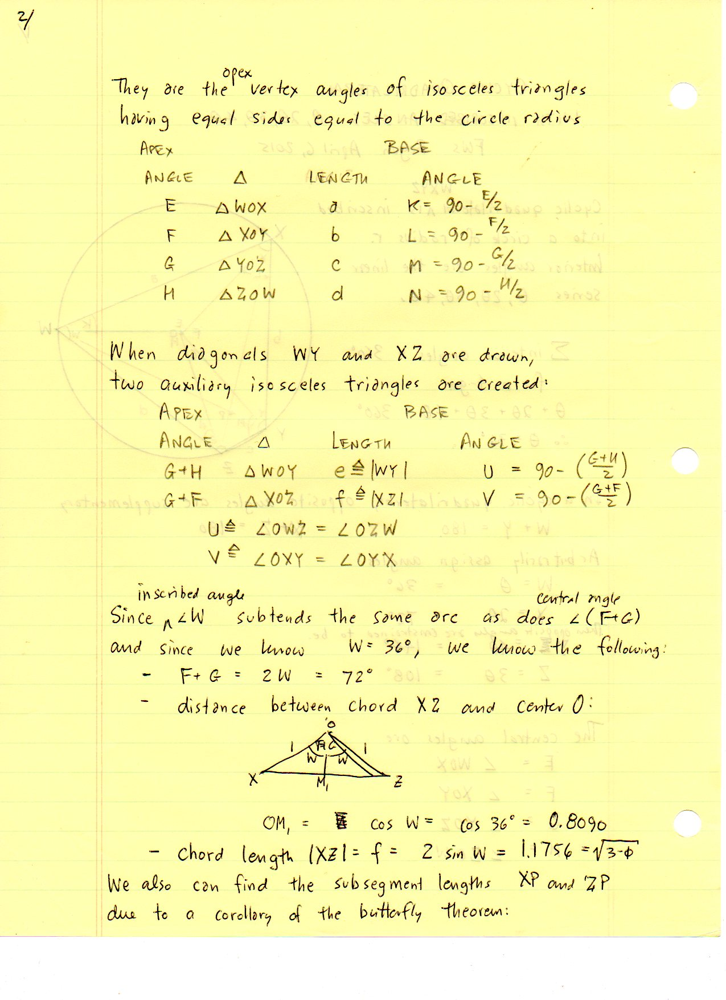

   Folio ``0102`` (original scan ``0102.jpg``) from ``resources/seelig/15_cyclic-quadrilateral``.

**Diplomatic Mathematical & Geometric Transcription**

**Diplomatic Transcription — Folio 0102** (``0102.jpg``, Sheet 5 of 16):

Computes midpoint distance :math:`|OM_1| = \cos 36^\circ = \phi/2` and chord :math:`|XZ| = \sqrt{3-\phi} \approx 1.1756`.

.. math::

   \theta + 2\theta + 3\theta + 4\theta = 360^\circ \implies \theta = 36^\circ, \qquad f = |XZ| = 2\sin 36^\circ = \sqrt{3 - \phi}, \qquad e = |YW| = 2\sin 72^\circ = \phi\sqrt{3 - \phi}

.. admonition:: Editorial & Symbolic Notes

   Archival scan ``0102.jpg`` from Fred W. Seelig's notebook dossier on **F.15 Cyclic Quadrilateral** (Page 5 of 16). Companion OpenDocument worksheet(s): ``Cyclic Quad``, ``Chord Intersection``. Classical Euclidean foundations: :ref:`III.21`, :ref:`III.22`, :ref:`IV.11`.

Folio 0103 (Page 6 of 16): Power of Diagonal Intersection P (Page 3, citing Vol. I, pp. 265–270)
------------------------------------------------------------------------------------------------

.. folio:: 0103

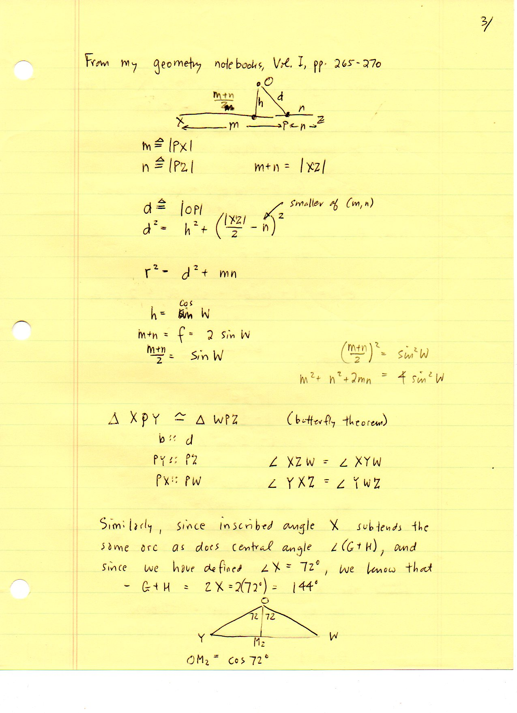

   Folio ``0103`` (original scan ``0103.jpg``) from ``resources/seelig/15_cyclic-quadrilateral``.

**Diplomatic Mathematical & Geometric Transcription**

**Diplomatic Transcription — Folio 0103** (``0103.jpg``, Sheet 6 of 16):

Relates :math:`d = |OP|` to diagonal segments :math:`m = |PX|, n = |PZ|` via :math:`r^2 = d^2 + mn`.

.. math::

   a c + b d = e f \quad (\text{Ptolemy}), \qquad (k^3 - k^2 + k - 1) = (k - 1)(k^2 + 1) = 0

.. admonition:: Editorial & Symbolic Notes

   Archival scan ``0103.jpg`` from Fred W. Seelig's notebook dossier on **F.15 Cyclic Quadrilateral** (Page 6 of 16). Companion OpenDocument worksheet(s): ``Cyclic Quad``, ``Chord Intersection``. Classical Euclidean foundations: :ref:`III.21`, :ref:`III.22`, :ref:`IV.11`.

Folio 0104 (Page 7 of 16): Diagonal \|YW\| = 2 sin 72 = phi*sqrt(3 - phi) (Page 4)
----------------------------------------------------------------------------------

.. folio:: 0104

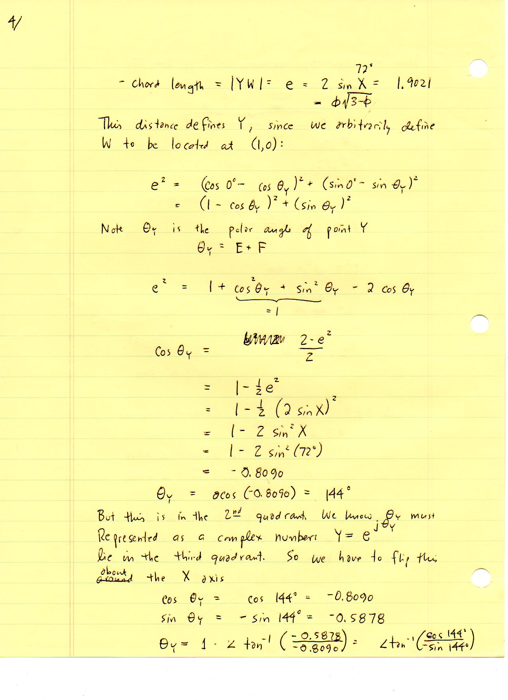

   Folio ``0104`` (original scan ``0104.jpg``) from ``resources/seelig/15_cyclic-quadrilateral``.

**Diplomatic Mathematical & Geometric Transcription**

**Diplomatic Transcription — Folio 0104** (``0104.jpg``, Sheet 7 of 16):

Computes :math:`|OM_2| = \cos 72^\circ \approx 0.3090` and :math:`|YW| = \phi\sqrt{3-\phi} \approx 1.9021`.

.. math::

   \theta + 2\theta + 3\theta + 4\theta = 360^\circ \implies \theta = 36^\circ, \qquad f = |XZ| = 2\sin 36^\circ = \sqrt{3 - \phi}, \qquad e = |YW| = 2\sin 72^\circ = \phi\sqrt{3 - \phi}

.. admonition:: Editorial & Symbolic Notes

   Archival scan ``0104.jpg`` from Fred W. Seelig's notebook dossier on **F.15 Cyclic Quadrilateral** (Page 7 of 16). Companion OpenDocument worksheet(s): ``Cyclic Quad``, ``Chord Intersection``. Classical Euclidean foundations: :ref:`III.21`, :ref:`III.22`, :ref:`IV.11`.

Folio 0105 (Page 8 of 16): Non-Cyclic Trap When Angles Are Ordered Sequentially
-------------------------------------------------------------------------------

.. folio:: 0105

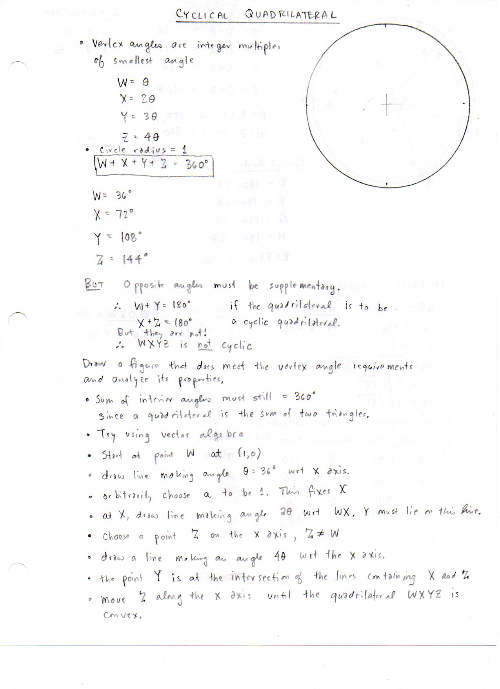

   Folio ``0105`` (original scan ``0105.jpg``) from ``resources/seelig/15_cyclic-quadrilateral``.

**Diplomatic Mathematical & Geometric Transcription**

**Diplomatic Transcription — Folio 0105** (``0105.jpg``, Sheet 8 of 16):

Shows that if :math:`W=36^\circ, X=72^\circ, Y=108^\circ, Z=144^\circ` in order around the perimeter, :math:`W + Y \ne 180^\circ` so :math:`WXYZ` is not cyclic.

.. math::

   a c + b d = e f \quad (\text{Ptolemy}), \qquad (k^3 - k^2 + k - 1) = (k - 1)(k^2 + 1) = 0

.. admonition:: Editorial & Symbolic Notes

   Archival scan ``0105.jpg`` from Fred W. Seelig's notebook dossier on **F.15 Cyclic Quadrilateral** (Page 8 of 16). Companion OpenDocument worksheet(s): ``Cyclic Quad``, ``Chord Intersection``. Classical Euclidean foundations: :ref:`III.21`, :ref:`III.22`, :ref:`IV.11`.

Folio 0106 (Page 9 of 16): Empirical C.a.R. Measurements of Side Lengths & Central Angles
-----------------------------------------------------------------------------------------

.. folio:: 0106

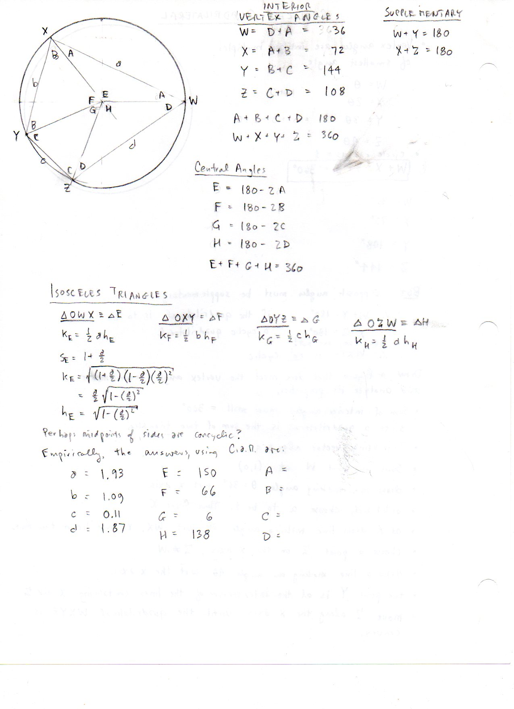

   Folio ``0106`` (original scan ``0106.jpg``) from ``resources/seelig/15_cyclic-quadrilateral``.

**Diplomatic Mathematical & Geometric Transcription**

**Diplomatic Transcription — Folio 0106** (``0106.jpg``, Sheet 9 of 16):

Records C.a.R. values :math:`a=1.93, b=1.09, c=0.11, d=1.87` and central angles :math:`150^\circ, 66^\circ, 6^\circ, 138^\circ`.

.. math::

   \theta + 2\theta + 3\theta + 4\theta = 360^\circ \implies \theta = 36^\circ, \qquad f = |XZ| = 2\sin 36^\circ = \sqrt{3 - \phi}, \qquad e = |YW| = 2\sin 72^\circ = \phi\sqrt{3 - \phi}

.. admonition:: Editorial & Symbolic Notes

   Archival scan ``0106.jpg`` from Fred W. Seelig's notebook dossier on **F.15 Cyclic Quadrilateral** (Page 9 of 16). Companion OpenDocument worksheet(s): ``Cyclic Quad``, ``Chord Intersection``. Classical Euclidean foundations: :ref:`III.21`, :ref:`III.22`, :ref:`IV.11`.

Folio 0107 (Page 10 of 16): Central Angles in Arithmetic Progression (36, 72, 108, 144)
---------------------------------------------------------------------------------------

.. folio:: 0107

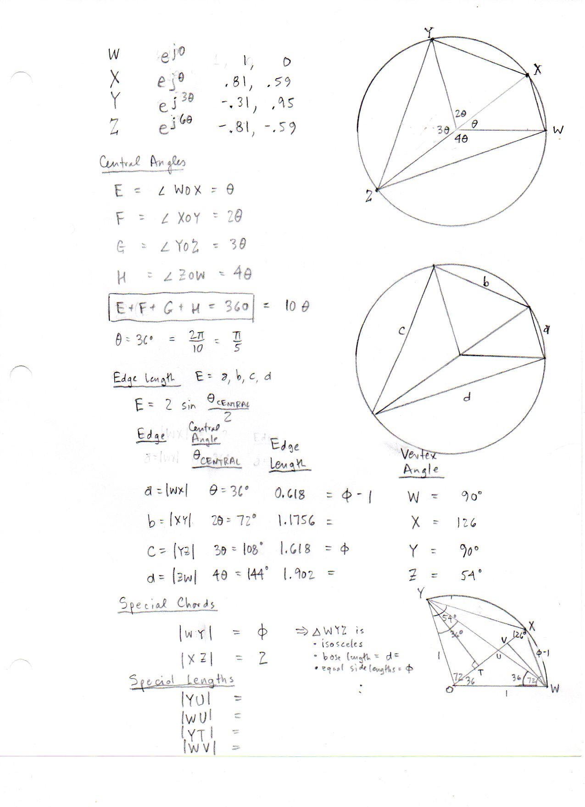

   Folio ``0107`` (original scan ``0107.jpg``) from ``resources/seelig/15_cyclic-quadrilateral``.

**Diplomatic Mathematical & Geometric Transcription**

**Diplomatic Transcription — Folio 0107** (``0107.jpg``, Sheet 10 of 16):

Places vertices at :math:`e^{j0}, e^{j\theta}, e^{j3\theta}, e^{j6\theta}`, obtaining golden-ratio sides :math:`a = \phi-1, c = \phi` and diagonals :math:`|WY| = \phi, |XZ| = 2`.

.. math::

   a c + b d = e f \quad (\text{Ptolemy}), \qquad (k^3 - k^2 + k - 1) = (k - 1)(k^2 + 1) = 0

.. admonition:: Editorial & Symbolic Notes

   Archival scan ``0107.jpg`` from Fred W. Seelig's notebook dossier on **F.15 Cyclic Quadrilateral** (Page 10 of 16). Companion OpenDocument worksheet(s): ``Cyclic Quad``, ``Chord Intersection``. Classical Euclidean foundations: :ref:`III.21`, :ref:`III.22`, :ref:`IV.11`.

Folio 0108 (Page 11 of 16): Four Central Isosceles Triangles OWX, OXY, OYZ, OZW
-------------------------------------------------------------------------------

.. folio:: 0108

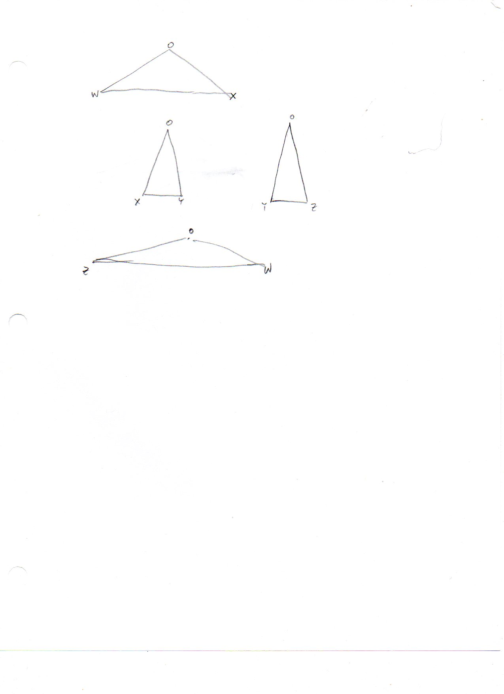

   Folio ``0108`` (original scan ``0108.jpg``) from ``resources/seelig/15_cyclic-quadrilateral``.

**Diplomatic Mathematical & Geometric Transcription**

**Diplomatic Transcription — Folio 0108** (``0108.jpg``, Sheet 11 of 16):

Isolated sketches of the four central sector triangles and their base angles.

.. math::

   \theta + 2\theta + 3\theta + 4\theta = 360^\circ \implies \theta = 36^\circ, \qquad f = |XZ| = 2\sin 36^\circ = \sqrt{3 - \phi}, \qquad e = |YW| = 2\sin 72^\circ = \phi\sqrt{3 - \phi}

.. admonition:: Editorial & Symbolic Notes

   Archival scan ``0108.jpg`` from Fred W. Seelig's notebook dossier on **F.15 Cyclic Quadrilateral** (Page 11 of 16). Companion OpenDocument worksheet(s): ``Cyclic Quad``, ``Chord Intersection``. Classical Euclidean foundations: :ref:`III.21`, :ref:`III.22`, :ref:`IV.11`.

Folio 0109 (Page 12 of 16): Vector Construction of the Non-Cyclic Quadrilateral
-------------------------------------------------------------------------------

.. folio:: 0109

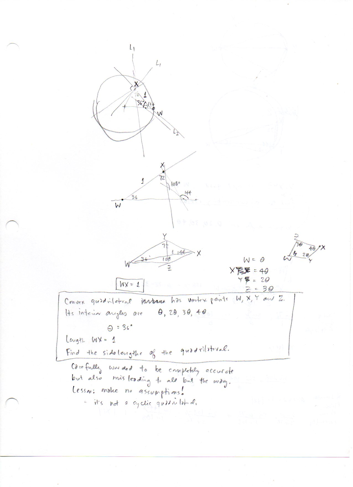

   Folio ``0109`` (original scan ``0109.jpg``) from ``resources/seelig/15_cyclic-quadrilateral``.

**Diplomatic Mathematical & Geometric Transcription**

**Diplomatic Transcription — Folio 0109** (``0109.jpg``, Sheet 12 of 16):

Constructs the non-cyclic quadrilateral with :math:`WX = 1` and comments on ambiguous problem statements.

.. math::

   a c + b d = e f \quad (\text{Ptolemy}), \qquad (k^3 - k^2 + k - 1) = (k - 1)(k^2 + 1) = 0

.. admonition:: Editorial & Symbolic Notes

   Archival scan ``0109.jpg`` from Fred W. Seelig's notebook dossier on **F.15 Cyclic Quadrilateral** (Page 12 of 16). Companion OpenDocument worksheet(s): ``Cyclic Quad``, ``Chord Intersection``. Classical Euclidean foundations: :ref:`III.21`, :ref:`III.22`, :ref:`IV.11`.

Folio 0110 (Page 13 of 16): Ptolemy's Theorem & Parameterization by Angle mu (Part 1)
-------------------------------------------------------------------------------------

.. folio:: 0110

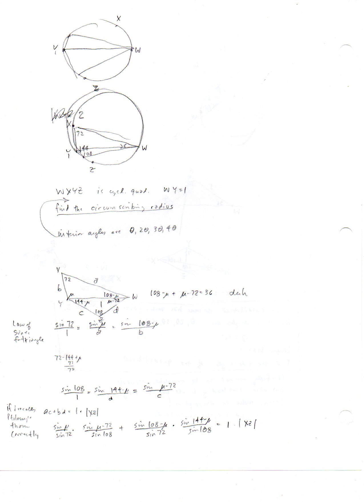

   Folio ``0110`` (original scan ``0110.jpg``) from ``resources/seelig/15_cyclic-quadrilateral``.

**Diplomatic Mathematical & Geometric Transcription**

**Diplomatic Transcription — Folio 0110** (``0110.jpg``, Sheet 13 of 16):

Normalizes diagonal :math:`WY = 1` and applies the Law of Sines and Ptolemy's theorem :math:`ac + bd = |XZ|`.

.. math::

   \theta + 2\theta + 3\theta + 4\theta = 360^\circ \implies \theta = 36^\circ, \qquad f = |XZ| = 2\sin 36^\circ = \sqrt{3 - \phi}, \qquad e = |YW| = 2\sin 72^\circ = \phi\sqrt{3 - \phi}

.. admonition:: Editorial & Symbolic Notes

   Archival scan ``0110.jpg`` from Fred W. Seelig's notebook dossier on **F.15 Cyclic Quadrilateral** (Page 13 of 16). Companion OpenDocument worksheet(s): ``Cyclic Quad``, ``Chord Intersection``. Classical Euclidean foundations: :ref:`III.21`, :ref:`III.22`, :ref:`IV.11`.

Folio 0111 (Page 14 of 16): Product-to-Sum Reduction for \|XZ\| (Part 2)
------------------------------------------------------------------------

.. folio:: 0111

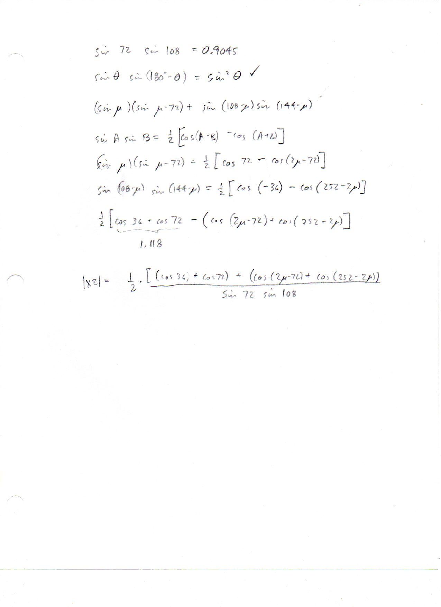

   Folio ``0111`` (original scan ``0111.jpg``) from ``resources/seelig/15_cyclic-quadrilateral``.

**Diplomatic Mathematical & Geometric Transcription**

**Diplomatic Transcription — Folio 0111** (``0111.jpg``, Sheet 14 of 16):

Expresses :math:`|XZ|` in terms of :math:`\cos(2\mu - 72^\circ)` and :math:`\cos(252^\circ - 2\mu)`.

.. math::

   a c + b d = e f \quad (\text{Ptolemy}), \qquad (k^3 - k^2 + k - 1) = (k - 1)(k^2 + 1) = 0

.. admonition:: Editorial & Symbolic Notes

   Archival scan ``0111.jpg`` from Fred W. Seelig's notebook dossier on **F.15 Cyclic Quadrilateral** (Page 14 of 16). Companion OpenDocument worksheet(s): ``Cyclic Quad``, ``Chord Intersection``. Classical Euclidean foundations: :ref:`III.21`, :ref:`III.22`, :ref:`IV.11`.

Folio 0112 (Page 15 of 16): An Open Cyclic Quadrilateral Problem (Fred Seelig, April 2015)
------------------------------------------------------------------------------------------

.. folio:: 0112

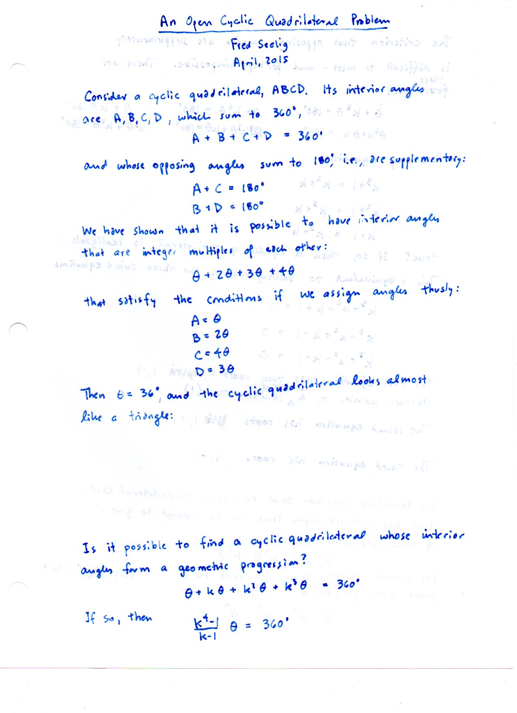

   Folio ``0112`` (original scan ``0112.jpg``) from ``resources/seelig/15_cyclic-quadrilateral``.

**Diplomatic Mathematical & Geometric Transcription**

**Diplomatic Transcription — Folio 0112** (``0112.jpg``, Sheet 15 of 16):

Poses the question of whether a cyclic quadrilateral can have interior angles in geometric progression :math:`\theta, k\theta, k^2\theta, k^3\theta`.

.. math::

   \theta + 2\theta + 3\theta + 4\theta = 360^\circ \implies \theta = 36^\circ, \qquad f = |XZ| = 2\sin 36^\circ = \sqrt{3 - \phi}, \qquad e = |YW| = 2\sin 72^\circ = \phi\sqrt{3 - \phi}

.. admonition:: Editorial & Symbolic Notes

   Archival scan ``0112.jpg`` from Fred W. Seelig's notebook dossier on **F.15 Cyclic Quadrilateral** (Page 15 of 16). Companion OpenDocument worksheet(s): ``Cyclic Quad``, ``Chord Intersection``. Classical Euclidean foundations: :ref:`III.21`, :ref:`III.22`, :ref:`IV.11`.

Folio 0113 (Page 16 of 16): Impossibility Proof via Cubic Factorization
-----------------------------------------------------------------------

.. folio:: 0113

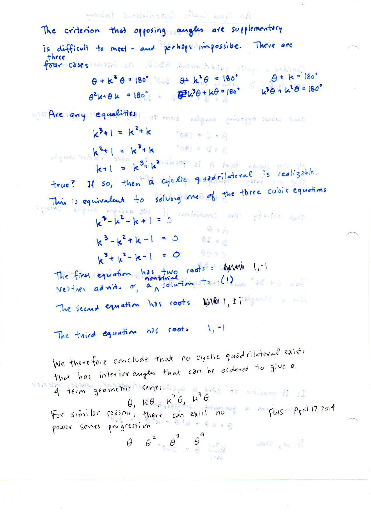

   Folio ``0113`` (original scan ``0113.jpg``) from ``resources/seelig/15_cyclic-quadrilateral``.

**Diplomatic Mathematical & Geometric Transcription**

**Diplomatic Transcription — Folio 0113** (``0113.jpg``, Sheet 16 of 16):

Proves that :math:`k^3 - k^2 - k + 1 = 0`, :math:`k^3 - k^2 + k - 1 = 0`, and :math:`k^3 + k^2 - k - 1 = 0` have only roots :math:`\pm 1, \pm i`, ruling out any non-trivial geometric progression.

.. math::

   a c + b d = e f \quad (\text{Ptolemy}), \qquad (k^3 - k^2 + k - 1) = (k - 1)(k^2 + 1) = 0

.. admonition:: Editorial & Symbolic Notes

   Archival scan ``0113.jpg`` from Fred W. Seelig's notebook dossier on **F.15 Cyclic Quadrilateral** (Page 16 of 16). Companion OpenDocument worksheet(s): ``Cyclic Quad``, ``Chord Intersection``. Classical Euclidean foundations: :ref:`III.21`, :ref:`III.22`, :ref:`IV.11`.
