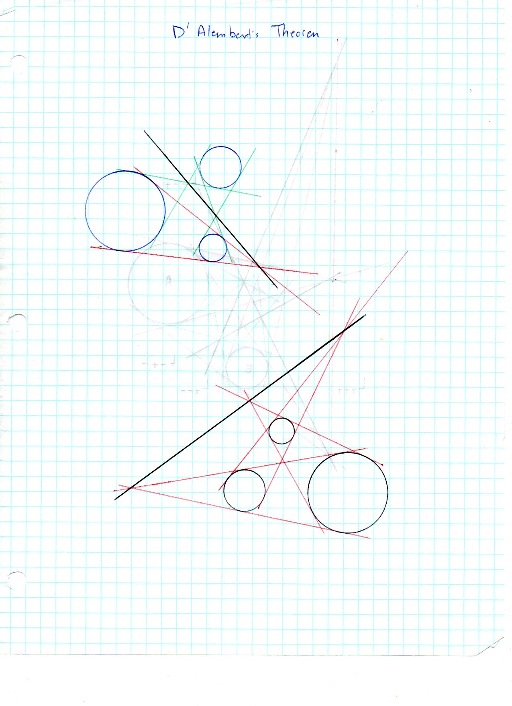
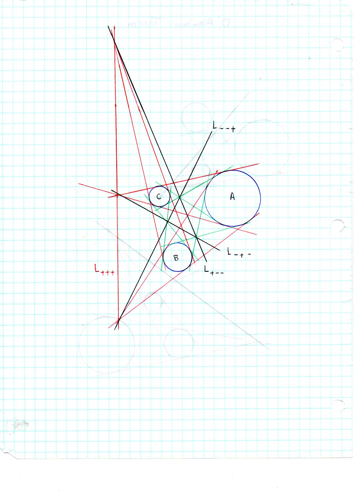
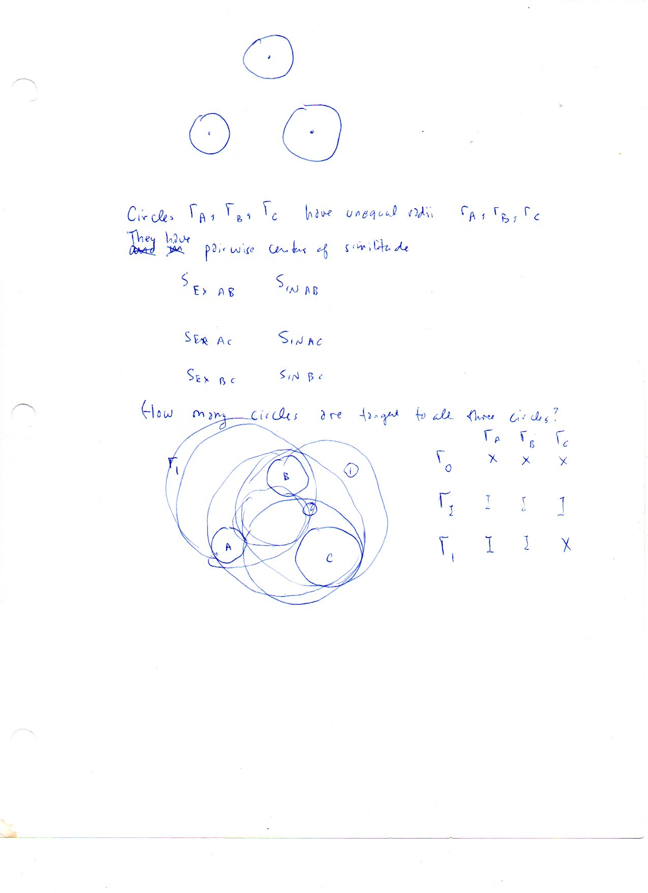
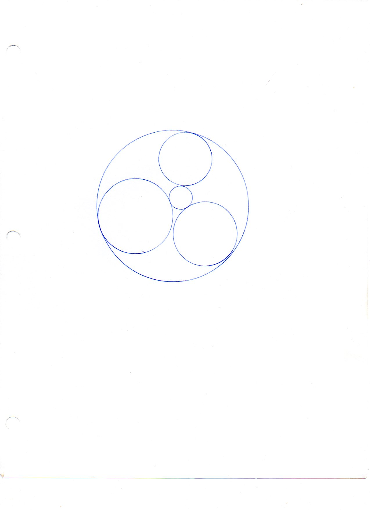

==================================
F.16 d'Alembert's Theorem — Folios
==================================

Archival manuscript scans and diplomatic transcriptions from :person:`seelig`'s
notebooks for **F.16 (d'Alembert's Theorem)** (:cite:`SeeligNotebooks`).

Folio 0114 (Page 1 of 4): D'Alembert's Theorem Multi-Color Constructions
------------------------------------------------------------------------

.. folio:: 0114

   Folio ``0114`` (original scan ``0114.jpg``) from ``resources/seelig/16_dalembert``.

**Diplomatic Mathematical & Geometric Transcription**

**Diplomatic Transcription — Folio 0114** (``0114.jpg``, Sheet 1 of 4):

Two constructions with red external tangent cones and green internal tangent cones whose apexes lie on thick black collinearity lines.

.. math::

   L_{+++}:\; \{S_{\text{EX}\,AB},\, S_{\text{EX}\,BC},\, S_{\text{EX}\,CA}\}, \qquad L_{+--}:\; \{S_{\text{EX}\,AB},\, S_{\text{IN}\,BC},\, S_{\text{IN}\,CA}\}

.. admonition:: Editorial & Symbolic Notes

   Archival scan ``0114.jpg`` from Fred W. Seelig's notebook dossier on **F.16 d'Alembert's Theorem** (Page 1 of 4). Companion OpenDocument worksheet(s): ``Centers of Similitude``. Classical Euclidean foundations: :ref:`VI.2`, :ref:`VI.4`.

Folio 0115 (Page 2 of 4): The Four Similitude Axes L_{+++}, L_{--+}, L_{-+-}, L_{+--}
-------------------------------------------------------------------------------------

.. folio:: 0115

   Folio ``0115`` (original scan ``0115.jpg``) from ``resources/seelig/16_dalembert``.

**Diplomatic Mathematical & Geometric Transcription**

**Diplomatic Transcription — Folio 0115** (``0115.jpg``, Sheet 2 of 4):

Grid-paper drawing of circles :math:`A, B, C` showing all 6 centers of similitude and all 4 Monge–d'Alembert axes.

.. math::

   L_{+++}:\; \{S_{\text{EX}\,AB},\, S_{\text{EX}\,BC},\, S_{\text{EX}\,CA}\}, \qquad L_{+--}:\; \{S_{\text{EX}\,AB},\, S_{\text{IN}\,BC},\, S_{\text{IN}\,CA}\}

.. admonition:: Editorial & Symbolic Notes

   Archival scan ``0115.jpg`` from Fred W. Seelig's notebook dossier on **F.16 d'Alembert's Theorem** (Page 2 of 4). Companion OpenDocument worksheet(s): ``Centers of Similitude``. Classical Euclidean foundations: :ref:`VI.2`, :ref:`VI.4`.

Folio 0116 (Page 3 of 4): Connection to the Problem of Apollonius
-----------------------------------------------------------------

.. folio:: 0116

   Folio ``0116`` (original scan ``0116.jpg``) from ``resources/seelig/16_dalembert``.

**Diplomatic Mathematical & Geometric Transcription**

**Diplomatic Transcription — Folio 0116** (``0116.jpg``, Sheet 3 of 4):

Lists the 6 similitude centers and sets up the `X`/`I` tangency state table for circles tangent to :math:`\Gamma_A, \Gamma_B, \Gamma_C`.

.. math::

   L_{+++}:\; \{S_{\text{EX}\,AB},\, S_{\text{EX}\,BC},\, S_{\text{EX}\,CA}\}, \qquad L_{+--}:\; \{S_{\text{EX}\,AB},\, S_{\text{IN}\,BC},\, S_{\text{IN}\,CA}\}

.. admonition:: Editorial & Symbolic Notes

   Archival scan ``0116.jpg`` from Fred W. Seelig's notebook dossier on **F.16 d'Alembert's Theorem** (Page 3 of 4). Companion OpenDocument worksheet(s): ``Centers of Similitude``. Classical Euclidean foundations: :ref:`VI.2`, :ref:`VI.4`.

Folio 0117 (Page 4 of 4): Compass Construction of Mutually Tangent Soddy Circles
--------------------------------------------------------------------------------

.. folio:: 0117

   Folio ``0117`` (original scan ``0117.jpg``) from ``resources/seelig/16_dalembert``.

**Diplomatic Mathematical & Geometric Transcription**

**Diplomatic Transcription — Folio 0117** (``0117.jpg``, Sheet 4 of 4):

Precision compass drawing of three mutually tangent circles enclosed by an outer tangent circle and surrounding a small inner tangent circle.

.. math::

   L_{+++}:\; \{S_{\text{EX}\,AB},\, S_{\text{EX}\,BC},\, S_{\text{EX}\,CA}\}, \qquad L_{+--}:\; \{S_{\text{EX}\,AB},\, S_{\text{IN}\,BC},\, S_{\text{IN}\,CA}\}

.. admonition:: Editorial & Symbolic Notes

   Archival scan ``0117.jpg`` from Fred W. Seelig's notebook dossier on **F.16 d'Alembert's Theorem** (Page 4 of 4). Companion OpenDocument worksheet(s): ``Centers of Similitude``. Classical Euclidean foundations: :ref:`VI.2`, :ref:`VI.4`.
