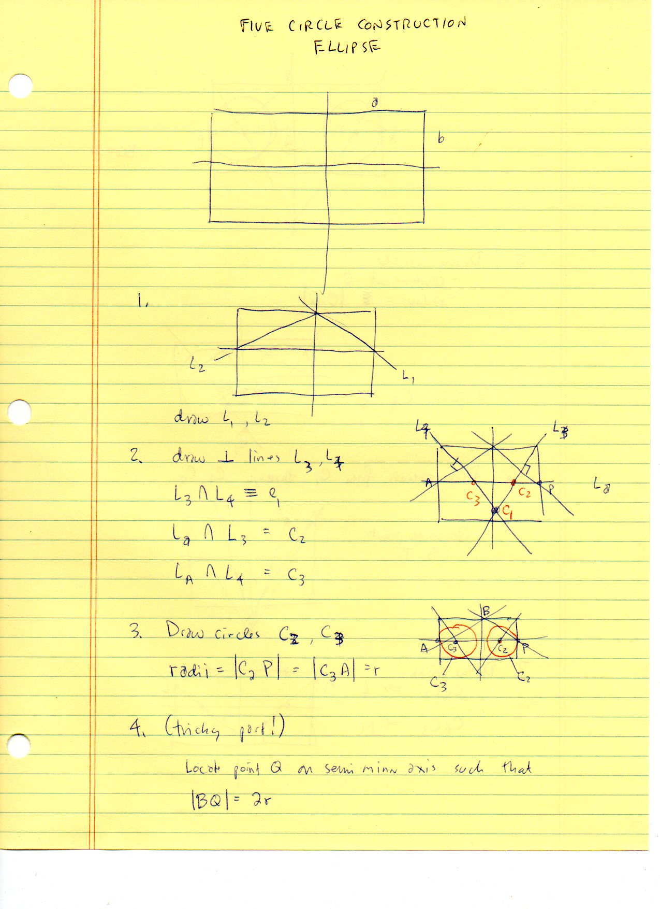
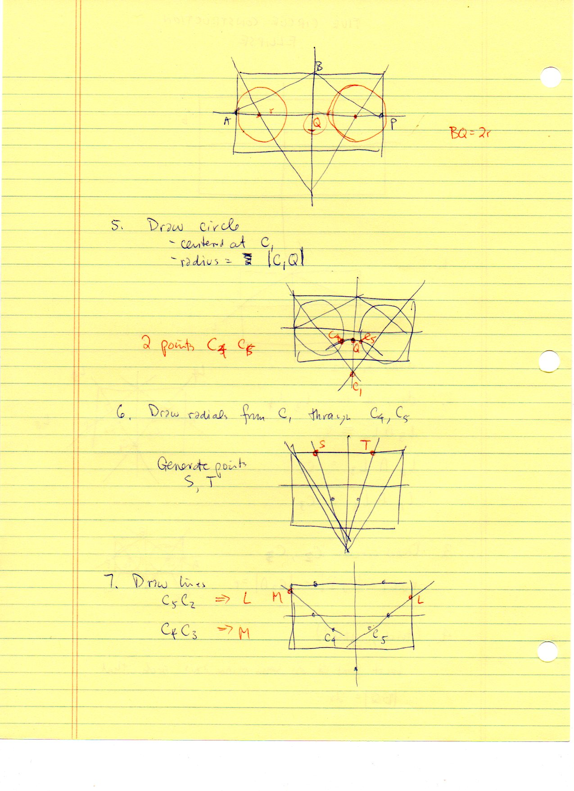
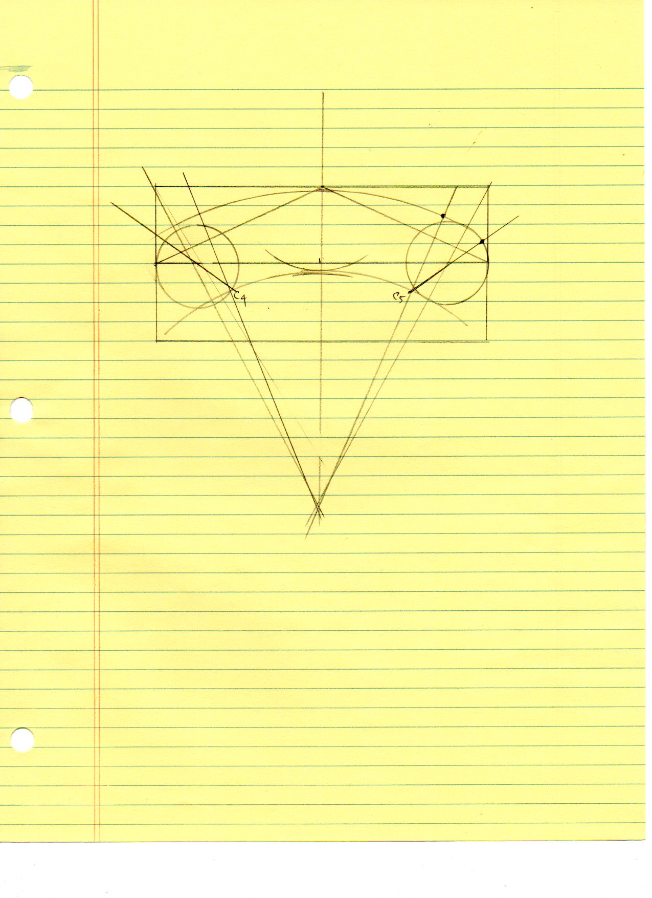
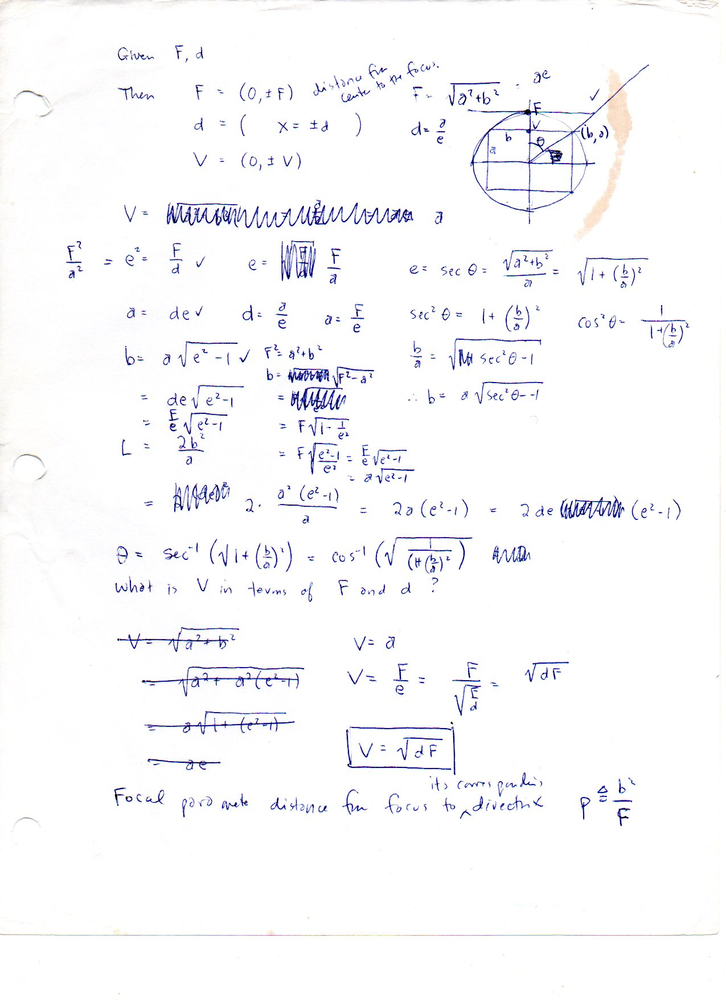

=====================
F.17 Ellipse — Folios
=====================

Archival manuscript scans and diplomatic transcriptions from :person:`seelig`'s
notebooks for **F.17 (Ellipse)** (:cite:`SeeligNotebooks`).

Folio 0118 (Page 1 of 4): Five-Circle Construction Ellipse — Steps 1–4
----------------------------------------------------------------------

.. folio:: 0118

   Folio ``0118`` (original scan ``0118.jpg``) from ``resources/seelig/17_ellipse``.

**Diplomatic Mathematical & Geometric Transcription**

**Diplomatic Transcription — Folio 0118** (``0118.jpg``, Sheet 1 of 4):

Sets up bounding box :math:`(a, b)`, diagonals :math:`L_1, L_2`, normals :math:`L_3, L_4` meeting at :math:`C_1, C_2, C_3`, and end-cap circles of radius :math:`r`.

.. math::

   \frac{x^2}{a^2} + \frac{y^2}{b^2} = 1, \qquad r_1 + r_2 = 2 a, \qquad V = a = \sqrt{d \cdot F}, \qquad L = \frac{2 b^2}{a}

.. admonition:: Editorial & Symbolic Notes

   Archival scan ``0118.jpg`` from Fred W. Seelig's notebook dossier on **F.17 Ellipse** (Page 1 of 4). Companion OpenDocument worksheet(s): ``General Reference``. Classical Euclidean foundations: :ref:`I.47`, :ref:`VI.13`.

Folio 0119 (Page 2 of 4): Five-Circle Construction Ellipse — Steps 5–7
----------------------------------------------------------------------

.. folio:: 0119

   Folio ``0119`` (original scan ``0119.jpg``) from ``resources/seelig/17_ellipse``.

**Diplomatic Mathematical & Geometric Transcription**

**Diplomatic Transcription — Folio 0119** (``0119.jpg``, Sheet 2 of 4):

Locates :math:`Q` with :math:`|BQ| = 2r`, draws circle :math:`(C_1, |C_1 Q|)` to find :math:`C_4, C_5`, and draws transition radials through :math:`C_2, C_3`.

.. math::

   \frac{x^2}{a^2} + \frac{y^2}{b^2} = 1, \qquad r_1 + r_2 = 2 a, \qquad V = a = \sqrt{d \cdot F}, \qquad L = \frac{2 b^2}{a}

.. admonition:: Editorial & Symbolic Notes

   Archival scan ``0119.jpg`` from Fred W. Seelig's notebook dossier on **F.17 Ellipse** (Page 2 of 4). Companion OpenDocument worksheet(s): ``General Reference``. Classical Euclidean foundations: :ref:`I.47`, :ref:`VI.13`.

Folio 0120 (Page 3 of 4): Full-Page Compass Execution of the Five-Circle Oval
-----------------------------------------------------------------------------

.. folio:: 0120

   Folio ``0120`` (original scan ``0120.jpg``) from ``resources/seelig/17_ellipse``.

**Diplomatic Mathematical & Geometric Transcription**

**Diplomatic Transcription — Folio 0120** (``0120.jpg``, Sheet 3 of 4):

Precision compass-and-straightedge construction showing centers :math:`C_1..C_5` and smooth tangent circular arcs.

.. math::

   \frac{x^2}{a^2} + \frac{y^2}{b^2} = 1, \qquad r_1 + r_2 = 2 a, \qquad V = a = \sqrt{d \cdot F}, \qquad L = \frac{2 b^2}{a}

.. admonition:: Editorial & Symbolic Notes

   Archival scan ``0120.jpg`` from Fred W. Seelig's notebook dossier on **F.17 Ellipse** (Page 3 of 4). Companion OpenDocument worksheet(s): ``General Reference``. Classical Euclidean foundations: :ref:`I.47`, :ref:`VI.13`.

Folio 0121 (Page 4 of 4): Focus, Directrix, Eccentricity & Latus Rectum Identities
----------------------------------------------------------------------------------

.. folio:: 0121

   Folio ``0121`` (original scan ``0121.jpg``) from ``resources/seelig/17_ellipse``.

**Diplomatic Mathematical & Geometric Transcription**

**Diplomatic Transcription — Folio 0121** (``0121.jpg``, Sheet 4 of 4):

Derives :math:`F = ae, d = a/e, e^2 = F/d, V = a = \sqrt{dF}`, and latus rectum :math:`L = 2b^2/a`.

.. math::

   \frac{x^2}{a^2} + \frac{y^2}{b^2} = 1, \qquad r_1 + r_2 = 2 a, \qquad V = a = \sqrt{d \cdot F}, \qquad L = \frac{2 b^2}{a}

.. admonition:: Editorial & Symbolic Notes

   Archival scan ``0121.jpg`` from Fred W. Seelig's notebook dossier on **F.17 Ellipse** (Page 4 of 4). Companion OpenDocument worksheet(s): ``General Reference``. Classical Euclidean foundations: :ref:`I.47`, :ref:`VI.13`.
