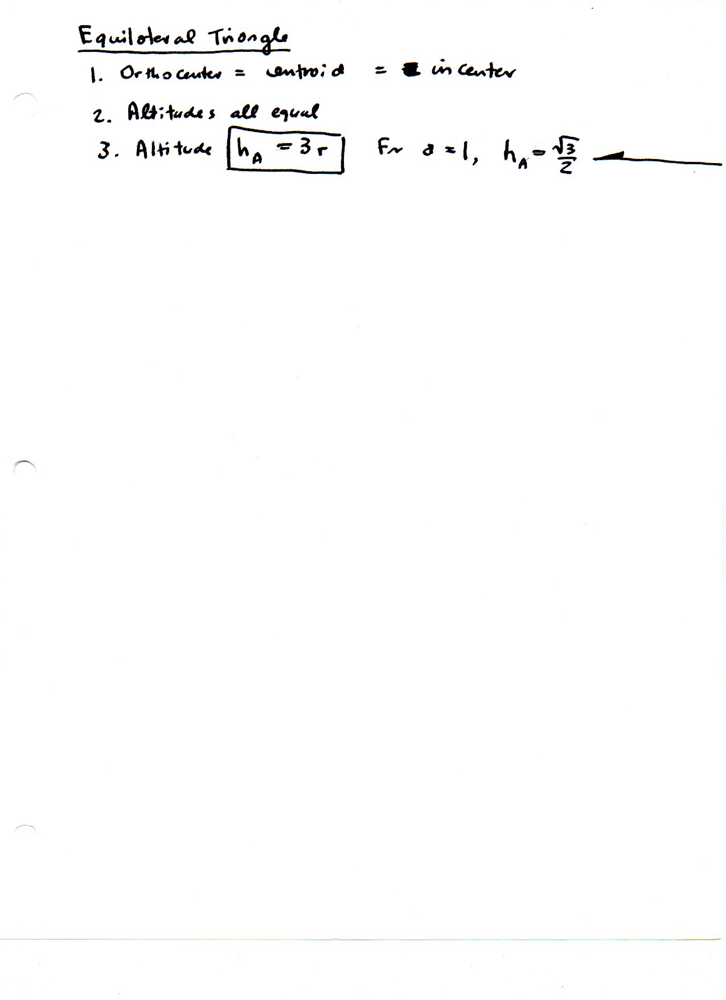
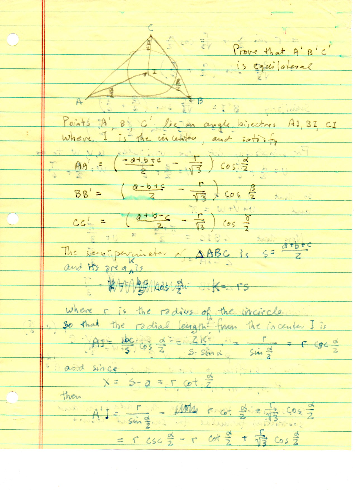
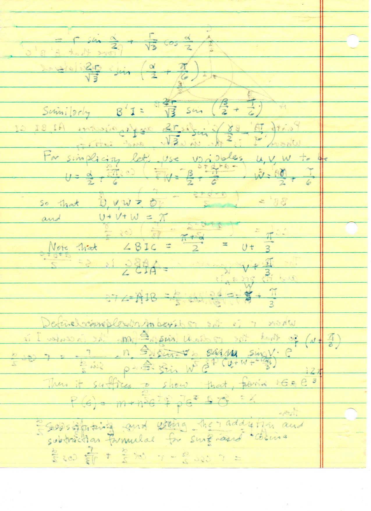

==================================
F.18 Equilateral Triangle — Folios
==================================

Archival manuscript scans and diplomatic transcriptions from :person:`seelig`'s
notebooks for **F.18 (Equilateral Triangle)** (:cite:`SeeligNotebooks`).

Folio 0122 (Page 1 of 3): Equilateral Triangle Fundamental Properties
---------------------------------------------------------------------

.. folio:: 0122

   Folio ``0122`` (original scan ``0122.jpg``) from ``resources/seelig/18_equilateral-triangle``.

**Diplomatic Mathematical & Geometric Transcription**

**Diplomatic Transcription — Folio 0122** (``0122.jpg``, Sheet 1 of 3):

Lists coincidence of orthocenter, centroid, and incenter, equal altitudes, and :math:`h_A = 3r` (:math:`h_A = \sqrt{3}/2` for :math:`a=1`).

.. math::

   h_A = \frac{\sqrt{3}}{2} a = 3 r, \qquad R = \frac{a}{\sqrt{3}} = 2 r, \qquad K = \frac{\sqrt{3}}{4} a^2

.. admonition:: Editorial & Symbolic Notes

   Archival scan ``0122.jpg`` from Fred W. Seelig's notebook dossier on **F.18 Equilateral Triangle** (Page 1 of 3). Companion OpenDocument worksheet(s): ``General Reference``, ``Polygon Table``. Classical Euclidean foundations: :ref:`I.1`, :ref:`IV.2`, :ref:`IV.3`. Kimberling *Encyclopedia of Triangle Centers* loci: :ref:`X(1)`, :ref:`X(2)`, :ref:`X(3)`, :ref:`X(4)`.

Folio 0123 (Page 2 of 3): Incenter-Bisector Equilateral Triangle Proof (Page 1)
-------------------------------------------------------------------------------

.. folio:: 0123

   Folio ``0123`` (original scan ``0123.jpg``) from ``resources/seelig/18_equilateral-triangle``.

**Diplomatic Mathematical & Geometric Transcription**

**Diplomatic Transcription — Folio 0123** (``0123.jpg``, Sheet 2 of 3):

Simplifies :math:`A'I = r\csc(\alpha/2) - r\cot(\alpha/2) + \frac{r}{\sqrt{3}}\cos(\alpha/2) = \frac{2r}{\sqrt{3}}\sin(\frac{\alpha}{2} + \frac{\pi}{6})`.

.. math::

   A'I = \frac{2 r}{\sqrt{3}}\sin\left(\frac{\alpha}{2} + \frac{\pi}{6}\right), \qquad P(\epsilon) = m + n\epsilon + p\epsilon^2 = 0 \quad (\epsilon = e^{i 2\pi/3})

.. admonition:: Editorial & Symbolic Notes

   Archival scan ``0123.jpg`` from Fred W. Seelig's notebook dossier on **F.18 Equilateral Triangle** (Page 2 of 3). Companion OpenDocument worksheet(s): ``General Reference``, ``Polygon Table``. Classical Euclidean foundations: :ref:`I.1`, :ref:`IV.2`, :ref:`IV.3`. Kimberling *Encyclopedia of Triangle Centers* loci: :ref:`X(1)`, :ref:`X(2)`, :ref:`X(3)`, :ref:`X(4)`.

Folio 0124 (Page 3 of 3): Incenter-Bisector Equilateral Triangle Proof via Roots of Unity (Page 2)
--------------------------------------------------------------------------------------------------

.. folio:: 0124

   Folio ``0124`` (original scan ``0124.jpg``) from ``resources/seelig/18_equilateral-triangle``.

**Diplomatic Mathematical & Geometric Transcription**

**Diplomatic Transcription — Folio 0124** (``0124.jpg``, Sheet 3 of 3):

Substitutes :math:`u = \alpha/2 + \pi/6, v = \beta/2 + \pi/6, w = \gamma/2 + \pi/6` (:math:`u+v+w=\pi`) and complex cube root of unity :math:`\epsilon = e^{i 2\pi/3}`.

.. math::

   h_A = \frac{\sqrt{3}}{2} a = 3 r, \qquad R = \frac{a}{\sqrt{3}} = 2 r, \qquad K = \frac{\sqrt{3}}{4} a^2

.. admonition:: Editorial & Symbolic Notes

   Archival scan ``0124.jpg`` from Fred W. Seelig's notebook dossier on **F.18 Equilateral Triangle** (Page 3 of 3). Companion OpenDocument worksheet(s): ``General Reference``, ``Polygon Table``. Classical Euclidean foundations: :ref:`I.1`, :ref:`IV.2`, :ref:`IV.3`. Kimberling *Encyclopedia of Triangle Centers* loci: :ref:`X(1)`, :ref:`X(2)`, :ref:`X(3)`, :ref:`X(4)`.
