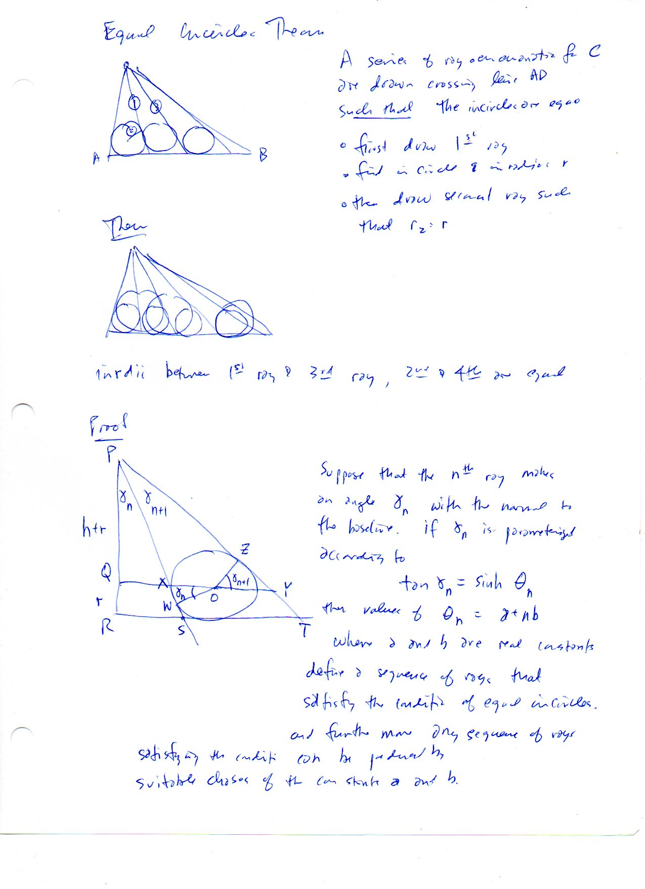
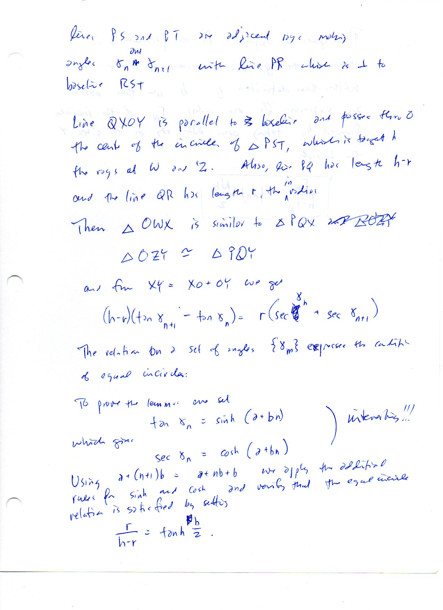

=====================================
F.19 Equal Incircles Theorem — Folios
=====================================

Archival manuscript scans and diplomatic transcriptions from :person:`seelig`'s
notebooks for **F.19 (Equal Incircles Theorem)** (:cite:`SeeligNotebooks`).

Folio 0125 (Page 1 of 2): Equal Incircles Theorem Statement & Ray-Fan Diagrams
------------------------------------------------------------------------------

.. folio:: 0125

   Folio ``0125`` (original scan ``0125.jpg``) from ``resources/seelig/19_equal-incircle-theorem``.

**Diplomatic Mathematical & Geometric Transcription**

**Diplomatic Transcription — Folio 0125** (``0125.jpg``, Sheet 1 of 2):

States the theorem with two ray-fan diagrams and introduces the hyperbolic substitution :math:`\tan\gamma_n = \sinh(a + nb)`.

.. math::

   (h - r)(\tan\gamma_{n+1} - \tan\gamma_n) = r(\sec\gamma_n + \sec\gamma_{n+1})

.. admonition:: Editorial & Symbolic Notes

   Archival scan ``0125.jpg`` from Fred W. Seelig's notebook dossier on **F.19 Equal Incircles Theorem** (Page 1 of 2). Companion OpenDocument worksheet(s): ``Incircle-Incenter``. Classical Euclidean foundations: :ref:`IV.4`, :ref:`VI.4`. Kimberling *Encyclopedia of Triangle Centers* loci: :ref:`X(1)`.

Folio 0126 (Page 2 of 2): Similarity Proof & Hyperbolic Identity ('interesting!!!')
-----------------------------------------------------------------------------------

.. folio:: 0126

   Folio ``0126`` (original scan ``0126.jpg``) from ``resources/seelig/19_equal-incircle-theorem``.

**Diplomatic Mathematical & Geometric Transcription**

**Diplomatic Transcription — Folio 0126** (``0126.jpg``, Sheet 2 of 2):

Uses :math:`\triangle OWX \sim \triangle PQX` to derive :math:`(h-r)(\tan\gamma_{n+1}-\tan\gamma_n) = r(\sec\gamma_n+\sec\gamma_{n+1})` and reduces it to :math:`\frac{r}{h-r} = \tanh(b/2)`.

.. math::

   \tan\gamma_n = \sinh(a + n b), \qquad \sec\gamma_n = \cosh(a + n b), \qquad \frac{r}{h - r} = \tanh\frac{b}{2}

.. admonition:: Editorial & Symbolic Notes

   Archival scan ``0126.jpg`` from Fred W. Seelig's notebook dossier on **F.19 Equal Incircles Theorem** (Page 2 of 2). Companion OpenDocument worksheet(s): ``Incircle-Incenter``. Classical Euclidean foundations: :ref:`IV.4`, :ref:`VI.4`. Kimberling *Encyclopedia of Triangle Centers* loci: :ref:`X(1)`.
