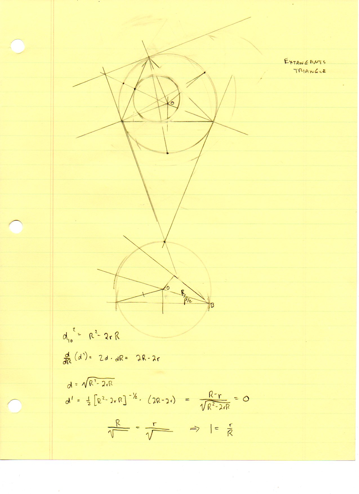

=======================
F.20 Extangent — Folios
=======================

Archival manuscript scans and diplomatic transcriptions from :person:`seelig`'s
notebooks for **F.20 (Extangent)** (:cite:`SeeligNotebooks`).

Folio 0127 (Page 1 of 1): Extangents Triangle & Derivative of Euler's Distance d_{IO}
-------------------------------------------------------------------------------------

.. folio:: 0127

   Folio ``0127`` (original scan ``0127.jpg``) from ``resources/seelig/20_extangent``.

**Diplomatic Mathematical & Geometric Transcription**

**Diplomatic Transcription — Folio 0127** (``0127.jpg``, Sheet 1 of 1):

Compass construction of the extangents triangle around an inscribed triangle and differentiation of :math:`d_{IO} = \sqrt{R^2 - 2rR}` with respect to :math:`R`.

.. math::

   d_{IO}^2 = R^2 - 2 r R, \qquad \frac{d}{d R}(d_{IO}) = \frac{R - r}{\sqrt{R^2 - 2 r R}}, \qquad r_a = \frac{K}{s - a}, \quad r_b = \frac{K}{s - b}, \quad r_c = \frac{K}{s - c}

.. admonition:: Editorial & Symbolic Notes

   Archival scan ``0127.jpg`` from Fred W. Seelig's notebook dossier on **F.20 Extangent** (Page 1 of 1). Companion OpenDocument worksheet(s): ``Excenters``, ``Incircle-Incenter``, ``Centers of Similitude``. Classical Euclidean foundations: :ref:`IV.4`. Kimberling *Encyclopedia of Triangle Centers* loci: :ref:`X(1)`, :ref:`X(3)`, :ref:`X(40)`, :ref:`X(55)`, :ref:`X(56)`.
