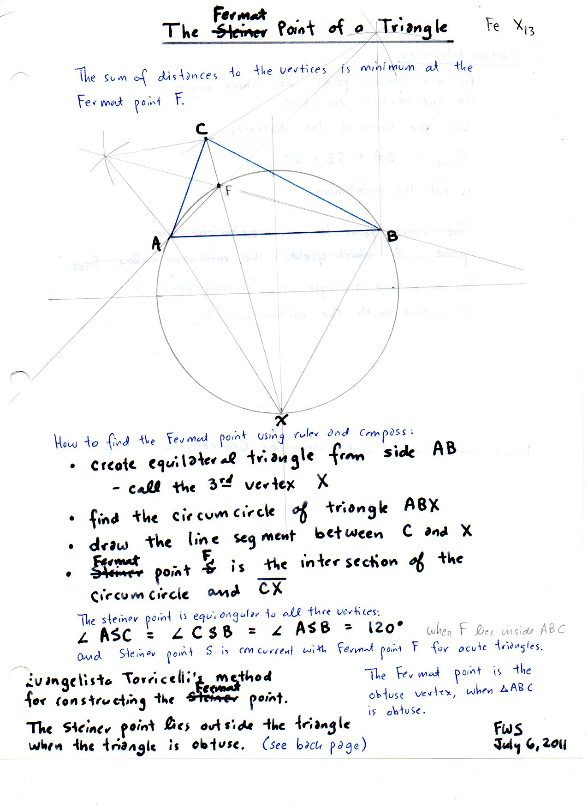
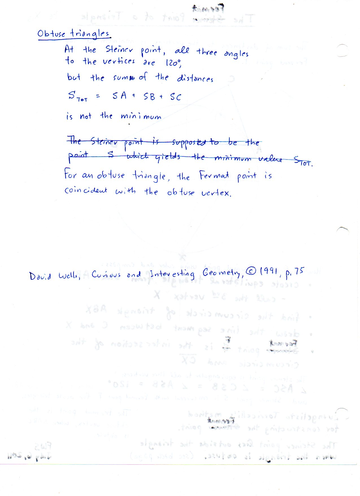

==========================
F.21 Fermat Point — Folios
==========================

Archival manuscript scans and diplomatic transcriptions from :person:`seelig`'s
notebooks for **F.21 (Fermat Point)** (:cite:`SeeligNotebooks`).

Folio 0128 (Page 1 of 2): Torricelli's Construction of the Fermat Point X(13) (FWS July 6, 2011)
------------------------------------------------------------------------------------------------

.. folio:: 0128

   Folio ``0128`` (original scan ``0128.jpg``) from ``resources/seelig/21_fermat-point``.

**Diplomatic Mathematical & Geometric Transcription**

**Diplomatic Transcription — Folio 0128** (``0128.jpg``, Sheet 1 of 2):

Step-by-step ruler-and-compass algorithm constructing external equilateral triangle :math:`\triangle ABX` and its circumcircle to locate :math:`F = X(13)`.

.. math::

   \angle AFB = \angle BFC = \angle CFA = 120^\circ, \qquad \min_{P} (|PA| + |PB| + |PC|) = |CC'| = \sqrt{\frac{a^2 + b^2 + c^2}{2} + 2\sqrt{3} K}

.. admonition:: Editorial & Symbolic Notes

   Archival scan ``0128.jpg`` from Fred W. Seelig's notebook dossier on **F.21 Fermat Point** (Page 1 of 2). Companion OpenDocument worksheet(s): ``General Reference``, ``Barycentric``. Classical Euclidean foundations: :ref:`I.1`, :ref:`III.21`, :ref:`III.22`. Kimberling *Encyclopedia of Triangle Centers* loci: :ref:`X(13)`, :ref:`X(14)`, :ref:`X(15)`, :ref:`X(16)`.

Folio 0129 (Page 2 of 2): Obtuse Triangle Regime & Distinction from the Steiner Point (Wells 1991, p. 75)
---------------------------------------------------------------------------------------------------------

.. folio:: 0129

   Folio ``0129`` (original scan ``0129.jpg``) from ``resources/seelig/21_fermat-point``.

**Diplomatic Mathematical & Geometric Transcription**

**Diplomatic Transcription — Folio 0129** (``0129.jpg``, Sheet 2 of 2):

Explains why :math:`S_{\text{TOT}} = SA + SB + SC` is minimized at the obtuse vertex whenever an angle is :math:`\ge 120^\circ`.

.. math::

   F = X(13) = \left(\csc\left(\alpha + \frac{\pi}{3}\right) : \csc\left(\beta + \frac{\pi}{3}\right) : \csc\left(\gamma + \frac{\pi}{3}\right)\right)

.. admonition:: Editorial & Symbolic Notes

   Archival scan ``0129.jpg`` from Fred W. Seelig's notebook dossier on **F.21 Fermat Point** (Page 2 of 2). Companion OpenDocument worksheet(s): ``General Reference``, ``Barycentric``. Classical Euclidean foundations: :ref:`I.1`, :ref:`III.21`, :ref:`III.22`. Kimberling *Encyclopedia of Triangle Centers* loci: :ref:`X(13)`, :ref:`X(14)`, :ref:`X(15)`, :ref:`X(16)`.
