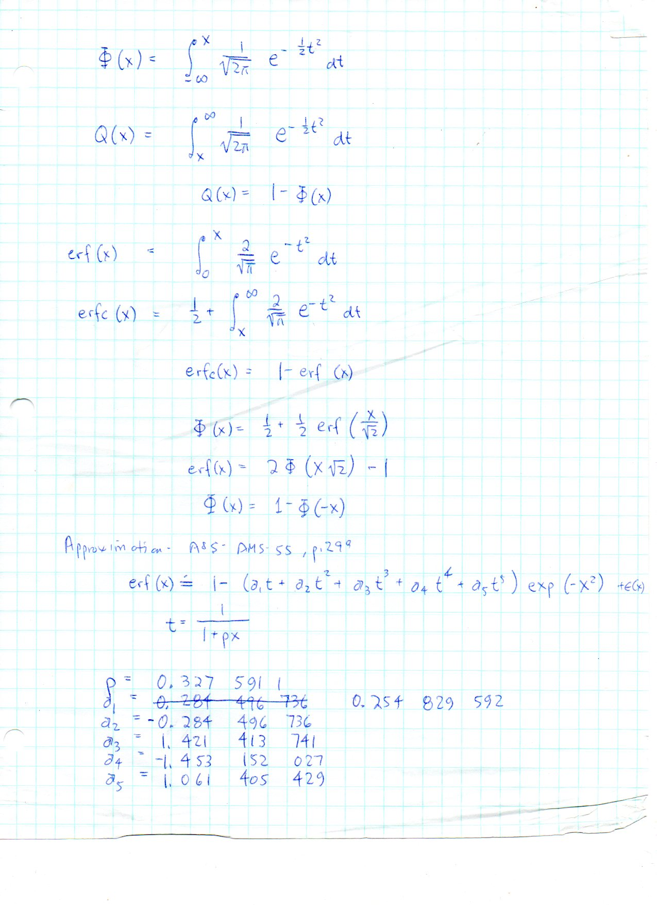
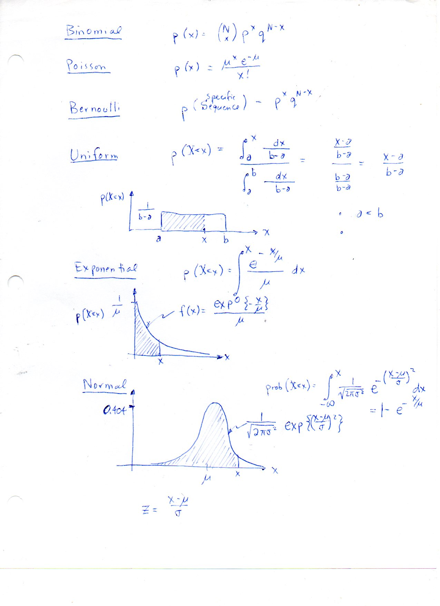

=======================
F.22 Functions — Folios
=======================

Archival manuscript scans and diplomatic transcriptions from :person:`seelig`'s
notebooks for **F.22 (Functions)** (:cite:`SeeligNotebooks`).

Folio 0130 (Page 1 of 2): Gaussian CDF Phi(x), Q(x), erf(x) & Abramowitz–Stegun Eq. 7.1.26
------------------------------------------------------------------------------------------

.. folio:: 0130

   Folio ``0130`` (original scan ``0130.jpg``) from ``resources/seelig/22_functions``.

**Diplomatic Mathematical & Geometric Transcription**

**Diplomatic Transcription — Folio 0130** (``0130.jpg``, Sheet 1 of 2):

Defines :math:`\Phi(x), Q(x), \operatorname{erf}(x), \operatorname{erfc}(x)` and lists the 6 numerical constants :math:`p, a_1..a_5` from AMS-55, p. 299.

.. math::

   \Phi(x) = \frac{1}{2} + \frac{1}{2}\operatorname{erf}\left(\frac{x}{\sqrt{2}}\right), \qquad \operatorname{erf}(x) \approx 1 - \left(\sum_{k=1}^5 a_k t^k\right) e^{-x^2}, \quad t = \frac{1}{1 + 0.3275911 x}

.. admonition:: Editorial & Symbolic Notes

   Archival scan ``0130.jpg`` from Fred W. Seelig's notebook dossier on **F.22 Functions** (Page 1 of 2). Companion OpenDocument worksheet(s): ``General Reference``.

Folio 0131 (Page 2 of 2): Six Discrete & Continuous Probability Distributions
-----------------------------------------------------------------------------

.. folio:: 0131

   Folio ``0131`` (original scan ``0131.jpg``) from ``resources/seelig/22_functions``.

**Diplomatic Mathematical & Geometric Transcription**

**Diplomatic Transcription — Folio 0131** (``0131.jpg``, Sheet 2 of 2):

Summarizes formulas and density/CDF sketches for Binomial, Poisson, Bernoulli, Uniform, Exponential, and Normal distributions.

.. math::

   \Phi(x) = \frac{1}{2} + \frac{1}{2}\operatorname{erf}\left(\frac{x}{\sqrt{2}}\right), \qquad \operatorname{erf}(x) \approx 1 - \left(\sum_{k=1}^5 a_k t^k\right) e^{-x^2}, \quad t = \frac{1}{1 + 0.3275911 x}

.. admonition:: Editorial & Symbolic Notes

   Archival scan ``0131.jpg`` from Fred W. Seelig's notebook dossier on **F.22 Functions** (Page 2 of 2). Companion OpenDocument worksheet(s): ``General Reference``.
