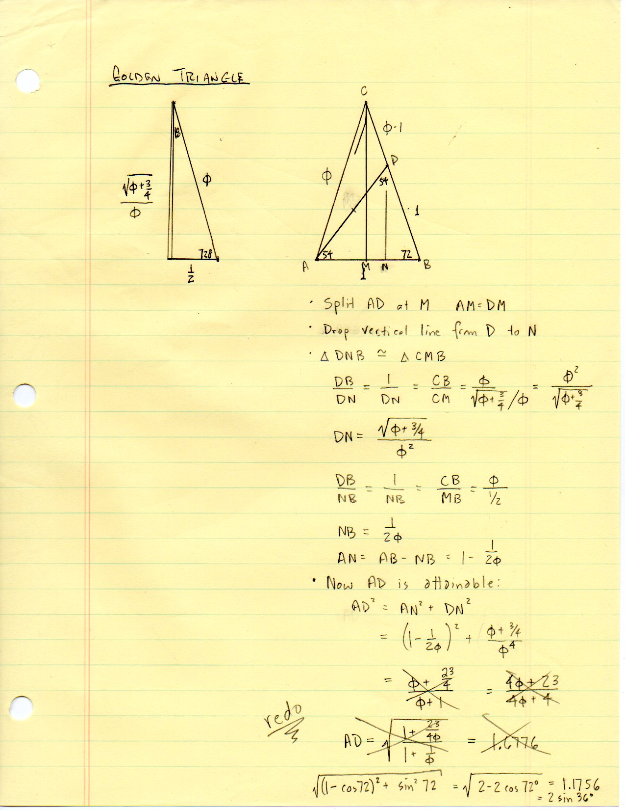
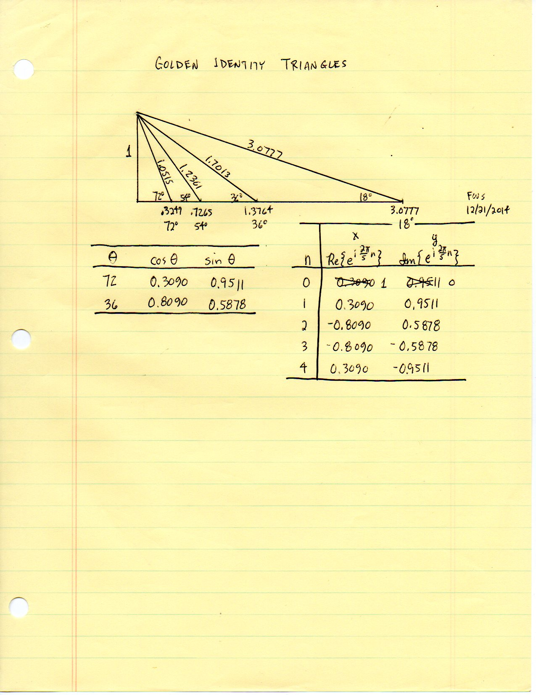
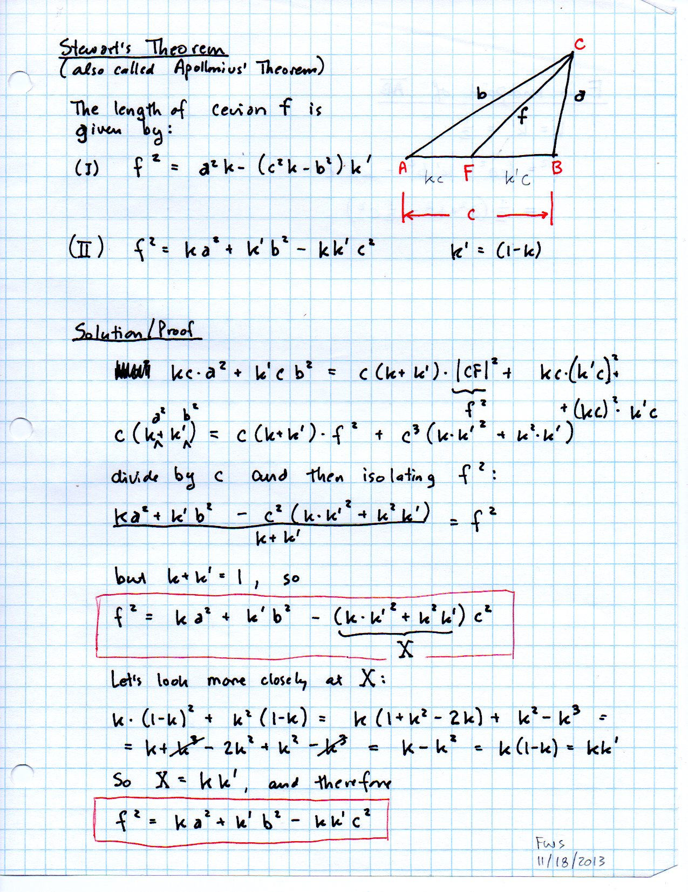

==============================
F.23 Golden Triangles — Folios
==============================

Archival manuscript scans and diplomatic transcriptions from :person:`seelig`'s
notebooks for **F.23 (Golden Triangles)** (:cite:`SeeligNotebooks`).

Folio 0132 (Page 1 of 3): Golden Triangle 72-72-36 & Segment AD
---------------------------------------------------------------

.. folio:: 0132

   Folio ``0132`` (original scan ``0132.jpg``) from ``resources/seelig/23_golden-triangles``.

**Diplomatic Mathematical & Geometric Transcription**

**Diplomatic Transcription — Folio 0132** (``0132.jpg``, Sheet 1 of 3):

Analyzes the :math:`72^\circ\text{–}72^\circ\text{–}36^\circ` triangle with legs :math:`\phi`, base :math:`1`, and point :math:`D` dividing :math:`BC` into :math:`\phi-1` and :math:`1`, proving :math:`AD = 2\sin 36^\circ \approx 1.1756`.

.. math::

   \phi = \frac{1 + \sqrt{5}}{2}, \qquad \cos 36^\circ = \frac{\phi}{2}, \qquad \cos 72^\circ = \frac{\phi - 1}{2} = \frac{1}{2\phi}, \qquad 2\sin 36^\circ = \sqrt{3 - \phi}

.. admonition:: Editorial & Symbolic Notes

   Archival scan ``0132.jpg`` from Fred W. Seelig's notebook dossier on **F.23 Golden Triangles** (Page 1 of 3). Companion OpenDocument worksheet(s): ``Golden Triangle``, ``Polygon Table``. Classical Euclidean foundations: :ref:`II.11`, :ref:`IV.10`, :ref:`IV.11`, :ref:`VI.30`.

Folio 0133 (Page 2 of 3): Golden Identity Triangles & 5th Roots of Unity (FWS 12/21/2014)
-----------------------------------------------------------------------------------------

.. folio:: 0133

   Folio ``0133`` (original scan ``0133.jpg``) from ``resources/seelig/23_golden-triangles``.

**Diplomatic Mathematical & Geometric Transcription**

**Diplomatic Transcription — Folio 0133** (``0133.jpg``, Sheet 2 of 3):

Draws nested right triangles of angles :math:`72^\circ, 54^\circ, 36^\circ, 18^\circ` with altitude :math:`1` and tabulates :math:`\operatorname{Re}` and :math:`\operatorname{Im}` of :math:`e^{i 2\pi n/5}`.

.. math::

   f^2 = k a^2 + k' b^2 - k k' c^2 \qquad (k + k' = 1)

.. admonition:: Editorial & Symbolic Notes

   Archival scan ``0133.jpg`` from Fred W. Seelig's notebook dossier on **F.23 Golden Triangles** (Page 2 of 3). Companion OpenDocument worksheet(s): ``Golden Triangle``, ``Polygon Table``. Classical Euclidean foundations: :ref:`II.11`, :ref:`IV.10`, :ref:`IV.11`, :ref:`VI.30`.

Folio 0134 (Page 3 of 3): Normalized Stewart's Theorem Proof (FWS 11/18/2013)
-----------------------------------------------------------------------------

.. folio:: 0134

   Folio ``0134`` (original scan ``0134.jpg``) from ``resources/seelig/23_golden-triangles``.

**Diplomatic Mathematical & Geometric Transcription**

**Diplomatic Transcription — Folio 0134** (``0134.jpg``, Sheet 3 of 3):

Proves :math:`f^2 = k a^2 + k' b^2 - k k' c^2` by reducing :math:`X = k(1-k)^2 + k^2(1-k) = k(1-k) = kk'`.

.. math::

   \phi = \frac{1 + \sqrt{5}}{2}, \qquad \cos 36^\circ = \frac{\phi}{2}, \qquad \cos 72^\circ = \frac{\phi - 1}{2} = \frac{1}{2\phi}, \qquad 2\sin 36^\circ = \sqrt{3 - \phi}

.. admonition:: Editorial & Symbolic Notes

   Archival scan ``0134.jpg`` from Fred W. Seelig's notebook dossier on **F.23 Golden Triangles** (Page 3 of 3). Companion OpenDocument worksheet(s): ``Golden Triangle``, ``Polygon Table``. Classical Euclidean foundations: :ref:`II.11`, :ref:`IV.10`, :ref:`IV.11`, :ref:`VI.30`.
