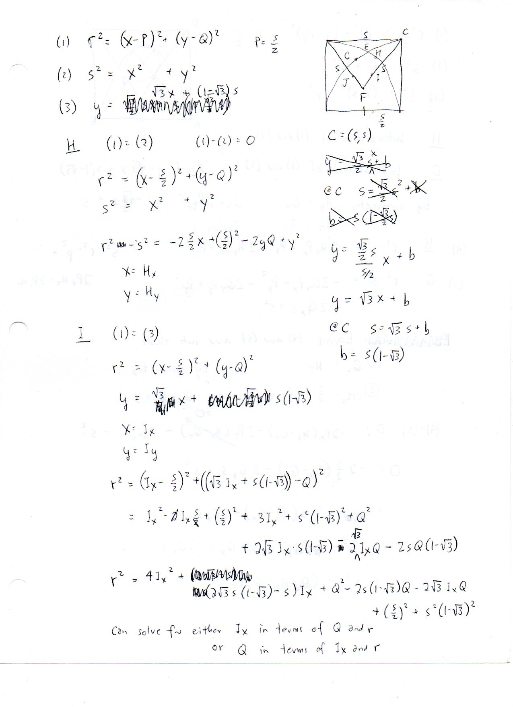
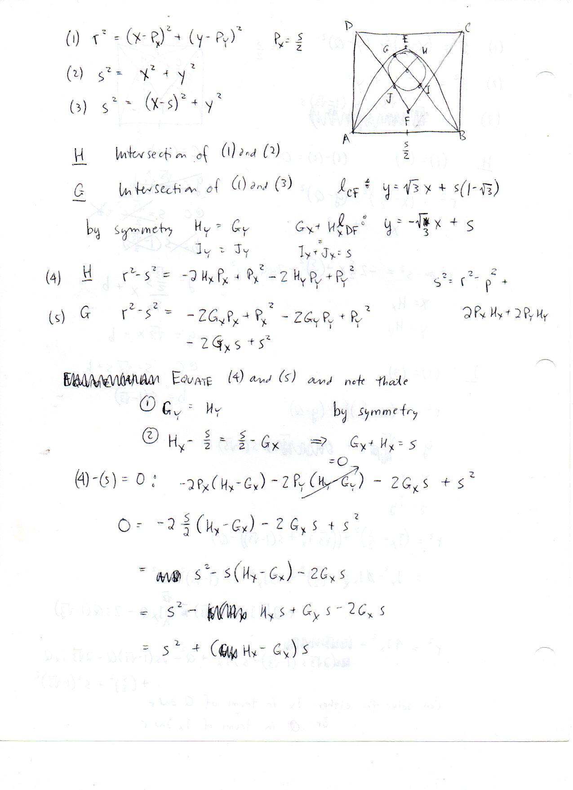
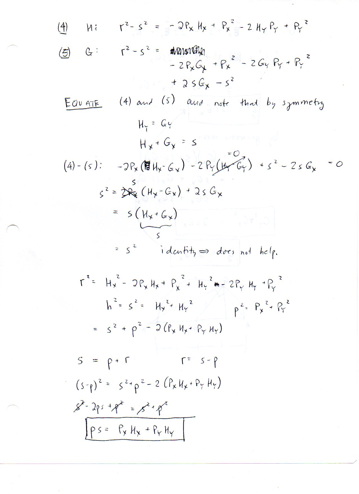
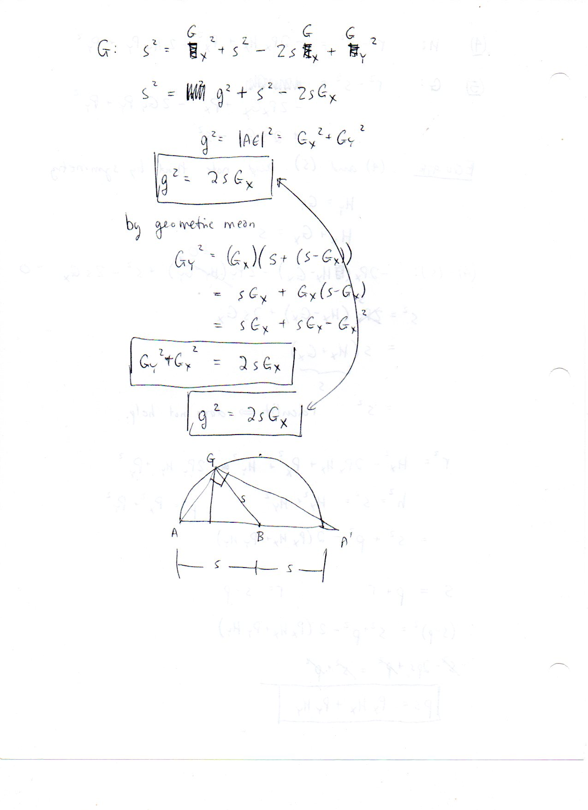
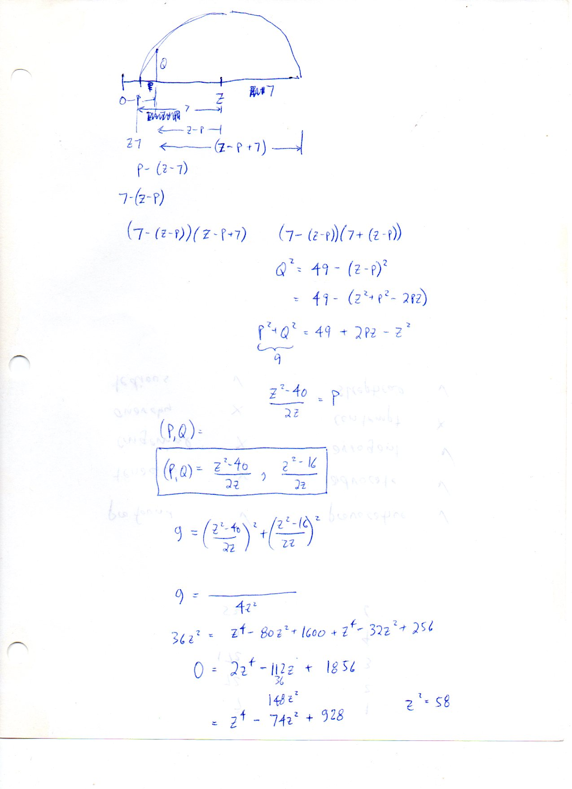

=========================
F.24 Gothic Arch — Folios
=========================

Archival manuscript scans and diplomatic transcriptions from :person:`seelig`'s
notebooks for **F.24 (Gothic Arch)** (:cite:`SeeligNotebooks`).

Folio 0135 (Page 1 of 5): Gothic Arch & Oculus Circle System in Square of Side s
--------------------------------------------------------------------------------

.. folio:: 0135

   Folio ``0135`` (original scan ``0135.jpg``) from ``resources/seelig/24_gothic``.

**Diplomatic Mathematical & Geometric Transcription**

**Diplomatic Transcription — Folio 0135** (``0135.jpg``, Sheet 1 of 5):

Sets up circle :math:`r^2 = (x-s/2)^2 + (y-Q)^2`, arch :math:`s^2 = x^2+y^2`, and line :math:`l_{CF}: y = \sqrt{3}x + s(1-\sqrt{3})`.

.. math::

   r^2 = \left(x - \frac{s}{2}\right)^2 + (y - Q)^2, \qquad p s = P_x H_x + P_y H_y \quad (r = s - p), \qquad g^2 = G_x^2 + G_y^2 = 2 s G_x

.. admonition:: Editorial & Symbolic Notes

   Archival scan ``0135.jpg`` from Fred W. Seelig's notebook dossier on **F.24 Gothic Arch** (Page 1 of 5). Companion OpenDocument worksheet(s): ``General Reference``. Classical Euclidean foundations: :ref:`I.1`, :ref:`III.11`, :ref:`III.12`.

Folio 0136 (Page 2 of 5): Three-Circle Symmetry Analysis at Intersections H and G
---------------------------------------------------------------------------------

.. folio:: 0136

   Folio ``0136`` (original scan ``0136.jpg``) from ``resources/seelig/24_gothic``.

**Diplomatic Mathematical & Geometric Transcription**

**Diplomatic Transcription — Folio 0136** (``0136.jpg``, Sheet 2 of 5):

Exploits horizontal symmetry :math:`H_y = G_y` and :math:`G_x + H_x = s` across the centerline :math:`x = s/2`.

.. math::

   r^2 = \left(x - \frac{s}{2}\right)^2 + (y - Q)^2, \qquad p s = P_x H_x + P_y H_y \quad (r = s - p), \qquad g^2 = G_x^2 + G_y^2 = 2 s G_x

.. admonition:: Editorial & Symbolic Notes

   Archival scan ``0136.jpg`` from Fred W. Seelig's notebook dossier on **F.24 Gothic Arch** (Page 2 of 5). Companion OpenDocument worksheet(s): ``General Reference``. Classical Euclidean foundations: :ref:`I.1`, :ref:`III.11`, :ref:`III.12`.

Folio 0137 (Page 3 of 5): Tangency Inner-Product Identity p*s = P_x H_x + P_y H_y
---------------------------------------------------------------------------------

.. folio:: 0137

   Folio ``0137`` (original scan ``0137.jpg``) from ``resources/seelig/24_gothic``.

**Diplomatic Mathematical & Geometric Transcription**

**Diplomatic Transcription — Folio 0137** (``0137.jpg``, Sheet 3 of 5):

Uses internal tangency :math:`r = s - p` (:math:`p^2 = P_x^2 + P_y^2`) to derive :math:`p s = P_x H_x + P_y H_y`.

.. math::

   r^2 = \left(x - \frac{s}{2}\right)^2 + (y - Q)^2, \qquad p s = P_x H_x + P_y H_y \quad (r = s - p), \qquad g^2 = G_x^2 + G_y^2 = 2 s G_x

.. admonition:: Editorial & Symbolic Notes

   Archival scan ``0137.jpg`` from Fred W. Seelig's notebook dossier on **F.24 Gothic Arch** (Page 3 of 5). Companion OpenDocument worksheet(s): ``General Reference``. Classical Euclidean foundations: :ref:`I.1`, :ref:`III.11`, :ref:`III.12`.

Folio 0138 (Page 4 of 5): Semicircle Geometric Mean Proof of g^2 = 2*s*G_x
--------------------------------------------------------------------------

.. folio:: 0138

   Folio ``0138`` (original scan ``0138.jpg``) from ``resources/seelig/24_gothic``.

**Diplomatic Mathematical & Geometric Transcription**

**Diplomatic Transcription — Folio 0138** (``0138.jpg``, Sheet 4 of 5):

Proves :math:`g^2 = G_x^2 + G_y^2 = 2sG_x` in a semicircle of diameter :math:`2s` centered at :math:`B`.

.. math::

   r^2 = \left(x - \frac{s}{2}\right)^2 + (y - Q)^2, \qquad p s = P_x H_x + P_y H_y \quad (r = s - p), \qquad g^2 = G_x^2 + G_y^2 = 2 s G_x

.. admonition:: Editorial & Symbolic Notes

   Archival scan ``0138.jpg`` from Fred W. Seelig's notebook dossier on **F.24 Gothic Arch** (Page 4 of 5). Companion OpenDocument worksheet(s): ``General Reference``. Classical Euclidean foundations: :ref:`I.1`, :ref:`III.11`, :ref:`III.12`.

Folio 0139 (Page 5 of 5): Biquadratic Reduction z^4 - 74z^2 + 928 = 0
---------------------------------------------------------------------

.. folio:: 0139

   Folio ``0139`` (original scan ``0139.jpg``) from ``resources/seelig/24_gothic``.

**Diplomatic Mathematical & Geometric Transcription**

**Diplomatic Transcription — Folio 0139** (``0139.jpg``, Sheet 5 of 5):

Solves the auxiliary circle-intersection system :math:`(P, Q) = (\frac{z^2-40}{2z}, \frac{z^2-16}{2z})` with :math:`P^2+Q^2=9` to get :math:`z^2 = 58`.

.. math::

   r^2 = \left(x - \frac{s}{2}\right)^2 + (y - Q)^2, \qquad p s = P_x H_x + P_y H_y \quad (r = s - p), \qquad g^2 = G_x^2 + G_y^2 = 2 s G_x

.. admonition:: Editorial & Symbolic Notes

   Archival scan ``0139.jpg`` from Fred W. Seelig's notebook dossier on **F.24 Gothic Arch** (Page 5 of 5). Companion OpenDocument worksheet(s): ``General Reference``. Classical Euclidean foundations: :ref:`I.1`, :ref:`III.11`, :ref:`III.12`.
