=================================
F.25 Harmonic Conjugates — Folios
=================================

Archival manuscript scans and diplomatic transcriptions from :person:`seelig`'s
notebooks for **F.25 (Harmonic Conjugates)** (:cite:`SeeligNotebooks`).

Folio 0140 (Page 1 of 28): Orthogonal Circles on Line AXBY (Page 1)
-------------------------------------------------------------------

.. folio:: 0140

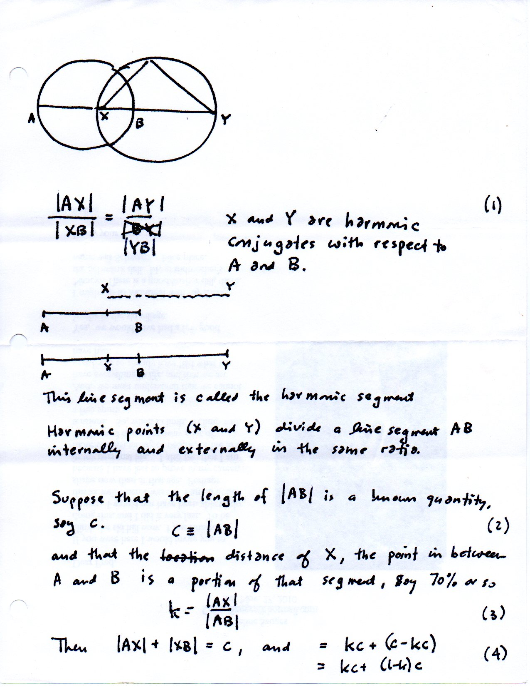

   Folio ``0140`` (original scan ``0140.jpg``) from ``resources/seelig/25_harmonic-conjugates``.

**Diplomatic Mathematical & Geometric Transcription**

**Diplomatic Transcription — Folio 0140** (``0140.jpg``, Sheet 1 of 28):

Defines harmonic conjugates :math:`|AX|/|XB| = |AY|/|YB|` with :math:`c = |AB|` and :math:`k = |AX|/|AB|`.

.. math::

   \frac{|AC|}{|CB|} = \frac{|AD|}{|BD|} = k = \frac{1 + \kappa}{1 - \kappa}, \qquad |MC| \cdot |MD| = x y = r^2, \qquad \frac{2}{|AB|} = \frac{1}{|AC|} + \frac{1}{|AD|}

.. admonition:: Editorial & Symbolic Notes

   Archival scan ``0140.jpg`` from Fred W. Seelig's notebook dossier on **F.25 Harmonic Conjugates** (Page 1 of 28). Companion OpenDocument worksheet(s): ``Harmonic Conjugates``, ``HC Tables``, ``Apollonian Circles``, ``Coaxial Circles``. Classical Euclidean foundations: :ref:`III.36`, :ref:`VI.3`.

Folio 0141 (Page 2 of 28): Internal & External Division Ratios (Page 2)
-----------------------------------------------------------------------

.. folio:: 0141

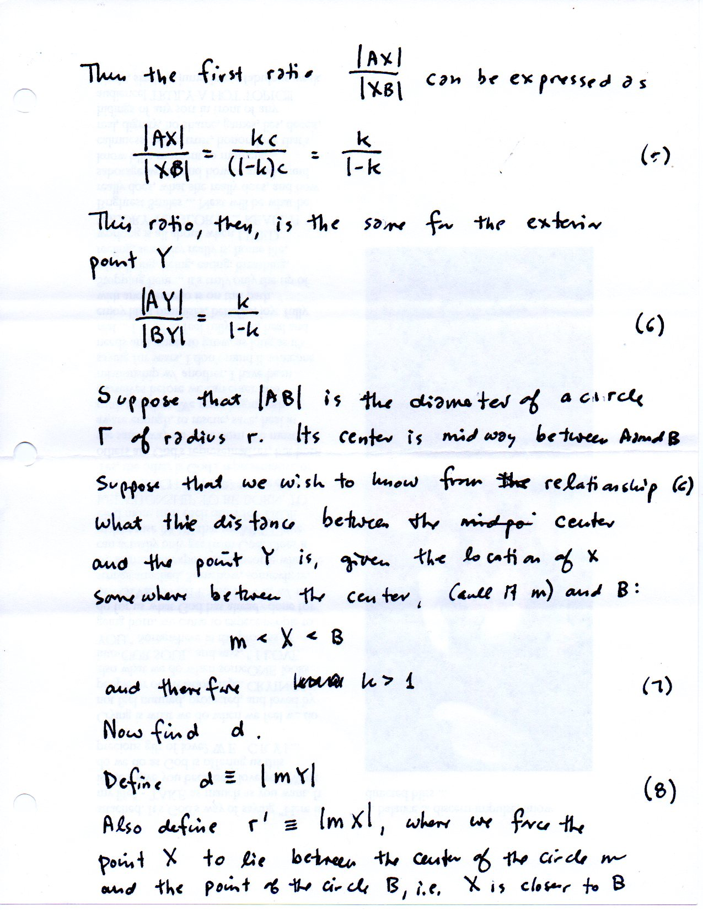

   Folio ``0141`` (original scan ``0141.jpg``) from ``resources/seelig/25_harmonic-conjugates``.

**Diplomatic Mathematical & Geometric Transcription**

**Diplomatic Transcription — Folio 0141** (``0141.jpg``, Sheet 2 of 28):

Expresses the division ratios in terms of :math:`k/(1-k)` on circle :math:`\Gamma(m, r)` with :math:`r' = |mX|, d = |mY|`.

.. math::

   \Pi_+ = \frac{1}{\kappa} + \kappa, \quad \Pi_- = \frac{1}{\kappa} - \kappa, \quad \Pi_+^2 - \Pi_-^2 = 4, \quad R = \frac{r}{2}\Pi_-, \quad d = \frac{r}{2}\Pi_+, \quad p = r\frac{\Pi_-}{\Pi_+}

.. admonition:: Editorial & Symbolic Notes

   Archival scan ``0141.jpg`` from Fred W. Seelig's notebook dossier on **F.25 Harmonic Conjugates** (Page 2 of 28). Companion OpenDocument worksheet(s): ``Harmonic Conjugates``, ``HC Tables``, ``Apollonian Circles``, ``Coaxial Circles``. Classical Euclidean foundations: :ref:`III.36`, :ref:`VI.3`.

Folio 0142 (Page 3 of 28): Symmetrical Ratio gamma = (r+r')/(r-r') = (d+r)/(d-r) (Page 3)
-----------------------------------------------------------------------------------------

.. folio:: 0142

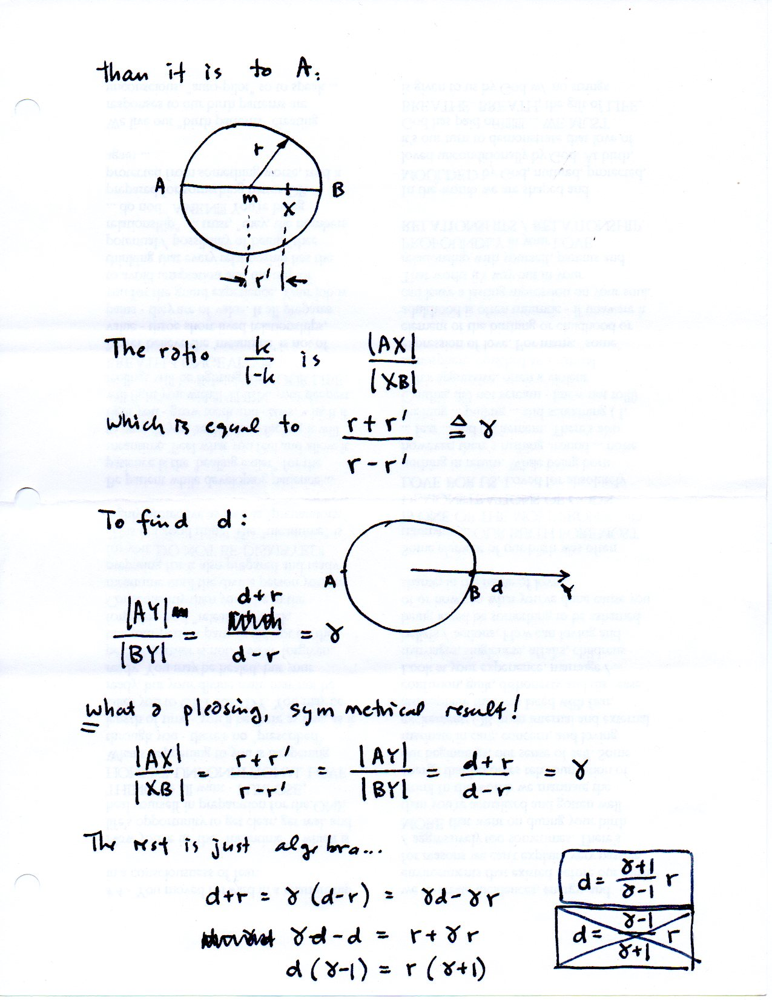

   Folio ``0142`` (original scan ``0142.jpg``) from ``resources/seelig/25_harmonic-conjugates``.

**Diplomatic Mathematical & Geometric Transcription**

**Diplomatic Transcription — Folio 0142** (``0142.jpg``, Sheet 3 of 28):

Proves :math:`d = \frac{\gamma+1}{\gamma-1}r` (*'What a pleasing, symmetrical result!'*).

.. math::

   \frac{|AC|}{|CB|} = \frac{|AD|}{|BD|} = k = \frac{1 + \kappa}{1 - \kappa}, \qquad |MC| \cdot |MD| = x y = r^2, \qquad \frac{2}{|AB|} = \frac{1}{|AC|} + \frac{1}{|AD|}

.. admonition:: Editorial & Symbolic Notes

   Archival scan ``0142.jpg`` from Fred W. Seelig's notebook dossier on **F.25 Harmonic Conjugates** (Page 3 of 28). Companion OpenDocument worksheet(s): ``Harmonic Conjugates``, ``HC Tables``, ``Apollonian Circles``, ``Coaxial Circles``. Classical Euclidean foundations: :ref:`III.36`, :ref:`VI.3`.

Folio 0143 (Page 4 of 28): Worked Example r = 1, k = 0.7 (Page 4)
-----------------------------------------------------------------

.. folio:: 0143

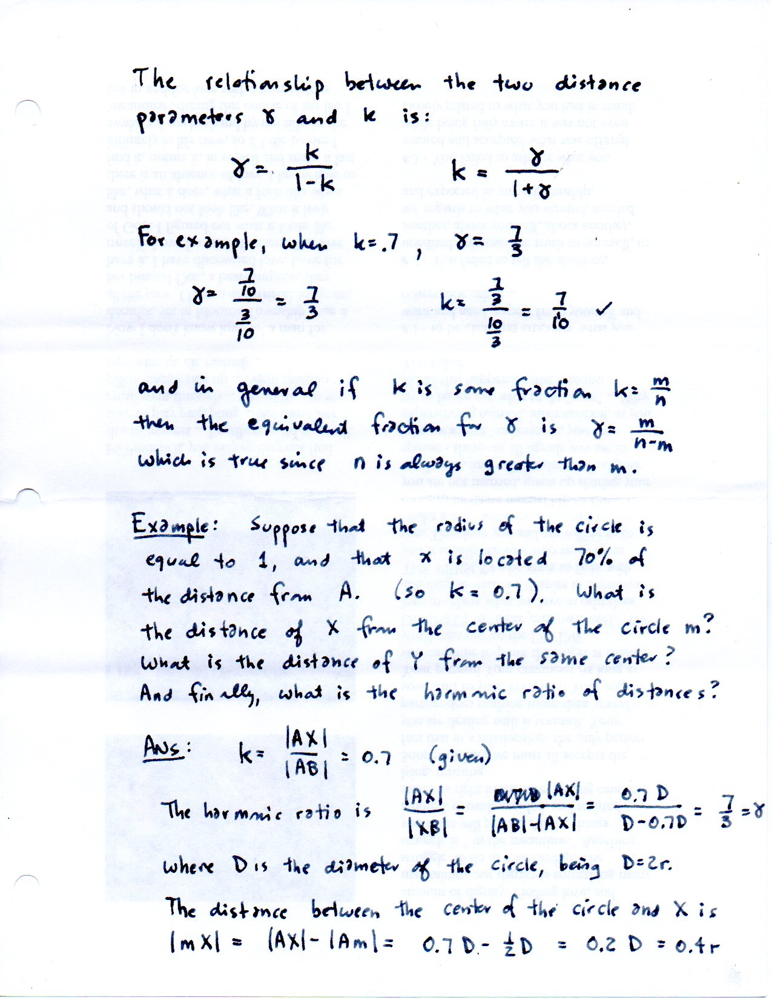

   Folio ``0143`` (original scan ``0143.jpg``) from ``resources/seelig/25_harmonic-conjugates``.

**Diplomatic Mathematical & Geometric Transcription**

**Diplomatic Transcription — Folio 0143** (``0143.jpg``, Sheet 4 of 28):

Computes :math:`\gamma = 7/3` and :math:`|mX| = 0.4r`.

.. math::

   \Pi_+ = \frac{1}{\kappa} + \kappa, \quad \Pi_- = \frac{1}{\kappa} - \kappa, \quad \Pi_+^2 - \Pi_-^2 = 4, \quad R = \frac{r}{2}\Pi_-, \quad d = \frac{r}{2}\Pi_+, \quad p = r\frac{\Pi_-}{\Pi_+}

.. admonition:: Editorial & Symbolic Notes

   Archival scan ``0143.jpg`` from Fred W. Seelig's notebook dossier on **F.25 Harmonic Conjugates** (Page 4 of 28). Companion OpenDocument worksheet(s): ``Harmonic Conjugates``, ``HC Tables``, ``Apollonian Circles``, ``Coaxial Circles``. Classical Euclidean foundations: :ref:`III.36`, :ref:`VI.3`.

Folio 0144 (Page 5 of 28): Inversion Identity r^2 = d*r' (Page 5, citing Ogilvy 1969, p. 19)
--------------------------------------------------------------------------------------------

.. folio:: 0144

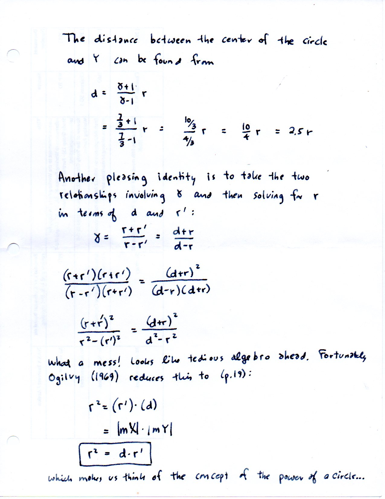

   Folio ``0144`` (original scan ``0144.jpg``) from ``resources/seelig/25_harmonic-conjugates``.

**Diplomatic Mathematical & Geometric Transcription**

**Diplomatic Transcription — Folio 0144** (``0144.jpg``, Sheet 5 of 28):

Completes example (:math:`d = 2.5r`) and proves :math:`r^2 = |mX|\cdot |mY|`.

.. math::

   \frac{|AC|}{|CB|} = \frac{|AD|}{|BD|} = k = \frac{1 + \kappa}{1 - \kappa}, \qquad |MC| \cdot |MD| = x y = r^2, \qquad \frac{2}{|AB|} = \frac{1}{|AC|} + \frac{1}{|AD|}

.. admonition:: Editorial & Symbolic Notes

   Archival scan ``0144.jpg`` from Fred W. Seelig's notebook dossier on **F.25 Harmonic Conjugates** (Page 5 of 28). Companion OpenDocument worksheet(s): ``Harmonic Conjugates``, ``HC Tables``, ``Apollonian Circles``, ``Coaxial Circles``. Classical Euclidean foundations: :ref:`III.36`, :ref:`VI.3`.

Folio 0145 (Page 6 of 28): Ogilvy's Theorem 8 on Orthogonal Circles (Page 6, Ogilvy p. 20)
------------------------------------------------------------------------------------------

.. folio:: 0145

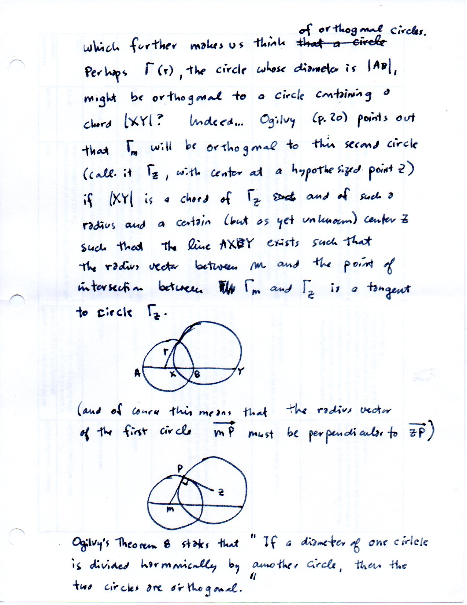

   Folio ``0145`` (original scan ``0145.jpg``) from ``resources/seelig/25_harmonic-conjugates``.

**Diplomatic Mathematical & Geometric Transcription**

**Diplomatic Transcription — Folio 0145** (``0145.jpg``, Sheet 6 of 28):

Proves that any circle dividing a diameter harmonically is orthogonal to the base circle (:math:`\vec{mP} \perp \vec{zP}`).

.. math::

   \Pi_+ = \frac{1}{\kappa} + \kappa, \quad \Pi_- = \frac{1}{\kappa} - \kappa, \quad \Pi_+^2 - \Pi_-^2 = 4, \quad R = \frac{r}{2}\Pi_-, \quad d = \frac{r}{2}\Pi_+, \quad p = r\frac{\Pi_-}{\Pi_+}

.. admonition:: Editorial & Symbolic Notes

   Archival scan ``0145.jpg`` from Fred W. Seelig's notebook dossier on **F.25 Harmonic Conjugates** (Page 6 of 28). Companion OpenDocument worksheet(s): ``Harmonic Conjugates``, ``HC Tables``, ``Apollonian Circles``, ``Coaxial Circles``. Classical Euclidean foundations: :ref:`III.36`, :ref:`VI.3`.

Folio 0146 (Page 7 of 28): Intersection Angle alpha of Two Circles (Page 7)
---------------------------------------------------------------------------

.. folio:: 0146

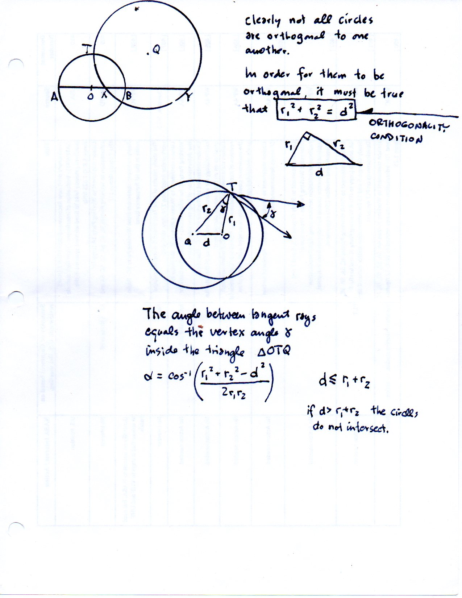

   Folio ``0146`` (original scan ``0146.jpg``) from ``resources/seelig/25_harmonic-conjugates``.

**Diplomatic Mathematical & Geometric Transcription**

**Diplomatic Transcription — Folio 0146** (``0146.jpg``, Sheet 7 of 28):

Writes :math:`\alpha = \cos^{-1}\left(\frac{r_1^2+r_2^2-d^2}{2r_1r_2}\right)` reducing to :math:`r^2+R^2=d^2` at :math:`90^\circ`.

.. math::

   \frac{|AC|}{|CB|} = \frac{|AD|}{|BD|} = k = \frac{1 + \kappa}{1 - \kappa}, \qquad |MC| \cdot |MD| = x y = r^2, \qquad \frac{2}{|AB|} = \frac{1}{|AC|} + \frac{1}{|AD|}

.. admonition:: Editorial & Symbolic Notes

   Archival scan ``0146.jpg`` from Fred W. Seelig's notebook dossier on **F.25 Harmonic Conjugates** (Page 7 of 28). Companion OpenDocument worksheet(s): ``Harmonic Conjugates``, ``HC Tables``, ``Apollonian Circles``, ``Coaxial Circles``. Classical Euclidean foundations: :ref:`III.36`, :ref:`VI.3`.

Folio 0147 (Page 8 of 28): Harmonic Conjugates Master Summary (citing Euclid VI.3, Heath p. 198)
------------------------------------------------------------------------------------------------

.. folio:: 0147

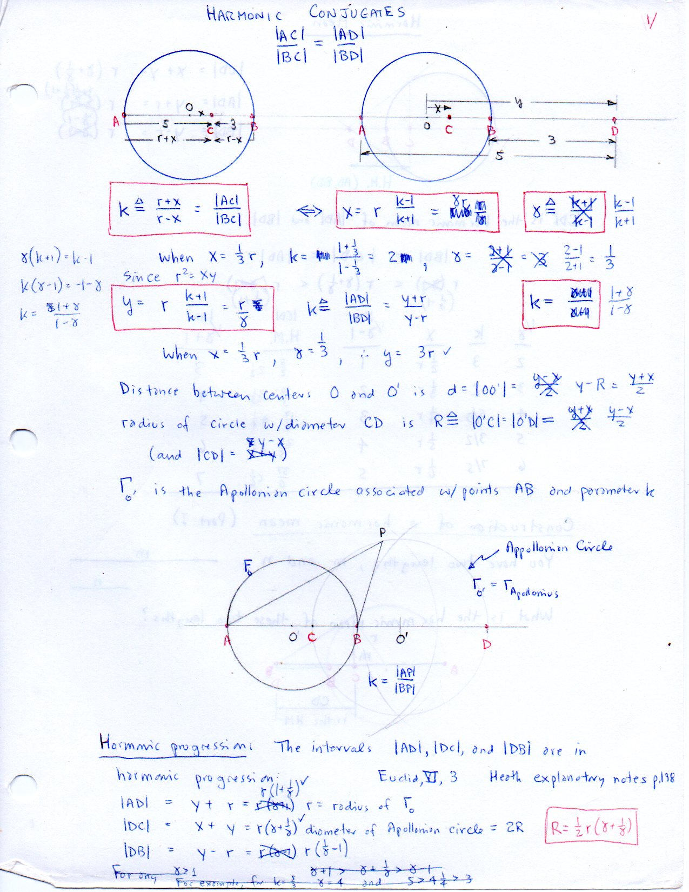

   Folio ``0147`` (original scan ``0147.jpg``) from ``resources/seelig/25_harmonic-conjugates``.

**Diplomatic Mathematical & Geometric Transcription**

**Diplomatic Transcription — Folio 0147** (``0147.jpg``, Sheet 8 of 28):

Summarizes :math:`k, x, y, \gamma, d, R`, the Apollonian circle :math:`\Gamma_{O'}`, and the harmonic progression :math:`|AD|, |DC|, |DB|`.

.. math::

   \Pi_+ = \frac{1}{\kappa} + \kappa, \quad \Pi_- = \frac{1}{\kappa} - \kappa, \quad \Pi_+^2 - \Pi_-^2 = 4, \quad R = \frac{r}{2}\Pi_-, \quad d = \frac{r}{2}\Pi_+, \quad p = r\frac{\Pi_-}{\Pi_+}

.. admonition:: Editorial & Symbolic Notes

   Archival scan ``0147.jpg`` from Fred W. Seelig's notebook dossier on **F.25 Harmonic Conjugates** (Page 8 of 28). Companion OpenDocument worksheet(s): ``Harmonic Conjugates``, ``HC Tables``, ``Apollonian Circles``, ``Coaxial Circles``. Classical Euclidean foundations: :ref:`III.36`, :ref:`VI.3`.

Folio 0148 (Page 9 of 28): Angle-Bisector & Tangent-Polar Properties (citing Ogilvy p. 27)
------------------------------------------------------------------------------------------

.. folio:: 0148

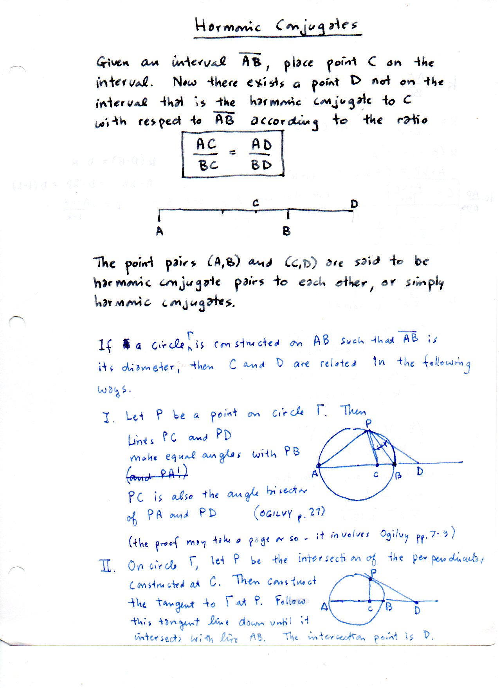

   Folio ``0148`` (original scan ``0148.jpg``) from ``resources/seelig/25_harmonic-conjugates``.

**Diplomatic Mathematical & Geometric Transcription**

**Diplomatic Transcription — Folio 0148** (``0148.jpg``, Sheet 9 of 28):

Lists circle properties I (:math:`PC` bisects :math:`\angle APD`) and II (perpendicular at :math:`C` meets :math:`\Gamma` at :math:`P`, where tangent meets :math:`AB` at :math:`D`).

.. math::

   \frac{|AC|}{|CB|} = \frac{|AD|}{|BD|} = k = \frac{1 + \kappa}{1 - \kappa}, \qquad |MC| \cdot |MD| = x y = r^2, \qquad \frac{2}{|AB|} = \frac{1}{|AC|} + \frac{1}{|AD|}

.. admonition:: Editorial & Symbolic Notes

   Archival scan ``0148.jpg`` from Fred W. Seelig's notebook dossier on **F.25 Harmonic Conjugates** (Page 9 of 28). Companion OpenDocument worksheet(s): ``Harmonic Conjugates``, ``HC Tables``, ``Apollonian Circles``, ``Coaxial Circles``. Classical Euclidean foundations: :ref:`III.36`, :ref:`VI.3`.

Folio 0149 (Page 10 of 28): Barycentric/Coordinate Isolation of C and D
-----------------------------------------------------------------------

.. folio:: 0149

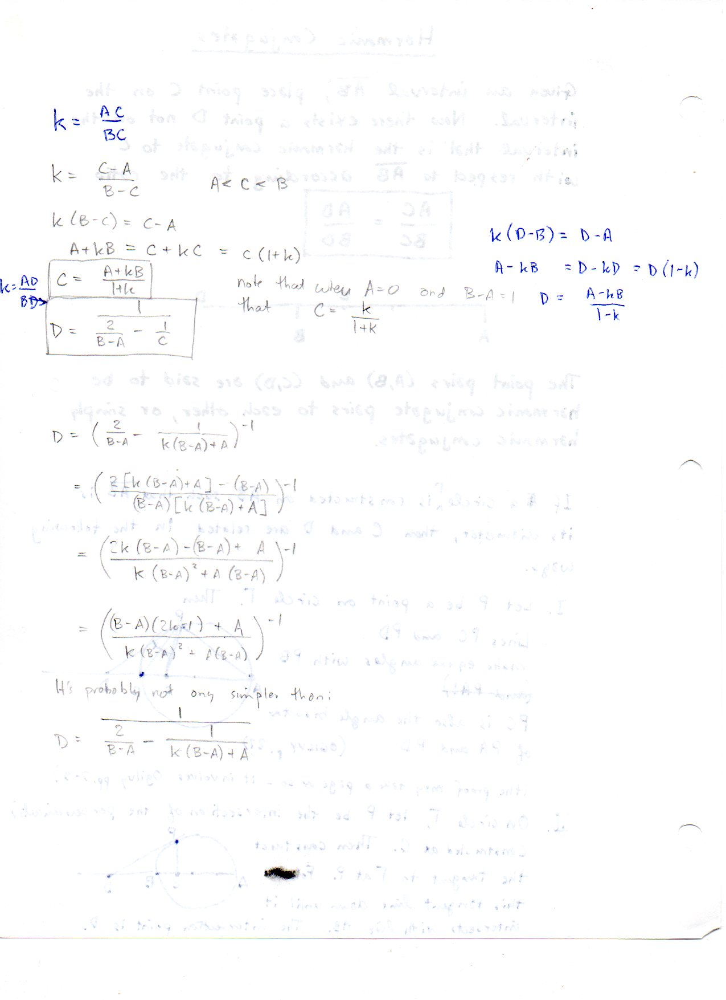

   Folio ``0149`` (original scan ``0149.jpg``) from ``resources/seelig/25_harmonic-conjugates``.

**Diplomatic Mathematical & Geometric Transcription**

**Diplomatic Transcription — Folio 0149** (``0149.jpg``, Sheet 10 of 28):

Derives :math:`C = (A+kB)/(1+k)` and harmonic reciprocal formulas for :math:`D`.

.. math::

   \Pi_+ = \frac{1}{\kappa} + \kappa, \quad \Pi_- = \frac{1}{\kappa} - \kappa, \quad \Pi_+^2 - \Pi_-^2 = 4, \quad R = \frac{r}{2}\Pi_-, \quad d = \frac{r}{2}\Pi_+, \quad p = r\frac{\Pi_-}{\Pi_+}

.. admonition:: Editorial & Symbolic Notes

   Archival scan ``0149.jpg`` from Fred W. Seelig's notebook dossier on **F.25 Harmonic Conjugates** (Page 10 of 28). Companion OpenDocument worksheet(s): ``Harmonic Conjugates``, ``HC Tables``, ``Apollonian Circles``, ``Coaxial Circles``. Classical Euclidean foundations: :ref:`III.36`, :ref:`VI.3`.

Folio 0150 (Page 11 of 28): Reciprocal Identities for k, k_2, k_3
-----------------------------------------------------------------

.. folio:: 0150

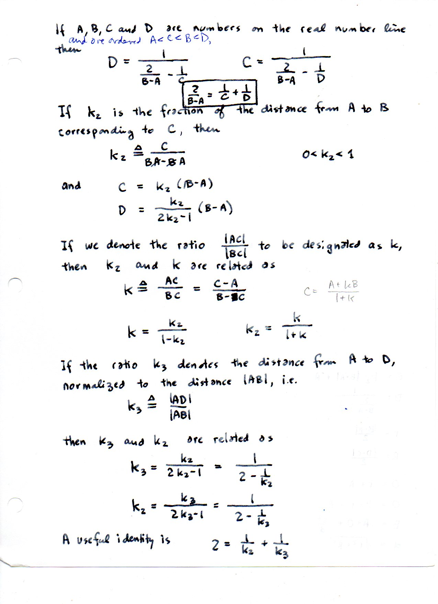

   Folio ``0150`` (original scan ``0150.jpg``) from ``resources/seelig/25_harmonic-conjugates``.

**Diplomatic Mathematical & Geometric Transcription**

**Diplomatic Transcription — Folio 0150** (``0150.jpg``, Sheet 11 of 28):

Proves :math:`\frac{2}{B-A} = \frac{1}{C} + \frac{1}{D}` and :math:`2 = \frac{1}{k_2} + \frac{1}{k_3}`.

.. math::

   \frac{|AC|}{|CB|} = \frac{|AD|}{|BD|} = k = \frac{1 + \kappa}{1 - \kappa}, \qquad |MC| \cdot |MD| = x y = r^2, \qquad \frac{2}{|AB|} = \frac{1}{|AC|} + \frac{1}{|AD|}

.. admonition:: Editorial & Symbolic Notes

   Archival scan ``0150.jpg`` from Fred W. Seelig's notebook dossier on **F.25 Harmonic Conjugates** (Page 11 of 28). Companion OpenDocument worksheet(s): ``Harmonic Conjugates``, ``HC Tables``, ``Apollonian Circles``, ``Coaxial Circles``. Classical Euclidean foundations: :ref:`III.36`, :ref:`VI.3`.

Folio 0151 (Page 12 of 28): Summary Coordinate Box for C, D, r, R, O, O', E, d
------------------------------------------------------------------------------

.. folio:: 0151

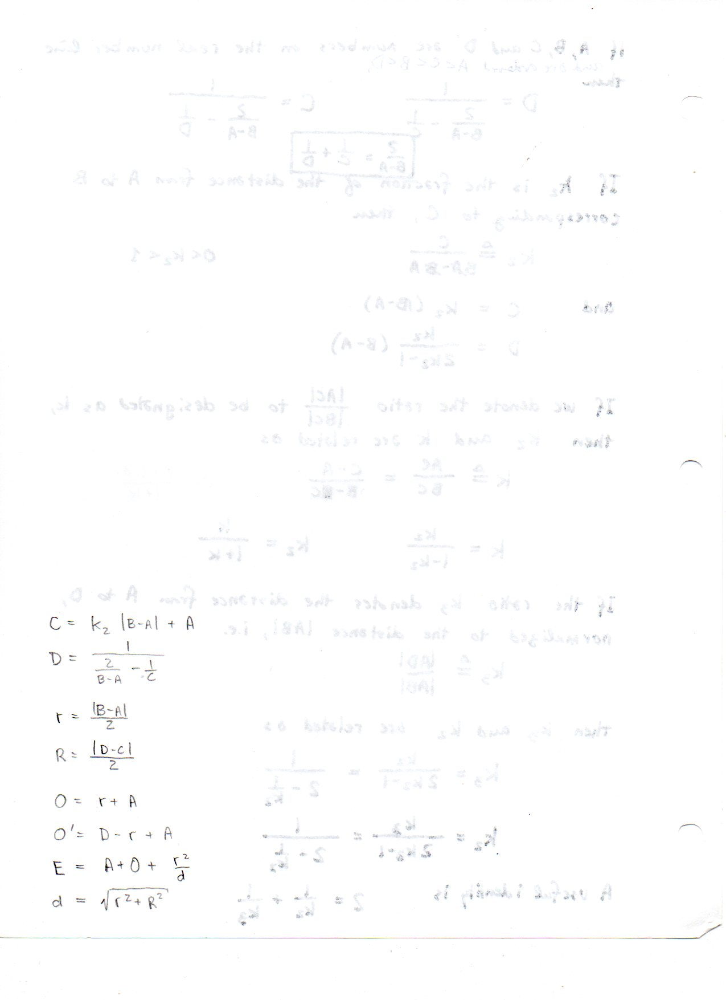

   Folio ``0151`` (original scan ``0151.jpg``) from ``resources/seelig/25_harmonic-conjugates``.

**Diplomatic Mathematical & Geometric Transcription**

**Diplomatic Transcription — Folio 0151** (``0151.jpg``, Sheet 12 of 28):

Compact coordinate reference for plotting orthogonal harmonic circles.

.. math::

   \Pi_+ = \frac{1}{\kappa} + \kappa, \quad \Pi_- = \frac{1}{\kappa} - \kappa, \quad \Pi_+^2 - \Pi_-^2 = 4, \quad R = \frac{r}{2}\Pi_-, \quad d = \frac{r}{2}\Pi_+, \quad p = r\frac{\Pi_-}{\Pi_+}

.. admonition:: Editorial & Symbolic Notes

   Archival scan ``0151.jpg`` from Fred W. Seelig's notebook dossier on **F.25 Harmonic Conjugates** (Page 12 of 28). Companion OpenDocument worksheet(s): ``Harmonic Conjugates``, ``HC Tables``, ``Apollonian Circles``, ``Coaxial Circles``. Classical Euclidean foundations: :ref:`III.36`, :ref:`VI.3`.

Folio 0152 (Page 13 of 28): Right Triangle OPO' Altitude & Projections ('Very pretty!')
---------------------------------------------------------------------------------------

.. folio:: 0152

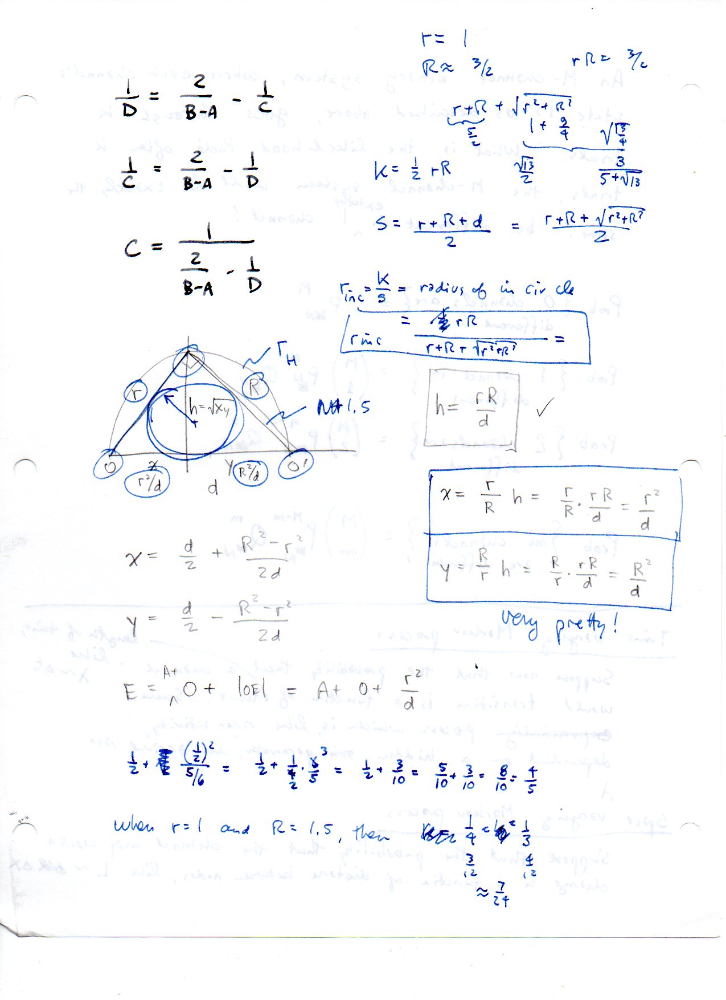

   Folio ``0152`` (original scan ``0152.jpg``) from ``resources/seelig/25_harmonic-conjugates``.

**Diplomatic Mathematical & Geometric Transcription**

**Diplomatic Transcription — Folio 0152** (``0152.jpg``, Sheet 13 of 28):

Derives :math:`h = |PE| = rR/d`, :math:`x = |OE| = r^2/d`, :math:`y = |O'E| = R^2/d`, and inradius :math:`r_{\text{inc}}`.

.. math::

   \frac{|AC|}{|CB|} = \frac{|AD|}{|BD|} = k = \frac{1 + \kappa}{1 - \kappa}, \qquad |MC| \cdot |MD| = x y = r^2, \qquad \frac{2}{|AB|} = \frac{1}{|AC|} + \frac{1}{|AD|}

.. admonition:: Editorial & Symbolic Notes

   Archival scan ``0152.jpg`` from Fred W. Seelig's notebook dossier on **F.25 Harmonic Conjugates** (Page 13 of 28). Companion OpenDocument worksheet(s): ``Harmonic Conjugates``, ``HC Tables``, ``Apollonian Circles``, ``Coaxial Circles``. Classical Euclidean foundations: :ref:`III.36`, :ref:`VI.3`.

Folio 0153 (Page 14 of 28): Reverse Scrap Sheet (Markov Channel Notes)
----------------------------------------------------------------------

.. folio:: 0153

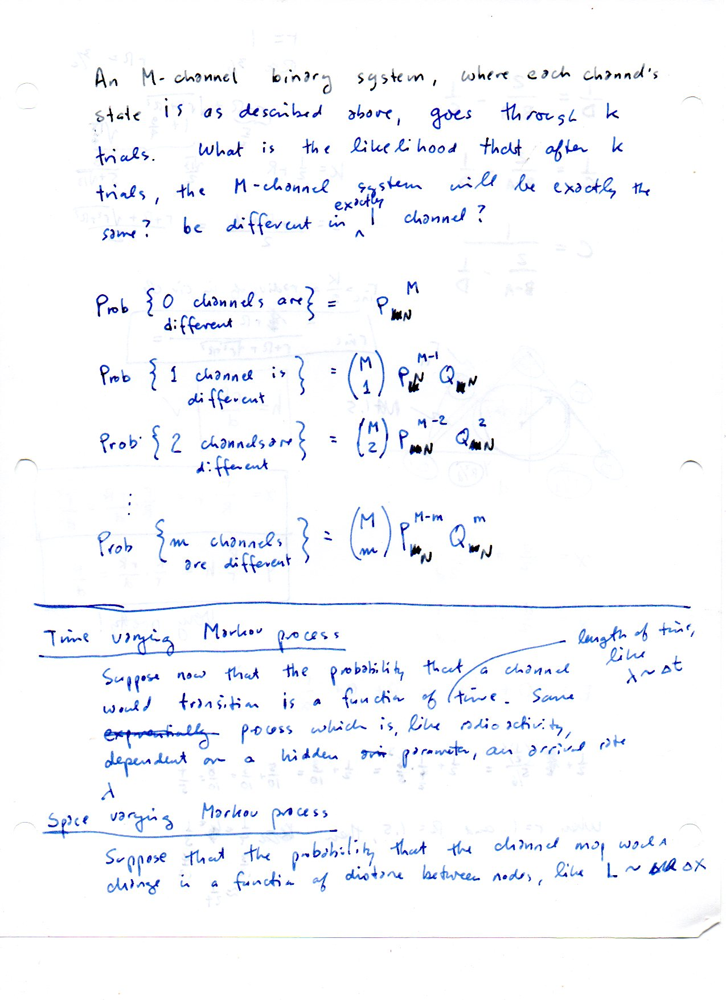

   Folio ``0153`` (original scan ``0153.jpg``) from ``resources/seelig/25_harmonic-conjugates``.

**Diplomatic Mathematical & Geometric Transcription**

**Diplomatic Transcription — Folio 0153** (``0153.jpg``, Sheet 14 of 28):

Reverse side of scrap paper containing unrelated binary Markov channel equations.

.. math::

   \Pi_+ = \frac{1}{\kappa} + \kappa, \quad \Pi_- = \frac{1}{\kappa} - \kappa, \quad \Pi_+^2 - \Pi_-^2 = 4, \quad R = \frac{r}{2}\Pi_-, \quad d = \frac{r}{2}\Pi_+, \quad p = r\frac{\Pi_-}{\Pi_+}

.. admonition:: Editorial & Symbolic Notes

   Archival scan ``0153.jpg`` from Fred W. Seelig's notebook dossier on **F.25 Harmonic Conjugates** (Page 14 of 28). Companion OpenDocument worksheet(s): ``Harmonic Conjugates``, ``HC Tables``, ``Apollonian Circles``, ``Coaxial Circles``. Classical Euclidean foundations: :ref:`III.36`, :ref:`VI.3`.

Folio 0154 (Page 15 of 28): 12-Row Numerical Table for A = 0, B = 1
-------------------------------------------------------------------

.. folio:: 0154

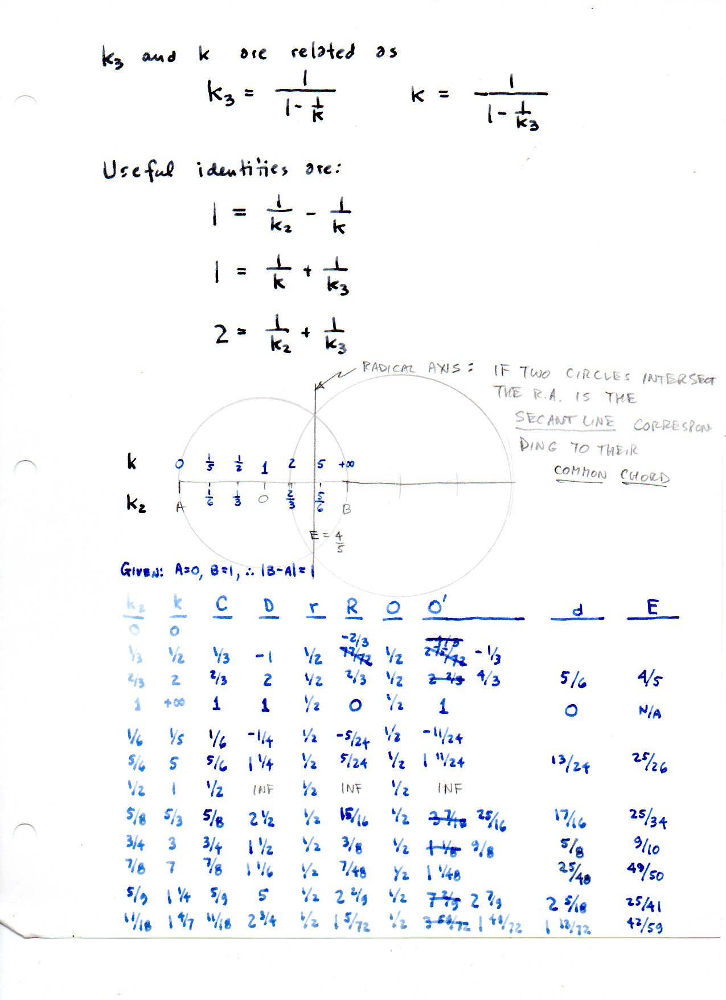

   Folio ``0154`` (original scan ``0154.jpg``) from ``resources/seelig/25_harmonic-conjugates``.

**Diplomatic Mathematical & Geometric Transcription**

**Diplomatic Transcription — Folio 0154** (``0154.jpg``, Sheet 15 of 28):

Tabulates :math:`k, k_2, k_3` and radical axis coordinates across 12 parameter values.

.. math::

   \frac{|AC|}{|CB|} = \frac{|AD|}{|BD|} = k = \frac{1 + \kappa}{1 - \kappa}, \qquad |MC| \cdot |MD| = x y = r^2, \qquad \frac{2}{|AB|} = \frac{1}{|AC|} + \frac{1}{|AD|}

.. admonition:: Editorial & Symbolic Notes

   Archival scan ``0154.jpg`` from Fred W. Seelig's notebook dossier on **F.25 Harmonic Conjugates** (Page 15 of 28). Companion OpenDocument worksheet(s): ``Harmonic Conjugates``, ``HC Tables``, ``Apollonian Circles``, ``Coaxial Circles``. Classical Euclidean foundations: :ref:`III.36`, :ref:`VI.3`.

Folio 0155 (Page 16 of 28): Two-Color Dimensioned Orthogonal Circles Diagram
----------------------------------------------------------------------------

.. folio:: 0155

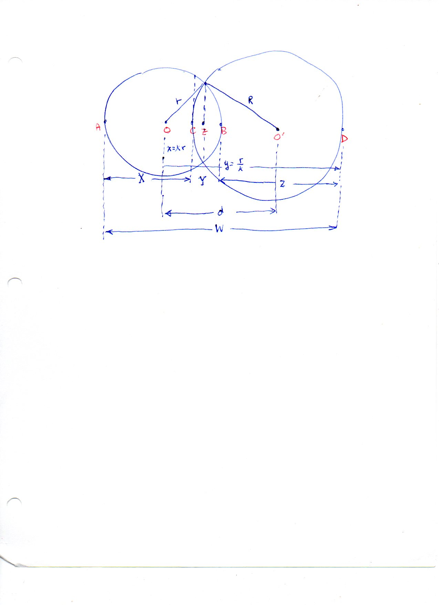

   Folio ``0155`` (original scan ``0155.jpg``) from ``resources/seelig/25_harmonic-conjugates``.

**Diplomatic Mathematical & Geometric Transcription**

**Diplomatic Transcription — Folio 0155** (``0155.jpg``, Sheet 16 of 28):

Blue/red drawing of :math:`\Gamma_O(r)` and :math:`\Gamma_{O'}(R)` showing segments :math:`X, Y, Z, d, W`.

.. math::

   \Pi_+ = \frac{1}{\kappa} + \kappa, \quad \Pi_- = \frac{1}{\kappa} - \kappa, \quad \Pi_+^2 - \Pi_-^2 = 4, \quad R = \frac{r}{2}\Pi_-, \quad d = \frac{r}{2}\Pi_+, \quad p = r\frac{\Pi_-}{\Pi_+}

.. admonition:: Editorial & Symbolic Notes

   Archival scan ``0155.jpg`` from Fred W. Seelig's notebook dossier on **F.25 Harmonic Conjugates** (Page 16 of 28). Companion OpenDocument worksheet(s): ``Harmonic Conjugates``, ``HC Tables``, ``Apollonian Circles``, ``Coaxial Circles``. Classical Euclidean foundations: :ref:`III.36`, :ref:`VI.3`.

Folio 0156 (Page 17 of 28): Master Diagram: Dual Relations & Internal Symmetry (FWS 6/20/2014)
----------------------------------------------------------------------------------------------

.. folio:: 0156

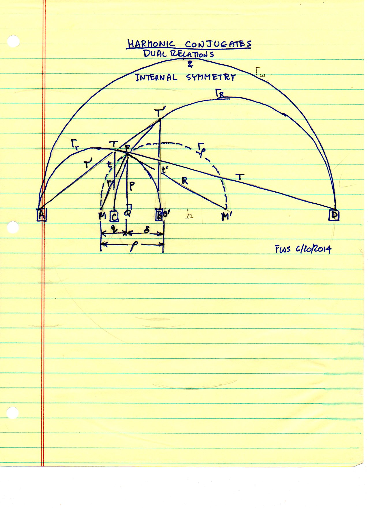

   Folio ``0156`` (original scan ``0156.jpg``) from ``resources/seelig/25_harmonic-conjugates``.

**Diplomatic Mathematical & Geometric Transcription**

**Diplomatic Transcription — Folio 0156** (``0156.jpg``, Sheet 17 of 28):

Yellow legal-pad master construction of semicircles :math:`\Gamma_r, \Gamma_R, \Gamma_w, \Gamma_\rho` and segments :math:`t, t', T, T', p, q, \delta, \rho`.

.. math::

   \frac{|AC|}{|CB|} = \frac{|AD|}{|BD|} = k = \frac{1 + \kappa}{1 - \kappa}, \qquad |MC| \cdot |MD| = x y = r^2, \qquad \frac{2}{|AB|} = \frac{1}{|AC|} + \frac{1}{|AD|}

.. admonition:: Editorial & Symbolic Notes

   Archival scan ``0156.jpg`` from Fred W. Seelig's notebook dossier on **F.25 Harmonic Conjugates** (Page 17 of 28). Companion OpenDocument worksheet(s): ``Harmonic Conjugates``, ``HC Tables``, ``Apollonian Circles``, ``Coaxial Circles``. Classical Euclidean foundations: :ref:`III.36`, :ref:`VI.3`.

Folio 0157 (Page 18 of 28): Theorem 1: Duality Theorem (kappa' = 1/k, k' = 1/kappa)
-----------------------------------------------------------------------------------

.. folio:: 0157

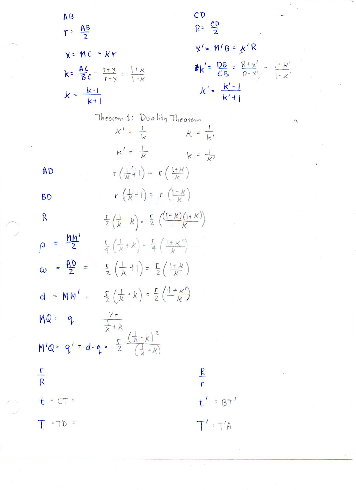

   Folio ``0157`` (original scan ``0157.jpg``) from ``resources/seelig/25_harmonic-conjugates``.

**Diplomatic Mathematical & Geometric Transcription**

**Diplomatic Transcription — Folio 0157** (``0157.jpg``, Sheet 18 of 28):

States the duality between :math:`(\Gamma_r, \kappa, k)` and :math:`(\Gamma_R, \kappa', k')` and lists 8 segment formulas.

.. math::

   \Pi_+ = \frac{1}{\kappa} + \kappa, \quad \Pi_- = \frac{1}{\kappa} - \kappa, \quad \Pi_+^2 - \Pi_-^2 = 4, \quad R = \frac{r}{2}\Pi_-, \quad d = \frac{r}{2}\Pi_+, \quad p = r\frac{\Pi_-}{\Pi_+}

.. admonition:: Editorial & Symbolic Notes

   Archival scan ``0157.jpg`` from Fred W. Seelig's notebook dossier on **F.25 Harmonic Conjugates** (Page 18 of 28). Companion OpenDocument worksheet(s): ``Harmonic Conjugates``, ``HC Tables``, ``Apollonian Circles``, ``Coaxial Circles``. Classical Euclidean foundations: :ref:`III.36`, :ref:`VI.3`.

Folio 0158 (Page 19 of 28): Integer Parameterization r = 2mn, kappa = m/n & Example (3, 7)
------------------------------------------------------------------------------------------

.. folio:: 0158

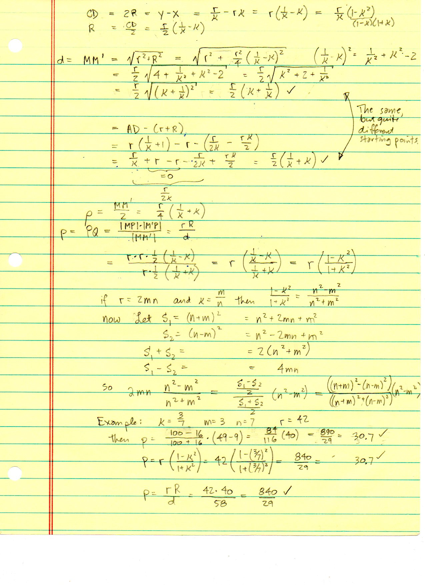

   Folio ``0158`` (original scan ``0158.jpg``) from ``resources/seelig/25_harmonic-conjugates``.

**Diplomatic Mathematical & Geometric Transcription**

**Diplomatic Transcription — Folio 0158** (``0158.jpg``, Sheet 19 of 28):

Derives :math:`d = \frac{r}{2}(\kappa + 1/\kappa)` and tests :math:`m=3, n=7, r=42 \implies R=40, d=58, p=840/29`.

.. math::

   \frac{|AC|}{|CB|} = \frac{|AD|}{|BD|} = k = \frac{1 + \kappa}{1 - \kappa}, \qquad |MC| \cdot |MD| = x y = r^2, \qquad \frac{2}{|AB|} = \frac{1}{|AC|} + \frac{1}{|AD|}

.. admonition:: Editorial & Symbolic Notes

   Archival scan ``0158.jpg`` from Fred W. Seelig's notebook dossier on **F.25 Harmonic Conjugates** (Page 19 of 28). Companion OpenDocument worksheet(s): ``Harmonic Conjugates``, ``HC Tables``, ``Apollonian Circles``, ``Coaxial Circles``. Classical Euclidean foundations: :ref:`III.36`, :ref:`VI.3`.

Folio 0159 (Page 20 of 28): Projection q = MQ = 2*kappa*r/(1 + kappa^2)
-----------------------------------------------------------------------

.. folio:: 0159

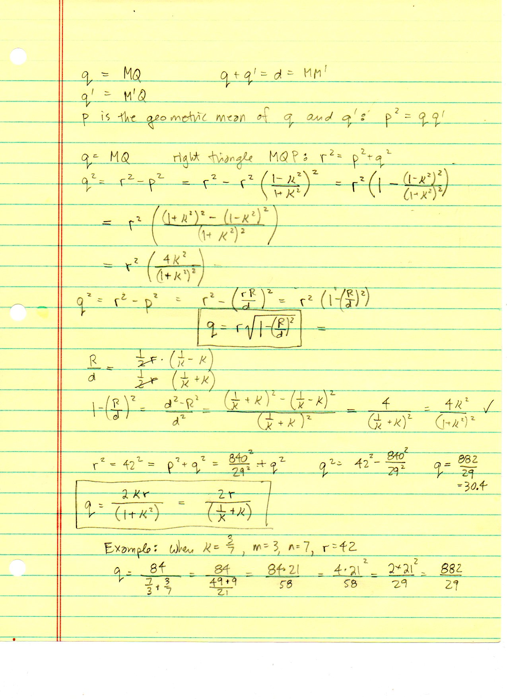

   Folio ``0159`` (original scan ``0159.jpg``) from ``resources/seelig/25_harmonic-conjugates``.

**Diplomatic Mathematical & Geometric Transcription**

**Diplomatic Transcription — Folio 0159** (``0159.jpg``, Sheet 20 of 28):

Proves the formula for :math:`q = MQ` and verifies :math:`q = 882/29 \approx 30.4` for :math:`(m,n)=(3,7)`.

.. math::

   \Pi_+ = \frac{1}{\kappa} + \kappa, \quad \Pi_- = \frac{1}{\kappa} - \kappa, \quad \Pi_+^2 - \Pi_-^2 = 4, \quad R = \frac{r}{2}\Pi_-, \quad d = \frac{r}{2}\Pi_+, \quad p = r\frac{\Pi_-}{\Pi_+}

.. admonition:: Editorial & Symbolic Notes

   Archival scan ``0159.jpg`` from Fred W. Seelig's notebook dossier on **F.25 Harmonic Conjugates** (Page 20 of 28). Companion OpenDocument worksheet(s): ``Harmonic Conjugates``, ``HC Tables``, ``Apollonian Circles``, ``Coaxial Circles``. Classical Euclidean foundations: :ref:`III.36`, :ref:`VI.3`.

Folio 0160 (Page 21 of 28): Equivalence of Three Expressions for q' = M'Q
-------------------------------------------------------------------------

.. folio:: 0160

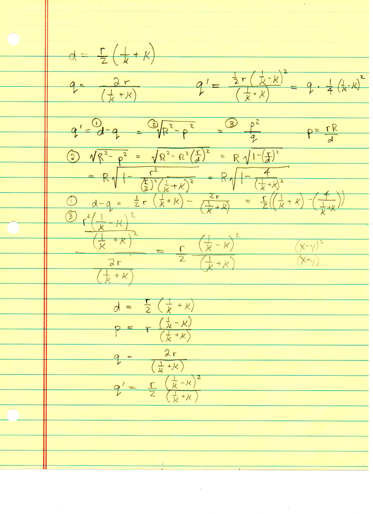

   Folio ``0160`` (original scan ``0160.jpg``) from ``resources/seelig/25_harmonic-conjugates``.

**Diplomatic Mathematical & Geometric Transcription**

**Diplomatic Transcription — Folio 0160** (``0160.jpg``, Sheet 21 of 28):

Proves :math:`q' = d - q = \sqrt{R^2 - p^2} = p^2/q` in terms of :math:`1/\kappa \pm \kappa`.

.. math::

   \frac{|AC|}{|CB|} = \frac{|AD|}{|BD|} = k = \frac{1 + \kappa}{1 - \kappa}, \qquad |MC| \cdot |MD| = x y = r^2, \qquad \frac{2}{|AB|} = \frac{1}{|AC|} + \frac{1}{|AD|}

.. admonition:: Editorial & Symbolic Notes

   Archival scan ``0160.jpg`` from Fred W. Seelig's notebook dossier on **F.25 Harmonic Conjugates** (Page 21 of 28). Companion OpenDocument worksheet(s): ``Harmonic Conjugates``, ``HC Tables``, ``Apollonian Circles``, ``Coaxial Circles``. Classical Euclidean foundations: :ref:`III.36`, :ref:`VI.3`.

Folio 0161 (Page 22 of 28): Duplicate Scan of q' Equivalence Proof
------------------------------------------------------------------

.. folio:: 0161

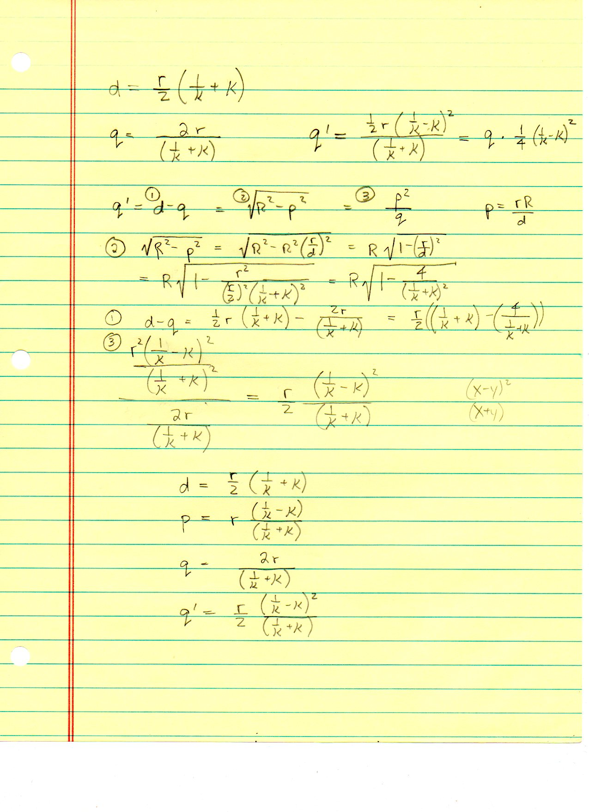

   Folio ``0161`` (original scan ``0161.jpg``) from ``resources/seelig/25_harmonic-conjugates``.

**Diplomatic Mathematical & Geometric Transcription**

**Diplomatic Transcription — Folio 0161** (``0161.jpg``, Sheet 22 of 28):

Second scan of the :math:`q'` equivalence derivation.

.. math::

   \Pi_+ = \frac{1}{\kappa} + \kappa, \quad \Pi_- = \frac{1}{\kappa} - \kappa, \quad \Pi_+^2 - \Pi_-^2 = 4, \quad R = \frac{r}{2}\Pi_-, \quad d = \frac{r}{2}\Pi_+, \quad p = r\frac{\Pi_-}{\Pi_+}

.. admonition:: Editorial & Symbolic Notes

   Archival scan ``0161.jpg`` from Fred W. Seelig's notebook dossier on **F.25 Harmonic Conjugates** (Page 22 of 28). Companion OpenDocument worksheet(s): ``Harmonic Conjugates``, ``HC Tables``, ``Apollonian Circles``, ``Coaxial Circles``. Classical Euclidean foundations: :ref:`III.36`, :ref:`VI.3`.

Folio 0162 (Page 23 of 28): Invariants Pi_plus and Pi_minus (Pi_plus^2 - Pi_minus^2 = 4)
----------------------------------------------------------------------------------------

.. folio:: 0162

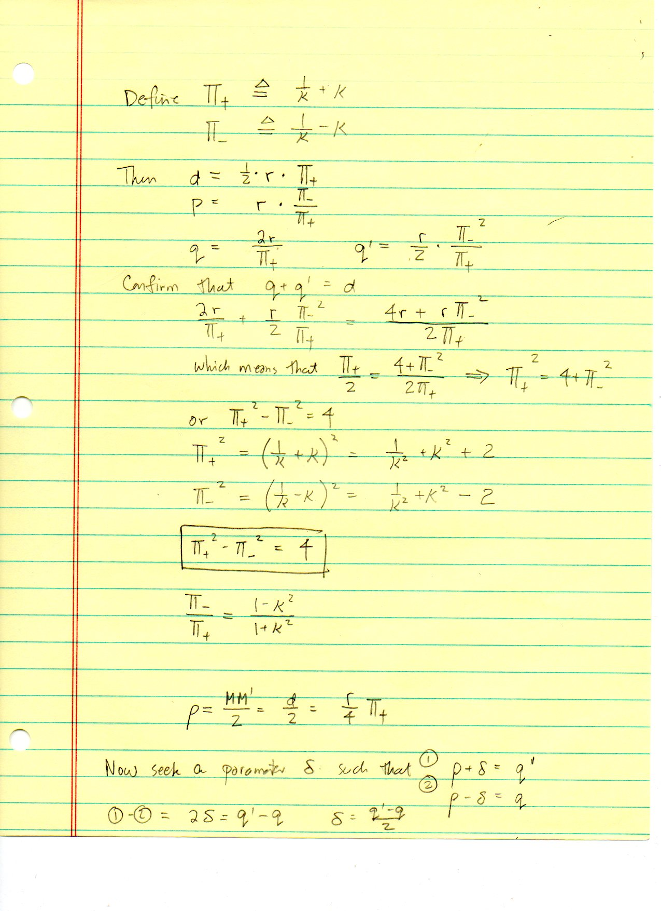

   Folio ``0162`` (original scan ``0162.jpg``) from ``resources/seelig/25_harmonic-conjugates``.

**Diplomatic Mathematical & Geometric Transcription**

**Diplomatic Transcription — Folio 0162** (``0162.jpg``, Sheet 23 of 28):

Defines :math:`\Pi_\pm = \frac{1}{\kappa} \pm \kappa` and expresses :math:`R, d, p, q, q', \delta` in terms of :math:`\Pi_\pm`.

.. math::

   \frac{|AC|}{|CB|} = \frac{|AD|}{|BD|} = k = \frac{1 + \kappa}{1 - \kappa}, \qquad |MC| \cdot |MD| = x y = r^2, \qquad \frac{2}{|AB|} = \frac{1}{|AC|} + \frac{1}{|AD|}

.. admonition:: Editorial & Symbolic Notes

   Archival scan ``0162.jpg`` from Fred W. Seelig's notebook dossier on **F.25 Harmonic Conjugates** (Page 23 of 28). Companion OpenDocument worksheet(s): ``Harmonic Conjugates``, ``HC Tables``, ``Apollonian Circles``, ``Coaxial Circles``. Classical Euclidean foundations: :ref:`III.36`, :ref:`VI.3`.

Folio 0163 (Page 24 of 28): Simplification of Midpoint Offset delta = (q' - q)/2
--------------------------------------------------------------------------------

.. folio:: 0163

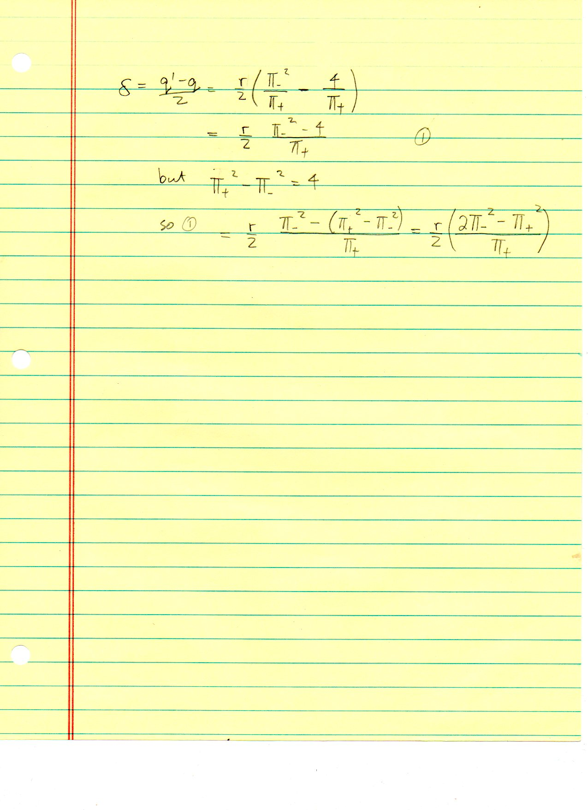

   Folio ``0163`` (original scan ``0163.jpg``) from ``resources/seelig/25_harmonic-conjugates``.

**Diplomatic Mathematical & Geometric Transcription**

**Diplomatic Transcription — Folio 0163** (``0163.jpg``, Sheet 24 of 28):

Reduces :math:`\delta = \frac{r}{2}\frac{\Pi_-^2 - 4}{\Pi_+}`.

.. math::

   \Pi_+ = \frac{1}{\kappa} + \kappa, \quad \Pi_- = \frac{1}{\kappa} - \kappa, \quad \Pi_+^2 - \Pi_-^2 = 4, \quad R = \frac{r}{2}\Pi_-, \quad d = \frac{r}{2}\Pi_+, \quad p = r\frac{\Pi_-}{\Pi_+}

.. admonition:: Editorial & Symbolic Notes

   Archival scan ``0163.jpg`` from Fred W. Seelig's notebook dossier on **F.25 Harmonic Conjugates** (Page 24 of 28). Companion OpenDocument worksheet(s): ``Harmonic Conjugates``, ``HC Tables``, ``Apollonian Circles``, ``Coaxial Circles``. Classical Euclidean foundations: :ref:`III.36`, :ref:`VI.3`.

Folio 0164 (Page 25 of 28): Dual Chords t = CT, t' = BT' and Tangents T, T'
---------------------------------------------------------------------------

.. folio:: 0164

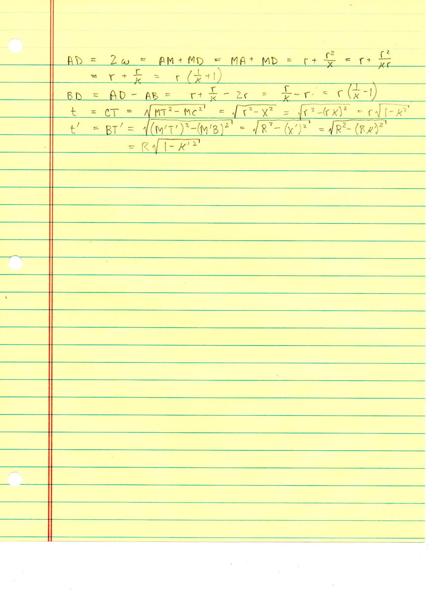

   Folio ``0164`` (original scan ``0164.jpg``) from ``resources/seelig/25_harmonic-conjugates``.

**Diplomatic Mathematical & Geometric Transcription**

**Diplomatic Transcription — Folio 0164** (``0164.jpg``, Sheet 25 of 28):

Derives :math:`t = r\sqrt{1-\kappa^2}` and :math:`t' = R\sqrt{1-{\kappa'}^2} = r\frac{1-\kappa}{\sqrt{\kappa}}`.

.. math::

   \frac{|AC|}{|CB|} = \frac{|AD|}{|BD|} = k = \frac{1 + \kappa}{1 - \kappa}, \qquad |MC| \cdot |MD| = x y = r^2, \qquad \frac{2}{|AB|} = \frac{1}{|AC|} + \frac{1}{|AD|}

.. admonition:: Editorial & Symbolic Notes

   Archival scan ``0164.jpg`` from Fred W. Seelig's notebook dossier on **F.25 Harmonic Conjugates** (Page 25 of 28). Companion OpenDocument worksheet(s): ``Harmonic Conjugates``, ``HC Tables``, ``Apollonian Circles``, ``Coaxial Circles``. Classical Euclidean foundations: :ref:`III.36`, :ref:`VI.3`.

Folio 0165 (Page 26 of 28): Grid Summary Sheet of All 10 Symmetric Segment Formulas
-----------------------------------------------------------------------------------

.. folio:: 0165

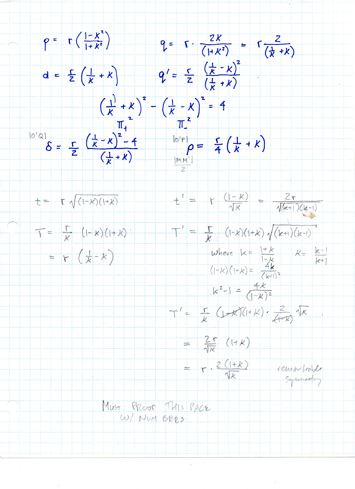

   Folio ``0165`` (original scan ``0165.jpg``) from ``resources/seelig/25_harmonic-conjugates``.

**Diplomatic Mathematical & Geometric Transcription**

**Diplomatic Transcription — Folio 0165** (``0165.jpg``, Sheet 26 of 28):

Consolidates :math:`p, q, d, q', \delta, \rho, t, t', T, T'` (*'remarkable symmetry'*).

.. math::

   \Pi_+ = \frac{1}{\kappa} + \kappa, \quad \Pi_- = \frac{1}{\kappa} - \kappa, \quad \Pi_+^2 - \Pi_-^2 = 4, \quad R = \frac{r}{2}\Pi_-, \quad d = \frac{r}{2}\Pi_+, \quad p = r\frac{\Pi_-}{\Pi_+}

.. admonition:: Editorial & Symbolic Notes

   Archival scan ``0165.jpg`` from Fred W. Seelig's notebook dossier on **F.25 Harmonic Conjugates** (Page 26 of 28). Companion OpenDocument worksheet(s): ``Harmonic Conjugates``, ``HC Tables``, ``Apollonian Circles``, ``Coaxial Circles``. Classical Euclidean foundations: :ref:`III.36`, :ref:`VI.3`.

Folio 0166 (Page 27 of 28): Geometric Mean Proof that \|BC\| = r(1 - kappa)
---------------------------------------------------------------------------

.. folio:: 0166

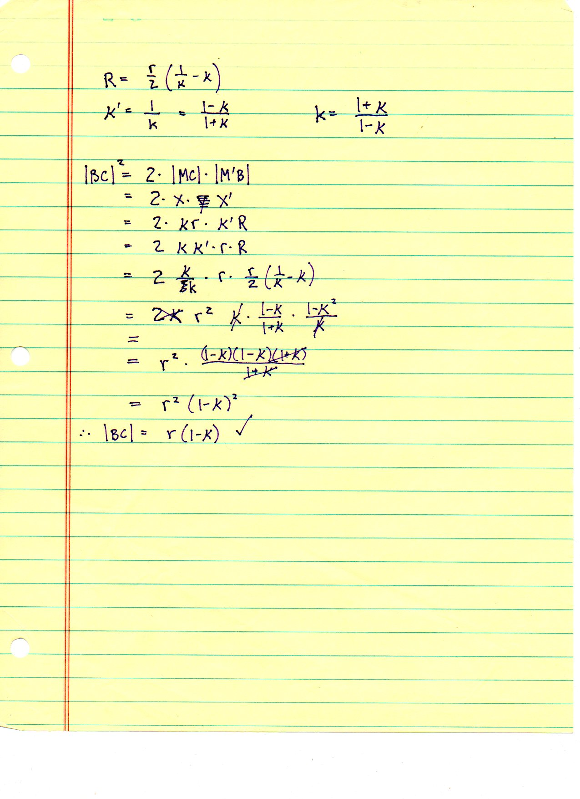

   Folio ``0166`` (original scan ``0166.jpg``) from ``resources/seelig/25_harmonic-conjugates``.

**Diplomatic Mathematical & Geometric Transcription**

**Diplomatic Transcription — Folio 0166** (``0166.jpg``, Sheet 27 of 28):

Proves :math:`|BC|^2 = 2|MC|\cdot|M'B| = r^2(1-\kappa)^2`.

.. math::

   \frac{|AC|}{|CB|} = \frac{|AD|}{|BD|} = k = \frac{1 + \kappa}{1 - \kappa}, \qquad |MC| \cdot |MD| = x y = r^2, \qquad \frac{2}{|AB|} = \frac{1}{|AC|} + \frac{1}{|AD|}

.. admonition:: Editorial & Symbolic Notes

   Archival scan ``0166.jpg`` from Fred W. Seelig's notebook dossier on **F.25 Harmonic Conjugates** (Page 27 of 28). Companion OpenDocument worksheet(s): ``Harmonic Conjugates``, ``HC Tables``, ``Apollonian Circles``, ``Coaxial Circles``. Classical Euclidean foundations: :ref:`III.36`, :ref:`VI.3`.

Folio 0167 (Page 28 of 28): External Tangent T' = R*sqrt(k^2 - 1)
-----------------------------------------------------------------

.. folio:: 0167

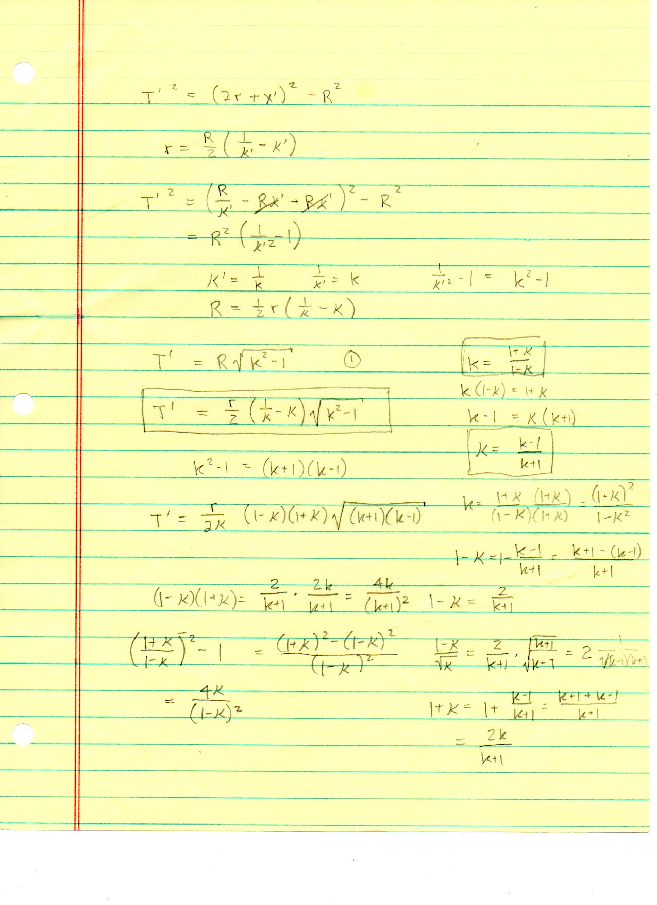

   Folio ``0167`` (original scan ``0167.jpg``) from ``resources/seelig/25_harmonic-conjugates``.

**Diplomatic Mathematical & Geometric Transcription**

**Diplomatic Transcription — Folio 0167** (``0167.jpg``, Sheet 28 of 28):

Completes the derivation of :math:`T' = r\frac{2(1+\kappa)}{\sqrt{\kappa}}`.

.. math::

   \Pi_+ = \frac{1}{\kappa} + \kappa, \quad \Pi_- = \frac{1}{\kappa} - \kappa, \quad \Pi_+^2 - \Pi_-^2 = 4, \quad R = \frac{r}{2}\Pi_-, \quad d = \frac{r}{2}\Pi_+, \quad p = r\frac{\Pi_-}{\Pi_+}

.. admonition:: Editorial & Symbolic Notes

   Archival scan ``0167.jpg`` from Fred W. Seelig's notebook dossier on **F.25 Harmonic Conjugates** (Page 28 of 28). Companion OpenDocument worksheet(s): ``Harmonic Conjugates``, ``HC Tables``, ``Apollonian Circles``, ``Coaxial Circles``. Classical Euclidean foundations: :ref:`III.36`, :ref:`VI.3`.
