==========================================
F.26 Harmonic Conjugate Inversion — Folios
==========================================

Archival manuscript scans and diplomatic transcriptions from :person:`seelig`'s
notebooks for **F.26 (Harmonic Conjugate Inversion)** (:cite:`SeeligNotebooks`).

Folio 0168 (Page 1 of 15): Harmonic Conjugation, Inversion & The Important Parallelogram (FWS 11/19/2013)
---------------------------------------------------------------------------------------------------------

.. folio:: 0168

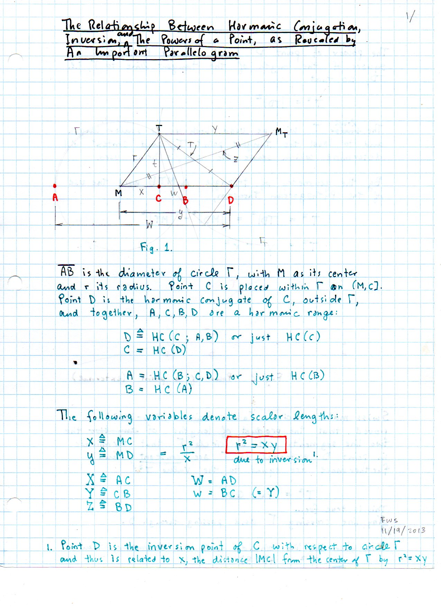

   Folio ``0168`` (original scan ``0168.jpg``) from ``resources/seelig/26_harmonic-conjugate-inversion``.

**Diplomatic Mathematical & Geometric Transcription**

**Diplomatic Transcription — Folio 0168** (``0168.jpg``, Sheet 1 of 15):

Introduces Fig. 1 showing circle :math:`\Gamma(M, r)`, inverse points :math:`C, D` (:math:`xy = r^2`), tangent :math:`DT = T`, and parallelogram :math:`M D M_T T` with diagonal :math:`z`.

.. math::

   x y = |MC| \cdot |MD| = r^2, \qquad T^2 = y^2 - r^2 = |AD| \cdot |BD|, \qquad z^2 + T^2 = 2(r^2 + y^2) \implies z^2 = y^2 + 3 r^2

.. admonition:: Editorial & Symbolic Notes

   Archival scan ``0168.jpg`` from Fred W. Seelig's notebook dossier on **F.26 Harmonic Conjugate Inversion** (Page 1 of 15). Companion OpenDocument worksheet(s): ``Harmonic Conjugates``, ``HC Tables``. Classical Euclidean foundations: :ref:`III.36`, :ref:`VI.8`.

Folio 0169 (Page 2 of 15): Jakob Steiner's Power of a Point (Page 2)
--------------------------------------------------------------------

.. folio:: 0169

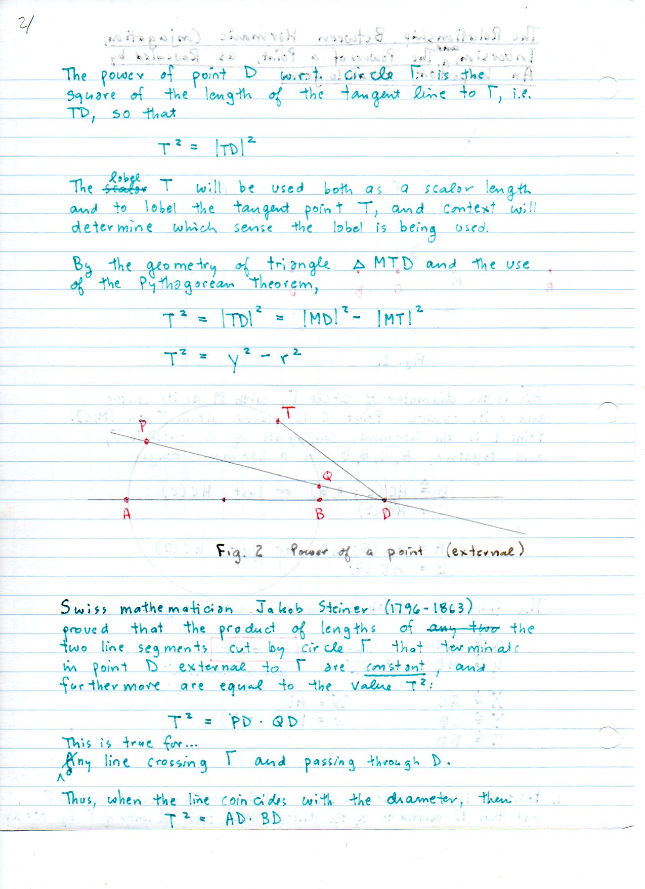

   Folio ``0169`` (original scan ``0169.jpg``) from ``resources/seelig/26_harmonic-conjugate-inversion``.

**Diplomatic Mathematical & Geometric Transcription**

**Diplomatic Transcription — Folio 0169** (``0169.jpg``, Sheet 2 of 15):

Cites Jakob Steiner (1796–1863) for :math:`T^2 = y^2 - r^2 = PD\cdot QD = AD\cdot BD` (Fig. 2).

.. math::

   (x,\, t,\, r,\, y,\, T) = \left(\hat{x}^2,\, \hat{x}\hat{t},\, \hat{x}\hat{r},\, \hat{r}^2,\, \hat{r}\hat{t}\right) \quad \text{where } \hat{x}^2 + \hat{t}^2 = \hat{r}^2

.. admonition:: Editorial & Symbolic Notes

   Archival scan ``0169.jpg`` from Fred W. Seelig's notebook dossier on **F.26 Harmonic Conjugate Inversion** (Page 2 of 15). Companion OpenDocument worksheet(s): ``Harmonic Conjugates``, ``HC Tables``. Classical Euclidean foundations: :ref:`III.36`, :ref:`VI.8`.

Folio 0170 (Page 3 of 15): Similarity Proof of TD^2 = PD*QD & Example r=5, x=3 (FWS 11/19/2013)
-----------------------------------------------------------------------------------------------

.. folio:: 0170

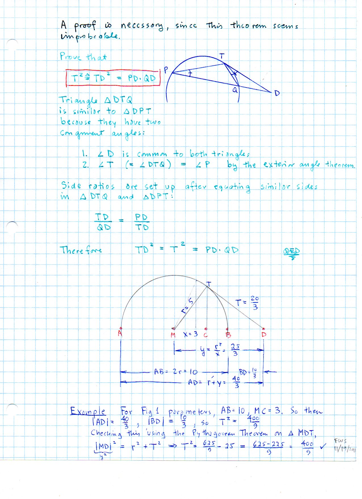

   Folio ``0170`` (original scan ``0170.jpg``) from ``resources/seelig/26_harmonic-conjugate-inversion``.

**Diplomatic Mathematical & Geometric Transcription**

**Diplomatic Transcription — Folio 0170** (``0170.jpg``, Sheet 3 of 15):

Proves :math:`\triangle DTQ \sim \triangle DPT` and computes :math:`y = 25/3, AD = 40/3, BD = 10/3, T = 20/3`.

.. math::

   x y = |MC| \cdot |MD| = r^2, \qquad T^2 = y^2 - r^2 = |AD| \cdot |BD|, \qquad z^2 + T^2 = 2(r^2 + y^2) \implies z^2 = y^2 + 3 r^2

.. admonition:: Editorial & Symbolic Notes

   Archival scan ``0170.jpg`` from Fred W. Seelig's notebook dossier on **F.26 Harmonic Conjugate Inversion** (Page 3 of 15). Companion OpenDocument worksheet(s): ``Harmonic Conjugates``, ``HC Tables``. Classical Euclidean foundations: :ref:`III.36`, :ref:`VI.8`.

Folio 0171 (Page 4 of 15): Stewart's Theorem on Parallelogram MDM_TT for Diagonal z
-----------------------------------------------------------------------------------

.. folio:: 0171

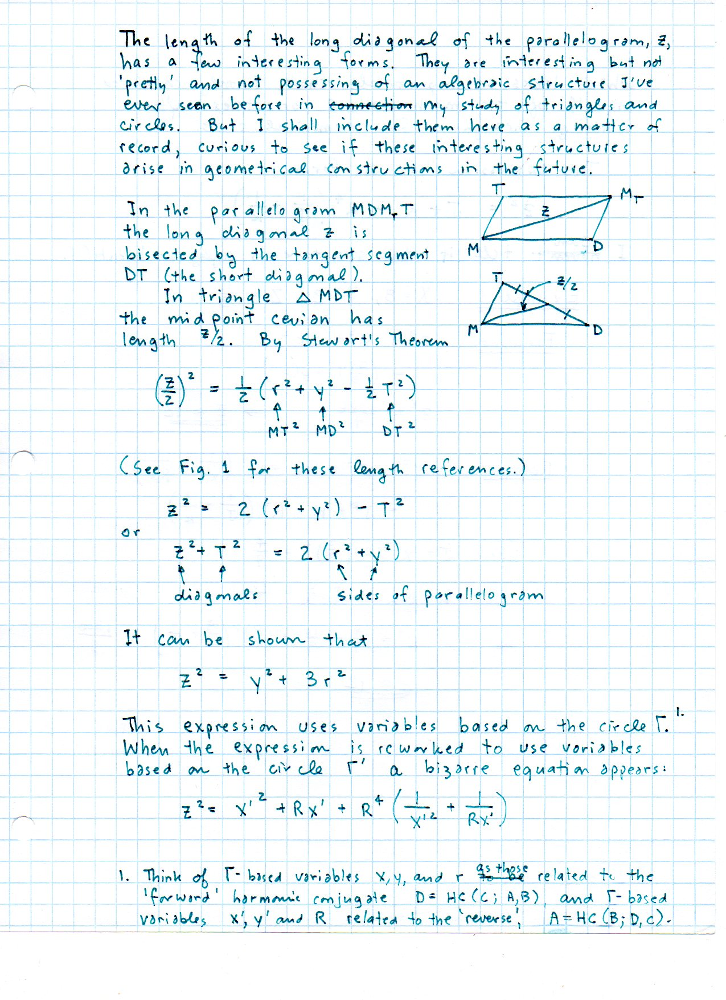

   Folio ``0171`` (original scan ``0171.jpg``) from ``resources/seelig/26_harmonic-conjugate-inversion``.

**Diplomatic Mathematical & Geometric Transcription**

**Diplomatic Transcription — Folio 0171** (``0171.jpg``, Sheet 4 of 15):

Proves :math:`z^2 + T^2 = 2(r^2+y^2) \implies z^2 = y^2 + 3r^2` and derives the reverse :math:`\Gamma'` formula in terms of :math:`x', R`.

.. math::

   (x,\, t,\, r,\, y,\, T) = \left(\hat{x}^2,\, \hat{x}\hat{t},\, \hat{x}\hat{r},\, \hat{r}^2,\, \hat{r}\hat{t}\right) \quad \text{where } \hat{x}^2 + \hat{t}^2 = \hat{r}^2

.. admonition:: Editorial & Symbolic Notes

   Archival scan ``0171.jpg`` from Fred W. Seelig's notebook dossier on **F.26 Harmonic Conjugate Inversion** (Page 4 of 15). Companion OpenDocument worksheet(s): ``Harmonic Conjugates``, ``HC Tables``. Classical Euclidean foundations: :ref:`III.36`, :ref:`VI.8`.

Folio 0172 (Page 5 of 15): Reverse Formula Verification on Example 1 (FWS 11/19/2013)
-------------------------------------------------------------------------------------

.. folio:: 0172

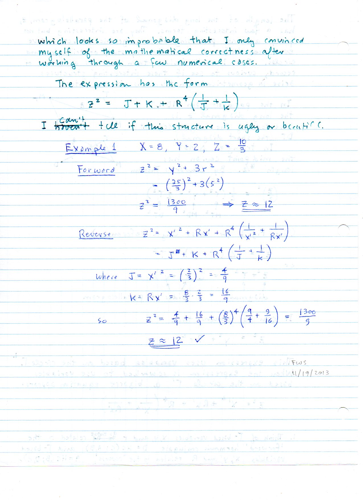

   Folio ``0172`` (original scan ``0172.jpg``) from ``resources/seelig/26_harmonic-conjugate-inversion``.

**Diplomatic Mathematical & Geometric Transcription**

**Diplomatic Transcription — Folio 0172** (``0172.jpg``, Sheet 5 of 15):

Rewrites :math:`z^2 = J + K + R^4(1/J + 1/K)` and confirms :math:`z^2 = 1300/9` from both forward and reverse equations.

.. math::

   x y = |MC| \cdot |MD| = r^2, \qquad T^2 = y^2 - r^2 = |AD| \cdot |BD|, \qquad z^2 + T^2 = 2(r^2 + y^2) \implies z^2 = y^2 + 3 r^2

.. admonition:: Editorial & Symbolic Notes

   Archival scan ``0172.jpg`` from Fred W. Seelig's notebook dossier on **F.26 Harmonic Conjugate Inversion** (Page 5 of 15). Companion OpenDocument worksheet(s): ``Harmonic Conjugates``, ``HC Tables``. Classical Euclidean foundations: :ref:`III.36`, :ref:`VI.8`.

Folio 0173 (Page 6 of 15): Graphic Scaling & Integer Solutions Table
--------------------------------------------------------------------

.. folio:: 0173

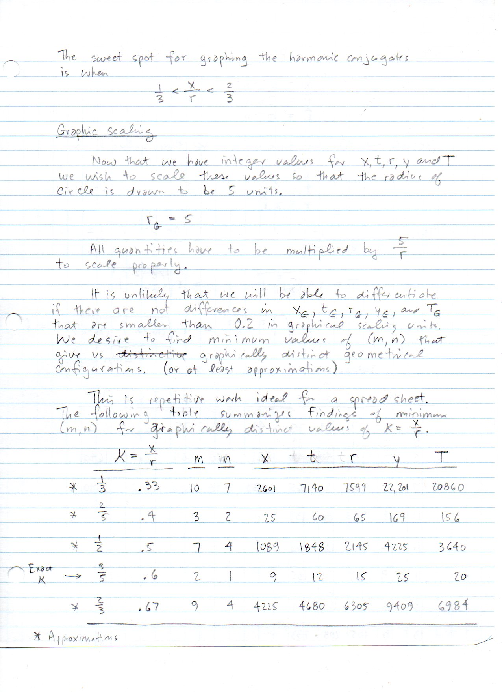

   Folio ``0173`` (original scan ``0173.jpg``) from ``resources/seelig/26_harmonic-conjugate-inversion``.

**Diplomatic Mathematical & Geometric Transcription**

**Diplomatic Transcription — Folio 0173** (``0173.jpg``, Sheet 6 of 15):

Identifies the graphing sweet spot :math:`1/3 < x/r < 2/3` and tabulates integer 5-tuples :math:`(x, t, r, y, T)`.

.. math::

   (x,\, t,\, r,\, y,\, T) = \left(\hat{x}^2,\, \hat{x}\hat{t},\, \hat{x}\hat{r},\, \hat{r}^2,\, \hat{r}\hat{t}\right) \quad \text{where } \hat{x}^2 + \hat{t}^2 = \hat{r}^2

.. admonition:: Editorial & Symbolic Notes

   Archival scan ``0173.jpg`` from Fred W. Seelig's notebook dossier on **F.26 Harmonic Conjugate Inversion** (Page 6 of 15). Companion OpenDocument worksheet(s): ``Harmonic Conjugates``, ``HC Tables``. Classical Euclidean foundations: :ref:`III.36`, :ref:`VI.8`.

Folio 0174 (Page 7 of 15): Generating Integer 5-Tuples from Pythagorean Triples
-------------------------------------------------------------------------------

.. folio:: 0174

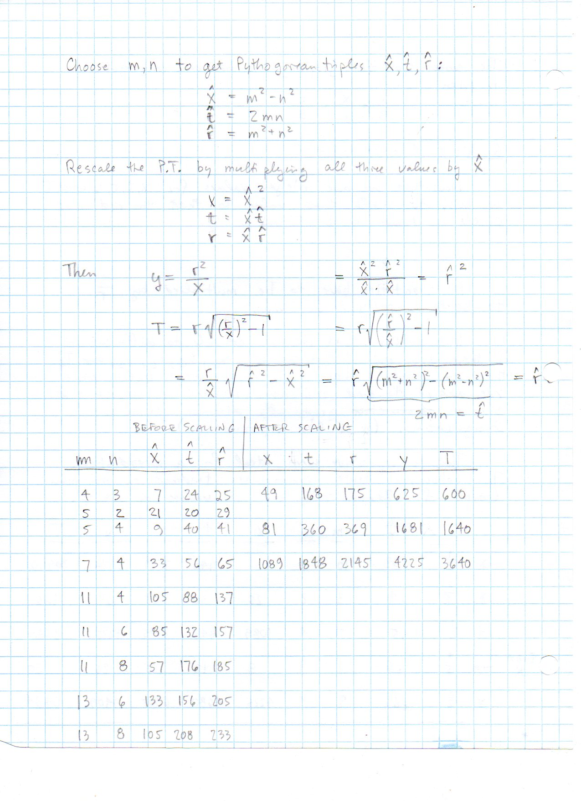

   Folio ``0174`` (original scan ``0174.jpg``) from ``resources/seelig/26_harmonic-conjugate-inversion``.

**Diplomatic Mathematical & Geometric Transcription**

**Diplomatic Transcription — Folio 0174** (``0174.jpg``, Sheet 7 of 15):

Proves that scaling :math:`(\hat{x}, \hat{t}, \hat{r})` by :math:`\hat{x}` and :math:`\hat{r}` yields integer :math:`(x, t, r, y, T)`.

.. math::

   x y = |MC| \cdot |MD| = r^2, \qquad T^2 = y^2 - r^2 = |AD| \cdot |BD|, \qquad z^2 + T^2 = 2(r^2 + y^2) \implies z^2 = y^2 + 3 r^2

.. admonition:: Editorial & Symbolic Notes

   Archival scan ``0174.jpg`` from Fred W. Seelig's notebook dossier on **F.26 Harmonic Conjugate Inversion** (Page 7 of 15). Companion OpenDocument worksheet(s): ``Harmonic Conjugates``, ``HC Tables``. Classical Euclidean foundations: :ref:`III.36`, :ref:`VI.8`.

Folio 0175 (Page 8 of 15): Collinearity Warning & Power of a Point Sketch
-------------------------------------------------------------------------

.. folio:: 0175

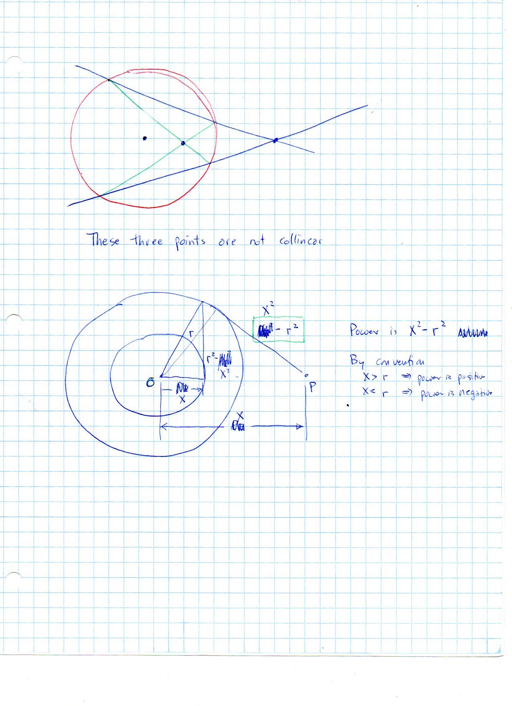

   Folio ``0175`` (original scan ``0175.jpg``) from ``resources/seelig/26_harmonic-conjugate-inversion``.

**Diplomatic Mathematical & Geometric Transcription**

**Diplomatic Transcription — Folio 0175** (``0175.jpg``, Sheet 8 of 15):

Illustrates non-collinear tangent points and the secant power relation :math:`x^2 - r^2`.

.. math::

   (x,\, t,\, r,\, y,\, T) = \left(\hat{x}^2,\, \hat{x}\hat{t},\, \hat{x}\hat{r},\, \hat{r}^2,\, \hat{r}\hat{t}\right) \quad \text{where } \hat{x}^2 + \hat{t}^2 = \hat{r}^2

.. admonition:: Editorial & Symbolic Notes

   Archival scan ``0175.jpg`` from Fred W. Seelig's notebook dossier on **F.26 Harmonic Conjugate Inversion** (Page 8 of 15). Companion OpenDocument worksheet(s): ``Harmonic Conjugates``, ``HC Tables``. Classical Euclidean foundations: :ref:`III.36`, :ref:`VI.8`.

Folio 0176 (Page 9 of 15): Tangent-Chord Proof of TD^2 = DE*DF
--------------------------------------------------------------

.. folio:: 0176

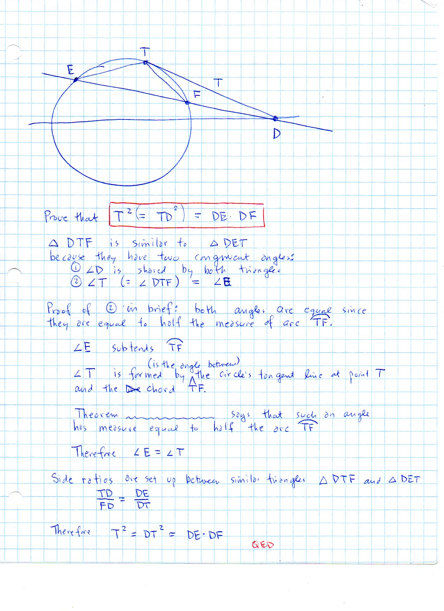

   Folio ``0176`` (original scan ``0176.jpg``) from ``resources/seelig/26_harmonic-conjugate-inversion``.

**Diplomatic Mathematical & Geometric Transcription**

**Diplomatic Transcription — Folio 0176** (``0176.jpg``, Sheet 9 of 15):

Detailed geometric proof using inscribed angles that :math:`\triangle DTF \sim \triangle DET`.

.. math::

   x y = |MC| \cdot |MD| = r^2, \qquad T^2 = y^2 - r^2 = |AD| \cdot |BD|, \qquad z^2 + T^2 = 2(r^2 + y^2) \implies z^2 = y^2 + 3 r^2

.. admonition:: Editorial & Symbolic Notes

   Archival scan ``0176.jpg`` from Fred W. Seelig's notebook dossier on **F.26 Harmonic Conjugate Inversion** (Page 9 of 15). Companion OpenDocument worksheet(s): ``Harmonic Conjugates``, ``HC Tables``. Classical Euclidean foundations: :ref:`III.36`, :ref:`VI.8`.

Folio 0177 (Page 10 of 15): Diophantine Problem Statement for (r, T, y) (FWS 11/19/2013)
----------------------------------------------------------------------------------------

.. folio:: 0177

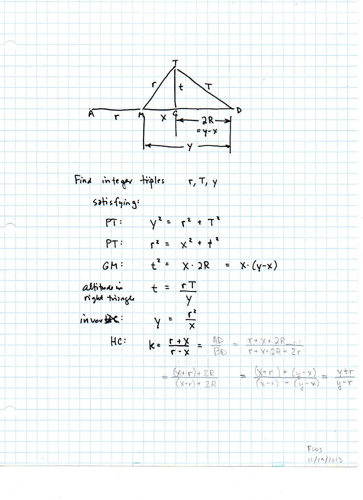

   Folio ``0177`` (original scan ``0177.jpg``) from ``resources/seelig/26_harmonic-conjugate-inversion``.

**Diplomatic Mathematical & Geometric Transcription**

**Diplomatic Transcription — Folio 0177** (``0177.jpg``, Sheet 10 of 15):

Formulates the number-theoretic problem of finding all-integer harmonic inversion configurations.

.. math::

   (x,\, t,\, r,\, y,\, T) = \left(\hat{x}^2,\, \hat{x}\hat{t},\, \hat{x}\hat{r},\, \hat{r}^2,\, \hat{r}\hat{t}\right) \quad \text{where } \hat{x}^2 + \hat{t}^2 = \hat{r}^2

.. admonition:: Editorial & Symbolic Notes

   Archival scan ``0177.jpg`` from Fred W. Seelig's notebook dossier on **F.26 Harmonic Conjugate Inversion** (Page 10 of 15). Companion OpenDocument worksheet(s): ``Harmonic Conjugates``, ``HC Tables``. Classical Euclidean foundations: :ref:`III.36`, :ref:`VI.8`.

Folio 0178 (Page 11 of 15): Master Landscape Table for kappa = 3/5 (FWS 11/20/2013)
-----------------------------------------------------------------------------------

.. folio:: 0178

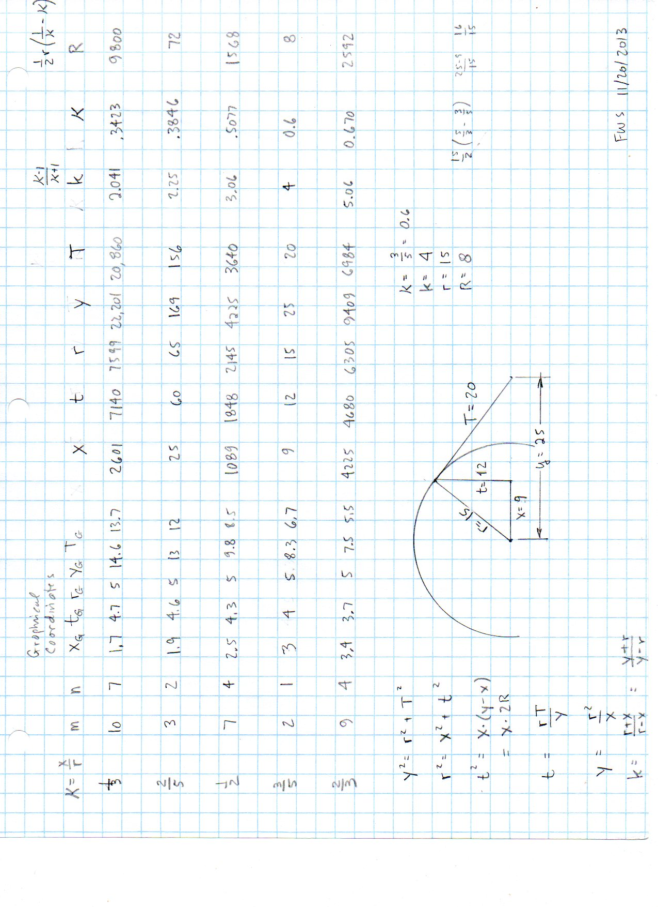

   Folio ``0178`` (original scan ``0178.jpg``) from ``resources/seelig/26_harmonic-conjugate-inversion``.

**Diplomatic Mathematical & Geometric Transcription**

**Diplomatic Transcription — Folio 0178** (``0178.jpg``, Sheet 11 of 15):

Complete table of graphical and exact integer coordinates (:math:`x=9, t=12, r=15, y=25, T=20, R=8, k=4`) with scale diagram.

.. math::

   x y = |MC| \cdot |MD| = r^2, \qquad T^2 = y^2 - r^2 = |AD| \cdot |BD|, \qquad z^2 + T^2 = 2(r^2 + y^2) \implies z^2 = y^2 + 3 r^2

.. admonition:: Editorial & Symbolic Notes

   Archival scan ``0178.jpg`` from Fred W. Seelig's notebook dossier on **F.26 Harmonic Conjugate Inversion** (Page 11 of 15). Companion OpenDocument worksheet(s): ``Harmonic Conjugates``, ``HC Tables``. Classical Euclidean foundations: :ref:`III.36`, :ref:`VI.8`.

Folio 0179 (Page 12 of 15): Worked Example r = 3, R = 4, kappa = 1/3
--------------------------------------------------------------------

.. folio:: 0179

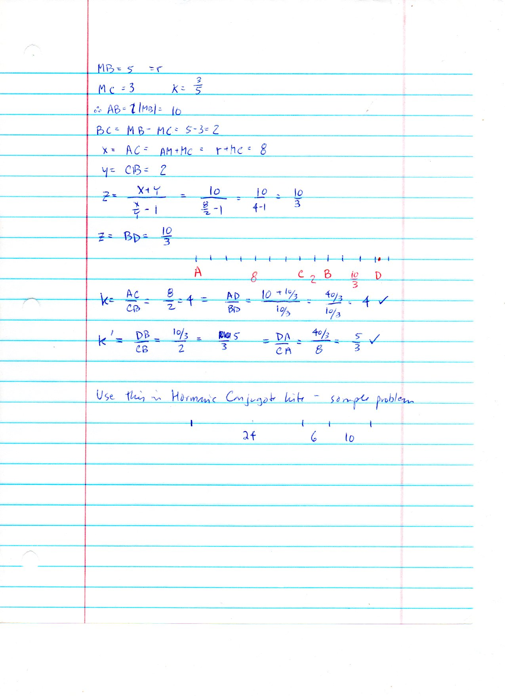

   Folio ``0179`` (original scan ``0179.jpg``) from ``resources/seelig/26_harmonic-conjugate-inversion``.

**Diplomatic Mathematical & Geometric Transcription**

**Diplomatic Transcription — Folio 0179** (``0179.jpg``, Sheet 12 of 15):

Verifies :math:`(W+w)/2 = (AD+BC)/2 = r+R = 7` for :math:`AB=6, CD=8`.

.. math::

   (x,\, t,\, r,\, y,\, T) = \left(\hat{x}^2,\, \hat{x}\hat{t},\, \hat{x}\hat{r},\, \hat{r}^2,\, \hat{r}\hat{t}\right) \quad \text{where } \hat{x}^2 + \hat{t}^2 = \hat{r}^2

.. admonition:: Editorial & Symbolic Notes

   Archival scan ``0179.jpg`` from Fred W. Seelig's notebook dossier on **F.26 Harmonic Conjugate Inversion** (Page 12 of 15). Companion OpenDocument worksheet(s): ``Harmonic Conjugates``, ``HC Tables``. Classical Euclidean foundations: :ref:`III.36`, :ref:`VI.8`.

Folio 0180 (Page 13 of 15): Harmonic Conjugate Kite Sample Problem (r = 5, x = 3)
---------------------------------------------------------------------------------

.. folio:: 0180

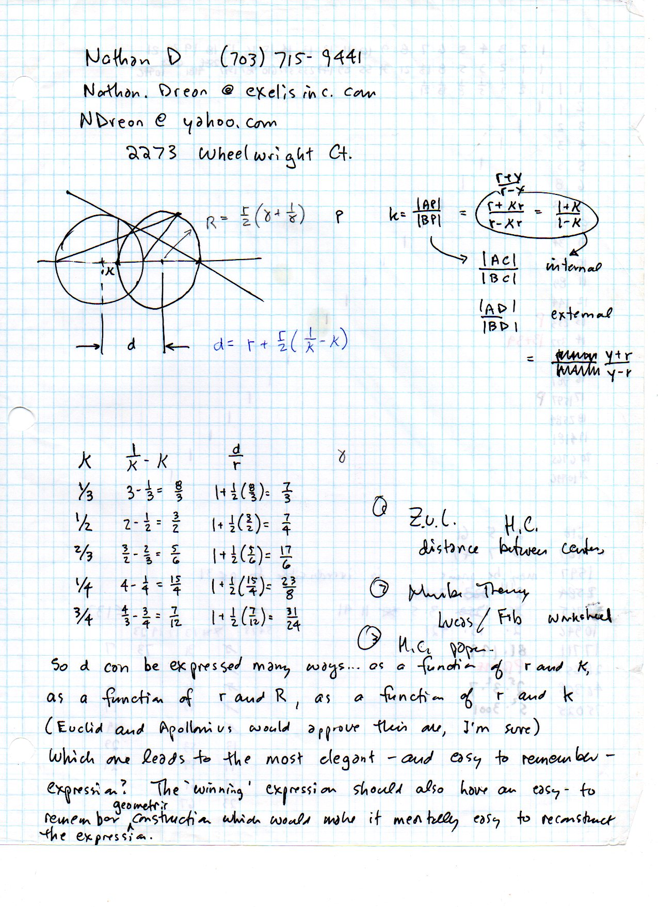

   Folio ``0180`` (original scan ``0180.jpg``) from ``resources/seelig/26_harmonic-conjugate-inversion``.

**Diplomatic Mathematical & Geometric Transcription**

**Diplomatic Transcription — Folio 0180** (``0180.jpg``, Sheet 13 of 15):

Computes all segments and ratios for :math:`\kappa = 3/5, k = 4, k' = 5/3`.

.. math::

   x y = |MC| \cdot |MD| = r^2, \qquad T^2 = y^2 - r^2 = |AD| \cdot |BD|, \qquad z^2 + T^2 = 2(r^2 + y^2) \implies z^2 = y^2 + 3 r^2

.. admonition:: Editorial & Symbolic Notes

   Archival scan ``0180.jpg`` from Fred W. Seelig's notebook dossier on **F.26 Harmonic Conjugate Inversion** (Page 13 of 15). Companion OpenDocument worksheet(s): ``Harmonic Conjugates``, ``HC Tables``. Classical Euclidean foundations: :ref:`III.36`, :ref:`VI.8`.

Folio 0181 (Page 14 of 15): Center Distance d and Radius R in Terms of kappa
----------------------------------------------------------------------------

.. folio:: 0181

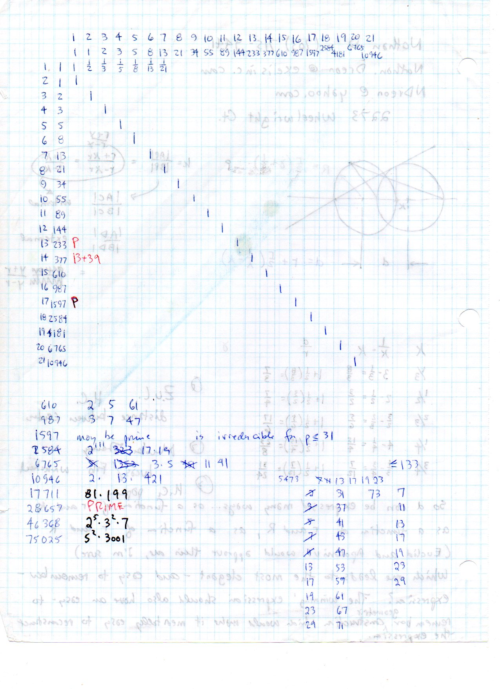

   Folio ``0181`` (original scan ``0181.jpg``) from ``resources/seelig/26_harmonic-conjugate-inversion``.

**Diplomatic Mathematical & Geometric Transcription**

**Diplomatic Transcription — Folio 0181** (``0181.jpg``, Sheet 14 of 15):

Tabulates :math:`\kappa, 1/\kappa - \kappa, d/r` and remarks *'(Euclid and Apollonius would approve their use, I'm sure)'*.

.. math::

   (x,\, t,\, r,\, y,\, T) = \left(\hat{x}^2,\, \hat{x}\hat{t},\, \hat{x}\hat{r},\, \hat{r}^2,\, \hat{r}\hat{t}\right) \quad \text{where } \hat{x}^2 + \hat{t}^2 = \hat{r}^2

.. admonition:: Editorial & Symbolic Notes

   Archival scan ``0181.jpg`` from Fred W. Seelig's notebook dossier on **F.26 Harmonic Conjugate Inversion** (Page 14 of 15). Companion OpenDocument worksheet(s): ``Harmonic Conjugates``, ``HC Tables``. Classical Euclidean foundations: :ref:`III.36`, :ref:`VI.8`.

Folio 0182 (Page 15 of 15): Fibonacci & Lucas Prime Factorization Table (F_1 to F_25)
-------------------------------------------------------------------------------------

.. folio:: 0182

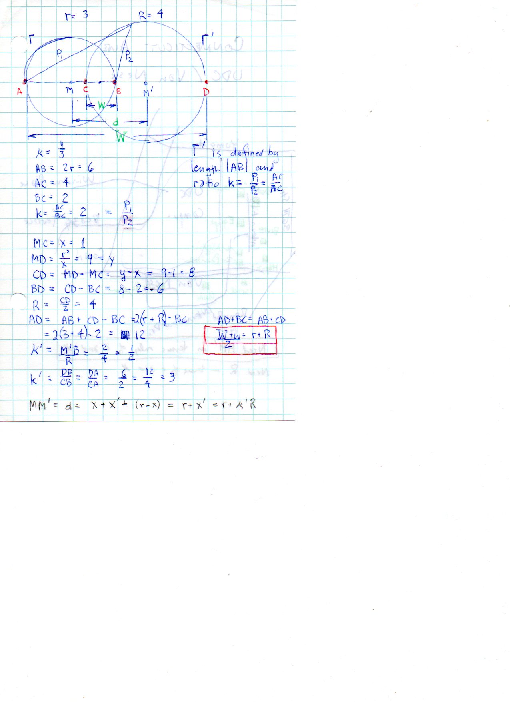

   Folio ``0182`` (original scan ``0182.jpg``) from ``resources/seelig/26_harmonic-conjugate-inversion``.

**Diplomatic Mathematical & Geometric Transcription**

**Diplomatic Transcription — Folio 0182** (``0182.jpg``, Sheet 15 of 15):

Reverse side of Folio 14 listing prime factorizations of Fibonacci and Lucas numbers.

.. math::

   x y = |MC| \cdot |MD| = r^2, \qquad T^2 = y^2 - r^2 = |AD| \cdot |BD|, \qquad z^2 + T^2 = 2(r^2 + y^2) \implies z^2 = y^2 + 3 r^2

.. admonition:: Editorial & Symbolic Notes

   Archival scan ``0182.jpg`` from Fred W. Seelig's notebook dossier on **F.26 Harmonic Conjugate Inversion** (Page 15 of 15). Companion OpenDocument worksheet(s): ``Harmonic Conjugates``, ``HC Tables``. Classical Euclidean foundations: :ref:`III.36`, :ref:`VI.8`.
