===========================
F.27 Harmonic Mean — Folios
===========================

Archival manuscript scans and diplomatic transcriptions from :person:`seelig`'s
notebooks for **F.27 (Harmonic Mean)** (:cite:`SeeligNotebooks`).

Folio 0183 (Page 1 of 19): Harmonic Mean \|CD\| = r(gamma + 1/gamma) & Construction Part I
------------------------------------------------------------------------------------------

.. folio:: 0183

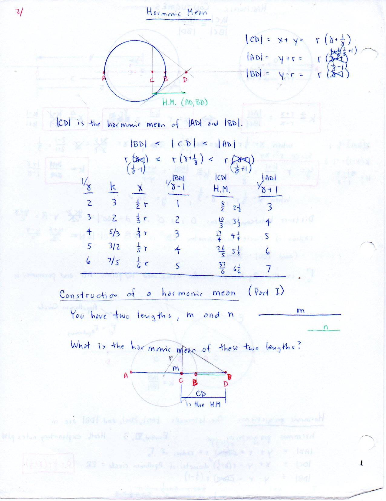

   Folio ``0183`` (original scan ``0183.jpg``) from ``resources/seelig/27_harmonic-mean``.

**Diplomatic Mathematical & Geometric Transcription**

**Diplomatic Transcription — Folio 0183** (``0183.jpg``, Sheet 1 of 19):

Proves :math:`|CD| = \operatorname{HM}(|BD|, |AD|)` with a table for :math:`1/\gamma \in \{2..6\}` and begins the compass construction.

.. math::

   |CD| = \operatorname{HM}(|BD|,\, |AD|) = \frac{2 |BD| \cdot |AD|}{|BD| + |AD|} = r\left(\gamma + \frac{1}{\gamma}\right), \qquad x^2 = \frac{(r / t)^2}{\frac{1}{r^2} + \frac{1}{t^2}} = \left(\frac{r}{\gamma}\right)^2

.. admonition:: Editorial & Symbolic Notes

   Archival scan ``0183.jpg`` from Fred W. Seelig's notebook dossier on **F.27 Harmonic Mean** (Page 1 of 19). Companion OpenDocument worksheet(s): ``Harmonic Conjugates``, ``HC Tables``. Classical Euclidean foundations: :ref:`VI.3`, :ref:`VI.8`, :ref:`VI.13`.

Folio 0184 (Page 2 of 19): Harmonic Mean and the Power of a Circle (Page 3)
---------------------------------------------------------------------------

.. folio:: 0184

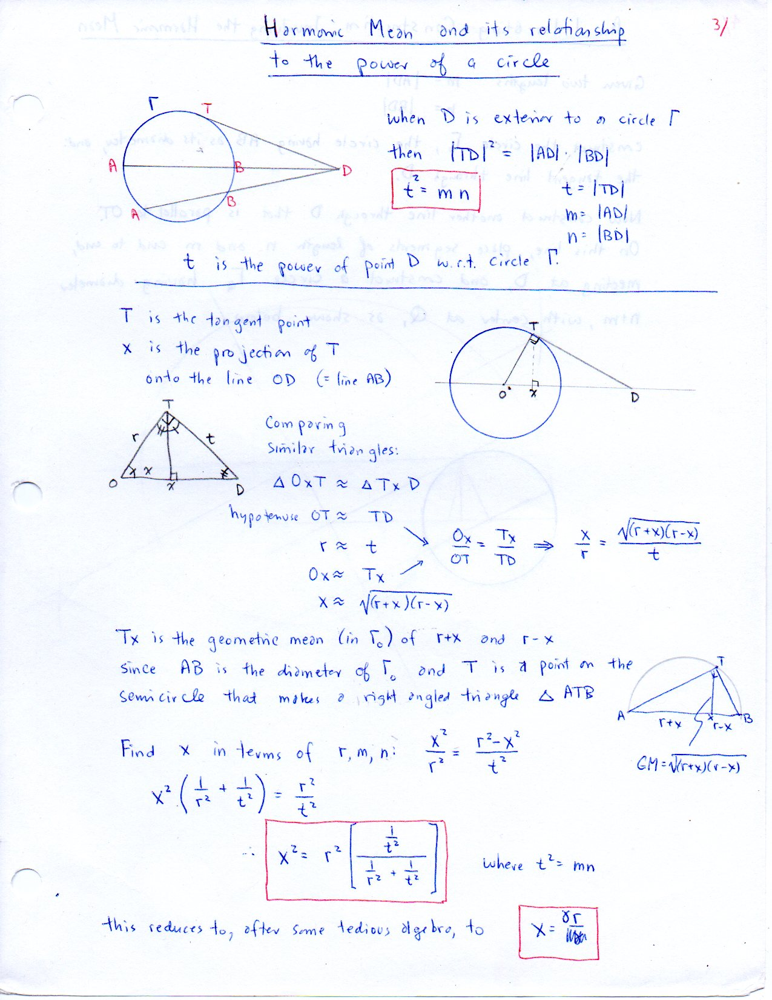

   Folio ``0184`` (original scan ``0184.jpg``) from ``resources/seelig/27_harmonic-mean``.

**Diplomatic Mathematical & Geometric Transcription**

**Diplomatic Transcription — Folio 0184** (``0184.jpg``, Sheet 2 of 19):

Uses :math:`t^2 = mn` and :math:`\triangle OxT \sim \triangle TxD` to derive :math:`x^2 = r^2[\frac{1/t^2}{1/r^2+1/t^2}] = (r/\gamma)^2`.

.. math::

   Y^2 + (X + Z) Y - X Z = 0 \implies Y = \frac{-(X + Z) + \sqrt{(X + Z)^2 + 4 X Z}}{2}

.. admonition:: Editorial & Symbolic Notes

   Archival scan ``0184.jpg`` from Fred W. Seelig's notebook dossier on **F.27 Harmonic Mean** (Page 2 of 19). Companion OpenDocument worksheet(s): ``Harmonic Conjugates``, ``HC Tables``. Classical Euclidean foundations: :ref:`VI.3`, :ref:`VI.8`, :ref:`VI.13`.

Folio 0185 (Page 3 of 19): An Interesting Construction Involving the Harmonic Mean (Page 4)
-------------------------------------------------------------------------------------------

.. folio:: 0185

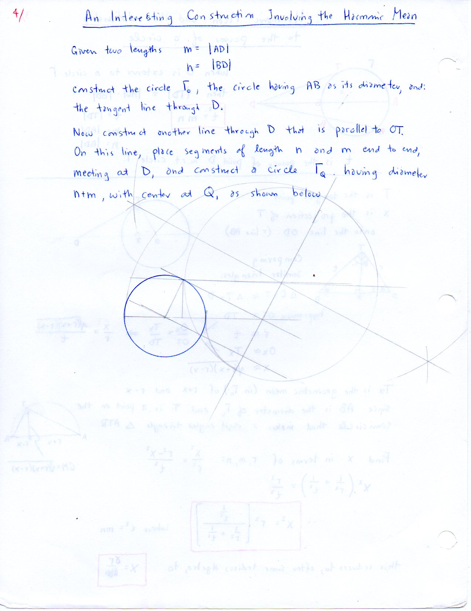

   Folio ``0185`` (original scan ``0185.jpg``) from ``resources/seelig/27_harmonic-mean``.

**Diplomatic Mathematical & Geometric Transcription**

**Diplomatic Transcription — Folio 0185** (``0185.jpg``, Sheet 3 of 19):

Constructs circle :math:`\Gamma_0` of diameter :math:`AB = m-n` and auxiliary circle :math:`\Gamma_Q` of diameter :math:`m+n`.

.. math::

   |CD| = \operatorname{HM}(|BD|,\, |AD|) = \frac{2 |BD| \cdot |AD|}{|BD| + |AD|} = r\left(\gamma + \frac{1}{\gamma}\right), \qquad x^2 = \frac{(r / t)^2}{\frac{1}{r^2} + \frac{1}{t^2}} = \left(\frac{r}{\gamma}\right)^2

.. admonition:: Editorial & Symbolic Notes

   Archival scan ``0185.jpg`` from Fred W. Seelig's notebook dossier on **F.27 Harmonic Mean** (Page 3 of 19). Companion OpenDocument worksheet(s): ``Harmonic Conjugates``, ``HC Tables``. Classical Euclidean foundations: :ref:`VI.3`, :ref:`VI.8`, :ref:`VI.13`.

Folio 0186 (Page 4 of 19): Parallel/Perpendicular Angle Chase on Circles Gamma_0 and Gamma_O'' (Page 6)
-------------------------------------------------------------------------------------------------------

.. folio:: 0186

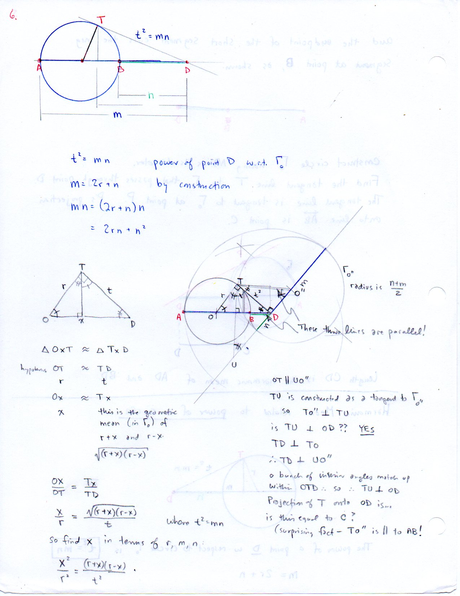

   Folio ``0186`` (original scan ``0186.jpg``) from ``resources/seelig/27_harmonic-mean``.

**Diplomatic Mathematical & Geometric Transcription**

**Diplomatic Transcription — Folio 0186** (``0186.jpg``, Sheet 4 of 19):

Proves :math:`OT \parallel UO''`, :math:`TU \perp OD`, and :math:`x^2/r^2 = (r^2-x^2)/t^2`.

.. math::

   Y^2 + (X + Z) Y - X Z = 0 \implies Y = \frac{-(X + Z) + \sqrt{(X + Z)^2 + 4 X Z}}{2}

.. admonition:: Editorial & Symbolic Notes

   Archival scan ``0186.jpg`` from Fred W. Seelig's notebook dossier on **F.27 Harmonic Mean** (Page 4 of 19). Companion OpenDocument worksheet(s): ``Harmonic Conjugates``, ``HC Tables``. Classical Euclidean foundations: :ref:`VI.3`, :ref:`VI.8`, :ref:`VI.13`.

Folio 0187 (Page 5 of 19): Boxed Formula for Projection x = r/gamma & Worked Example (Page 7)
---------------------------------------------------------------------------------------------

.. folio:: 0187

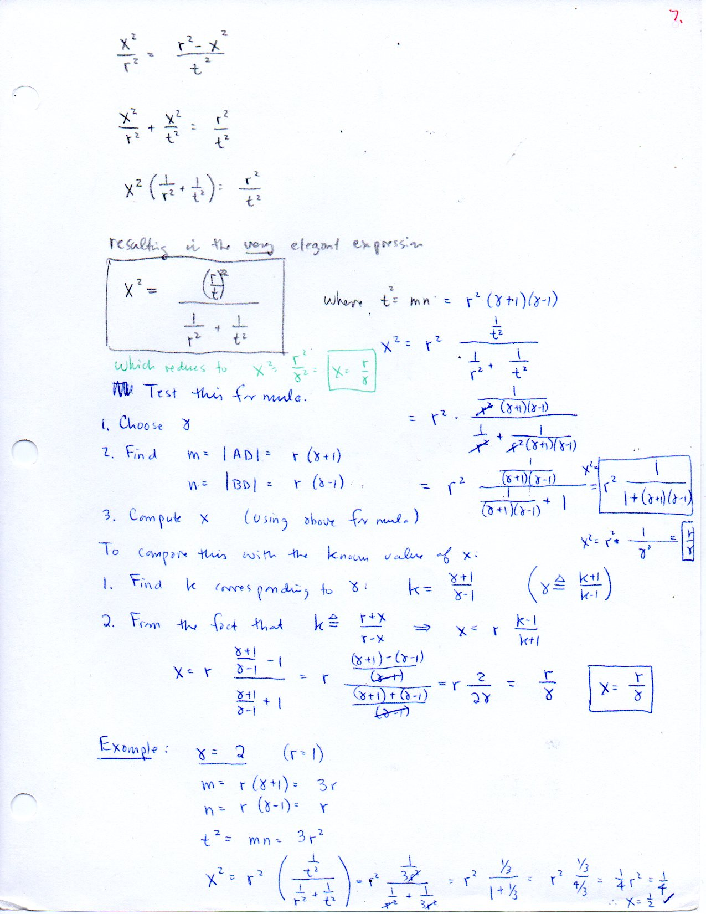

   Folio ``0187`` (original scan ``0187.jpg``) from ``resources/seelig/27_harmonic-mean``.

**Diplomatic Mathematical & Geometric Transcription**

**Diplomatic Transcription — Folio 0187** (``0187.jpg``, Sheet 5 of 19):

Completes the proof of :math:`x = r/\gamma` and tests :math:`\gamma = 2, r = 1 \implies m=3, n=1, t^2=3, x=1/2`.

.. math::

   |CD| = \operatorname{HM}(|BD|,\, |AD|) = \frac{2 |BD| \cdot |AD|}{|BD| + |AD|} = r\left(\gamma + \frac{1}{\gamma}\right), \qquad x^2 = \frac{(r / t)^2}{\frac{1}{r^2} + \frac{1}{t^2}} = \left(\frac{r}{\gamma}\right)^2

.. admonition:: Editorial & Symbolic Notes

   Archival scan ``0187.jpg`` from Fred W. Seelig's notebook dossier on **F.27 Harmonic Mean** (Page 5 of 19). Companion OpenDocument worksheet(s): ``Harmonic Conjugates``, ``HC Tables``. Classical Euclidean foundations: :ref:`VI.3`, :ref:`VI.8`, :ref:`VI.13`.

Folio 0188 (Page 6 of 19): Harmonic Progression Proof via Euclid VI.3 (Heath p. 198)
------------------------------------------------------------------------------------

.. folio:: 0188

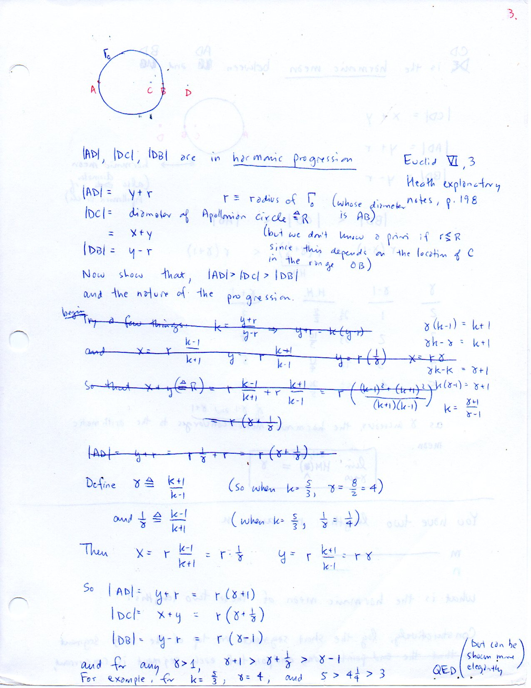

   Folio ``0188`` (original scan ``0188.jpg``) from ``resources/seelig/27_harmonic-mean``.

**Diplomatic Mathematical & Geometric Transcription**

**Diplomatic Transcription — Folio 0188** (``0188.jpg``, Sheet 6 of 19):

Shows that :math:`|AD| = r(\gamma+1), |DC| = r(\gamma+1/\gamma), |DB| = r(\gamma-1)` are in harmonic progression.

.. math::

   Y^2 + (X + Z) Y - X Z = 0 \implies Y = \frac{-(X + Z) + \sqrt{(X + Z)^2 + 4 X Z}}{2}

.. admonition:: Editorial & Symbolic Notes

   Archival scan ``0188.jpg`` from Fred W. Seelig's notebook dossier on **F.27 Harmonic Mean** (Page 6 of 19). Companion OpenDocument worksheet(s): ``Harmonic Conjugates``, ``HC Tables``. Classical Euclidean foundations: :ref:`VI.3`, :ref:`VI.8`, :ref:`VI.13`.

Folio 0189 (Page 7 of 19): Asymptotic Limit lim_{gamma->inf} HM(gamma+1, gamma-1) = gamma
-----------------------------------------------------------------------------------------

.. folio:: 0189

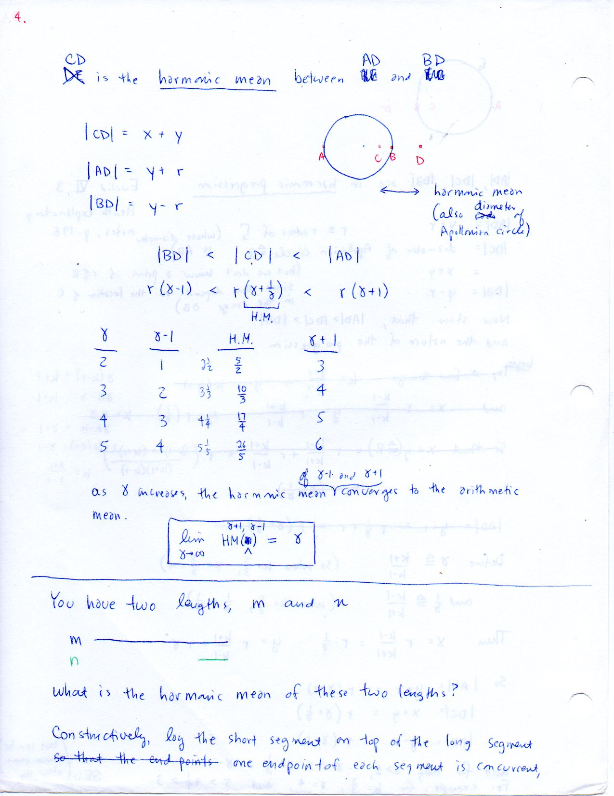

   Folio ``0189`` (original scan ``0189.jpg``) from ``resources/seelig/27_harmonic-mean``.

**Diplomatic Mathematical & Geometric Transcription**

**Diplomatic Transcription — Folio 0189** (``0189.jpg``, Sheet 7 of 19):

Proves the asymptotic limit and tabulates values for :math:`\gamma \in \{2, 3, 4, 5\}`.

.. math::

   |CD| = \operatorname{HM}(|BD|,\, |AD|) = \frac{2 |BD| \cdot |AD|}{|BD| + |AD|} = r\left(\gamma + \frac{1}{\gamma}\right), \qquad x^2 = \frac{(r / t)^2}{\frac{1}{r^2} + \frac{1}{t^2}} = \left(\frac{r}{\gamma}\right)^2

.. admonition:: Editorial & Symbolic Notes

   Archival scan ``0189.jpg`` from Fred W. Seelig's notebook dossier on **F.27 Harmonic Mean** (Page 7 of 19). Companion OpenDocument worksheet(s): ``Harmonic Conjugates``, ``HC Tables``. Classical Euclidean foundations: :ref:`VI.3`, :ref:`VI.8`, :ref:`VI.13`.

Folio 0190 (Page 8 of 19): Derivation of x, y, and Apollonian Radius R from xy = r^2
------------------------------------------------------------------------------------

.. folio:: 0190

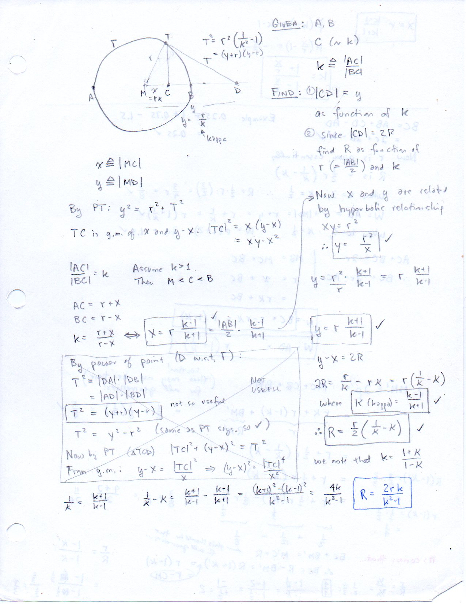

   Folio ``0190`` (original scan ``0190.jpg``) from ``resources/seelig/27_harmonic-mean``.

**Diplomatic Mathematical & Geometric Transcription**

**Diplomatic Transcription — Folio 0190** (``0190.jpg``, Sheet 8 of 19):

Derives :math:`x = r\frac{k-1}{k+1}, y = r\frac{k+1}{k-1}`, and :math:`R = \frac{2rk}{k^2-1}`.

.. math::

   Y^2 + (X + Z) Y - X Z = 0 \implies Y = \frac{-(X + Z) + \sqrt{(X + Z)^2 + 4 X Z}}{2}

.. admonition:: Editorial & Symbolic Notes

   Archival scan ``0190.jpg`` from Fred W. Seelig's notebook dossier on **F.27 Harmonic Mean** (Page 8 of 19). Companion OpenDocument worksheet(s): ``Harmonic Conjugates``, ``HC Tables``. Classical Euclidean foundations: :ref:`VI.3`, :ref:`VI.8`, :ref:`VI.13`.

Folio 0191 (Page 9 of 19): Identities for w = BC, W = AD, and Center Distance MM' = 2*rho
-----------------------------------------------------------------------------------------

.. folio:: 0191

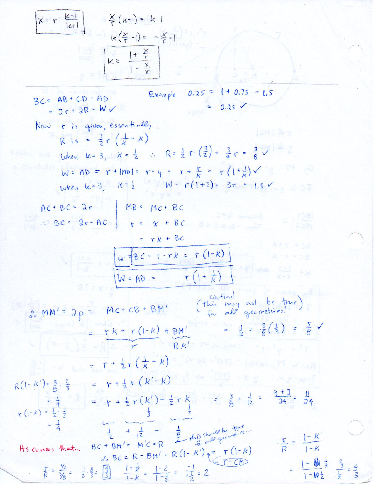

   Folio ``0191`` (original scan ``0191.jpg``) from ``resources/seelig/27_harmonic-mean``.

**Diplomatic Mathematical & Geometric Transcription**

**Diplomatic Transcription — Folio 0191** (``0191.jpg``, Sheet 9 of 19):

Proves :math:`r/R = (1-\kappa')/(1-\kappa)` and tests :math:`k=3, \kappa=1/2`.

.. math::

   |CD| = \operatorname{HM}(|BD|,\, |AD|) = \frac{2 |BD| \cdot |AD|}{|BD| + |AD|} = r\left(\gamma + \frac{1}{\gamma}\right), \qquad x^2 = \frac{(r / t)^2}{\frac{1}{r^2} + \frac{1}{t^2}} = \left(\frac{r}{\gamma}\right)^2

.. admonition:: Editorial & Symbolic Notes

   Archival scan ``0191.jpg`` from Fred W. Seelig's notebook dossier on **F.27 Harmonic Mean** (Page 9 of 19). Companion OpenDocument worksheet(s): ``Harmonic Conjugates``, ``HC Tables``. Classical Euclidean foundations: :ref:`VI.3`, :ref:`VI.8`, :ref:`VI.13`.

Folio 0192 (Page 10 of 19): Harmonic Progression Examples 1 & 2 (Cropped Scan)
------------------------------------------------------------------------------

.. folio:: 0192

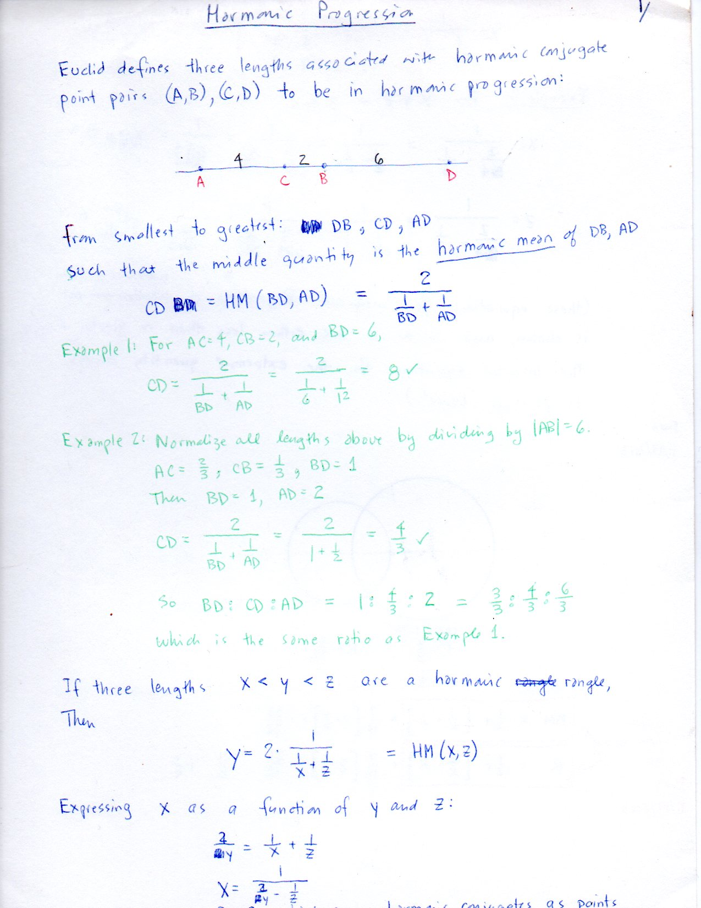

   Folio ``0192`` (original scan ``0192.jpg``) from ``resources/seelig/27_harmonic-mean``.

**Diplomatic Mathematical & Geometric Transcription**

**Diplomatic Transcription — Folio 0192** (``0192.jpg``, Sheet 10 of 19):

Works :math:`AC=4, CB=2, BD=6 \implies CD = \operatorname{HM}(6,12) = 8`.

.. math::

   Y^2 + (X + Z) Y - X Z = 0 \implies Y = \frac{-(X + Z) + \sqrt{(X + Z)^2 + 4 X Z}}{2}

.. admonition:: Editorial & Symbolic Notes

   Archival scan ``0192.jpg`` from Fred W. Seelig's notebook dossier on **F.27 Harmonic Mean** (Page 10 of 19). Companion OpenDocument worksheet(s): ``Harmonic Conjugates``, ``HC Tables``. Classical Euclidean foundations: :ref:`VI.3`, :ref:`VI.8`, :ref:`VI.13`.

Folio 0193 (Page 11 of 19): Harmonic Progression with Euclid VI.3 Footnote (Partial Scan)
-----------------------------------------------------------------------------------------

.. folio:: 0193

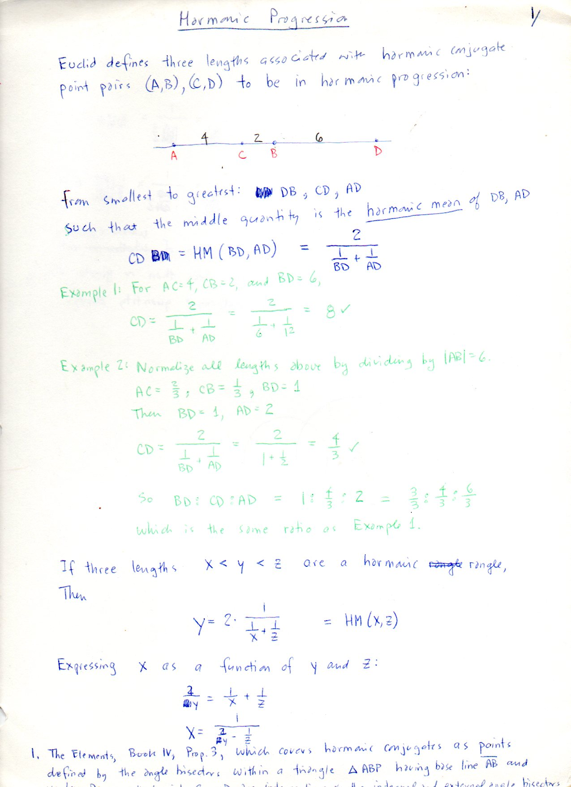

   Folio ``0193`` (original scan ``0193.jpg``) from ``resources/seelig/27_harmonic-mean``.

**Diplomatic Mathematical & Geometric Transcription**

**Diplomatic Transcription — Folio 0193** (``0193.jpg``, Sheet 11 of 19):

Shows the first two lines of Footnote 1 on angle bisectors of :math:`\triangle ABP`.

.. math::

   |CD| = \operatorname{HM}(|BD|,\, |AD|) = \frac{2 |BD| \cdot |AD|}{|BD| + |AD|} = r\left(\gamma + \frac{1}{\gamma}\right), \qquad x^2 = \frac{(r / t)^2}{\frac{1}{r^2} + \frac{1}{t^2}} = \left(\frac{r}{\gamma}\right)^2

.. admonition:: Editorial & Symbolic Notes

   Archival scan ``0193.jpg`` from Fred W. Seelig's notebook dossier on **F.27 Harmonic Mean** (Page 11 of 19). Companion OpenDocument worksheet(s): ``Harmonic Conjugates``, ``HC Tables``. Classical Euclidean foundations: :ref:`VI.3`, :ref:`VI.8`, :ref:`VI.13`.

Folio 0194 (Page 12 of 19): Harmonic Progression with Full Euclid VI.3 Footnote
-------------------------------------------------------------------------------

.. folio:: 0194

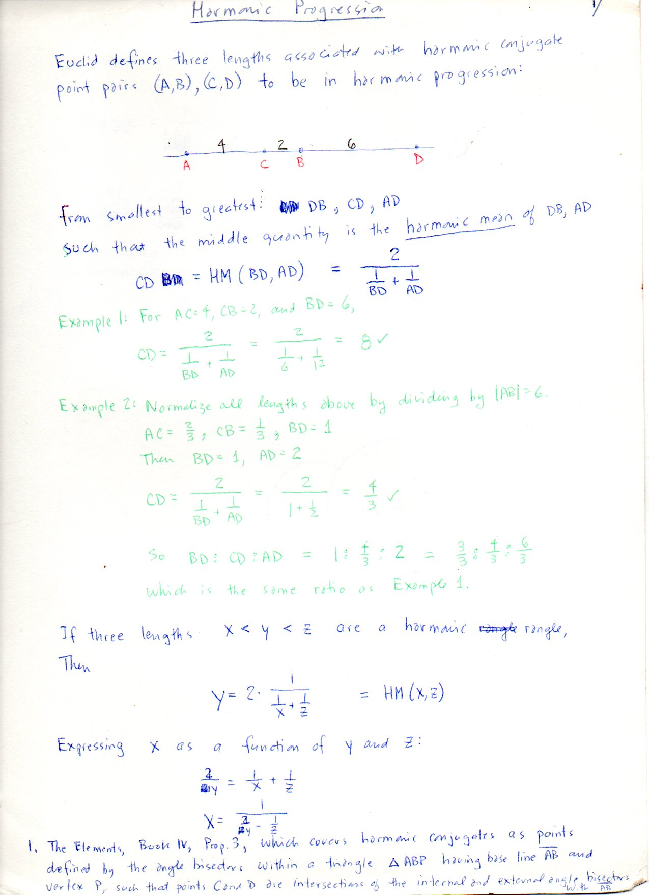

   Folio ``0194`` (original scan ``0194.jpg``) from ``resources/seelig/27_harmonic-mean``.

**Diplomatic Mathematical & Geometric Transcription**

**Diplomatic Transcription — Folio 0194** (``0194.jpg``, Sheet 12 of 19):

Uncropped scan showing all three lines of Footnote 1 citing *Elements* VI.3.

.. math::

   Y^2 + (X + Z) Y - X Z = 0 \implies Y = \frac{-(X + Z) + \sqrt{(X + Z)^2 + 4 X Z}}{2}

.. admonition:: Editorial & Symbolic Notes

   Archival scan ``0194.jpg`` from Fred W. Seelig's notebook dossier on **F.27 Harmonic Mean** (Page 12 of 19). Companion OpenDocument worksheet(s): ``Harmonic Conjugates``, ``HC Tables``. Classical Euclidean foundations: :ref:`VI.3`, :ref:`VI.8`, :ref:`VI.13`.

Folio 0195 (Page 13 of 19): Harmonic Progression Page 2: Example 3 & r = 7/8, kappa = 1/2 (FWS 11/13/2013)
----------------------------------------------------------------------------------------------------------

.. folio:: 0195

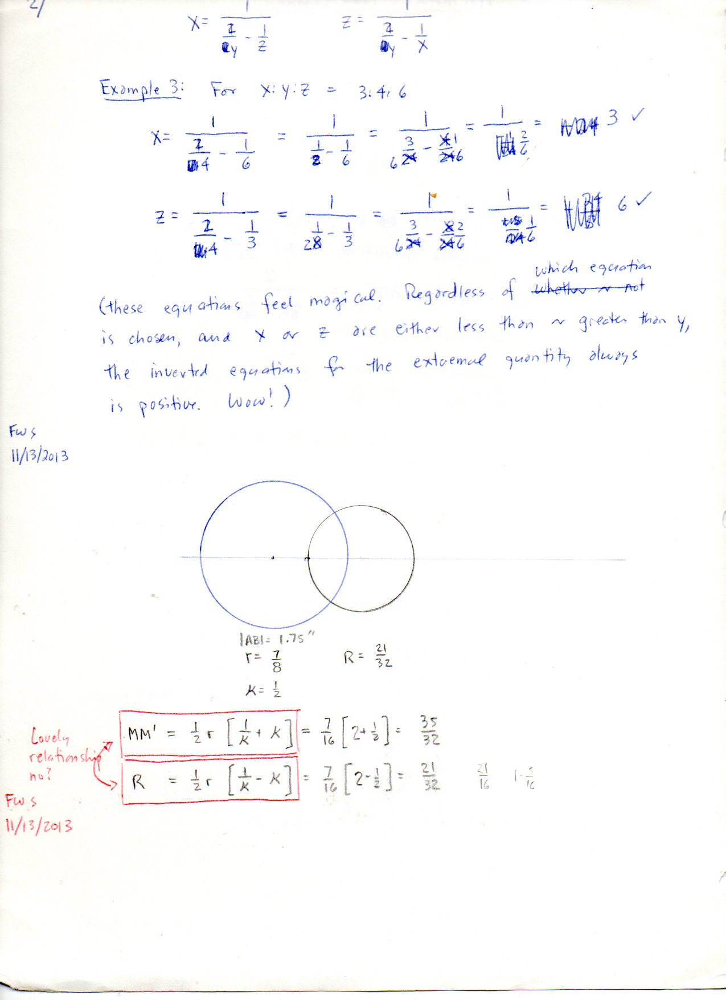

   Folio ``0195`` (original scan ``0195.jpg``) from ``resources/seelig/27_harmonic-mean``.

**Diplomatic Mathematical & Geometric Transcription**

**Diplomatic Transcription — Folio 0195** (``0195.jpg``, Sheet 13 of 19):

Computes :math:`MM' = 35/32` and :math:`R = 21/32` for :math:`r = 7/8, \kappa = 1/2`.

.. math::

   |CD| = \operatorname{HM}(|BD|,\, |AD|) = \frac{2 |BD| \cdot |AD|}{|BD| + |AD|} = r\left(\gamma + \frac{1}{\gamma}\right), \qquad x^2 = \frac{(r / t)^2}{\frac{1}{r^2} + \frac{1}{t^2}} = \left(\frac{r}{\gamma}\right)^2

.. admonition:: Editorial & Symbolic Notes

   Archival scan ``0195.jpg`` from Fred W. Seelig's notebook dossier on **F.27 Harmonic Mean** (Page 13 of 19). Companion OpenDocument worksheet(s): ``Harmonic Conjugates``, ``HC Tables``. Classical Euclidean foundations: :ref:`VI.3`, :ref:`VI.8`, :ref:`VI.13`.

Folio 0196 (Page 14 of 19): Duplicate Scan of Harmonic Progression Page 2
-------------------------------------------------------------------------

.. folio:: 0196

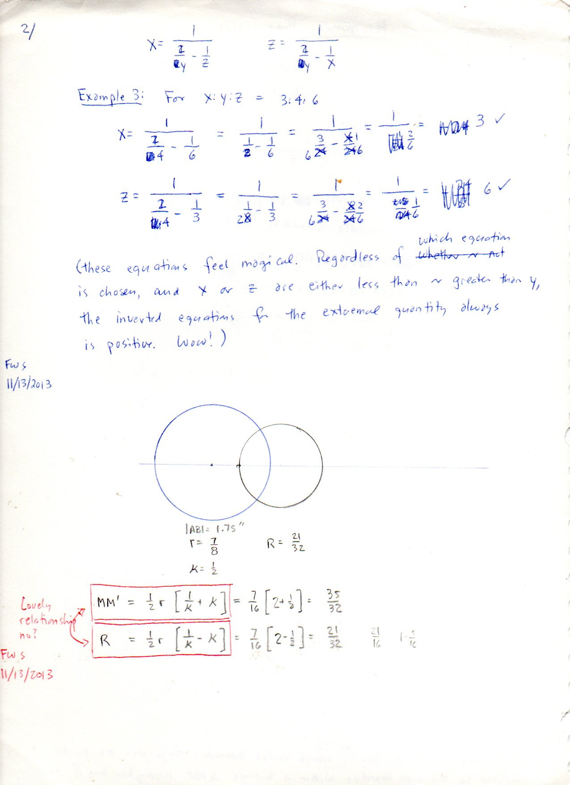

   Folio ``0196`` (original scan ``0196.jpg``) from ``resources/seelig/27_harmonic-mean``.

**Diplomatic Mathematical & Geometric Transcription**

**Diplomatic Transcription — Folio 0196** (``0196.jpg``, Sheet 14 of 19):

Second scan of the `FWS 11/13/2013` worksheet.

.. math::

   Y^2 + (X + Z) Y - X Z = 0 \implies Y = \frac{-(X + Z) + \sqrt{(X + Z)^2 + 4 X Z}}{2}

.. admonition:: Editorial & Symbolic Notes

   Archival scan ``0196.jpg`` from Fred W. Seelig's notebook dossier on **F.27 Harmonic Mean** (Page 14 of 19). Companion OpenDocument worksheet(s): ``Harmonic Conjugates``, ``HC Tables``. Classical Euclidean foundations: :ref:`VI.3`, :ref:`VI.8`, :ref:`VI.13`.

Folio 0197 (Page 15 of 19): Problems 6–9: Prime-Number Harmonic Ranges (FWS 11/14/2013)
---------------------------------------------------------------------------------------

.. folio:: 0197

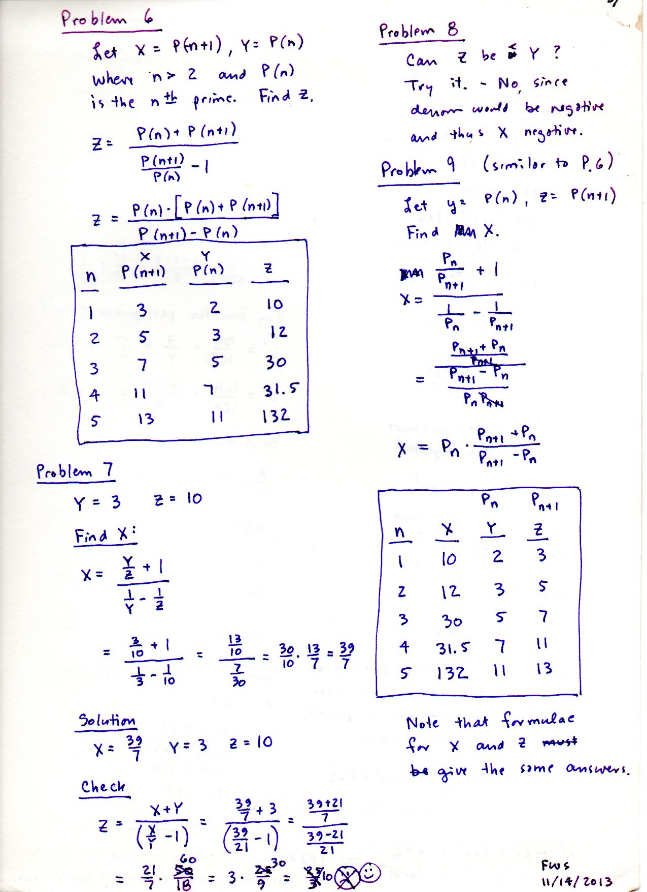

   Folio ``0197`` (original scan ``0197.jpg``) from ``resources/seelig/27_harmonic-mean``.

**Diplomatic Mathematical & Geometric Transcription**

**Diplomatic Transcription — Folio 0197** (``0197.jpg``, Sheet 15 of 19):

Evaluates :math:`Z = \frac{P_n(P_n+P_{n+1})}{P_{n+1}-P_n}` for consecutive primes :math:`(3,2)\to 10, (5,3)\to 12, (7,5)\to 30, (11,7)\to 63/2`.

.. math::

   |CD| = \operatorname{HM}(|BD|,\, |AD|) = \frac{2 |BD| \cdot |AD|}{|BD| + |AD|} = r\left(\gamma + \frac{1}{\gamma}\right), \qquad x^2 = \frac{(r / t)^2}{\frac{1}{r^2} + \frac{1}{t^2}} = \left(\frac{r}{\gamma}\right)^2

.. admonition:: Editorial & Symbolic Notes

   Archival scan ``0197.jpg`` from Fred W. Seelig's notebook dossier on **F.27 Harmonic Mean** (Page 15 of 19). Companion OpenDocument worksheet(s): ``Harmonic Conjugates``, ``HC Tables``. Classical Euclidean foundations: :ref:`VI.3`, :ref:`VI.8`, :ref:`VI.13`.

Folio 0198 (Page 16 of 19): Problem 10: Quadratic for Middle Segment Y Given X and Z
------------------------------------------------------------------------------------

.. folio:: 0198

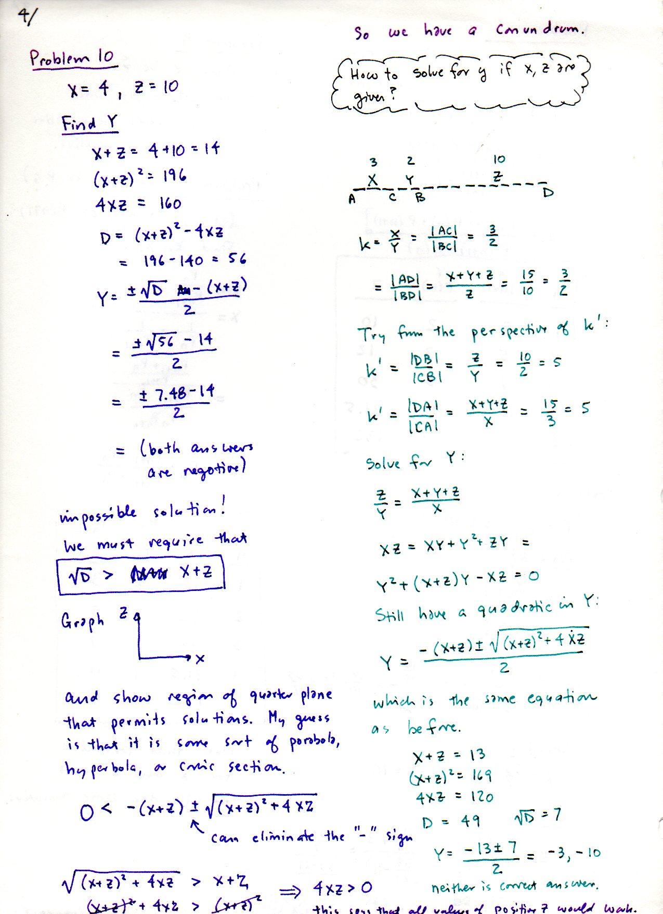

   Folio ``0198`` (original scan ``0198.jpg``) from ``resources/seelig/27_harmonic-mean``.

**Diplomatic Mathematical & Geometric Transcription**

**Diplomatic Transcription — Folio 0198** (``0198.jpg``, Sheet 16 of 19):

Solves :math:`Y^2 + (X+Z)Y - XZ = 0` for the internal segment :math:`Y = CB`.

.. math::

   Y^2 + (X + Z) Y - X Z = 0 \implies Y = \frac{-(X + Z) + \sqrt{(X + Z)^2 + 4 X Z}}{2}

.. admonition:: Editorial & Symbolic Notes

   Archival scan ``0198.jpg`` from Fred W. Seelig's notebook dossier on **F.27 Harmonic Mean** (Page 16 of 19). Companion OpenDocument worksheet(s): ``Harmonic Conjugates``, ``HC Tables``. Classical Euclidean foundations: :ref:`VI.3`, :ref:`VI.8`, :ref:`VI.13`.

Folio 0199 (Page 17 of 19): Bilinear Transform Through the Lens of Harmonic Conjugates (Page 1, Oct. 25, 2013)
--------------------------------------------------------------------------------------------------------------

.. folio:: 0199

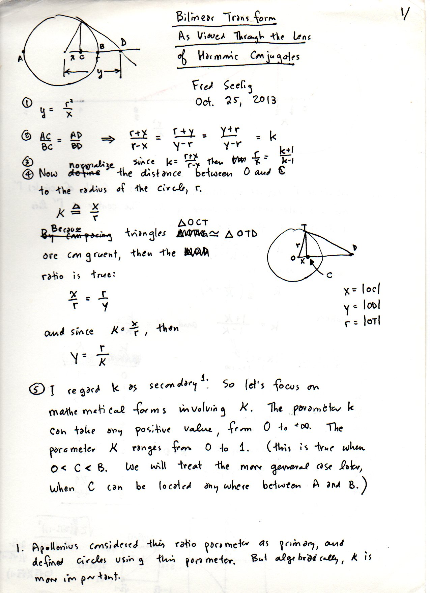

   Folio ``0199`` (original scan ``0199.jpg``) from ``resources/seelig/27_harmonic-mean``.

**Diplomatic Mathematical & Geometric Transcription**

**Diplomatic Transcription — Folio 0199** (``0199.jpg``, Sheet 17 of 19):

Explains why :math:`\kappa = x/r` is algebraically primary compared to Apollonius's ratio :math:`k`.

.. math::

   |CD| = \operatorname{HM}(|BD|,\, |AD|) = \frac{2 |BD| \cdot |AD|}{|BD| + |AD|} = r\left(\gamma + \frac{1}{\gamma}\right), \qquad x^2 = \frac{(r / t)^2}{\frac{1}{r^2} + \frac{1}{t^2}} = \left(\frac{r}{\gamma}\right)^2

.. admonition:: Editorial & Symbolic Notes

   Archival scan ``0199.jpg`` from Fred W. Seelig's notebook dossier on **F.27 Harmonic Mean** (Page 17 of 19). Companion OpenDocument worksheet(s): ``Harmonic Conjugates``, ``HC Tables``. Classical Euclidean foundations: :ref:`VI.3`, :ref:`VI.8`, :ref:`VI.13`.

Folio 0200 (Page 18 of 19): Hyperbola Plots for k(kappa) and kappa(k) (Page 2)
------------------------------------------------------------------------------

.. folio:: 0200

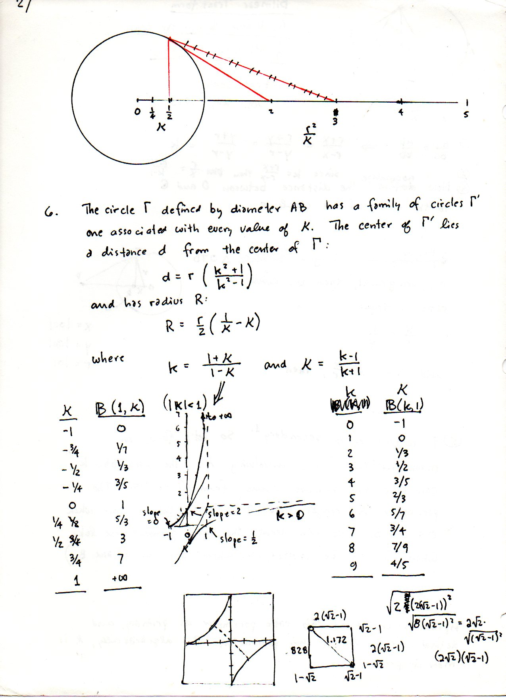

   Folio ``0200`` (original scan ``0200.jpg``) from ``resources/seelig/27_harmonic-mean``.

**Diplomatic Mathematical & Geometric Transcription**

**Diplomatic Transcription — Folio 0200** (``0200.jpg``, Sheet 18 of 19):

Tables and sketches of :math:`k = \frac{1+\kappa}{1-\kappa}` and :math:`\kappa = \frac{k-1}{k+1}`.

.. math::

   Y^2 + (X + Z) Y - X Z = 0 \implies Y = \frac{-(X + Z) + \sqrt{(X + Z)^2 + 4 X Z}}{2}

.. admonition:: Editorial & Symbolic Notes

   Archival scan ``0200.jpg`` from Fred W. Seelig's notebook dossier on **F.27 Harmonic Mean** (Page 18 of 19). Companion OpenDocument worksheet(s): ``Harmonic Conjugates``, ``HC Tables``. Classical Euclidean foundations: :ref:`VI.3`, :ref:`VI.8`, :ref:`VI.13`.

Folio 0201 (Page 19 of 19): Self-Inverse Bilinear Transform y = (1-x)/(1+x) (Page 3)
------------------------------------------------------------------------------------

.. folio:: 0201

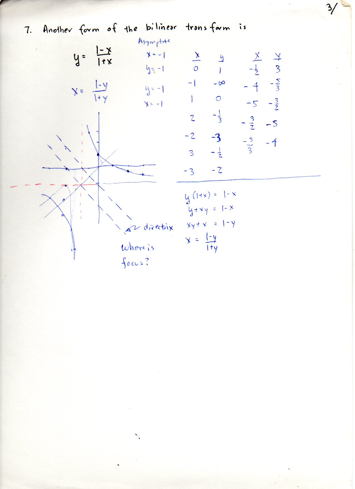

   Folio ``0201`` (original scan ``0201.jpg``) from ``resources/seelig/27_harmonic-mean``.

**Diplomatic Mathematical & Geometric Transcription**

**Diplomatic Transcription — Folio 0201** (``0201.jpg``, Sheet 19 of 19):

Plots :math:`y = \frac{1-x}{1+x}` with asymptotes :math:`x = -1, y = -1`.

.. math::

   |CD| = \operatorname{HM}(|BD|,\, |AD|) = \frac{2 |BD| \cdot |AD|}{|BD| + |AD|} = r\left(\gamma + \frac{1}{\gamma}\right), \qquad x^2 = \frac{(r / t)^2}{\frac{1}{r^2} + \frac{1}{t^2}} = \left(\frac{r}{\gamma}\right)^2

.. admonition:: Editorial & Symbolic Notes

   Archival scan ``0201.jpg`` from Fred W. Seelig's notebook dossier on **F.27 Harmonic Mean** (Page 19 of 19). Companion OpenDocument worksheet(s): ``Harmonic Conjugates``, ``HC Tables``. Classical Euclidean foundations: :ref:`VI.3`, :ref:`VI.8`, :ref:`VI.13`.
