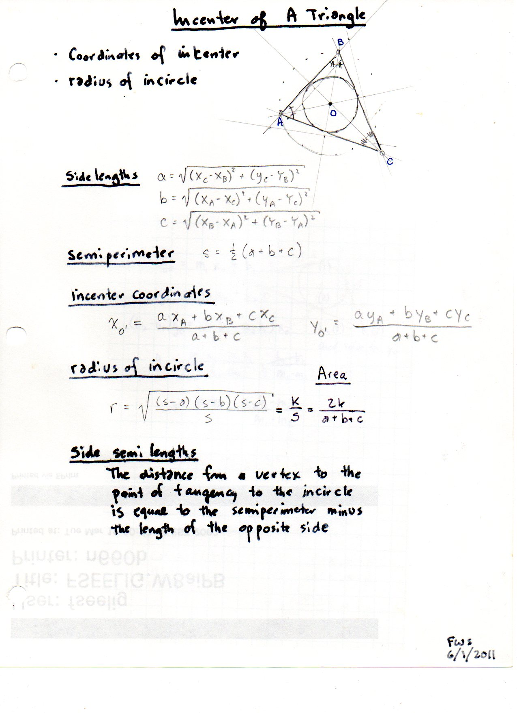
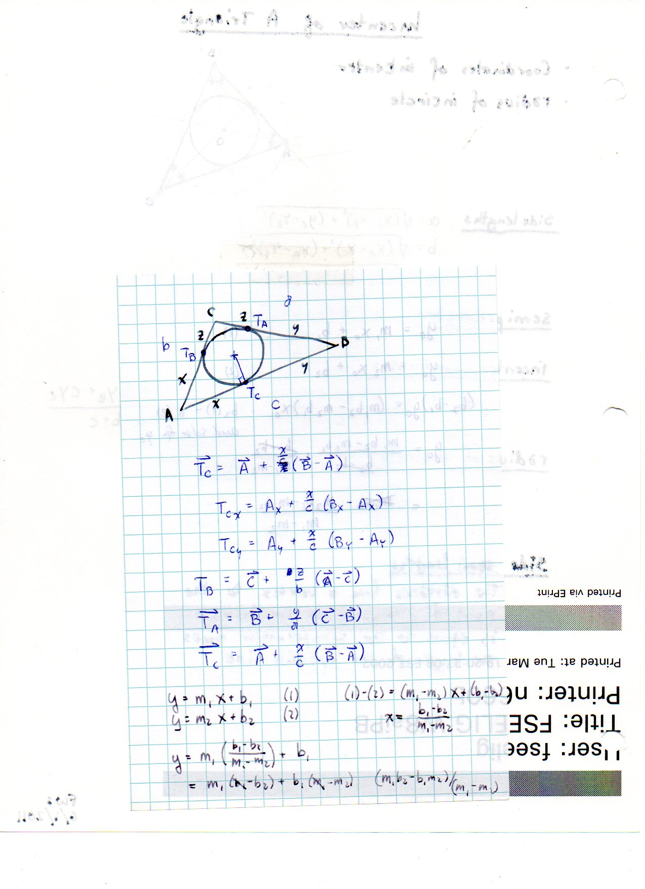
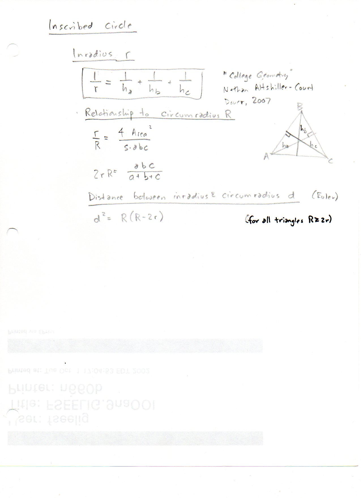
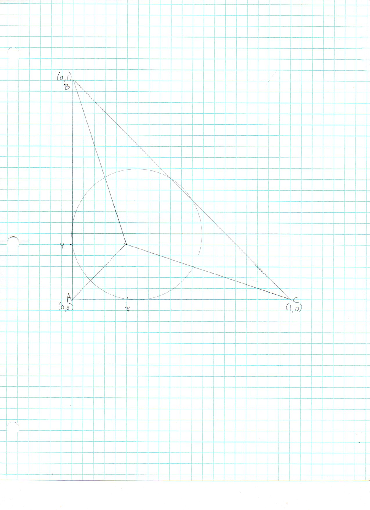
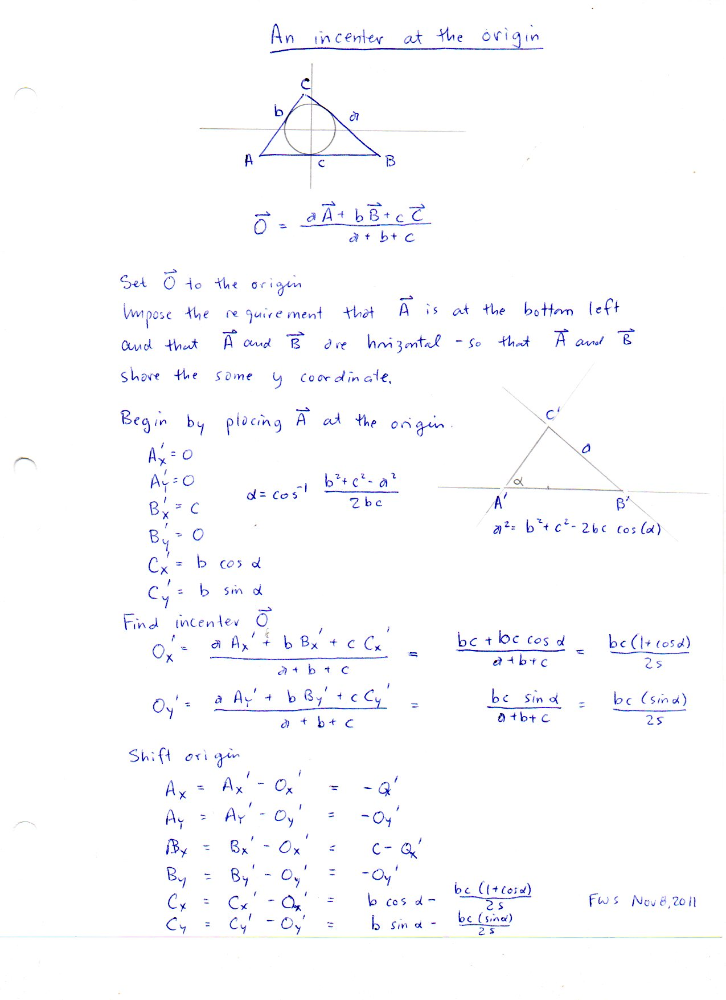

======================
F.28 Incenter — Folios
======================

Archival manuscript scans and diplomatic transcriptions from :person:`seelig`'s
notebooks for **F.28 (Incenter)** (:cite:`SeeligNotebooks`).

Folio 0202 (Page 1 of 5): Incenter of a Triangle Summary Sheet (FWS 6/1/2011)
-----------------------------------------------------------------------------

.. folio:: 0202

   Folio ``0202`` (original scan ``0202.jpg``) from ``resources/seelig/28_incenter``.

**Diplomatic Mathematical & Geometric Transcription**

**Diplomatic Transcription — Folio 0202** (``0202.jpg``, Sheet 1 of 5):

Gives formulas for :math:`a, b, c, s, (X_O, Y_O), r = K/s`, and tangent segments :math:`s-a, s-b, s-c`.

.. math::

   \vec{I} = \frac{a \vec{A} + b \vec{B} + c \vec{C}}{a + b + c}, \qquad r = \frac{K}{s} = \sqrt{\frac{(s - a)(s - b)(s - c)}{s}}, \qquad \frac{1}{r} = \frac{1}{h_a} + \frac{1}{h_b} + \frac{1}{h_c}

.. admonition:: Editorial & Symbolic Notes

   Archival scan ``0202.jpg`` from Fred W. Seelig's notebook dossier on **F.28 Incenter** (Page 1 of 5). Companion OpenDocument worksheet(s): ``Incircle-Incenter``, ``General Reference``, ``5-6-7 A,B,C``. Classical Euclidean foundations: :ref:`IV.4`, :ref:`VI.3`. Kimberling *Encyclopedia of Triangle Centers* loci: :ref:`X(1)`, :ref:`X(7)`.

Folio 0203 (Page 2 of 5): Vector Equations for Contact Points T_A, T_B, T_C
---------------------------------------------------------------------------

.. folio:: 0203

   Folio ``0203`` (original scan ``0203.jpg``) from ``resources/seelig/28_incenter``.

**Diplomatic Mathematical & Geometric Transcription**

**Diplomatic Transcription — Folio 0203** (``0203.jpg``, Sheet 2 of 5):

Expresses :math:`\vec{T}_C = \vec{A} + \frac{x}{c}(\vec{B}-\vec{A})` and line intersection formulas.

.. math::

   2 r R = \frac{a b c}{a + b + c}, \qquad d_{IO}^2 = R(R - 2 r) \implies R \ge 2 r

.. admonition:: Editorial & Symbolic Notes

   Archival scan ``0203.jpg`` from Fred W. Seelig's notebook dossier on **F.28 Incenter** (Page 2 of 5). Companion OpenDocument worksheet(s): ``Incircle-Incenter``, ``General Reference``, ``5-6-7 A,B,C``. Classical Euclidean foundations: :ref:`IV.4`, :ref:`VI.3`. Kimberling *Encyclopedia of Triangle Centers* loci: :ref:`X(1)`, :ref:`X(7)`.

Folio 0204 (Page 3 of 5): Inradius, Altitudes & Euler's Formula (citing Altshiller-Court 2007)
----------------------------------------------------------------------------------------------

.. folio:: 0204

   Folio ``0204`` (original scan ``0204.jpg``) from ``resources/seelig/28_incenter``.

**Diplomatic Mathematical & Geometric Transcription**

**Diplomatic Transcription — Folio 0204** (``0204.jpg``, Sheet 3 of 5):

Records :math:`1/r = 1/h_a + 1/h_b + 1/h_c`, :math:`2rR = abc/(a+b+c)`, and :math:`d^2 = R(R-2r)`.

.. math::

   \vec{I} = \frac{a \vec{A} + b \vec{B} + c \vec{C}}{a + b + c}, \qquad r = \frac{K}{s} = \sqrt{\frac{(s - a)(s - b)(s - c)}{s}}, \qquad \frac{1}{r} = \frac{1}{h_a} + \frac{1}{h_b} + \frac{1}{h_c}

.. admonition:: Editorial & Symbolic Notes

   Archival scan ``0204.jpg`` from Fred W. Seelig's notebook dossier on **F.28 Incenter** (Page 3 of 5). Companion OpenDocument worksheet(s): ``Incircle-Incenter``, ``General Reference``, ``5-6-7 A,B,C``. Classical Euclidean foundations: :ref:`IV.4`, :ref:`VI.3`. Kimberling *Encyclopedia of Triangle Centers* loci: :ref:`X(1)`, :ref:`X(7)`.

Folio 0205 (Page 4 of 5): Inscribed Circle in Unit Right Triangle
-----------------------------------------------------------------

.. folio:: 0205

   Folio ``0205`` (original scan ``0205.jpg``) from ``resources/seelig/28_incenter``.

**Diplomatic Mathematical & Geometric Transcription**

**Diplomatic Transcription — Folio 0205** (``0205.jpg``, Sheet 4 of 5):

Graph-paper construction of the incircle and angle bisectors of the right triangle with vertices :math:`(0,0), (0,1), (1,0)`.

.. math::

   2 r R = \frac{a b c}{a + b + c}, \qquad d_{IO}^2 = R(R - 2 r) \implies R \ge 2 r

.. admonition:: Editorial & Symbolic Notes

   Archival scan ``0205.jpg`` from Fred W. Seelig's notebook dossier on **F.28 Incenter** (Page 4 of 5). Companion OpenDocument worksheet(s): ``Incircle-Incenter``, ``General Reference``, ``5-6-7 A,B,C``. Classical Euclidean foundations: :ref:`IV.4`, :ref:`VI.3`. Kimberling *Encyclopedia of Triangle Centers* loci: :ref:`X(1)`, :ref:`X(7)`.

Folio 0206 (Page 5 of 5): Translating a Triangle so the Incenter is at the Origin (FWS Nov 8, 2011)
---------------------------------------------------------------------------------------------------

.. folio:: 0206

   Folio ``0206`` (original scan ``0206.jpg``) from ``resources/seelig/28_incenter``.

**Diplomatic Mathematical & Geometric Transcription**

**Diplomatic Transcription — Folio 0206** (``0206.jpg``, Sheet 5 of 5):

Derives shifted coordinates :math:`\vec{A} = -\vec{O}', \vec{B} = \vec{B}'-\vec{O}', \vec{C} = \vec{C}'-\vec{O}'` with :math:`O'_x = bc(1+\cos\alpha)/(2s), O'_y = bc\sin\alpha/(2s)`.

.. math::

   \vec{I} = \frac{a \vec{A} + b \vec{B} + c \vec{C}}{a + b + c}, \qquad r = \frac{K}{s} = \sqrt{\frac{(s - a)(s - b)(s - c)}{s}}, \qquad \frac{1}{r} = \frac{1}{h_a} + \frac{1}{h_b} + \frac{1}{h_c}

.. admonition:: Editorial & Symbolic Notes

   Archival scan ``0206.jpg`` from Fred W. Seelig's notebook dossier on **F.28 Incenter** (Page 5 of 5). Companion OpenDocument worksheet(s): ``Incircle-Incenter``, ``General Reference``, ``5-6-7 A,B,C``. Classical Euclidean foundations: :ref:`IV.4`, :ref:`VI.3`. Kimberling *Encyclopedia of Triangle Centers* loci: :ref:`X(1)`, :ref:`X(7)`.
