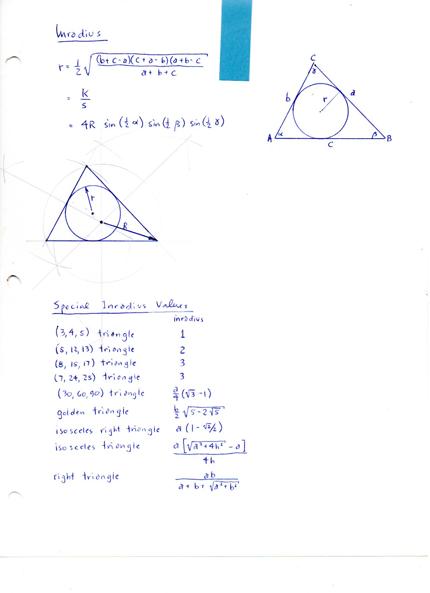
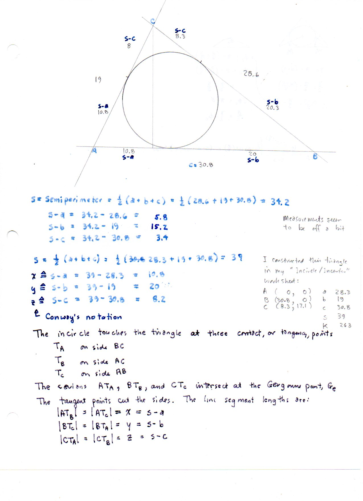
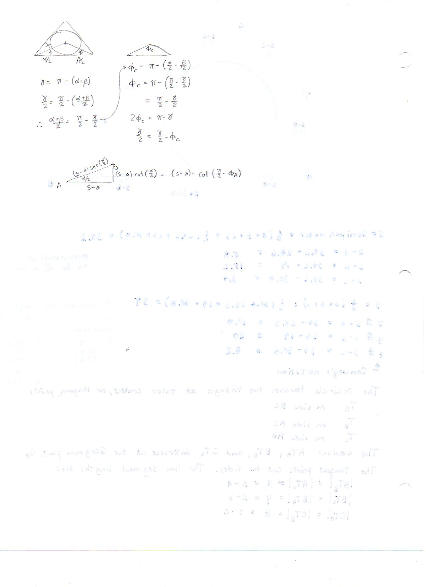

======================
F.29 Inradius — Folios
======================

Archival manuscript scans and diplomatic transcriptions from :person:`seelig`'s
notebooks for **F.29 (Inradius)** (:cite:`SeeligNotebooks`).

Folio 0207 (Page 1 of 3): Inradius & Special Inradius Values
------------------------------------------------------------

.. folio:: 0207

   Folio ``0207`` (original scan ``0207.jpg``) from ``resources/seelig/29_inradius``.

**Diplomatic Mathematical & Geometric Transcription**

**Diplomatic Transcription — Folio 0207** (``0207.jpg``, Sheet 1 of 3):

Records algebraic and trigonometric formulas for :math:`r` alongside a special-value table for Pythagorean triples :math:`(3,4,5), (5,12,13), (8,15,17), (7,24,25)`, the :math:`30^\circ\text{--}60^\circ\text{--}90^\circ` triangle, and the golden triangle :math:`(\phi b, \phi b, b)` with :math:`r = \frac{b}{2}\sqrt{5-2\sqrt{5}}`.

.. math::

   r = \frac{K}{s} = \frac{1}{2}\sqrt{\frac{(b+c-a)(c+a-b)(a+b-c)}{a+b+c}} = \sqrt{\frac{x y z}{x + y + z}}

.. admonition:: Editorial & Symbolic Notes

   Archival scan ``0207.jpg`` from Fred W. Seelig's notebook dossier on **F.29 Inradius** (Page 1 of 3). Companion OpenDocument worksheet(s): ``Incircle-Incenter``, ``General Reference``. Classical Euclidean foundations: :ref:`IV.4`. Kimberling *Encyclopedia of Triangle Centers* loci: :ref:`X(1)`, :ref:`X(7)`.

Folio 0208 (Page 2 of 3): Conway Intouch Segments & Gergonne Point (Page 1)
---------------------------------------------------------------------------

.. folio:: 0208

   Folio ``0208`` (original scan ``0208.jpg``) from ``resources/seelig/29_inradius``.

**Diplomatic Mathematical & Geometric Transcription**

**Diplomatic Transcription — Folio 0208** (``0208.jpg``, Sheet 2 of 3):

Relates :math:`x = s-a, y = s-b, z = s-c` to the incircle contact points :math:`T_A, T_B, T_C` and the Gergonne point :math:`G_e = AT_A \cap BT_B \cap CT_C`, deriving :math:`r^2 = xyz/s`.

.. math::

   r = 4 R \sin\frac{\alpha}{2}\sin\frac{\beta}{2}\sin\frac{\gamma}{2}, \qquad x = s - a,\; y = s - b,\; z = s - c

.. admonition:: Editorial & Symbolic Notes

   Archival scan ``0208.jpg`` from Fred W. Seelig's notebook dossier on **F.29 Inradius** (Page 2 of 3). Companion OpenDocument worksheet(s): ``Incircle-Incenter``, ``General Reference``. Classical Euclidean foundations: :ref:`IV.4`. Kimberling *Encyclopedia of Triangle Centers* loci: :ref:`X(1)`, :ref:`X(7)`.

Folio 0209 (Page 3 of 3): Measured Scalene Verification (Page 2)
----------------------------------------------------------------

.. folio:: 0209

   Folio ``0209`` (original scan ``0209.jpg``) from ``resources/seelig/29_inradius``.

**Diplomatic Mathematical & Geometric Transcription**

**Diplomatic Transcription — Folio 0209** (``0209.jpg``, Sheet 3 of 3):

Constructs the incircle and Gergonne cevians on a measured triangle (:math:`a=28.3, b=19, c=30.8, s=39, x=10.7, y=20, z=8.2, K=263`) and verifies :math:`r = K/s \approx 6.74`.

.. math::

   r = \frac{K}{s} = \frac{1}{2}\sqrt{\frac{(b+c-a)(c+a-b)(a+b-c)}{a+b+c}} = \sqrt{\frac{x y z}{x + y + z}}

.. admonition:: Editorial & Symbolic Notes

   Archival scan ``0209.jpg`` from Fred W. Seelig's notebook dossier on **F.29 Inradius** (Page 3 of 3). Companion OpenDocument worksheet(s): ``Incircle-Incenter``, ``General Reference``. Classical Euclidean foundations: :ref:`IV.4`. Kimberling *Encyclopedia of Triangle Centers* loci: :ref:`X(1)`, :ref:`X(7)`.
