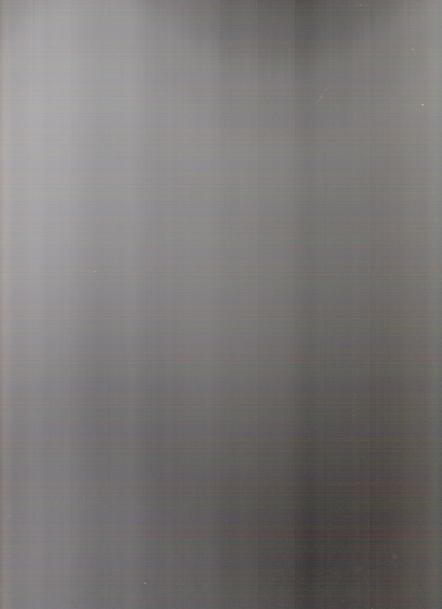
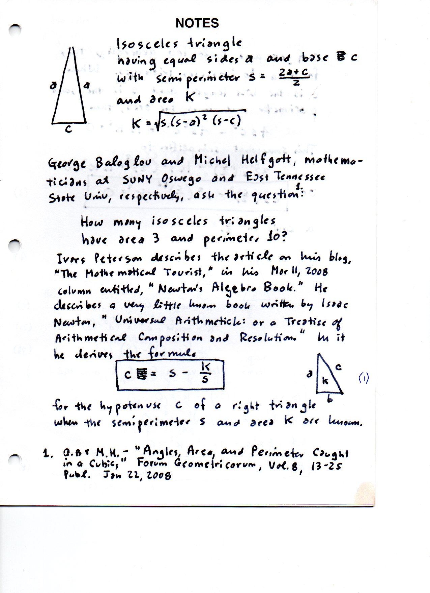
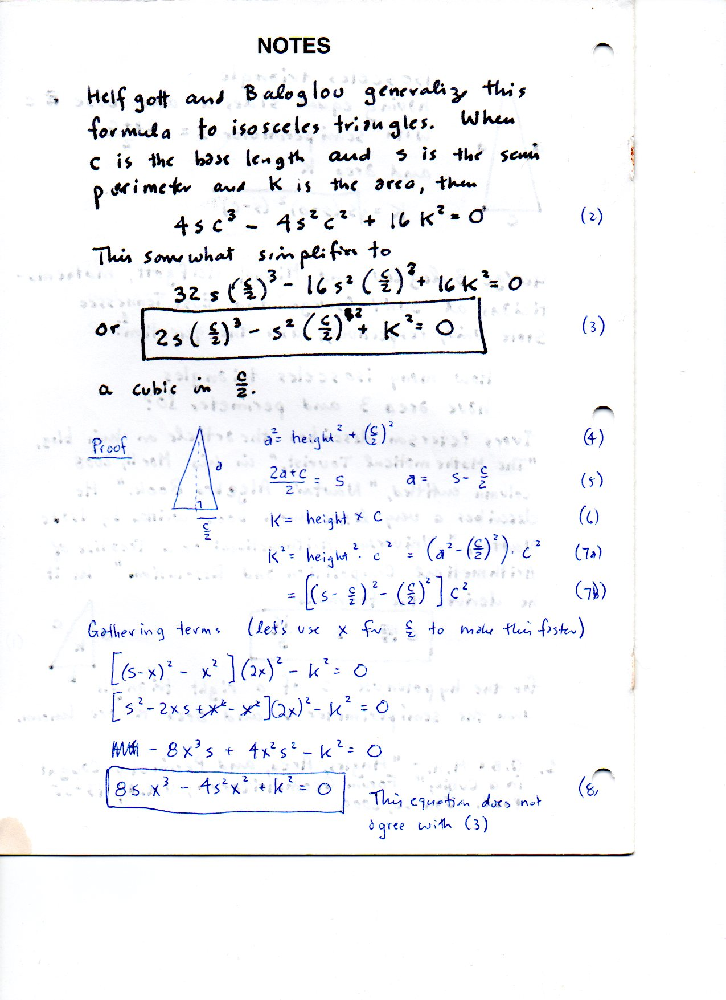
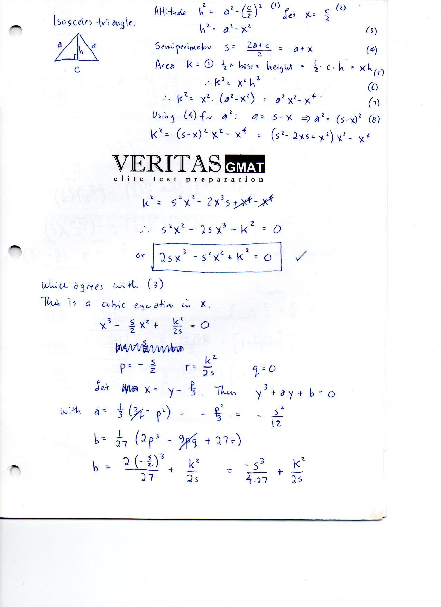
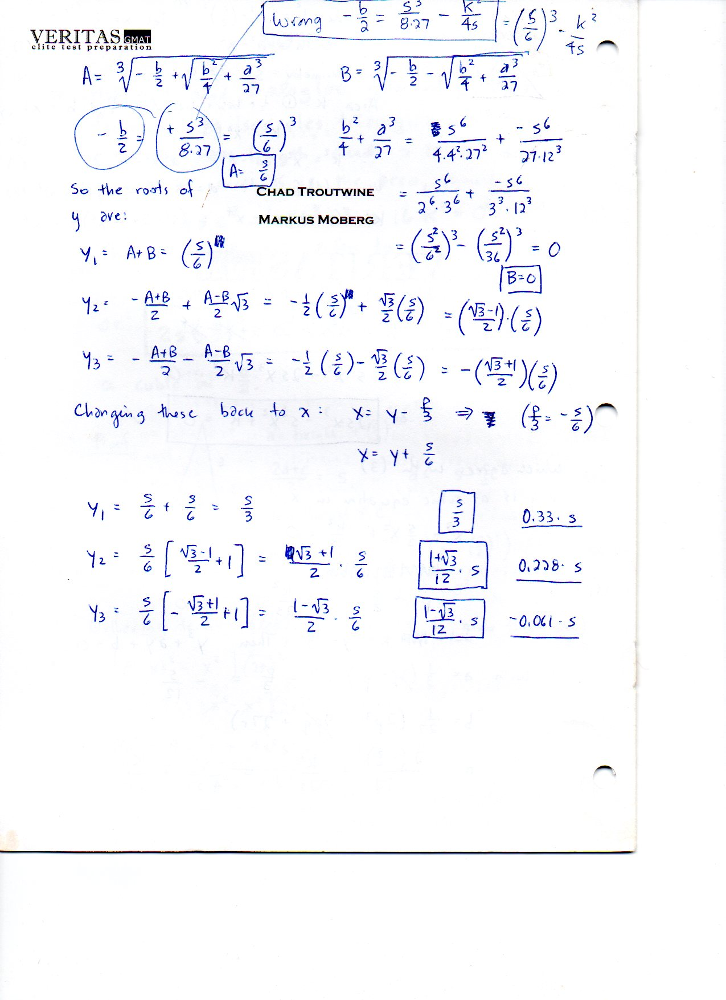

=================================
F.30 Isosceles Triangles — Folios
=================================

Archival manuscript scans and diplomatic transcriptions from :person:`seelig`'s
notebooks for **F.30 (Isosceles Triangles)** (:cite:`SeeligNotebooks`).

Folio 0210 (Page 1 of 5): Scanner Separator Sheet
-------------------------------------------------

.. folio:: 0210

   Folio ``0210`` (original scan ``0210.jpg``) from ``resources/seelig/30_isosceles``.

**Diplomatic Mathematical & Geometric Transcription**

**Diplomatic Transcription — Folio 0210** (``0210.jpg``, Sheet 1 of 5):

Blank dark separator scan preceding the four-page isosceles cubic manuscript.

.. math::

   a = b = s - x, \qquad x = \frac{c}{2}, \qquad K = x\sqrt{s(s - 2x)} \implies 2 s x^3 - s^2 x^2 + K^2 = 0

.. admonition:: Editorial & Symbolic Notes

   Archival scan ``0210.jpg`` from Fred W. Seelig's notebook dossier on **F.30 Isosceles Triangles** (Page 1 of 5). Companion OpenDocument worksheet(s): ``Isosceles Triangle``, ``Right Triangle``. Classical Euclidean foundations: :ref:`I.5`, :ref:`I.6`.

Folio 0211 (Page 2 of 5): Isosceles Triangle — Area-Perimeter Cubic (Page 1)
----------------------------------------------------------------------------

.. folio:: 0211

   Folio ``0211`` (original scan ``0211.jpg``) from ``resources/seelig/30_isosceles``.

**Diplomatic Mathematical & Geometric Transcription**

**Diplomatic Transcription — Folio 0211** (``0211.jpg``, Sheet 2 of 5):

Cites Baloglou & Helfgott (2008) and Ivars Peterson; sets :math:`x = c/2, a = s-x, h = \sqrt{s(s-2x)}` to derive :math:`2sx^3 - s^2 x^2 + K^2 = 0`.

.. math::

   x = y + \frac{s}{6} \implies y^3 - \frac{s^2}{12} y + \left(\frac{K^2}{2s} - \frac{s^3}{54}\right) = 0, \qquad c_{\text{right}} = s - \frac{K}{s}

.. admonition:: Editorial & Symbolic Notes

   Archival scan ``0211.jpg`` from Fred W. Seelig's notebook dossier on **F.30 Isosceles Triangles** (Page 2 of 5). Companion OpenDocument worksheet(s): ``Isosceles Triangle``, ``Right Triangle``. Classical Euclidean foundations: :ref:`I.5`, :ref:`I.6`.

Folio 0212 (Page 3 of 5): Newton's Right-Triangle Formula & Cubic Setup (Page 2)
--------------------------------------------------------------------------------

.. folio:: 0212

   Folio ``0212`` (original scan ``0212.jpg``) from ``resources/seelig/30_isosceles``.

**Diplomatic Mathematical & Geometric Transcription**

**Diplomatic Transcription — Folio 0212** (``0212.jpg``, Sheet 3 of 5):

Contrasts Newton's *Universal Arithmetick* right-triangle identity :math:`c = s - K/s` with the isosceles cubic :math:`x^3 - \frac{s}{2}x^2 + \frac{K^2}{2s} = 0`.

.. math::

   a = b = s - x, \qquad x = \frac{c}{2}, \qquad K = x\sqrt{s(s - 2x)} \implies 2 s x^3 - s^2 x^2 + K^2 = 0

.. admonition:: Editorial & Symbolic Notes

   Archival scan ``0212.jpg`` from Fred W. Seelig's notebook dossier on **F.30 Isosceles Triangles** (Page 3 of 5). Companion OpenDocument worksheet(s): ``Isosceles Triangle``, ``Right Triangle``. Classical Euclidean foundations: :ref:`I.5`, :ref:`I.6`.

Folio 0213 (Page 4 of 5): Reduction to Depressed Cubic (Page 3)
---------------------------------------------------------------

.. folio:: 0213

   Folio ``0213`` (original scan ``0213.jpg``) from ``resources/seelig/30_isosceles``.

**Diplomatic Mathematical & Geometric Transcription**

**Diplomatic Transcription — Folio 0213** (``0213.jpg``, Sheet 4 of 5):

Substitutes :math:`x = y - a/3 = y + s/6` into :math:`x^3 + ax^2 + bx + c = 0` to eliminate the quadratic term, obtaining :math:`p = -s^2/12` and :math:`q = -s^3/54 + K^2/(2s)`.

.. math::

   x = y + \frac{s}{6} \implies y^3 - \frac{s^2}{12} y + \left(\frac{K^2}{2s} - \frac{s^3}{54}\right) = 0, \qquad c_{\text{right}} = s - \frac{K}{s}

.. admonition:: Editorial & Symbolic Notes

   Archival scan ``0213.jpg`` from Fred W. Seelig's notebook dossier on **F.30 Isosceles Triangles** (Page 4 of 5). Companion OpenDocument worksheet(s): ``Isosceles Triangle``, ``Right Triangle``. Classical Euclidean foundations: :ref:`I.5`, :ref:`I.6`.

Folio 0214 (Page 5 of 5): Cardano's Formula & Casus Irreducibilis (Page 4)
--------------------------------------------------------------------------

.. folio:: 0214

   Folio ``0214`` (original scan ``0214.jpg``) from ``resources/seelig/30_isosceles``.

**Diplomatic Mathematical & Geometric Transcription**

**Diplomatic Transcription — Folio 0214** (``0214.jpg``, Sheet 5 of 5):

Writes Cardano's radical solution for :math:`y^3 + py + q = 0` and checks the discriminant boundary :math:`q^2/4 + p^3/27 \le 0` corresponding to two real isosceles solutions coalescing at the equilateral triangle.

.. math::

   a = b = s - x, \qquad x = \frac{c}{2}, \qquad K = x\sqrt{s(s - 2x)} \implies 2 s x^3 - s^2 x^2 + K^2 = 0

.. admonition:: Editorial & Symbolic Notes

   Archival scan ``0214.jpg`` from Fred W. Seelig's notebook dossier on **F.30 Isosceles Triangles** (Page 5 of 5). Companion OpenDocument worksheet(s): ``Isosceles Triangle``, ``Right Triangle``. Classical Euclidean foundations: :ref:`I.5`, :ref:`I.6`.
