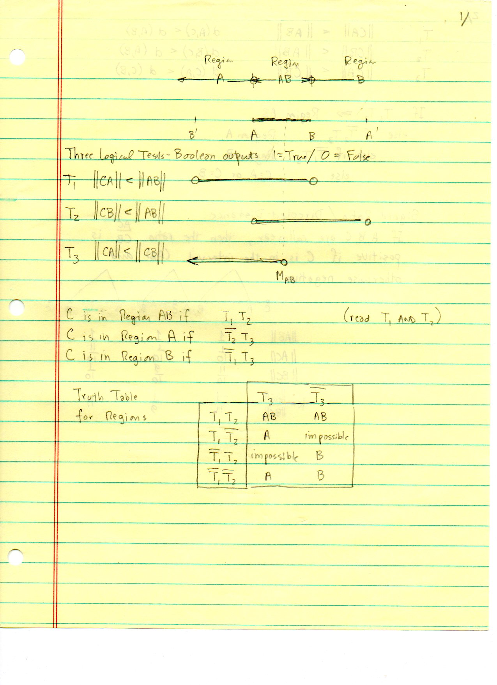
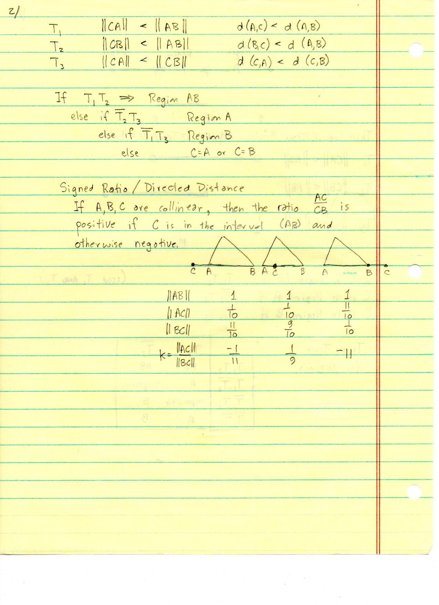
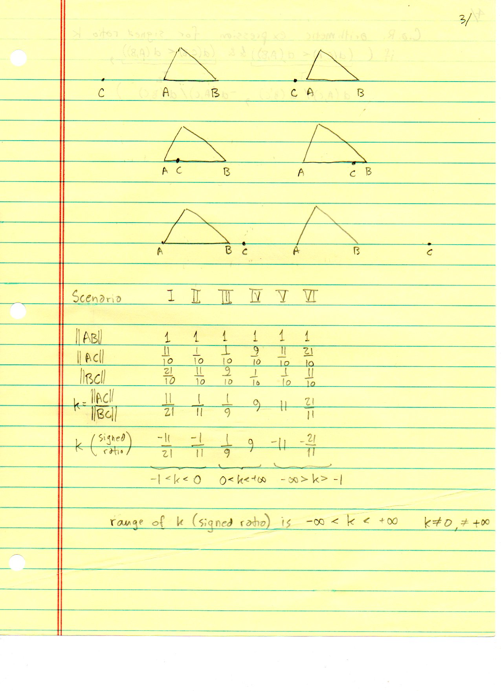
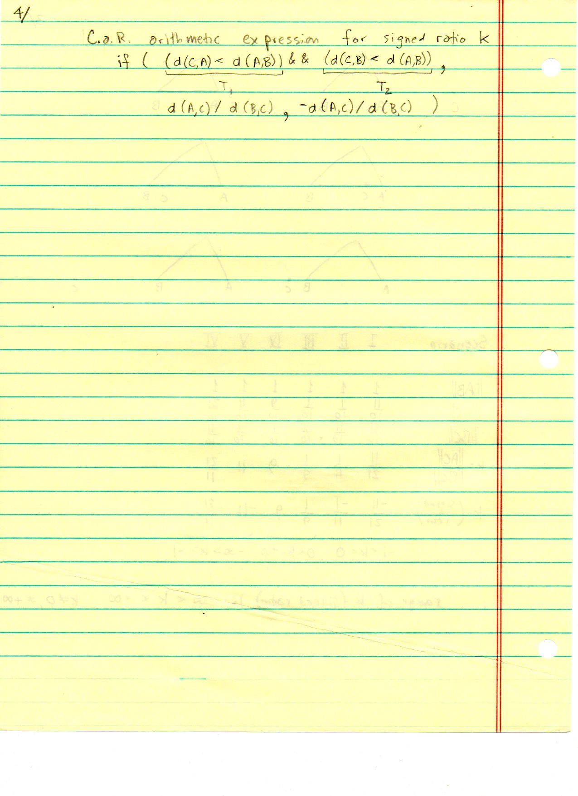
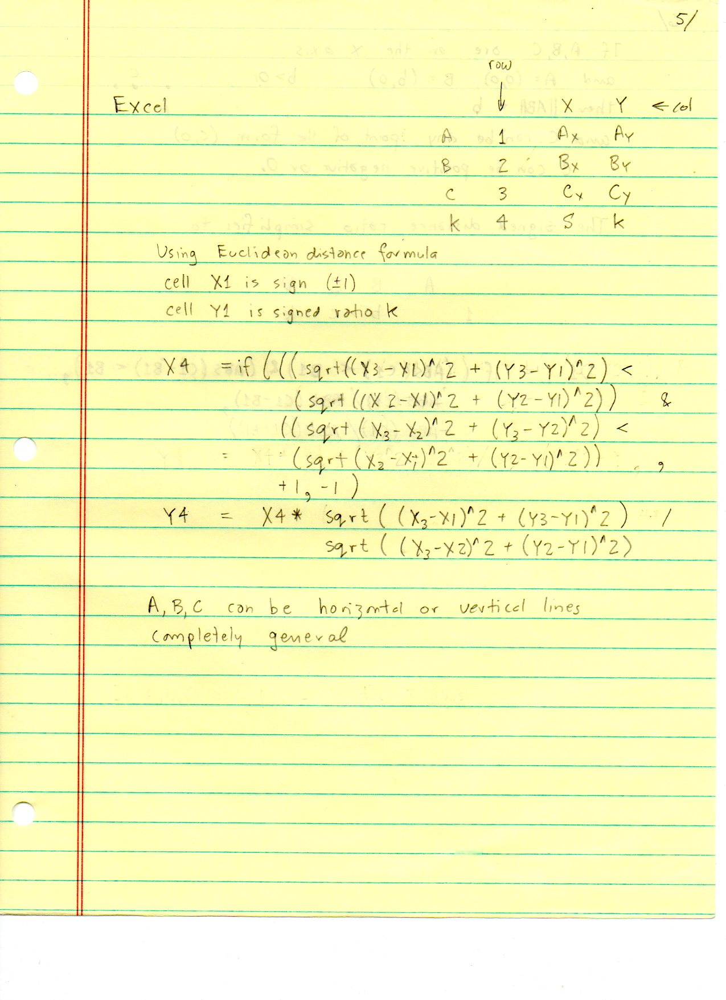
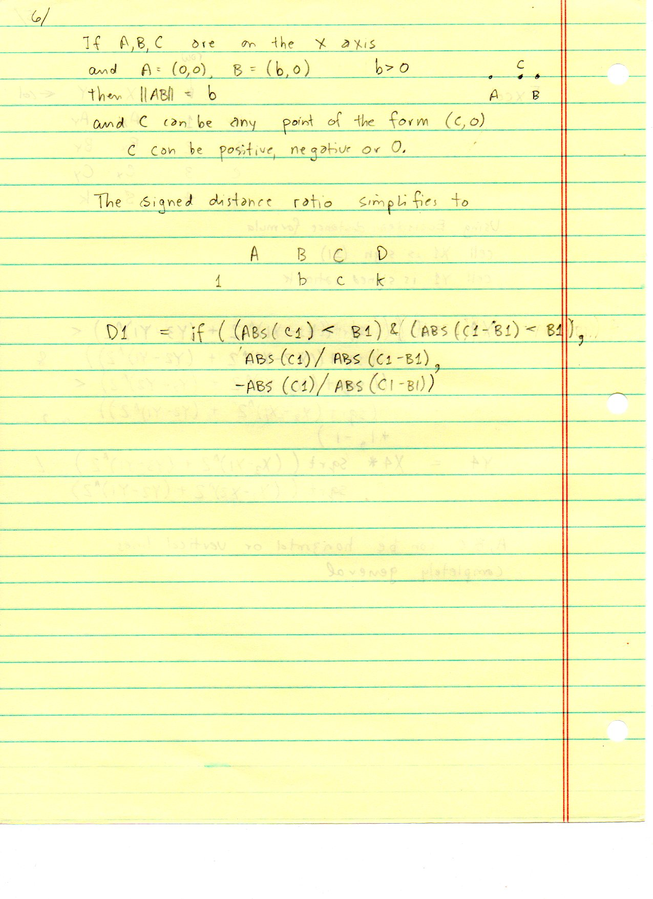

=========================
F.31 Logic Tests — Folios
=========================

Archival manuscript scans and diplomatic transcriptions from :person:`seelig`'s
notebooks for **F.31 (Logic Tests)** (:cite:`SeeligNotebooks`).

Folio 0215 (Page 1 of 6): Three Logical Tests — Boolean Outputs (Page 1/)
-------------------------------------------------------------------------

.. folio:: 0215

   Folio ``0215`` (original scan ``0215.jpg``) from ``resources/seelig/31_logic-tests``.

**Diplomatic Mathematical & Geometric Transcription**

**Diplomatic Transcription — Folio 0215** (``0215.jpg``, Sheet 1 of 6):

Defines predicates :math:`T_1, T_2, T_3` on :math:`\|CA\|, \|CB\|, \|AB\|` and partitions the line through :math:`A, B` into Region :math:`A`, Region :math:`AB`, and Region :math:`B`.

.. math::

   T_1 = (\|CA\| < \|AB\|), \qquad T_2 = (\|CB\| < \|AB\|), \qquad T_3 = (\|CA\| < \|CB\|)

.. admonition:: Editorial & Symbolic Notes

   Archival scan ``0215.jpg`` from Fred W. Seelig's notebook dossier on **F.31 Logic Tests** (Page 1 of 6). Companion OpenDocument worksheet(s): ``Point in Triangle``, ``Point in Triangle (2)``, ``Harmonic Conjugates``. Classical Euclidean foundations: :ref:`V.8`.

Folio 0216 (Page 2 of 6): Truth Table & Scenarios I–III (Page 2/)
-----------------------------------------------------------------

.. folio:: 0216

   Folio ``0216`` (original scan ``0216.jpg``) from ``resources/seelig/31_logic-tests``.

**Diplomatic Mathematical & Geometric Transcription**

**Diplomatic Transcription — Folio 0216** (``0216.jpg``, Sheet 2 of 6):

Evaluates :math:`(T_1, T_2, T_3)` across Scenarios I–III as :math:`C` traverses the ray beyond :math:`A` and the left half of segment :math:`AB`.

.. math::

   \text{Region } A:\; \overline{T}_2 T_3\; (-1 < k < 0), \qquad \text{Region } AB:\; T_1 T_2\; (0 < k < \infty), \qquad \text{Region } B:\; \overline{T}_1\overline{T}_3\; (-\infty < k < -1)

.. admonition:: Editorial & Symbolic Notes

   Archival scan ``0216.jpg`` from Fred W. Seelig's notebook dossier on **F.31 Logic Tests** (Page 2 of 6). Companion OpenDocument worksheet(s): ``Point in Triangle``, ``Point in Triangle (2)``, ``Harmonic Conjugates``. Classical Euclidean foundations: :ref:`V.8`.

Folio 0217 (Page 3 of 6): Scenarios IV–VI & Signed Ratio k (Page 3/)
--------------------------------------------------------------------

.. folio:: 0217

   Folio ``0217`` (original scan ``0217.jpg``) from ``resources/seelig/31_logic-tests``.

**Diplomatic Mathematical & Geometric Transcription**

**Diplomatic Transcription — Folio 0217** (``0217.jpg``, Sheet 3 of 6):

Completes Scenarios IV–VI across the right half of :math:`AB` and the ray beyond :math:`B`, mapping each region to the interval of :math:`k = \pm\|AC\|/\|BC\|`.

.. math::

   T_1 = (\|CA\| < \|AB\|), \qquad T_2 = (\|CB\| < \|AB\|), \qquad T_3 = (\|CA\| < \|CB\|)

.. admonition:: Editorial & Symbolic Notes

   Archival scan ``0217.jpg`` from Fred W. Seelig's notebook dossier on **F.31 Logic Tests** (Page 3 of 6). Companion OpenDocument worksheet(s): ``Point in Triangle``, ``Point in Triangle (2)``, ``Harmonic Conjugates``. Classical Euclidean foundations: :ref:`V.8`.

Folio 0218 (Page 4 of 6): C.a.R. Conditional Expression Synthesis (Page 4/)
---------------------------------------------------------------------------

.. folio:: 0218

   Folio ``0218`` (original scan ``0218.jpg``) from ``resources/seelig/31_logic-tests``.

**Diplomatic Mathematical & Geometric Transcription**

**Diplomatic Transcription — Folio 0218** (``0218.jpg``, Sheet 4 of 6):

Translates the Boolean minterms :math:`\overline{T}_2 T_3, T_1 T_2, \overline{T}_1\overline{T}_3` into C.a.R. ``if(...)`` expressions for signed :math:`k`.

.. math::

   \text{Region } A:\; \overline{T}_2 T_3\; (-1 < k < 0), \qquad \text{Region } AB:\; T_1 T_2\; (0 < k < \infty), \qquad \text{Region } B:\; \overline{T}_1\overline{T}_3\; (-\infty < k < -1)

.. admonition:: Editorial & Symbolic Notes

   Archival scan ``0218.jpg`` from Fred W. Seelig's notebook dossier on **F.31 Logic Tests** (Page 4 of 6). Companion OpenDocument worksheet(s): ``Point in Triangle``, ``Point in Triangle (2)``, ``Harmonic Conjugates``. Classical Euclidean foundations: :ref:`V.8`.

Folio 0219 (Page 5 of 6): Spreadsheet Implementation — Part 1 (Page 5/)
-----------------------------------------------------------------------

.. folio:: 0219

   Folio ``0219`` (original scan ``0219.jpg``) from ``resources/seelig/31_logic-tests``.

**Diplomatic Mathematical & Geometric Transcription**

**Diplomatic Transcription — Folio 0219** (``0219.jpg``, Sheet 5 of 6):

Writes Excel/OpenFormula ``IF``/``AND`` cell expressions testing whether :math:`C` lies inside :math:`AB` or externally on either side.

.. math::

   T_1 = (\|CA\| < \|AB\|), \qquad T_2 = (\|CB\| < \|AB\|), \qquad T_3 = (\|CA\| < \|CB\|)

.. admonition:: Editorial & Symbolic Notes

   Archival scan ``0219.jpg`` from Fred W. Seelig's notebook dossier on **F.31 Logic Tests** (Page 5 of 6). Companion OpenDocument worksheet(s): ``Point in Triangle``, ``Point in Triangle (2)``, ``Harmonic Conjugates``. Classical Euclidean foundations: :ref:`V.8`.

Folio 0220 (Page 6 of 6): Spreadsheet Implementation — Part 2 (Page 6/)
-----------------------------------------------------------------------

.. folio:: 0220

   Folio ``0220`` (original scan ``0220.jpg``) from ``resources/seelig/31_logic-tests``.

**Diplomatic Mathematical & Geometric Transcription**

**Diplomatic Transcription — Folio 0220** (``0220.jpg``, Sheet 6 of 6):

Verifies the Boolean logic cells against numeric test coordinates for :math:`A, B, C` and their harmonic conjugate :math:`D`.

.. math::

   \text{Region } A:\; \overline{T}_2 T_3\; (-1 < k < 0), \qquad \text{Region } AB:\; T_1 T_2\; (0 < k < \infty), \qquad \text{Region } B:\; \overline{T}_1\overline{T}_3\; (-\infty < k < -1)

.. admonition:: Editorial & Symbolic Notes

   Archival scan ``0220.jpg`` from Fred W. Seelig's notebook dossier on **F.31 Logic Tests** (Page 6 of 6). Companion OpenDocument worksheet(s): ``Point in Triangle``, ``Point in Triangle (2)``, ``Harmonic Conjugates``. Classical Euclidean foundations: :ref:`V.8`.
