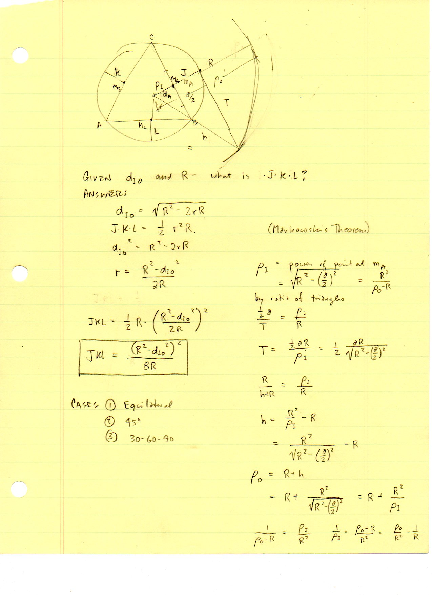
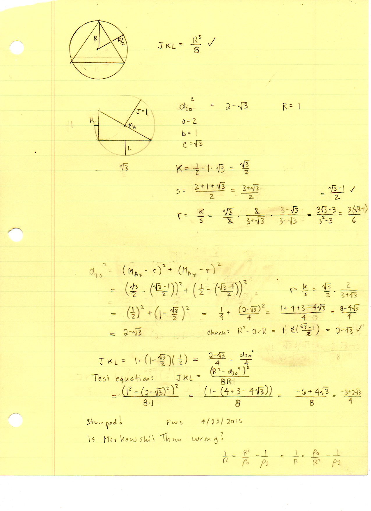

=================================
F.32 Markowski's Theorem — Folios
=================================

Archival manuscript scans and diplomatic transcriptions from :person:`seelig`'s
notebooks for **F.32 (Markowski's Theorem)** (:cite:`SeeligNotebooks`).

Folio 0221 (Page 1 of 2): Markowski's Theorem & Midpoint Inversion (FWS 4/23/2015)
----------------------------------------------------------------------------------

.. folio:: 0221

   Folio ``0221`` (original scan ``0221.jpg``) from ``resources/seelig/32_markowski``.

**Diplomatic Mathematical & Geometric Transcription**

**Diplomatic Transcription — Folio 0221** (``0221.jpg``, Sheet 1 of 2):

Combines :math:`d_{IO} = \sqrt{R^2-2rR}` and :math:`JKL = \frac{1}{2}r^2 R` to derive :math:`JKL = \frac{(R^2-d_{IO}^2)^2}{8R}`, and records the midpoint inversion circle radius :math:`\rho_I = \sqrt{R^2-(a/2)^2}`.

.. math::

   J K L = \frac{1}{2} r^2 R = \frac{(R^2 - d_{IO}^2)^2}{8 R}, \qquad d_{IO}^2 = R^2 - 2 r R

.. admonition:: Editorial & Symbolic Notes

   Archival scan ``0221.jpg`` from Fred W. Seelig's notebook dossier on **F.32 Markowski's Theorem** (Page 1 of 2). Companion OpenDocument worksheet(s): ``Circumcircle-Circumcenter``, ``Incircle-Incenter``. Classical Euclidean foundations: :ref:`III.35`, :ref:`IV.5`. Kimberling *Encyclopedia of Triangle Centers* loci: :ref:`X(1)`, :ref:`X(3)`.

Folio 0222 (Page 2 of 2): Equilateral & 30-60-90 Triangle Verifications (FWS 4/23/2015)
---------------------------------------------------------------------------------------

.. folio:: 0222

   Folio ``0222`` (original scan ``0222.jpg``) from ``resources/seelig/32_markowski``.

**Diplomatic Mathematical & Geometric Transcription**

**Diplomatic Transcription — Folio 0222** (``0222.jpg``, Sheet 2 of 2):

Verifies :math:`JKL = R^3/8` for the equilateral triangle and :math:`JKL = (2-\sqrt{3})/4` for the :math:`30^\circ\text{--}60^\circ\text{--}90^\circ` triangle (:math:`R=1`), where an extra squaring of :math:`d_{IO}^2 = 2-\sqrt{3}` prompted the marginal note *'Stumped! FWS 4/23/2015'*.

.. math::

   J + K + L = 2 R + r, \qquad \rho_I = \sqrt{R^2 - \left(\frac{a}{2}\right)^2}

.. admonition:: Editorial & Symbolic Notes

   Archival scan ``0222.jpg`` from Fred W. Seelig's notebook dossier on **F.32 Markowski's Theorem** (Page 2 of 2). Companion OpenDocument worksheet(s): ``Circumcircle-Circumcenter``, ``Incircle-Incenter``. Classical Euclidean foundations: :ref:`III.35`, :ref:`IV.5`. Kimberling *Encyclopedia of Triangle Centers* loci: :ref:`X(1)`, :ref:`X(3)`.
