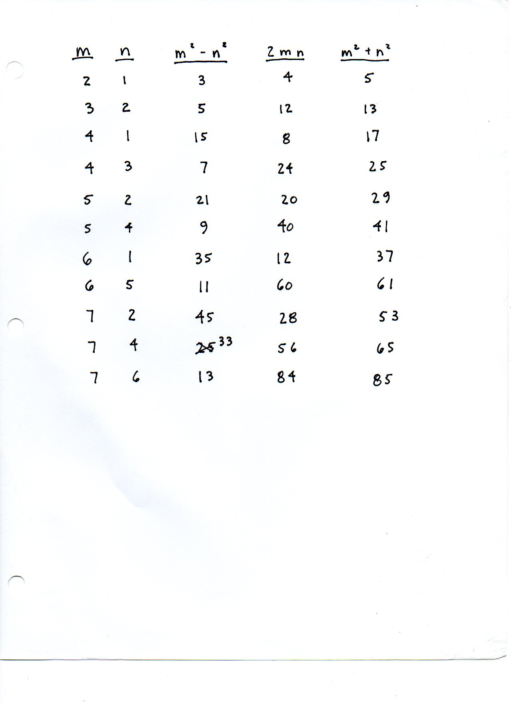

=========================================
F.33 Euclidean (m, n) Generators — Folios
=========================================

Archival manuscript scans and diplomatic transcriptions from :person:`seelig`'s
notebooks for **F.33 (Euclidean (m, n) Generators)** (:cite:`SeeligNotebooks`).

Folio 0223 (Page 1 of 1): Euclidean (m, n) Pythagorean Triple Table
-------------------------------------------------------------------

.. folio:: 0223

   Folio ``0223`` (original scan ``0223.jpg``) from ``resources/seelig/33_m-n``.

**Diplomatic Mathematical & Geometric Transcription**

**Diplomatic Transcription — Folio 0223** (``0223.jpg``, Sheet 1 of 1):

Tabulates :math:`(m, n, m^2-n^2, 2mn, m^2+n^2)` for 11 coprime pairs of opposite parity from :math:`(2,1)\mapsto(3,4,5)` to :math:`(7,6)\mapsto(13,84,85)`.

.. math::

   a = m^2 - n^2, \qquad b = 2 m n, \qquad c = m^2 + n^2, \qquad a^2 + b^2 = (m^2 + n^2)^2 = c^2

.. admonition:: Editorial & Symbolic Notes

   Archival scan ``0223.jpg`` from Fred W. Seelig's notebook dossier on **F.33 Euclidean (m, n) Generators** (Page 1 of 1). Companion OpenDocument worksheet(s): ``Pythagorean Triples``, ``Right Triangle``. Classical Euclidean foundations: :ref:`I.47`, :ref:`X.29`.
