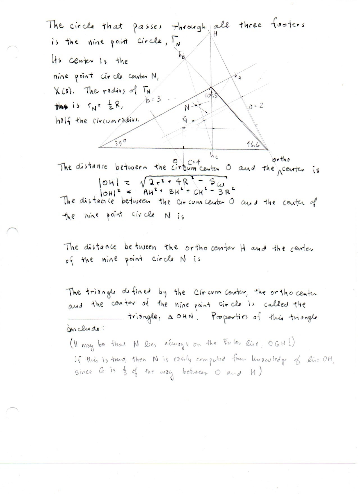

===============================
F.34 Nine-Point Circle — Folios
===============================

Archival manuscript scans and diplomatic transcriptions from :person:`seelig`'s
notebooks for **F.34 (Nine-Point Circle)** (:cite:`SeeligNotebooks`).

Folio 0224 (Page 1 of 1): Nine-Point Circle & Orthocenter Distance Identities
-----------------------------------------------------------------------------

.. folio:: 0224

   Folio ``0224`` (original scan ``0224.jpg``) from ``resources/seelig/34_nine-point-circle``.

**Diplomatic Mathematical & Geometric Transcription**

**Diplomatic Transcription — Folio 0224** (``0224.jpg``, Sheet 1 of 1):

Defines :math:`\Gamma_N` through the three altitude feet with center :math:`N = X(5)` on the Euler line and radius :math:`r_N = R/2`, records :math:`|OH| = \sqrt{2r^2+4R^2-S_\omega}` and :math:`|OH|^2 = AH^2+BH^2+CH^2-3R^2`, and sketches the :math:`(2,3,4)` obtuse configuration.

.. math::

   r_N = \frac{1}{2} R, \qquad N = \frac{O + H}{2} = X(5), \qquad |ON| = \frac{1}{2}|OH|

.. admonition:: Editorial & Symbolic Notes

   Archival scan ``0224.jpg`` from Fred W. Seelig's notebook dossier on **F.34 Nine-Point Circle** (Page 1 of 1). Companion OpenDocument worksheet(s): ``9-Point Circle``, ``Euler Line``, ``Orthocenter``. Classical Euclidean foundations: :ref:`IV.5`. Kimberling *Encyclopedia of Triangle Centers* loci: :ref:`X(2)`, :ref:`X(3)`, :ref:`X(4)`, :ref:`X(5)`.
