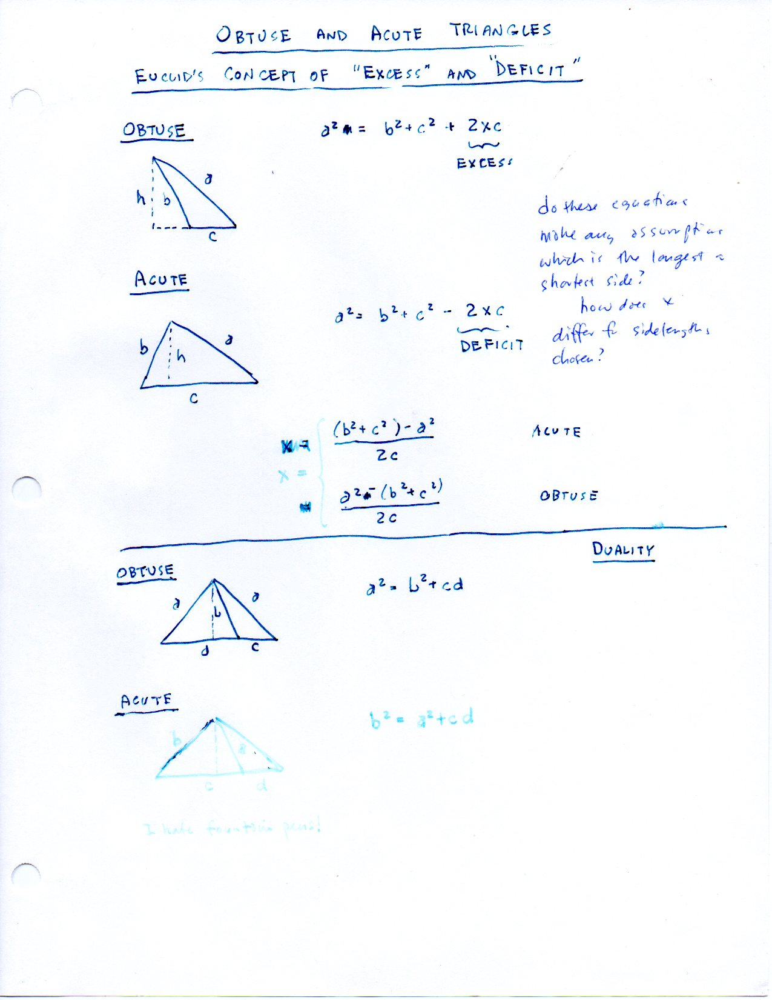
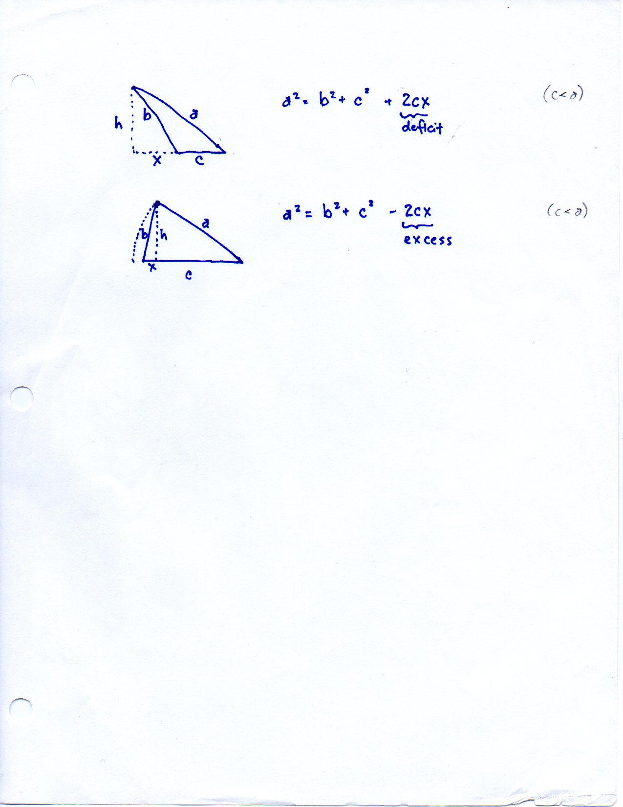
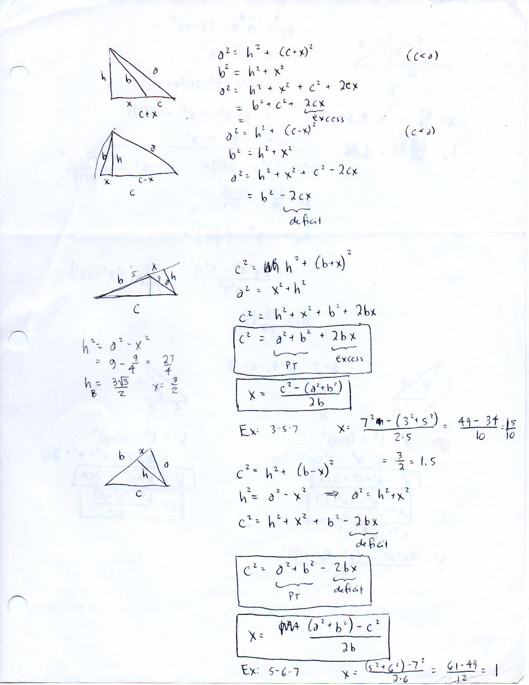
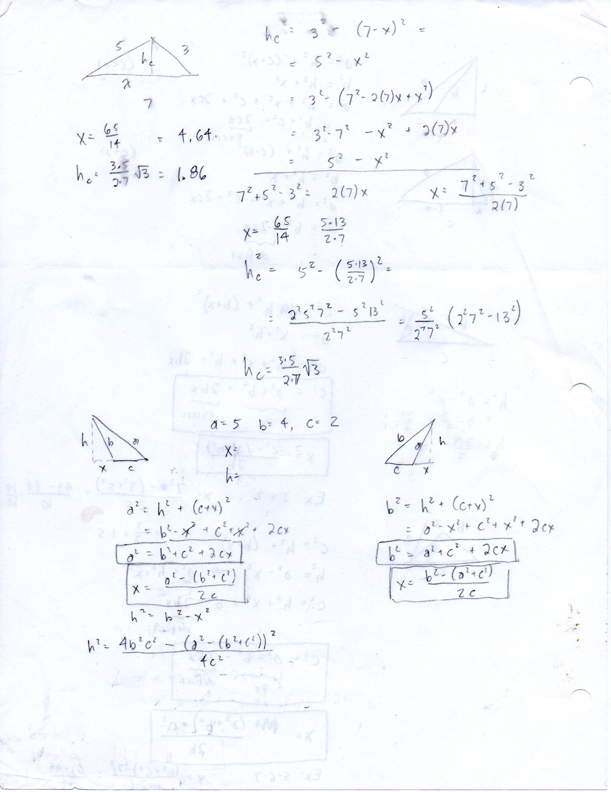
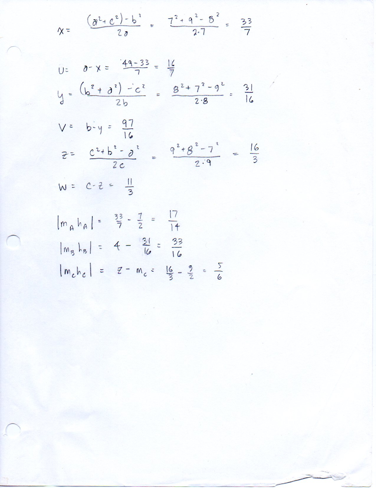
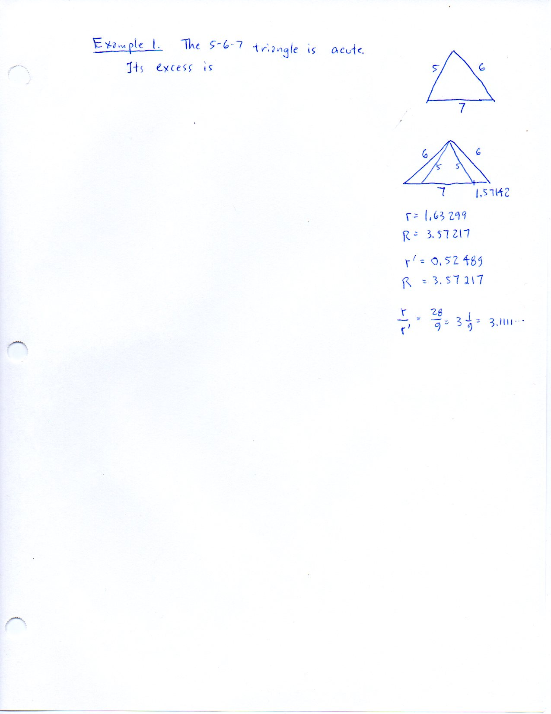
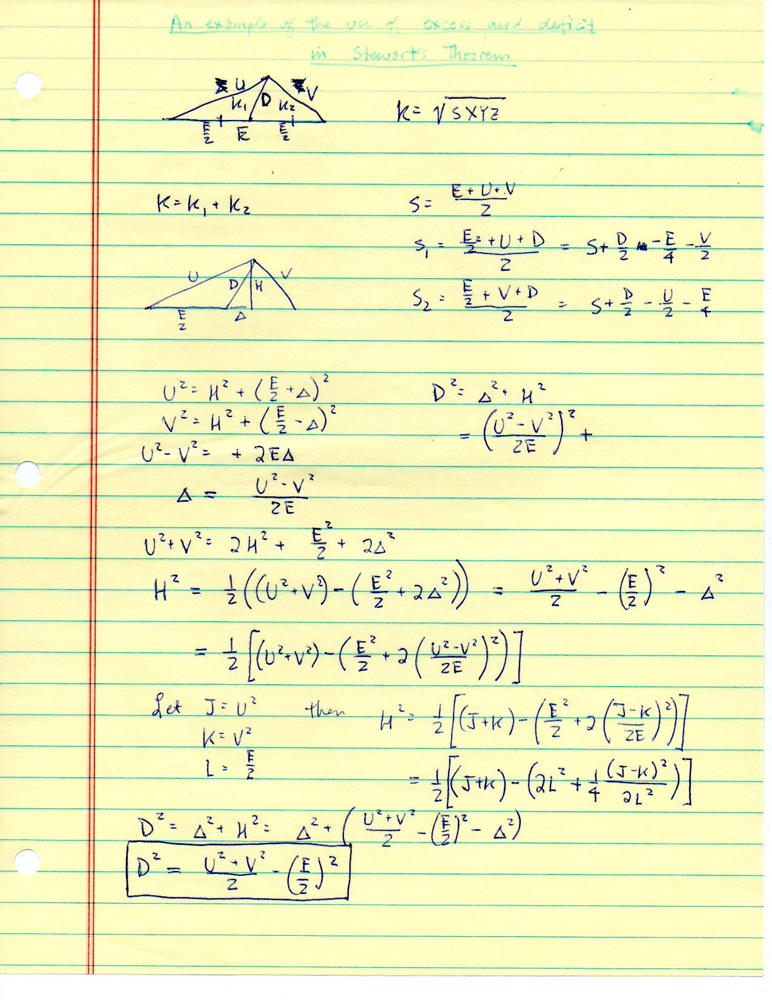

========================================
F.35 Obtuse and Acute Triangles — Folios
========================================

Archival manuscript scans and diplomatic transcriptions from :person:`seelig`'s
notebooks for **F.35 (Obtuse and Acute Triangles)** (:cite:`SeeligNotebooks`).

Folio 0225 (Page 1 of 7): Euclid's Concept of Excess (II.12) & Deficit (II.13)
------------------------------------------------------------------------------

.. folio:: 0225

   Folio ``0225`` (original scan ``0225.jpg``) from ``resources/seelig/35_obtuse-and-acute``.

**Diplomatic Mathematical & Geometric Transcription**

**Diplomatic Transcription — Folio 0225** (``0225.jpg``, Sheet 1 of 7):

Formulates :math:`a^2 = b^2 + c^2 \pm 2cx`, solves for the projection :math:`x = \pm\frac{a^2-(b^2+c^2)}{2c}`, and recovers altitude :math:`h = \sqrt{b^2-x^2}`.

.. math::

   a^2 = b^2 + c^2 \pm 2 c x \implies x = \frac{|a^2 - (b^2 + c^2)|}{2 c}, \qquad h^2 = b^2 - x^2

.. admonition:: Editorial & Symbolic Notes

   Archival scan ``0225.jpg`` from Fred W. Seelig's notebook dossier on **F.35 Obtuse and Acute Triangles** (Page 1 of 7). Companion OpenDocument worksheet(s): ``General Reference``, ``5-6-7 A,B,C``, ``Altitudes``. Classical Euclidean foundations: :ref:`II.12`, :ref:`II.13`. Kimberling *Encyclopedia of Triangle Centers* loci: :ref:`X(2)`, :ref:`X(4)`.

Folio 0226 (Page 2 of 7): Obtuse (3, 5, 7) Triangle — Base 5 Projection
-----------------------------------------------------------------------

.. folio:: 0226

   Folio ``0226`` (original scan ``0226.jpg``) from ``resources/seelig/35_obtuse-and-acute``.

**Diplomatic Mathematical & Geometric Transcription**

**Diplomatic Transcription — Folio 0226** (``0226.jpg``, Sheet 2 of 7):

Evaluates :math:`a=7, b=3, c=5` to find exterior projection :math:`x = 1.5`, altitude :math:`h_B = \frac{3\sqrt{3}}{2}`, and :math:`120^\circ` obtuse angle.

.. math::

   |M_C H_C| = \left|\frac{c}{2} - x\right| = \frac{|a^2 - b^2|}{2 c}, \qquad m_c^2 = \frac{a^2 + b^2}{2} - \left(\frac{c}{2}\right)^2

.. admonition:: Editorial & Symbolic Notes

   Archival scan ``0226.jpg`` from Fred W. Seelig's notebook dossier on **F.35 Obtuse and Acute Triangles** (Page 2 of 7). Companion OpenDocument worksheet(s): ``General Reference``, ``5-6-7 A,B,C``, ``Altitudes``. Classical Euclidean foundations: :ref:`II.12`, :ref:`II.13`. Kimberling *Encyclopedia of Triangle Centers* loci: :ref:`X(2)`, :ref:`X(4)`.

Folio 0227 (Page 3 of 7): Obtuse (3, 5, 7) Triangle — Base 7 Projection
-----------------------------------------------------------------------

.. folio:: 0227

   Folio ``0227`` (original scan ``0227.jpg``) from ``resources/seelig/35_obtuse-and-acute``.

**Diplomatic Mathematical & Geometric Transcription**

**Diplomatic Transcription — Folio 0227** (``0227.jpg``, Sheet 3 of 7):

Projects onto the longest side :math:`c=7` to find :math:`x = 65/14, h_c = \frac{15\sqrt{3}}{14}`, and area :math:`K = \frac{15\sqrt{3}}{4}`.

.. math::

   a^2 = b^2 + c^2 \pm 2 c x \implies x = \frac{|a^2 - (b^2 + c^2)|}{2 c}, \qquad h^2 = b^2 - x^2

.. admonition:: Editorial & Symbolic Notes

   Archival scan ``0227.jpg`` from Fred W. Seelig's notebook dossier on **F.35 Obtuse and Acute Triangles** (Page 3 of 7). Companion OpenDocument worksheet(s): ``General Reference``, ``5-6-7 A,B,C``, ``Altitudes``. Classical Euclidean foundations: :ref:`II.12`, :ref:`II.13`. Kimberling *Encyclopedia of Triangle Centers* loci: :ref:`X(2)`, :ref:`X(4)`.

Folio 0228 (Page 4 of 7): Acute (5, 6, 7) Triangle Deficit Analysis
-------------------------------------------------------------------

.. folio:: 0228

   Folio ``0228`` (original scan ``0228.jpg``) from ``resources/seelig/35_obtuse-and-acute``.

**Diplomatic Mathematical & Geometric Transcription**

**Diplomatic Transcription — Folio 0228** (``0228.jpg``, Sheet 4 of 7):

Applies Euclid II.13 to :math:`(5,6,7)`, finding interior projection :math:`x = 1`, altitude :math:`h = 2\sqrt{6}`, and segment ratio :math:`r/r' = 28/9`.

.. math::

   |M_C H_C| = \left|\frac{c}{2} - x\right| = \frac{|a^2 - b^2|}{2 c}, \qquad m_c^2 = \frac{a^2 + b^2}{2} - \left(\frac{c}{2}\right)^2

.. admonition:: Editorial & Symbolic Notes

   Archival scan ``0228.jpg`` from Fred W. Seelig's notebook dossier on **F.35 Obtuse and Acute Triangles** (Page 4 of 7). Companion OpenDocument worksheet(s): ``General Reference``, ``5-6-7 A,B,C``, ``Altitudes``. Classical Euclidean foundations: :ref:`II.12`, :ref:`II.13`. Kimberling *Encyclopedia of Triangle Centers* loci: :ref:`X(2)`, :ref:`X(4)`.

Folio 0229 (Page 5 of 7): Acute (7, 8, 9) Triangle — Altitude Foot Offsets (Page 1)
-----------------------------------------------------------------------------------

.. folio:: 0229

   Folio ``0229`` (original scan ``0229.jpg``) from ``resources/seelig/35_obtuse-and-acute``.

**Diplomatic Mathematical & Geometric Transcription**

**Diplomatic Transcription — Folio 0229** (``0229.jpg``, Sheet 5 of 7):

Computes the altitude feet :math:`h_A, h_B, h_C` and midpoints :math:`m_A, m_B, m_C` on the :math:`(7,8,9)` triangle.

.. math::

   a^2 = b^2 + c^2 \pm 2 c x \implies x = \frac{|a^2 - (b^2 + c^2)|}{2 c}, \qquad h^2 = b^2 - x^2

.. admonition:: Editorial & Symbolic Notes

   Archival scan ``0229.jpg`` from Fred W. Seelig's notebook dossier on **F.35 Obtuse and Acute Triangles** (Page 5 of 7). Companion OpenDocument worksheet(s): ``General Reference``, ``5-6-7 A,B,C``, ``Altitudes``. Classical Euclidean foundations: :ref:`II.12`, :ref:`II.13`. Kimberling *Encyclopedia of Triangle Centers* loci: :ref:`X(2)`, :ref:`X(4)`.

Folio 0230 (Page 6 of 7): Acute (7, 8, 9) Triangle — Midpoint-to-Foot Distances (Page 2)
----------------------------------------------------------------------------------------

.. folio:: 0230

   Folio ``0230`` (original scan ``0230.jpg``) from ``resources/seelig/35_obtuse-and-acute``.

**Diplomatic Mathematical & Geometric Transcription**

**Diplomatic Transcription — Folio 0230** (``0230.jpg``, Sheet 6 of 7):

Evaluates the exact rational offsets :math:`|m_A h_A| = 17/14, |m_B h_B| = 33/16`, and :math:`|m_C h_C| = 5/6`.

.. math::

   |M_C H_C| = \left|\frac{c}{2} - x\right| = \frac{|a^2 - b^2|}{2 c}, \qquad m_c^2 = \frac{a^2 + b^2}{2} - \left(\frac{c}{2}\right)^2

.. admonition:: Editorial & Symbolic Notes

   Archival scan ``0230.jpg`` from Fred W. Seelig's notebook dossier on **F.35 Obtuse and Acute Triangles** (Page 6 of 7). Companion OpenDocument worksheet(s): ``General Reference``, ``5-6-7 A,B,C``, ``Altitudes``. Classical Euclidean foundations: :ref:`II.12`, :ref:`II.13`. Kimberling *Encyclopedia of Triangle Centers* loci: :ref:`X(2)`, :ref:`X(4)`.

Folio 0231 (Page 7 of 7): Median Theorem from Excess & Deficit
--------------------------------------------------------------

.. folio:: 0231

   Folio ``0231`` (original scan ``0231.jpg``) from ``resources/seelig/35_obtuse-and-acute``.

**Diplomatic Mathematical & Geometric Transcription**

**Diplomatic Transcription — Folio 0231** (``0231.jpg``, Sheet 7 of 7):

Adds Euclid II.12 and II.13 on the two halves of a bisected base :math:`E` to prove Apollonius's median formula :math:`D^2 = \frac{U^2+V^2}{2} - (E/2)^2`.

.. math::

   a^2 = b^2 + c^2 \pm 2 c x \implies x = \frac{|a^2 - (b^2 + c^2)|}{2 c}, \qquad h^2 = b^2 - x^2

.. admonition:: Editorial & Symbolic Notes

   Archival scan ``0231.jpg`` from Fred W. Seelig's notebook dossier on **F.35 Obtuse and Acute Triangles** (Page 7 of 7). Companion OpenDocument worksheet(s): ``General Reference``, ``5-6-7 A,B,C``, ``Altitudes``. Classical Euclidean foundations: :ref:`II.12`, :ref:`II.13`. Kimberling *Encyclopedia of Triangle Centers* loci: :ref:`X(2)`, :ref:`X(4)`.
