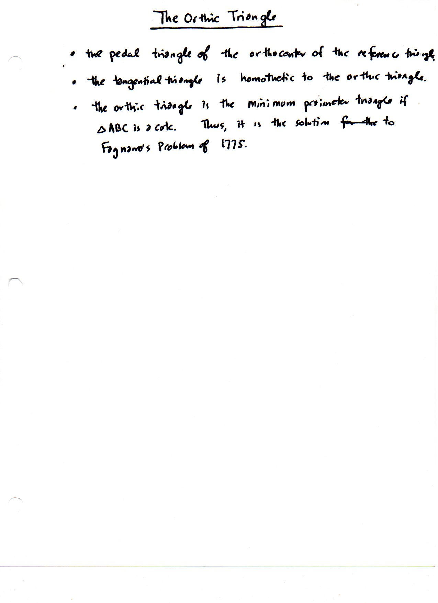

=============================
F.36 Orthic Triangle — Folios
=============================

Archival manuscript scans and diplomatic transcriptions from :person:`seelig`'s
notebooks for **F.36 (Orthic Triangle)** (:cite:`SeeligNotebooks`).

Folio 0232 (Page 1 of 1): The Orthic Triangle & Fagnano's Problem
-----------------------------------------------------------------

.. folio:: 0232

   Folio ``0232`` (original scan ``0232.jpg``) from ``resources/seelig/36_orthic-triangle``.

**Diplomatic Mathematical & Geometric Transcription**

**Diplomatic Transcription — Folio 0232** (``0232.jpg``, Sheet 1 of 1):

Records the three fundamental characterizations of the orthic triangle: (1) pedal triangle of :math:`H`, (2) homothetic to the tangential triangle, and (3) solution to Fagnano's 1775 minimum-perimeter inscribed triangle problem.

.. math::

   a_{\text{orthic}} = a \cos\alpha, \qquad b_{\text{orthic}} = b \cos\beta, \qquad c_{\text{orthic}} = c \cos\gamma

.. admonition:: Editorial & Symbolic Notes

   Archival scan ``0232.jpg`` from Fred W. Seelig's notebook dossier on **F.36 Orthic Triangle** (Page 1 of 1). Companion OpenDocument worksheet(s): ``Orthic Triangle``, ``Orthocenter``, ``Pedal Triangle``. Classical Euclidean foundations: :ref:`I.12`, :ref:`III.32`. Kimberling *Encyclopedia of Triangle Centers* loci: :ref:`X(3)`, :ref:`X(4)`, :ref:`X(5)`.
