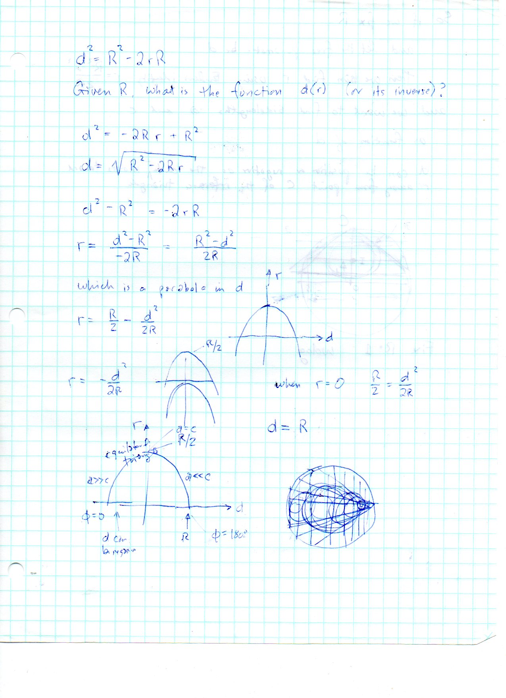
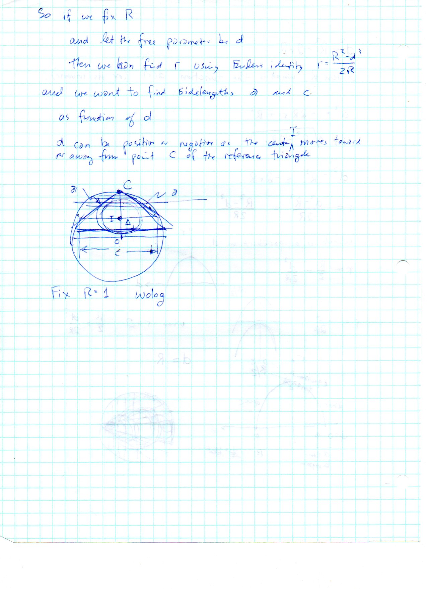
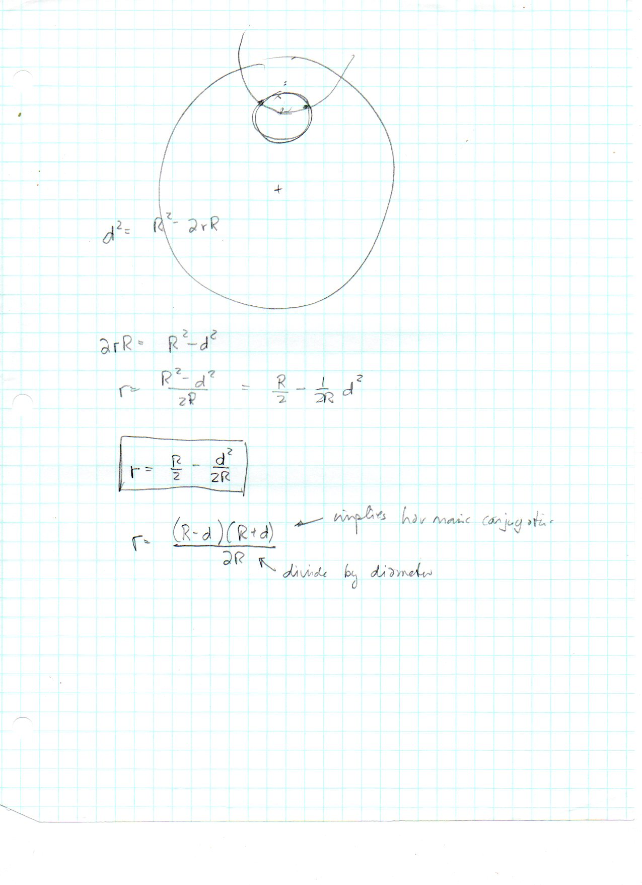

=======================================
F.37 Euler's Inradius Parabola — Folios
=======================================

Archival manuscript scans and diplomatic transcriptions from :person:`seelig`'s
notebooks for **F.37 (Euler's Inradius Parabola)** (:cite:`SeeligNotebooks`).

Folio 0233 (Page 1 of 3): Euler's Identity as a Downward Parabola r(d)
----------------------------------------------------------------------

.. folio:: 0233

   Folio ``0233`` (original scan ``0233.jpg``) from ``resources/seelig/37_parabolas``.

**Diplomatic Mathematical & Geometric Transcription**

**Diplomatic Transcription — Folio 0233** (``0233.jpg``, Sheet 1 of 3):

Inverts :math:`d^2 = R^2 - 2rR` into :math:`r(d) = \frac{R}{2} - \frac{d^2}{2R}` and plots the parabola from vertex :math:`(0, R/2)` to roots :math:`(\pm R, 0)`.

.. math::

   d^2 = R^2 - 2 r R \iff r(d) = \frac{R}{2} - \frac{d^2}{2 R} = \frac{(R - d)(R + d)}{2 R}

.. admonition:: Editorial & Symbolic Notes

   Archival scan ``0233.jpg`` from Fred W. Seelig's notebook dossier on **F.37 Euler's Inradius Parabola** (Page 1 of 3). Companion OpenDocument worksheet(s): ``Incircle-Incenter``, ``Circumcircle-Circumcenter``. Classical Euclidean foundations: :ref:`II.5`, :ref:`III.35`. Kimberling *Encyclopedia of Triangle Centers* loci: :ref:`X(1)`, :ref:`X(3)`.

Folio 0234 (Page 2 of 3): Factored Form & Power of the Incenter
---------------------------------------------------------------

.. folio:: 0234

   Folio ``0234`` (original scan ``0234.jpg``) from ``resources/seelig/37_parabolas``.

**Diplomatic Mathematical & Geometric Transcription**

**Diplomatic Transcription — Folio 0234** (``0234.jpg``, Sheet 2 of 3):

Rewrites :math:`2rR = (R-d)(R+d)` as the chord-segment product of the incenter inside the circumcircle of radius :math:`R`.

.. math::

   r_{\max} = r(0) = \frac{R}{2}, \qquad (R - d)(R + d) = 2 r R

.. admonition:: Editorial & Symbolic Notes

   Archival scan ``0234.jpg`` from Fred W. Seelig's notebook dossier on **F.37 Euler's Inradius Parabola** (Page 2 of 3). Companion OpenDocument worksheet(s): ``Incircle-Incenter``, ``Circumcircle-Circumcenter``. Classical Euclidean foundations: :ref:`II.5`, :ref:`III.35`. Kimberling *Encyclopedia of Triangle Centers* loci: :ref:`X(1)`, :ref:`X(3)`.

Folio 0235 (Page 3 of 3): Harmonic Division Along the Circumdiameter
--------------------------------------------------------------------

.. folio:: 0235

   Folio ``0235`` (original scan ``0235.jpg``) from ``resources/seelig/37_parabolas``.

**Diplomatic Mathematical & Geometric Transcription**

**Diplomatic Transcription — Folio 0235** (``0235.jpg``, Sheet 3 of 3):

Relates the diameter segments :math:`R-d` and :math:`R+d` to the harmonic ratio :math:`k = (R+d)/(R-d)`.

.. math::

   d^2 = R^2 - 2 r R \iff r(d) = \frac{R}{2} - \frac{d^2}{2 R} = \frac{(R - d)(R + d)}{2 R}

.. admonition:: Editorial & Symbolic Notes

   Archival scan ``0235.jpg`` from Fred W. Seelig's notebook dossier on **F.37 Euler's Inradius Parabola** (Page 3 of 3). Companion OpenDocument worksheet(s): ``Incircle-Incenter``, ``Circumcircle-Circumcenter``. Classical Euclidean foundations: :ref:`II.5`, :ref:`III.35`. Kimberling *Encyclopedia of Triangle Centers* loci: :ref:`X(1)`, :ref:`X(3)`.
