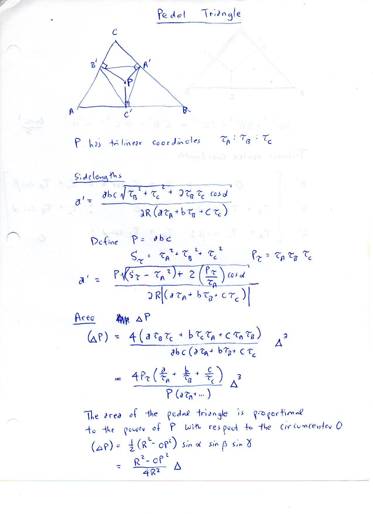
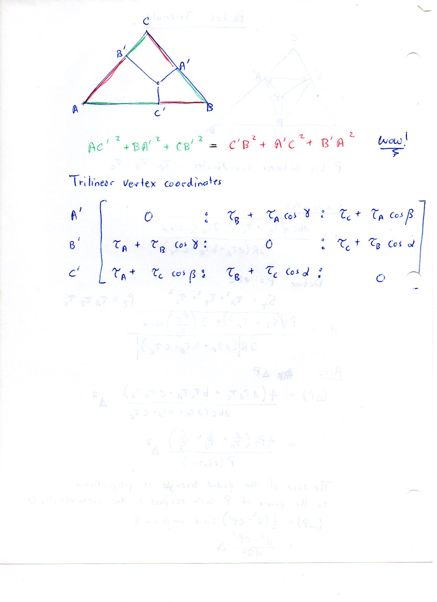

=============================
F.38 Pedal Triangles — Folios
=============================

Archival manuscript scans and diplomatic transcriptions from :person:`seelig`'s
notebooks for **F.38 (Pedal Triangles)** (:cite:`SeeligNotebooks`).

Folio 0236 (Page 1 of 2): Pedal Triangle Side Lengths & Area Formula
--------------------------------------------------------------------

.. folio:: 0236

   Folio ``0236`` (original scan ``0236.jpg``) from ``resources/seelig/38_pedal-triangles``.

**Diplomatic Mathematical & Geometric Transcription**

**Diplomatic Transcription — Folio 0236** (``0236.jpg``, Sheet 1 of 2):

Records the trilinear pedal side-length formula for :math:`a', b', c'` and Euler's pedal area relation :math:`(\Delta P) = \frac{R^2-OP^2}{4R^2}\Delta`.

.. math::

   a' = \frac{a b c \sqrt{\tau_B^2 + \tau_C^2 + 2\tau_B\tau_C\cos\alpha}}{2 R (a\tau_A + b\tau_B + c\tau_C)}, \qquad \Delta(P) = \frac{R^2 - OP^2}{4 R^2}\Delta

.. admonition:: Editorial & Symbolic Notes

   Archival scan ``0236.jpg`` from Fred W. Seelig's notebook dossier on **F.38 Pedal Triangles** (Page 1 of 2). Companion OpenDocument worksheet(s): ``Pedal Triangle``, ``Orthic Triangle``. Classical Euclidean foundations: :ref:`I.12`, :ref:`I.47`. Kimberling *Encyclopedia of Triangle Centers* loci: :ref:`X(1)`, :ref:`X(3)`, :ref:`X(4)`.

Folio 0237 (Page 2 of 2): Carnot's Alternating Square Law & Trilinear Matrix
----------------------------------------------------------------------------

.. folio:: 0237

   Folio ``0237`` (original scan ``0237.jpg``) from ``resources/seelig/38_pedal-triangles``.

**Diplomatic Mathematical & Geometric Transcription**

**Diplomatic Transcription — Folio 0237** (``0237.jpg``, Sheet 2 of 2):

Writes the alternating segment square equality :math:`{AC'}^2 + {BA'}^2 + {CB'}^2 = {C'B}^2 + {A'C}^2 + {B'A}^2` (*'wow!'*) and the :math:`3\times 3` trilinear coordinate matrix of :math:`A', B', C'`.

.. math::

   {AC'}^2 + {BA'}^2 + {CB'}^2 = {C'B}^2 + {A'C}^2 + {B'A}^2

.. admonition:: Editorial & Symbolic Notes

   Archival scan ``0237.jpg`` from Fred W. Seelig's notebook dossier on **F.38 Pedal Triangles** (Page 2 of 2). Companion OpenDocument worksheet(s): ``Pedal Triangle``, ``Orthic Triangle``. Classical Euclidean foundations: :ref:`I.12`, :ref:`I.47`. Kimberling *Encyclopedia of Triangle Centers* loci: :ref:`X(1)`, :ref:`X(3)`, :ref:`X(4)`.
