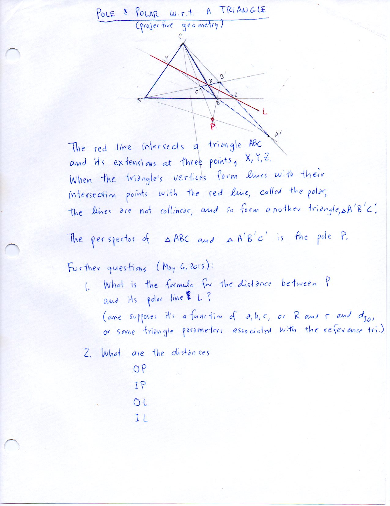

=======================================================
F.39 Pole and Polar with Respect to a Triangle — Folios
=======================================================

Archival manuscript scans and diplomatic transcriptions from :person:`seelig`'s
notebooks for **F.39 (Pole and Polar with Respect to a Triangle)** (:cite:`SeeligNotebooks`).

Folio 0238 (Page 1 of 1): Pole & Polar W.r.t. a Triangle (May 6, 2015)
----------------------------------------------------------------------

.. folio:: 0238

   Folio ``0238`` (original scan ``0238.jpg``) from ``resources/seelig/39_pole-polar``.

**Diplomatic Mathematical & Geometric Transcription**

**Diplomatic Transcription — Folio 0238** (``0238.jpg``, Sheet 1 of 1):

Constructs the cevian triangle :math:`A'B'C'` of pole :math:`P` and the collinear perspectrix/trilinear polar :math:`L` through :math:`X, Y, Z`, posing open metric questions for :math:`d(P,L), OP, IP, OL, IL`.

.. math::

   P = (u : v : w) \iff L:\; \frac{x}{u} + \frac{y}{v} + \frac{z}{w} = 0

.. admonition:: Editorial & Symbolic Notes

   Archival scan ``0238.jpg`` from Fred W. Seelig's notebook dossier on **F.39 Pole and Polar with Respect to a Triangle** (Page 1 of 1). Companion OpenDocument worksheet(s): ``Pole & Polar``, ``Harmonic Conjugates``. Classical Euclidean foundations: :ref:`VI.2`, :ref:`VI.3`. Kimberling *Encyclopedia of Triangle Centers* loci: :ref:`X(1)`, :ref:`X(2)`, :ref:`X(3)`.
