==================================================
F.40 Regular Polygons and Nested Radicals — Folios
==================================================

Archival manuscript scans and diplomatic transcriptions from :person:`seelig`'s
notebooks for **F.40 (Regular Polygons and Nested Radicals)** (:cite:`SeeligNotebooks`).

Folio 0239 (Page 1 of 18): Edge-Doubling Recursion for Unit-Circle Polygons (2-001)
-----------------------------------------------------------------------------------

.. folio:: 0239

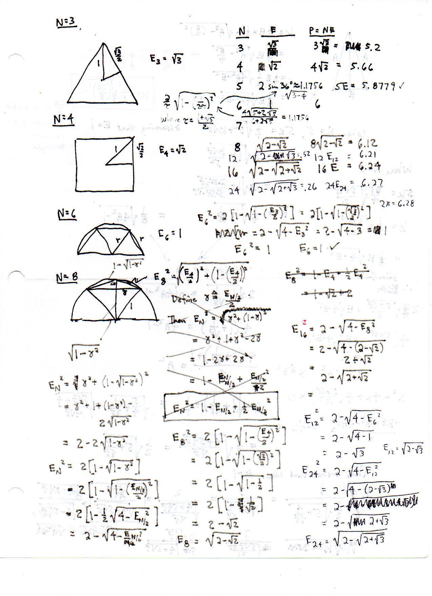

   Folio ``0239`` (original scan ``0239.jpg``) from ``resources/seelig/40_polygons``.

**Diplomatic Mathematical & Geometric Transcription**

**Diplomatic Transcription — Folio 0239** (``0239.jpg``, Sheet 1 of 18):

Derives :math:`E_N = \sqrt{2-\sqrt{4-E_{N/2}^2}}` and apothem :math:`r_N = \frac{1}{2}\sqrt{4-E_N^2}` from the sagitta right triangle in a unit circle (:math:`R=1`).

.. math::

   E_N = 2\sin\frac{\pi}{N} = \sqrt{2 - \sqrt{4 - E_{N/2}^2}}, \qquad r_N = \cos\frac{\pi}{N} = \frac{1}{2}\sqrt{4 - E_N^2}

.. admonition:: Editorial & Symbolic Notes

   Archival scan ``0239.jpg`` from Fred W. Seelig's notebook dossier on **F.40 Regular Polygons and Nested Radicals** (Page 1 of 18). Companion OpenDocument worksheet(s): ``Polygon Table``, ``Golden Triangle``. Classical Euclidean foundations: :ref:`IV.11`, :ref:`IV.15`, :ref:`IV.16`, :ref:`XIII.9`, :ref:`XIII.10`.

Folio 0240 (Page 2 of 18): Square & Octagon Doubling Family (2-002)
-------------------------------------------------------------------

.. folio:: 0240

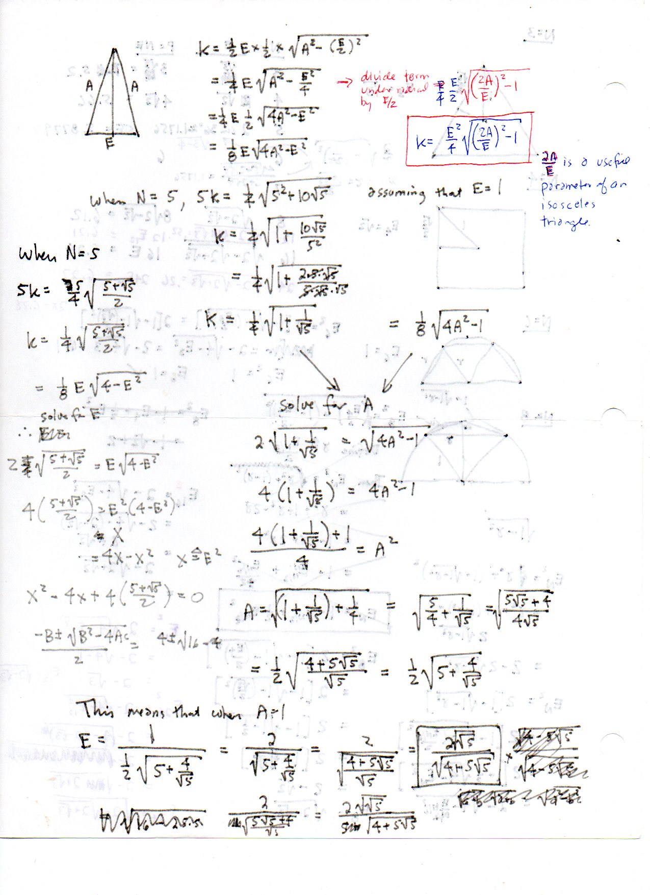

   Folio ``0240`` (original scan ``0240.jpg``) from ``resources/seelig/40_polygons``.

**Diplomatic Mathematical & Geometric Transcription**

**Diplomatic Transcription — Folio 0240** (``0240.jpg``, Sheet 2 of 18):

Evaluates nested radicals for :math:`N = 4, 8, 16, 32, 64` starting from :math:`E_4 = \sqrt{2}`.

.. math::

   E_{10} = \phi - 1 = \sqrt{2 - \phi}, \qquad E_5 = \sqrt{3 - \phi}, \qquad E_{15} = 2\sin 12^\circ = \frac{1}{4}\left(\sqrt{10 + 2\sqrt{5}} + \sqrt{3} - \sqrt{15}\right)

.. admonition:: Editorial & Symbolic Notes

   Archival scan ``0240.jpg`` from Fred W. Seelig's notebook dossier on **F.40 Regular Polygons and Nested Radicals** (Page 2 of 18). Companion OpenDocument worksheet(s): ``Polygon Table``, ``Golden Triangle``. Classical Euclidean foundations: :ref:`IV.11`, :ref:`IV.15`, :ref:`IV.16`, :ref:`XIII.9`, :ref:`XIII.10`.

Folio 0241 (Page 3 of 18): Hexagon & Dodecagon Doubling Family (2-003)
----------------------------------------------------------------------

.. folio:: 0241

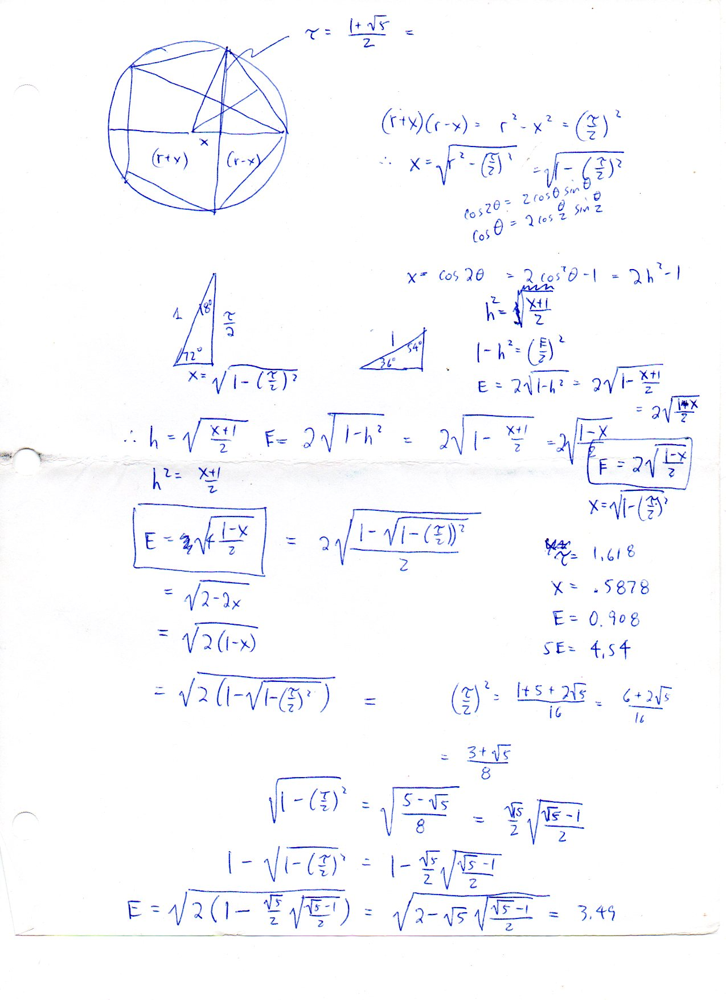

   Folio ``0241`` (original scan ``0241.jpg``) from ``resources/seelig/40_polygons``.

**Diplomatic Mathematical & Geometric Transcription**

**Diplomatic Transcription — Folio 0241** (``0241.jpg``, Sheet 3 of 18):

Evaluates nested radicals for :math:`N = 3, 6, 12, 24, 48` starting from :math:`E_3 = \sqrt{3}` and :math:`E_6 = 1`.

.. math::

   E_N = 2\sin\frac{\pi}{N} = \sqrt{2 - \sqrt{4 - E_{N/2}^2}}, \qquad r_N = \cos\frac{\pi}{N} = \frac{1}{2}\sqrt{4 - E_N^2}

.. admonition:: Editorial & Symbolic Notes

   Archival scan ``0241.jpg`` from Fred W. Seelig's notebook dossier on **F.40 Regular Polygons and Nested Radicals** (Page 3 of 18). Companion OpenDocument worksheet(s): ``Polygon Table``, ``Golden Triangle``. Classical Euclidean foundations: :ref:`IV.11`, :ref:`IV.15`, :ref:`IV.16`, :ref:`XIII.9`, :ref:`XIII.10`.

Folio 0242 (Page 4 of 18): Pentagon & Decagon Golden Ratio Radicals (2-004)
---------------------------------------------------------------------------

.. folio:: 0242

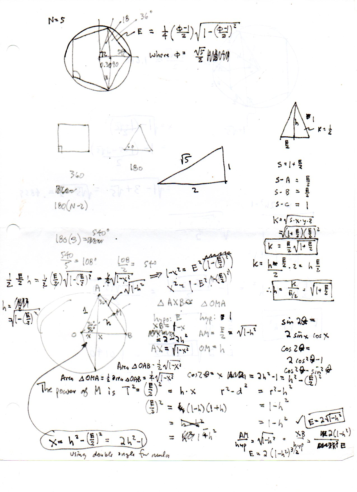

   Folio ``0242`` (original scan ``0242.jpg``) from ``resources/seelig/40_polygons``.

**Diplomatic Mathematical & Geometric Transcription**

**Diplomatic Transcription — Folio 0242** (``0242.jpg``, Sheet 4 of 18):

Expresses :math:`E_{10} = \phi^{-1} = \sqrt{2-\phi}`, :math:`E_5 = \sqrt{3-\phi}`, and :math:`E_{20} = \sqrt{2-\sqrt{2+\phi}}` in terms of :math:`\phi = \frac{1+\sqrt{5}}{2}`.

.. math::

   E_{10} = \phi - 1 = \sqrt{2 - \phi}, \qquad E_5 = \sqrt{3 - \phi}, \qquad E_{15} = 2\sin 12^\circ = \frac{1}{4}\left(\sqrt{10 + 2\sqrt{5}} + \sqrt{3} - \sqrt{15}\right)

.. admonition:: Editorial & Symbolic Notes

   Archival scan ``0242.jpg`` from Fred W. Seelig's notebook dossier on **F.40 Regular Polygons and Nested Radicals** (Page 4 of 18). Companion OpenDocument worksheet(s): ``Polygon Table``, ``Golden Triangle``. Classical Euclidean foundations: :ref:`IV.11`, :ref:`IV.15`, :ref:`IV.16`, :ref:`XIII.9`, :ref:`XIII.10`.

Folio 0243 (Page 5 of 18): Master Polygon Reference Table (2-005)
-----------------------------------------------------------------

.. folio:: 0243

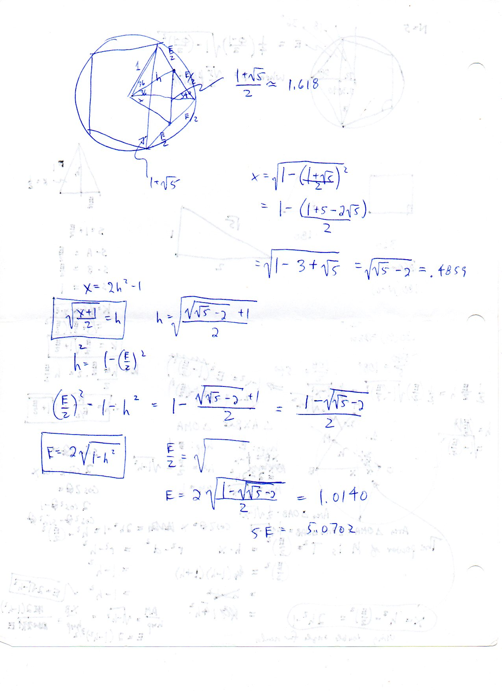

   Folio ``0243`` (original scan ``0243.jpg``) from ``resources/seelig/40_polygons``.

**Diplomatic Mathematical & Geometric Transcription**

**Diplomatic Transcription — Folio 0243** (``0243.jpg``, Sheet 5 of 18):

Compiles :math:`N, \theta_N, E_N, r_N`, and perimeter :math:`N E_N \to 2\pi` across all constructible families.

.. math::

   E_N = 2\sin\frac{\pi}{N} = \sqrt{2 - \sqrt{4 - E_{N/2}^2}}, \qquad r_N = \cos\frac{\pi}{N} = \frac{1}{2}\sqrt{4 - E_N^2}

.. admonition:: Editorial & Symbolic Notes

   Archival scan ``0243.jpg`` from Fred W. Seelig's notebook dossier on **F.40 Regular Polygons and Nested Radicals** (Page 5 of 18). Companion OpenDocument worksheet(s): ``Polygon Table``, ``Golden Triangle``. Classical Euclidean foundations: :ref:`IV.11`, :ref:`IV.15`, :ref:`IV.16`, :ref:`XIII.9`, :ref:`XIII.10`.

Folio 0244 (Page 6 of 18): Regular Pentadecagon E_15 Derivation (2-006, FWS 4/20/2015)
--------------------------------------------------------------------------------------

.. folio:: 0244

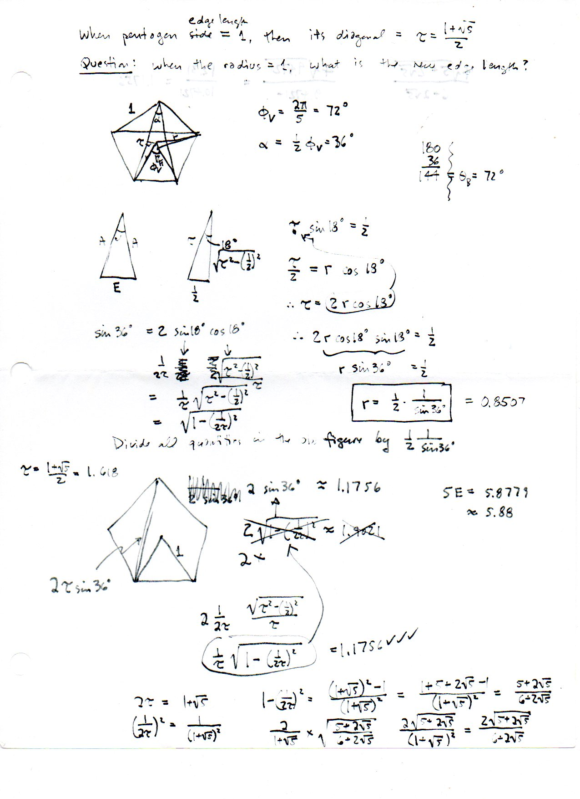

   Folio ``0244`` (original scan ``0244.jpg``) from ``resources/seelig/40_polygons``.

**Diplomatic Mathematical & Geometric Transcription**

**Diplomatic Transcription — Folio 0244** (``0244.jpg``, Sheet 6 of 18):

Computes :math:`E_{15} = 2\sin 12^\circ \approx 0.415823` using :math:`12^\circ = 30^\circ - 18^\circ` and Euclid IV.16.

.. math::

   E_{10} = \phi - 1 = \sqrt{2 - \phi}, \qquad E_5 = \sqrt{3 - \phi}, \qquad E_{15} = 2\sin 12^\circ = \frac{1}{4}\left(\sqrt{10 + 2\sqrt{5}} + \sqrt{3} - \sqrt{15}\right)

.. admonition:: Editorial & Symbolic Notes

   Archival scan ``0244.jpg`` from Fred W. Seelig's notebook dossier on **F.40 Regular Polygons and Nested Radicals** (Page 6 of 18). Companion OpenDocument worksheet(s): ``Polygon Table``, ``Golden Triangle``. Classical Euclidean foundations: :ref:`IV.11`, :ref:`IV.15`, :ref:`IV.16`, :ref:`XIII.9`, :ref:`XIII.10`.

Folio 0245 (Page 7 of 18): Stafford's Exact Radical Table for pi/30 (2-007)
---------------------------------------------------------------------------

.. folio:: 0245

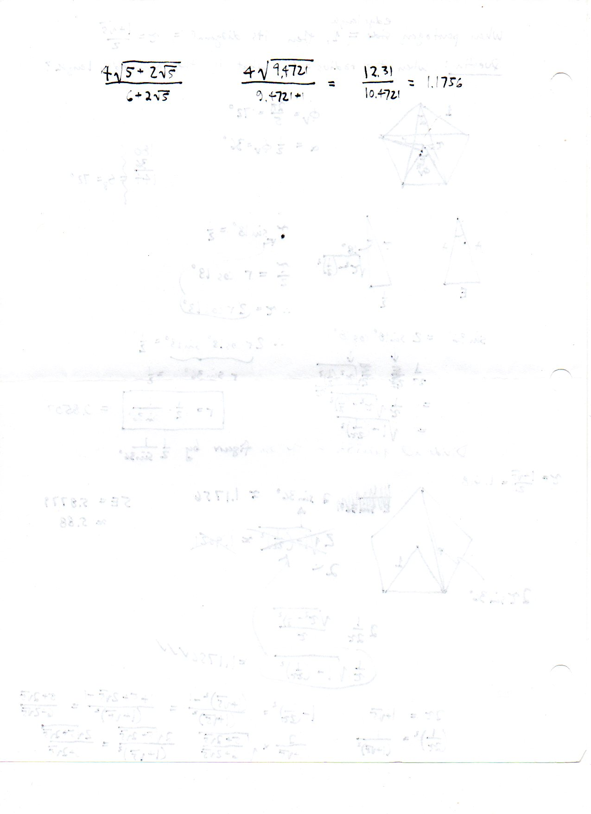

   Folio ``0245`` (original scan ``0245.jpg``) from ``resources/seelig/40_polygons``.

**Diplomatic Mathematical & Geometric Transcription**

**Diplomatic Transcription — Folio 0245** (``0245.jpg``, Sheet 7 of 18):

Cites James Stafford's trigonometric radical table for multiples of :math:`6^\circ = \pi/30` to verify :math:`\sin 12^\circ` and :math:`\cos 12^\circ`.

.. math::

   E_N = 2\sin\frac{\pi}{N} = \sqrt{2 - \sqrt{4 - E_{N/2}^2}}, \qquad r_N = \cos\frac{\pi}{N} = \frac{1}{2}\sqrt{4 - E_N^2}

.. admonition:: Editorial & Symbolic Notes

   Archival scan ``0245.jpg`` from Fred W. Seelig's notebook dossier on **F.40 Regular Polygons and Nested Radicals** (Page 7 of 18). Companion OpenDocument worksheet(s): ``Polygon Table``, ``Golden Triangle``. Classical Euclidean foundations: :ref:`IV.11`, :ref:`IV.15`, :ref:`IV.16`, :ref:`XIII.9`, :ref:`XIII.10`.

Folio 0246 (Page 8 of 18): Pentadecagon Apothem & Area (2-008)
--------------------------------------------------------------

.. folio:: 0246

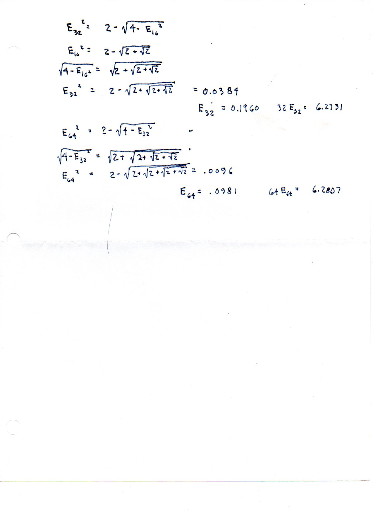

   Folio ``0246`` (original scan ``0246.jpg``) from ``resources/seelig/40_polygons``.

**Diplomatic Mathematical & Geometric Transcription**

**Diplomatic Transcription — Folio 0246** (``0246.jpg``, Sheet 8 of 18):

Simplifies the nested radical for :math:`r_{15} = \cos 12^\circ` and the area :math:`K_{15} = \frac{15}{2}E_{15}r_{15}`.

.. math::

   E_{10} = \phi - 1 = \sqrt{2 - \phi}, \qquad E_5 = \sqrt{3 - \phi}, \qquad E_{15} = 2\sin 12^\circ = \frac{1}{4}\left(\sqrt{10 + 2\sqrt{5}} + \sqrt{3} - \sqrt{15}\right)

.. admonition:: Editorial & Symbolic Notes

   Archival scan ``0246.jpg`` from Fred W. Seelig's notebook dossier on **F.40 Regular Polygons and Nested Radicals** (Page 8 of 18). Companion OpenDocument worksheet(s): ``Polygon Table``, ``Golden Triangle``. Classical Euclidean foundations: :ref:`IV.11`, :ref:`IV.15`, :ref:`IV.16`, :ref:`XIII.9`, :ref:`XIII.10`.

Folio 0247 (Page 9 of 18): 30-gon & 60-gon Doubling Steps (2-009)
-----------------------------------------------------------------

.. folio:: 0247

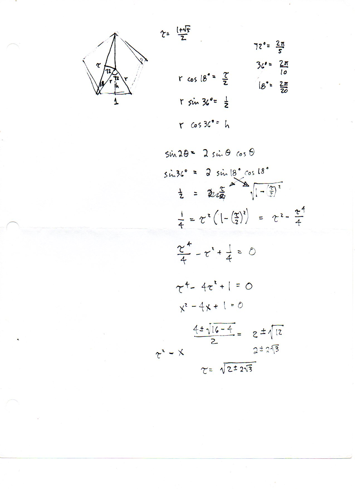

   Folio ``0247`` (original scan ``0247.jpg``) from ``resources/seelig/40_polygons``.

**Diplomatic Mathematical & Geometric Transcription**

**Diplomatic Transcription — Folio 0247** (``0247.jpg``, Sheet 9 of 18):

Applies the edge-doubling recursion to :math:`E_{15}` to obtain :math:`E_{30}` and :math:`E_{60}`.

.. math::

   E_N = 2\sin\frac{\pi}{N} = \sqrt{2 - \sqrt{4 - E_{N/2}^2}}, \qquad r_N = \cos\frac{\pi}{N} = \frac{1}{2}\sqrt{4 - E_N^2}

.. admonition:: Editorial & Symbolic Notes

   Archival scan ``0247.jpg`` from Fred W. Seelig's notebook dossier on **F.40 Regular Polygons and Nested Radicals** (Page 9 of 18). Companion OpenDocument worksheet(s): ``Polygon Table``, ``Golden Triangle``. Classical Euclidean foundations: :ref:`IV.11`, :ref:`IV.15`, :ref:`IV.16`, :ref:`XIII.9`, :ref:`XIII.10`.

Folio 0248 (Page 10 of 18): Inscribed Triangle & Square Constructions (001)
---------------------------------------------------------------------------

.. folio:: 0248

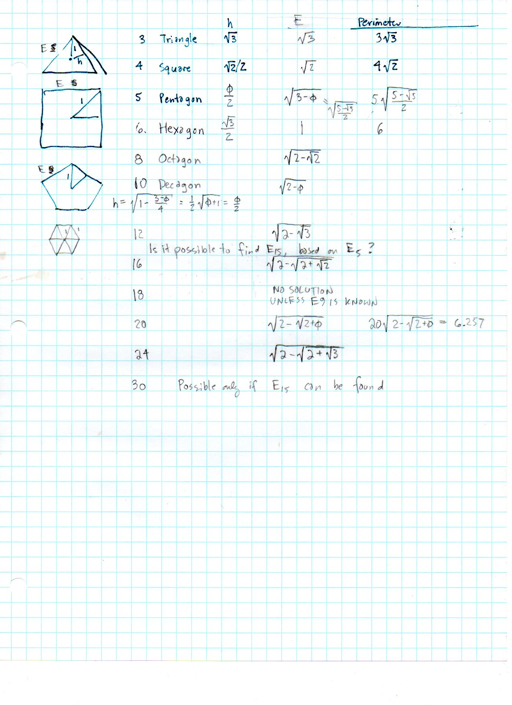

   Folio ``0248`` (original scan ``0248.jpg``) from ``resources/seelig/40_polygons``.

**Diplomatic Mathematical & Geometric Transcription**

**Diplomatic Transcription — Folio 0248** (``0248.jpg``, Sheet 10 of 18):

Compass diagrams of the inscribed equilateral triangle (:math:`E_3 = \sqrt{3}R`) and square (:math:`E_4 = \sqrt{2}R`).

.. math::

   E_{10} = \phi - 1 = \sqrt{2 - \phi}, \qquad E_5 = \sqrt{3 - \phi}, \qquad E_{15} = 2\sin 12^\circ = \frac{1}{4}\left(\sqrt{10 + 2\sqrt{5}} + \sqrt{3} - \sqrt{15}\right)

.. admonition:: Editorial & Symbolic Notes

   Archival scan ``0248.jpg`` from Fred W. Seelig's notebook dossier on **F.40 Regular Polygons and Nested Radicals** (Page 10 of 18). Companion OpenDocument worksheet(s): ``Polygon Table``, ``Golden Triangle``. Classical Euclidean foundations: :ref:`IV.11`, :ref:`IV.15`, :ref:`IV.16`, :ref:`XIII.9`, :ref:`XIII.10`.

Folio 0249 (Page 11 of 18): Inscribed Pentagon & Decagon Geometry (002)
-----------------------------------------------------------------------

.. folio:: 0249

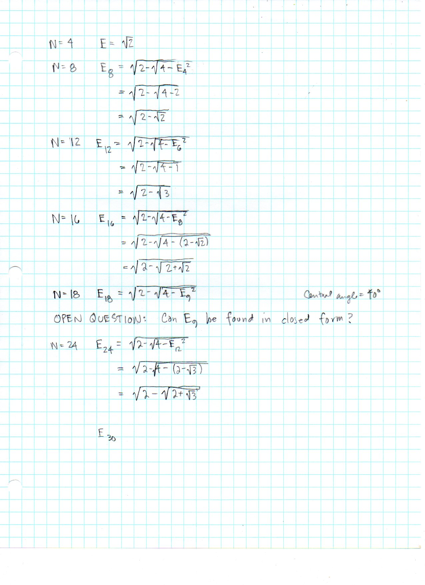

   Folio ``0249`` (original scan ``0249.jpg``) from ``resources/seelig/40_polygons``.

**Diplomatic Mathematical & Geometric Transcription**

**Diplomatic Transcription — Folio 0249** (``0249.jpg``, Sheet 11 of 18):

Shows Ptolemy's / Euclid XIII.10 relation :math:`E_5^2 = R^2 + E_{10}^2` inside the unit circle.

.. math::

   E_N = 2\sin\frac{\pi}{N} = \sqrt{2 - \sqrt{4 - E_{N/2}^2}}, \qquad r_N = \cos\frac{\pi}{N} = \frac{1}{2}\sqrt{4 - E_N^2}

.. admonition:: Editorial & Symbolic Notes

   Archival scan ``0249.jpg`` from Fred W. Seelig's notebook dossier on **F.40 Regular Polygons and Nested Radicals** (Page 11 of 18). Companion OpenDocument worksheet(s): ``Polygon Table``, ``Golden Triangle``. Classical Euclidean foundations: :ref:`IV.11`, :ref:`IV.15`, :ref:`IV.16`, :ref:`XIII.9`, :ref:`XIII.10`.

Folio 0250 (Page 12 of 18): Golden Triangle & Gnomon Decomposition of the Decagon (003)
---------------------------------------------------------------------------------------

.. folio:: 0250

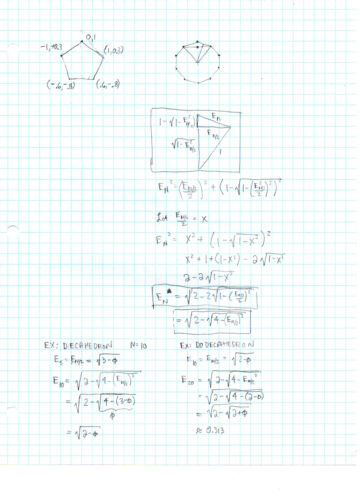

   Folio ``0250`` (original scan ``0250.jpg``) from ``resources/seelig/40_polygons``.

**Diplomatic Mathematical & Geometric Transcription**

**Diplomatic Transcription — Folio 0250** (``0250.jpg``, Sheet 12 of 18):

Partitions the regular decagon into ten acute :math:`72^\circ\text{--}72^\circ\text{--}36^\circ` golden triangles.

.. math::

   E_{10} = \phi - 1 = \sqrt{2 - \phi}, \qquad E_5 = \sqrt{3 - \phi}, \qquad E_{15} = 2\sin 12^\circ = \frac{1}{4}\left(\sqrt{10 + 2\sqrt{5}} + \sqrt{3} - \sqrt{15}\right)

.. admonition:: Editorial & Symbolic Notes

   Archival scan ``0250.jpg`` from Fred W. Seelig's notebook dossier on **F.40 Regular Polygons and Nested Radicals** (Page 12 of 18). Companion OpenDocument worksheet(s): ``Polygon Table``, ``Golden Triangle``. Classical Euclidean foundations: :ref:`IV.11`, :ref:`IV.15`, :ref:`IV.16`, :ref:`XIII.9`, :ref:`XIII.10`.

Folio 0251 (Page 13 of 18): Chord Length & Central Angle Identities (004)
-------------------------------------------------------------------------

.. folio:: 0251

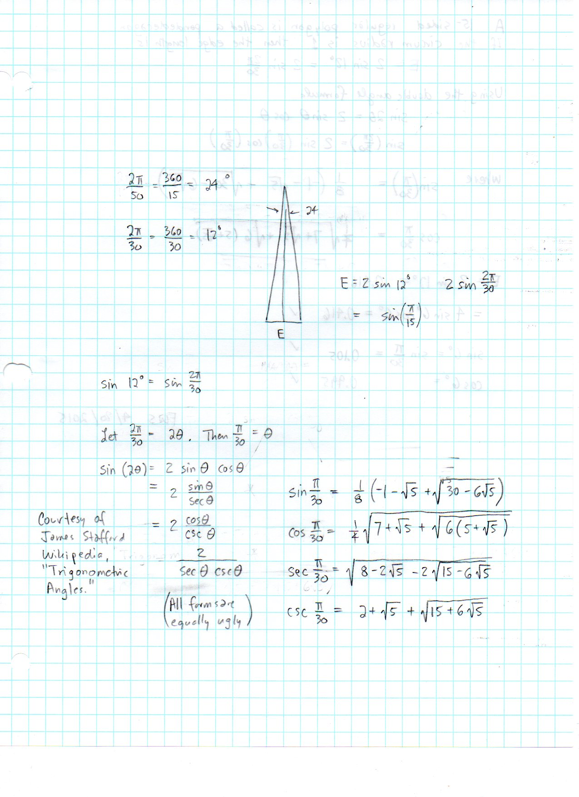

   Folio ``0251`` (original scan ``0251.jpg``) from ``resources/seelig/40_polygons``.

**Diplomatic Mathematical & Geometric Transcription**

**Diplomatic Transcription — Folio 0251** (``0251.jpg``, Sheet 13 of 18):

Relates chord length :math:`c(\theta) = 2R\sin(\theta/2)` to the sagitta :math:`s = R - \sqrt{R^2 - (c/2)^2}`.

.. math::

   E_N = 2\sin\frac{\pi}{N} = \sqrt{2 - \sqrt{4 - E_{N/2}^2}}, \qquad r_N = \cos\frac{\pi}{N} = \frac{1}{2}\sqrt{4 - E_N^2}

.. admonition:: Editorial & Symbolic Notes

   Archival scan ``0251.jpg`` from Fred W. Seelig's notebook dossier on **F.40 Regular Polygons and Nested Radicals** (Page 13 of 18). Companion OpenDocument worksheet(s): ``Polygon Table``, ``Golden Triangle``. Classical Euclidean foundations: :ref:`IV.11`, :ref:`IV.15`, :ref:`IV.16`, :ref:`XIII.9`, :ref:`XIII.10`.

Folio 0252 (Page 14 of 18): Polygon Perimeter & Area Convergence to pi (005)
----------------------------------------------------------------------------

.. folio:: 0252

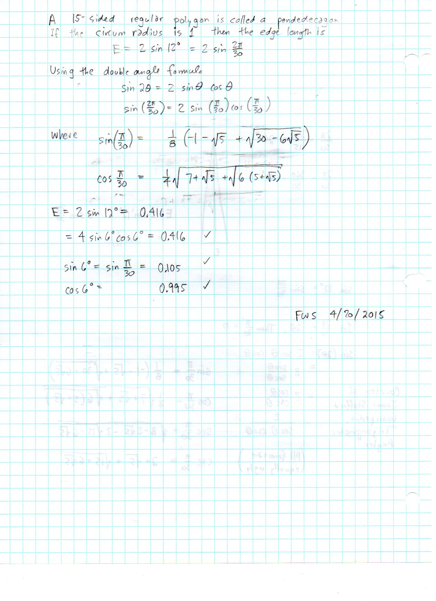

   Folio ``0252`` (original scan ``0252.jpg``) from ``resources/seelig/40_polygons``.

**Diplomatic Mathematical & Geometric Transcription**

**Diplomatic Transcription — Folio 0252** (``0252.jpg``, Sheet 14 of 18):

Tabulates :math:`\pi_N = \frac{N}{2}E_N` and :math:`A_N = \frac{N}{2}E_N r_N` for increasing :math:`N`.

.. math::

   E_{10} = \phi - 1 = \sqrt{2 - \phi}, \qquad E_5 = \sqrt{3 - \phi}, \qquad E_{15} = 2\sin 12^\circ = \frac{1}{4}\left(\sqrt{10 + 2\sqrt{5}} + \sqrt{3} - \sqrt{15}\right)

.. admonition:: Editorial & Symbolic Notes

   Archival scan ``0252.jpg`` from Fred W. Seelig's notebook dossier on **F.40 Regular Polygons and Nested Radicals** (Page 14 of 18). Companion OpenDocument worksheet(s): ``Polygon Table``, ``Golden Triangle``. Classical Euclidean foundations: :ref:`IV.11`, :ref:`IV.15`, :ref:`IV.16`, :ref:`XIII.9`, :ref:`XIII.10`.

Folio 0253 (Page 15 of 18): Regular Enneagon (N = 9) Angle-Chasing Attempt — Page 1 (006)
-----------------------------------------------------------------------------------------

.. folio:: 0253

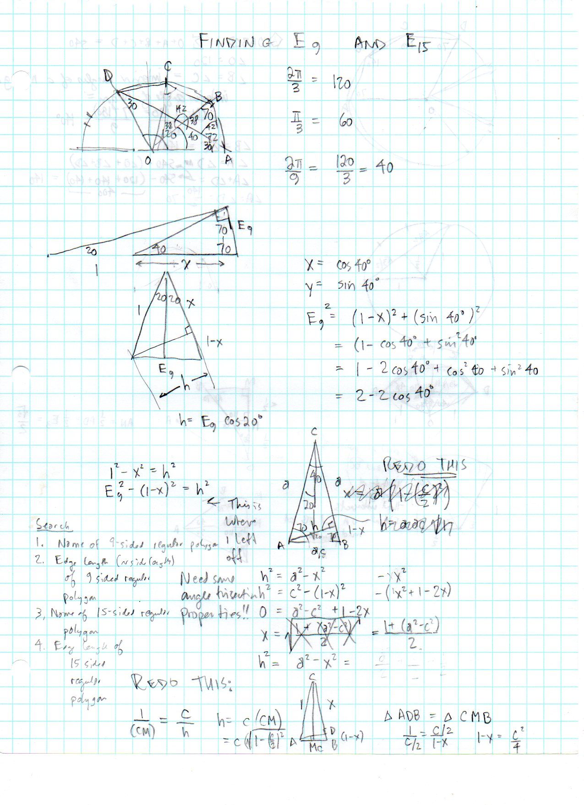

   Folio ``0253`` (original scan ``0253.jpg``) from ``resources/seelig/40_polygons``.

**Diplomatic Mathematical & Geometric Transcription**

**Diplomatic Transcription — Folio 0253** (``0253.jpg``, Sheet 15 of 18):

Investigates chord relationships in the regular 9-gon (:math:`20^\circ` central half-angle).

.. math::

   E_N = 2\sin\frac{\pi}{N} = \sqrt{2 - \sqrt{4 - E_{N/2}^2}}, \qquad r_N = \cos\frac{\pi}{N} = \frac{1}{2}\sqrt{4 - E_N^2}

.. admonition:: Editorial & Symbolic Notes

   Archival scan ``0253.jpg`` from Fred W. Seelig's notebook dossier on **F.40 Regular Polygons and Nested Radicals** (Page 15 of 18). Companion OpenDocument worksheet(s): ``Polygon Table``, ``Golden Triangle``. Classical Euclidean foundations: :ref:`IV.11`, :ref:`IV.15`, :ref:`IV.16`, :ref:`XIII.9`, :ref:`XIII.10`.

Folio 0254 (Page 16 of 18): Regular Enneagon (N = 9) Diagonal Relations — Page 2 (007)
--------------------------------------------------------------------------------------

.. folio:: 0254

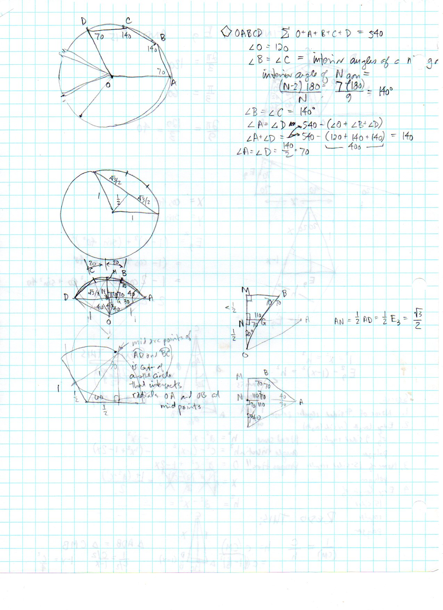

   Folio ``0254`` (original scan ``0254.jpg``) from ``resources/seelig/40_polygons``.

**Diplomatic Mathematical & Geometric Transcription**

**Diplomatic Transcription — Folio 0254** (``0254.jpg``, Sheet 16 of 18):

Records the three diagonal lengths of the regular enneagon and notes the irreducible cubic :math:`x^3 - 3x + 1 = 0`.

.. math::

   E_{10} = \phi - 1 = \sqrt{2 - \phi}, \qquad E_5 = \sqrt{3 - \phi}, \qquad E_{15} = 2\sin 12^\circ = \frac{1}{4}\left(\sqrt{10 + 2\sqrt{5}} + \sqrt{3} - \sqrt{15}\right)

.. admonition:: Editorial & Symbolic Notes

   Archival scan ``0254.jpg`` from Fred W. Seelig's notebook dossier on **F.40 Regular Polygons and Nested Radicals** (Page 16 of 18). Companion OpenDocument worksheet(s): ``Polygon Table``, ``Golden Triangle``. Classical Euclidean foundations: :ref:`IV.11`, :ref:`IV.15`, :ref:`IV.16`, :ref:`XIII.9`, :ref:`XIII.10`.

Folio 0255 (Page 17 of 18): Cartesian Cevian Length Sheet — Part 1 (009)
------------------------------------------------------------------------

.. folio:: 0255

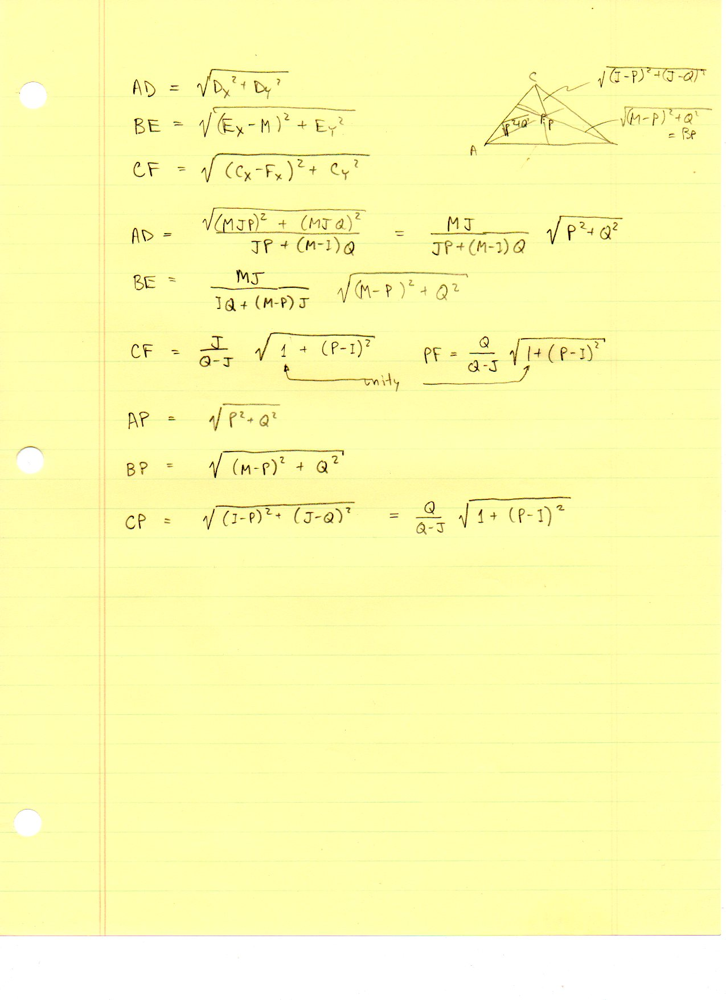

   Folio ``0255`` (original scan ``0255.jpg``) from ``resources/seelig/40_polygons``.

**Diplomatic Mathematical & Geometric Transcription**

**Diplomatic Transcription — Folio 0255** (``0255.jpg``, Sheet 17 of 18):

Derives cevian segment lengths in a Cartesian triangle frame.

.. math::

   E_N = 2\sin\frac{\pi}{N} = \sqrt{2 - \sqrt{4 - E_{N/2}^2}}, \qquad r_N = \cos\frac{\pi}{N} = \frac{1}{2}\sqrt{4 - E_N^2}

.. admonition:: Editorial & Symbolic Notes

   Archival scan ``0255.jpg`` from Fred W. Seelig's notebook dossier on **F.40 Regular Polygons and Nested Radicals** (Page 17 of 18). Companion OpenDocument worksheet(s): ``Polygon Table``, ``Golden Triangle``. Classical Euclidean foundations: :ref:`IV.11`, :ref:`IV.15`, :ref:`IV.16`, :ref:`XIII.9`, :ref:`XIII.10`.

Folio 0256 (Page 18 of 18): Cartesian Cevian Length Sheet — Part 2 (010)
------------------------------------------------------------------------

.. folio:: 0256

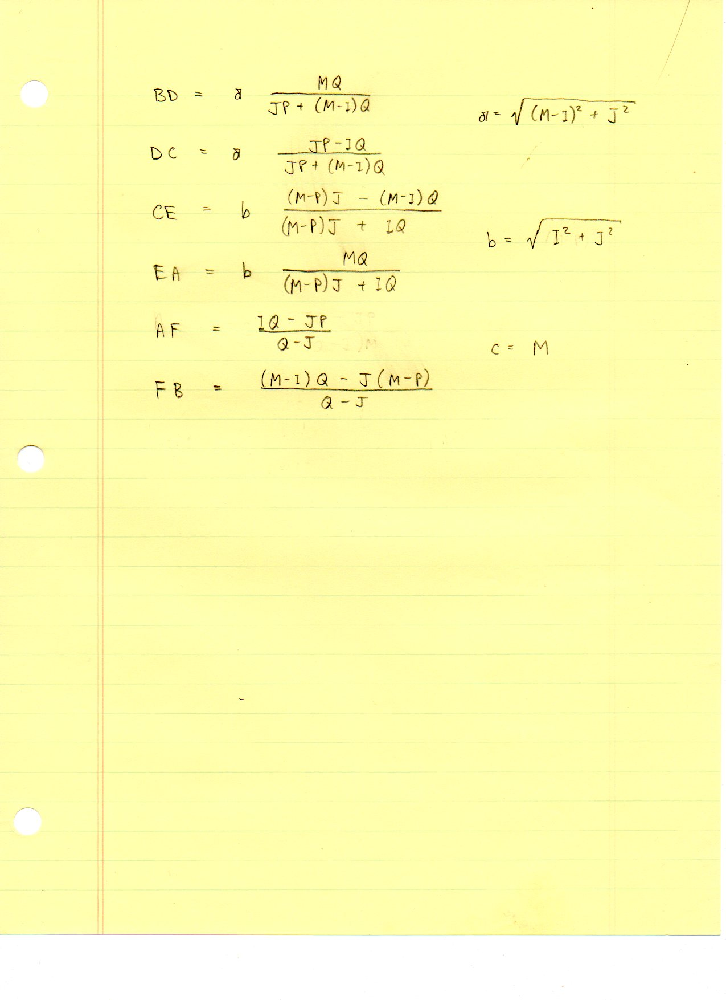

   Folio ``0256`` (original scan ``0256.jpg``) from ``resources/seelig/40_polygons``.

**Diplomatic Mathematical & Geometric Transcription**

**Diplomatic Transcription — Folio 0256** (``0256.jpg``, Sheet 18 of 18):

Completes the algebraic expansion of the Cartesian cevian length formula.

.. math::

   E_{10} = \phi - 1 = \sqrt{2 - \phi}, \qquad E_5 = \sqrt{3 - \phi}, \qquad E_{15} = 2\sin 12^\circ = \frac{1}{4}\left(\sqrt{10 + 2\sqrt{5}} + \sqrt{3} - \sqrt{15}\right)

.. admonition:: Editorial & Symbolic Notes

   Archival scan ``0256.jpg`` from Fred W. Seelig's notebook dossier on **F.40 Regular Polygons and Nested Radicals** (Page 18 of 18). Companion OpenDocument worksheet(s): ``Polygon Table``, ``Golden Triangle``. Classical Euclidean foundations: :ref:`IV.11`, :ref:`IV.15`, :ref:`IV.16`, :ref:`XIII.9`, :ref:`XIII.10`.
