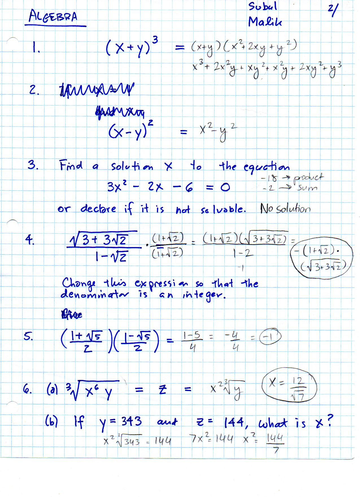
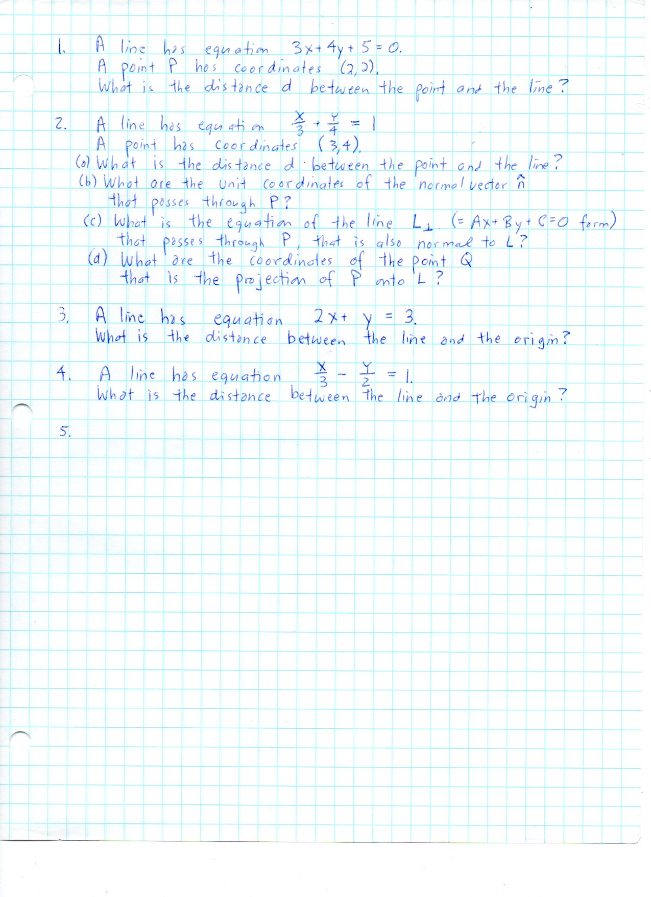
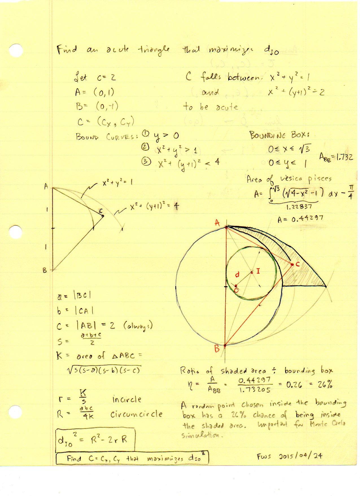
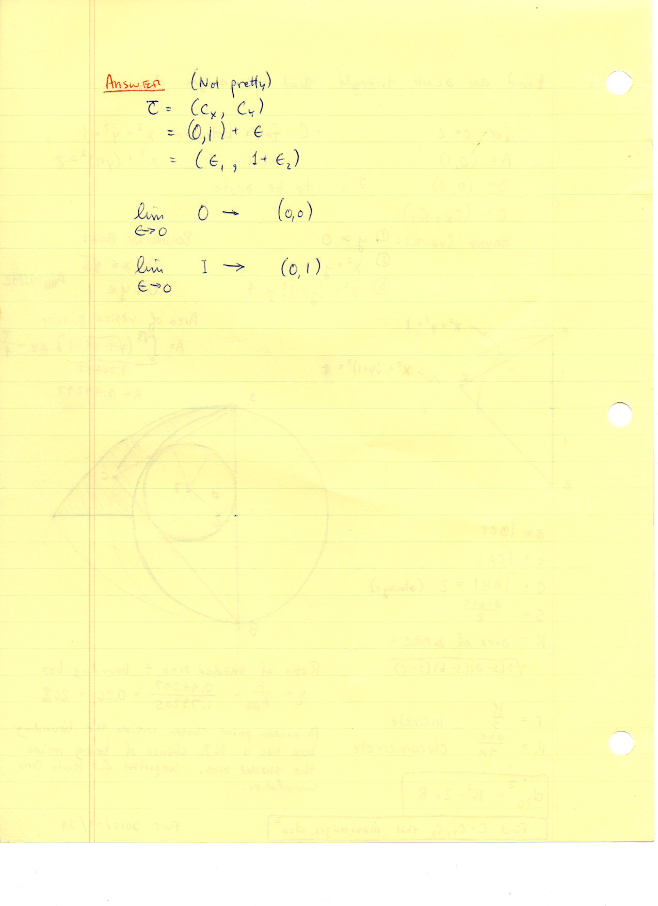
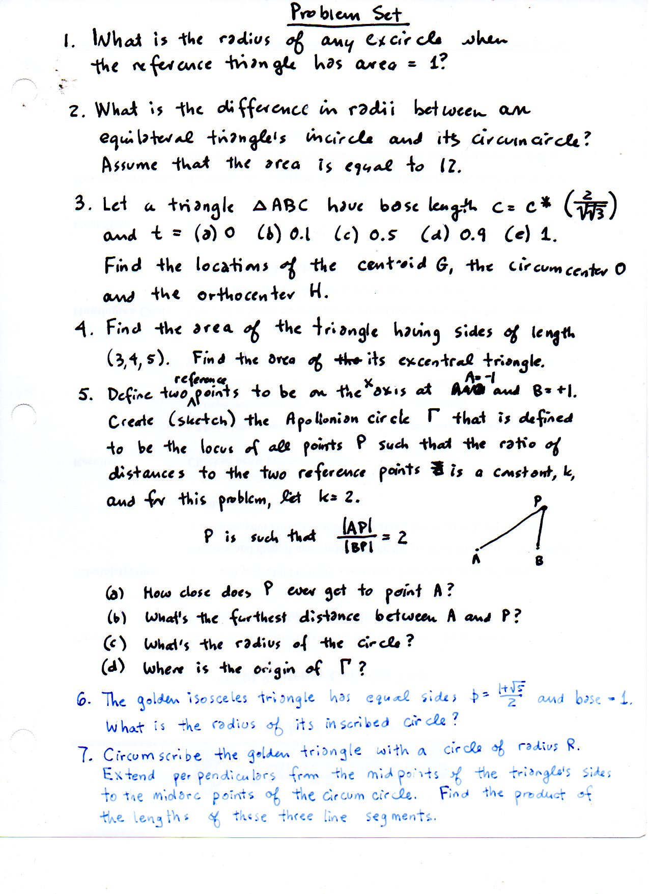
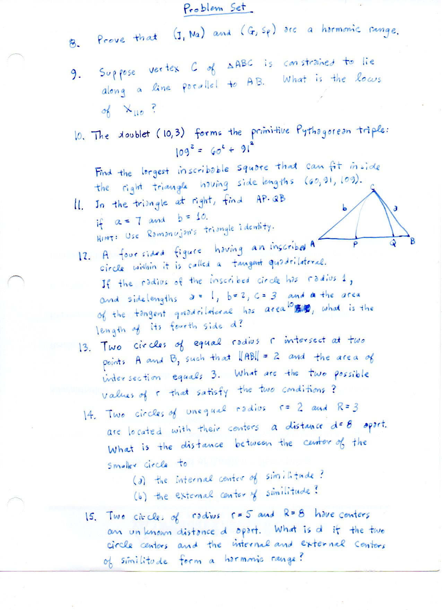
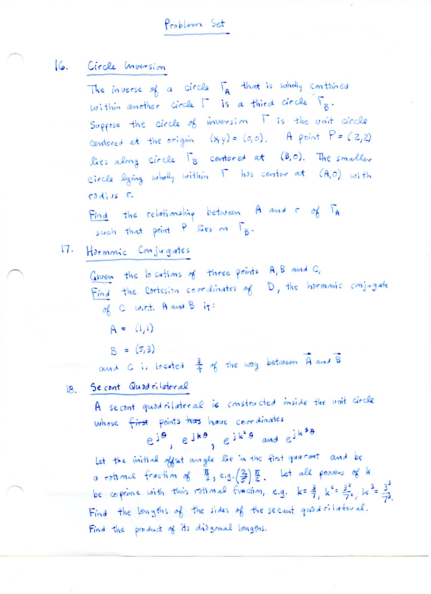
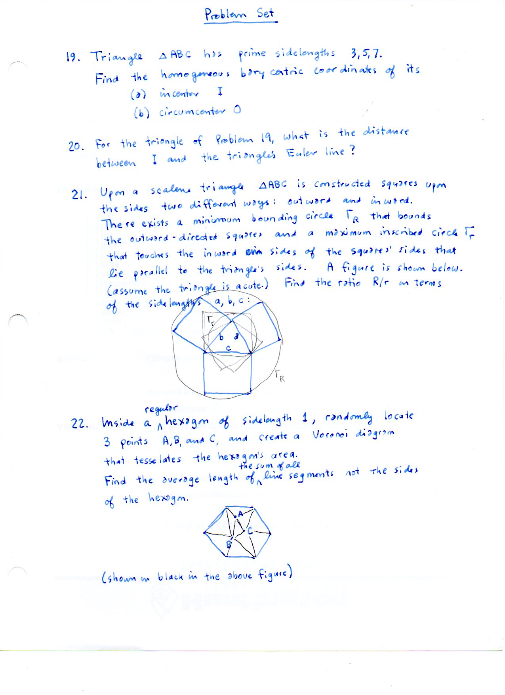
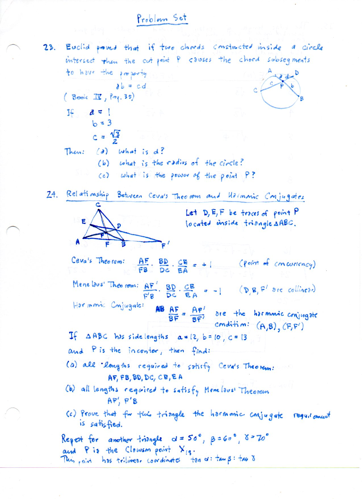
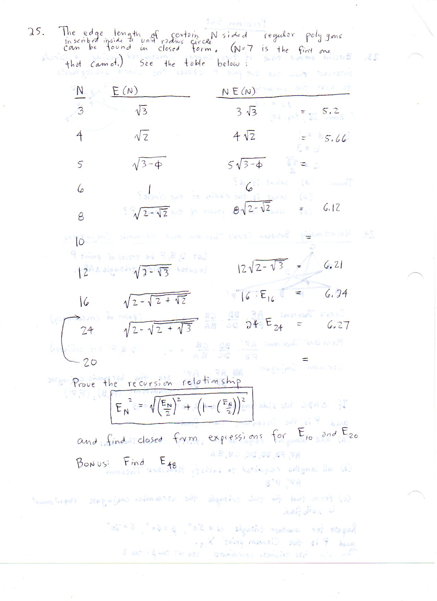

==================================================
F.41 Geometric Problems and Extremal Loci — Folios
==================================================

Archival manuscript scans and diplomatic transcriptions from :person:`seelig`'s
notebooks for **F.41 (Geometric Problems and Extremal Loci)** (:cite:`SeeligNotebooks`).

Folio 0257 (Page 1 of 10): Algebraic & Radical Simplification Sheet (001)
-------------------------------------------------------------------------

.. folio:: 0257

   Folio ``0257`` (original scan ``0257.jpg``) from ``resources/seelig/41_problems``.

**Diplomatic Mathematical & Geometric Transcription**

**Diplomatic Transcription — Folio 0257** (``0257.jpg``, Sheet 1 of 10):

Works through radical and quadratic simplifications used across the triangle problem set.

.. math::

   A_{\text{acute}} = \int_0^{\sqrt{3}} \left(\sqrt{4 - x^2} - 1\right) dx - \frac{\pi}{4} = \frac{5\pi - 6\sqrt{3}}{12} \approx 0.44297

.. admonition:: Editorial & Symbolic Notes

   Archival scan ``0257.jpg`` from Fred W. Seelig's notebook dossier on **F.41 Geometric Problems and Extremal Loci** (Page 1 of 10). Companion OpenDocument worksheet(s): ``Monte Carlo``, ``General Reference``. Classical Euclidean foundations: :ref:`I.1`, :ref:`III.31`. Kimberling *Encyclopedia of Triangle Centers* loci: :ref:`X(1)`, :ref:`X(3)`.

Folio 0258 (Page 2 of 10): Coordinate Line & Circle Intersection Sheet (002)
----------------------------------------------------------------------------

.. folio:: 0258

   Folio ``0258`` (original scan ``0258.jpg``) from ``resources/seelig/41_problems``.

**Diplomatic Mathematical & Geometric Transcription**

**Diplomatic Transcription — Folio 0258** (``0258.jpg``, Sheet 2 of 10):

Solves simultaneous line-circle equations in Cartesian coordinates.

.. math::

   p_{\text{accept}} = \frac{A_{\text{acute}}}{\sqrt{3}} \approx 0.25575, \qquad d_{IO} = \sqrt{R^2 - 2 r R}

.. admonition:: Editorial & Symbolic Notes

   Archival scan ``0258.jpg`` from Fred W. Seelig's notebook dossier on **F.41 Geometric Problems and Extremal Loci** (Page 2 of 10). Companion OpenDocument worksheet(s): ``Monte Carlo``, ``General Reference``. Classical Euclidean foundations: :ref:`I.1`, :ref:`III.31`. Kimberling *Encyclopedia of Triangle Centers* loci: :ref:`X(1)`, :ref:`X(3)`.

Folio 0259 (Page 3 of 10): Maximizing d_IO for an Acute Triangle — Vesica Integration (2-001, FWS 2015/04/24)
-------------------------------------------------------------------------------------------------------------

.. folio:: 0259

   Folio ``0259`` (original scan ``0259.jpg``) from ``resources/seelig/41_problems``.

**Diplomatic Mathematical & Geometric Transcription**

**Diplomatic Transcription — Folio 0259** (``0259.jpg``, Sheet 3 of 10):

Integrates the acute region :math:`A = \int_0^{\sqrt{3}}(\sqrt{4-x^2}-1)\,dx - \pi/4 \approx 0.44297` above the right-triangle semicircle to explain the 26% Monte Carlo hit rate.

.. math::

   A_{\text{acute}} = \int_0^{\sqrt{3}} \left(\sqrt{4 - x^2} - 1\right) dx - \frac{\pi}{4} = \frac{5\pi - 6\sqrt{3}}{12} \approx 0.44297

.. admonition:: Editorial & Symbolic Notes

   Archival scan ``0259.jpg`` from Fred W. Seelig's notebook dossier on **F.41 Geometric Problems and Extremal Loci** (Page 3 of 10). Companion OpenDocument worksheet(s): ``Monte Carlo``, ``General Reference``. Classical Euclidean foundations: :ref:`I.1`, :ref:`III.31`. Kimberling *Encyclopedia of Triangle Centers* loci: :ref:`X(1)`, :ref:`X(3)`.

Folio 0260 (Page 4 of 10): Extremal Limit C -> (0, 1) for d_IO (2-002)
----------------------------------------------------------------------

.. folio:: 0260

   Folio ``0260`` (original scan ``0260.jpg``) from ``resources/seelig/41_problems``.

**Diplomatic Mathematical & Geometric Transcription**

**Diplomatic Transcription — Folio 0260** (``0260.jpg``, Sheet 4 of 10):

Tracks :math:`R, r, d_{IO}` as :math:`C` approaches the boundary point :math:`(0,1)` of the acute region.

.. math::

   p_{\text{accept}} = \frac{A_{\text{acute}}}{\sqrt{3}} \approx 0.25575, \qquad d_{IO} = \sqrt{R^2 - 2 r R}

.. admonition:: Editorial & Symbolic Notes

   Archival scan ``0260.jpg`` from Fred W. Seelig's notebook dossier on **F.41 Geometric Problems and Extremal Loci** (Page 4 of 10). Companion OpenDocument worksheet(s): ``Monte Carlo``, ``General Reference``. Classical Euclidean foundations: :ref:`I.1`, :ref:`III.31`. Kimberling *Encyclopedia of Triangle Centers* loci: :ref:`X(1)`, :ref:`X(3)`.

Folio 0261 (Page 5 of 10): Master Geometry Problem Set — Problems 1–4 (2-003)
-----------------------------------------------------------------------------

.. folio:: 0261

   Folio ``0261`` (original scan ``0261.jpg``) from ``resources/seelig/41_problems``.

**Diplomatic Mathematical & Geometric Transcription**

**Diplomatic Transcription — Folio 0261** (``0261.jpg``, Sheet 5 of 10):

States research problems on triangle reconstruction from partial elements, Euler's formula, and harmonic division.

.. math::

   A_{\text{acute}} = \int_0^{\sqrt{3}} \left(\sqrt{4 - x^2} - 1\right) dx - \frac{\pi}{4} = \frac{5\pi - 6\sqrt{3}}{12} \approx 0.44297

.. admonition:: Editorial & Symbolic Notes

   Archival scan ``0261.jpg`` from Fred W. Seelig's notebook dossier on **F.41 Geometric Problems and Extremal Loci** (Page 5 of 10). Companion OpenDocument worksheet(s): ``Monte Carlo``, ``General Reference``. Classical Euclidean foundations: :ref:`I.1`, :ref:`III.31`. Kimberling *Encyclopedia of Triangle Centers* loci: :ref:`X(1)`, :ref:`X(3)`.

Folio 0262 (Page 6 of 10): Master Geometry Problem Set — Problems 5–9 (2-004)
-----------------------------------------------------------------------------

.. folio:: 0262

   Folio ``0262`` (original scan ``0262.jpg``) from ``resources/seelig/41_problems``.

**Diplomatic Mathematical & Geometric Transcription**

**Diplomatic Transcription — Folio 0262** (``0262.jpg``, Sheet 6 of 10):

Poses problems on Apollonian circles, radical axes, and centers of similitude.

.. math::

   p_{\text{accept}} = \frac{A_{\text{acute}}}{\sqrt{3}} \approx 0.25575, \qquad d_{IO} = \sqrt{R^2 - 2 r R}

.. admonition:: Editorial & Symbolic Notes

   Archival scan ``0262.jpg`` from Fred W. Seelig's notebook dossier on **F.41 Geometric Problems and Extremal Loci** (Page 6 of 10). Companion OpenDocument worksheet(s): ``Monte Carlo``, ``General Reference``. Classical Euclidean foundations: :ref:`I.1`, :ref:`III.31`. Kimberling *Encyclopedia of Triangle Centers* loci: :ref:`X(1)`, :ref:`X(3)`.

Folio 0263 (Page 7 of 10): Master Geometry Problem Set — Problems 10–14 (2-005)
-------------------------------------------------------------------------------

.. folio:: 0263

   Folio ``0263`` (original scan ``0263.jpg``) from ``resources/seelig/41_problems``.

**Diplomatic Mathematical & Geometric Transcription**

**Diplomatic Transcription — Folio 0263** (``0263.jpg``, Sheet 7 of 10):

Poses problems on Ceva, Menelaus, Stewart's Theorem, and barycentric coordinates.

.. math::

   A_{\text{acute}} = \int_0^{\sqrt{3}} \left(\sqrt{4 - x^2} - 1\right) dx - \frac{\pi}{4} = \frac{5\pi - 6\sqrt{3}}{12} \approx 0.44297

.. admonition:: Editorial & Symbolic Notes

   Archival scan ``0263.jpg`` from Fred W. Seelig's notebook dossier on **F.41 Geometric Problems and Extremal Loci** (Page 7 of 10). Companion OpenDocument worksheet(s): ``Monte Carlo``, ``General Reference``. Classical Euclidean foundations: :ref:`I.1`, :ref:`III.31`. Kimberling *Encyclopedia of Triangle Centers* loci: :ref:`X(1)`, :ref:`X(3)`.

Folio 0264 (Page 8 of 10): Master Geometry Problem Set — Problems 15–19 (2-006)
-------------------------------------------------------------------------------

.. folio:: 0264

   Folio ``0264`` (original scan ``0264.jpg``) from ``resources/seelig/41_problems``.

**Diplomatic Mathematical & Geometric Transcription**

**Diplomatic Transcription — Folio 0264** (``0264.jpg``, Sheet 8 of 10):

Poses problems on the nine-point circle, orthic triangle, and Conway's notation.

.. math::

   p_{\text{accept}} = \frac{A_{\text{acute}}}{\sqrt{3}} \approx 0.25575, \qquad d_{IO} = \sqrt{R^2 - 2 r R}

.. admonition:: Editorial & Symbolic Notes

   Archival scan ``0264.jpg`` from Fred W. Seelig's notebook dossier on **F.41 Geometric Problems and Extremal Loci** (Page 8 of 10). Companion OpenDocument worksheet(s): ``Monte Carlo``, ``General Reference``. Classical Euclidean foundations: :ref:`I.1`, :ref:`III.31`. Kimberling *Encyclopedia of Triangle Centers* loci: :ref:`X(1)`, :ref:`X(3)`.

Folio 0265 (Page 9 of 10): Master Geometry Problem Set — Problems 20–23 (2-007)
-------------------------------------------------------------------------------

.. folio:: 0265

   Folio ``0265`` (original scan ``0265.jpg``) from ``resources/seelig/41_problems``.

**Diplomatic Mathematical & Geometric Transcription**

**Diplomatic Transcription — Folio 0265** (``0265.jpg``, Sheet 9 of 10):

Poses problems on regular polygons, golden triangles, and biquadratic Heron forms.

.. math::

   A_{\text{acute}} = \int_0^{\sqrt{3}} \left(\sqrt{4 - x^2} - 1\right) dx - \frac{\pi}{4} = \frac{5\pi - 6\sqrt{3}}{12} \approx 0.44297

.. admonition:: Editorial & Symbolic Notes

   Archival scan ``0265.jpg`` from Fred W. Seelig's notebook dossier on **F.41 Geometric Problems and Extremal Loci** (Page 9 of 10). Companion OpenDocument worksheet(s): ``Monte Carlo``, ``General Reference``. Classical Euclidean foundations: :ref:`I.1`, :ref:`III.31`. Kimberling *Encyclopedia of Triangle Centers* loci: :ref:`X(1)`, :ref:`X(3)`.

Folio 0266 (Page 10 of 10): Master Geometry Problem Set — Problems 24–25 (2-008)
--------------------------------------------------------------------------------

.. folio:: 0266

   Folio ``0266`` (original scan ``0266.jpg``) from ``resources/seelig/41_problems``.

**Diplomatic Mathematical & Geometric Transcription**

**Diplomatic Transcription — Folio 0266** (``0266.jpg``, Sheet 10 of 10):

Concludes the 25-problem syllabus with projective pole-polar and bilinear transformation challenges.

.. math::

   p_{\text{accept}} = \frac{A_{\text{acute}}}{\sqrt{3}} \approx 0.25575, \qquad d_{IO} = \sqrt{R^2 - 2 r R}

.. admonition:: Editorial & Symbolic Notes

   Archival scan ``0266.jpg`` from Fred W. Seelig's notebook dossier on **F.41 Geometric Problems and Extremal Loci** (Page 10 of 10). Companion OpenDocument worksheet(s): ``Monte Carlo``, ``General Reference``. Classical Euclidean foundations: :ref:`I.1`, :ref:`III.31`. Kimberling *Encyclopedia of Triangle Centers* loci: :ref:`X(1)`, :ref:`X(3)`.
