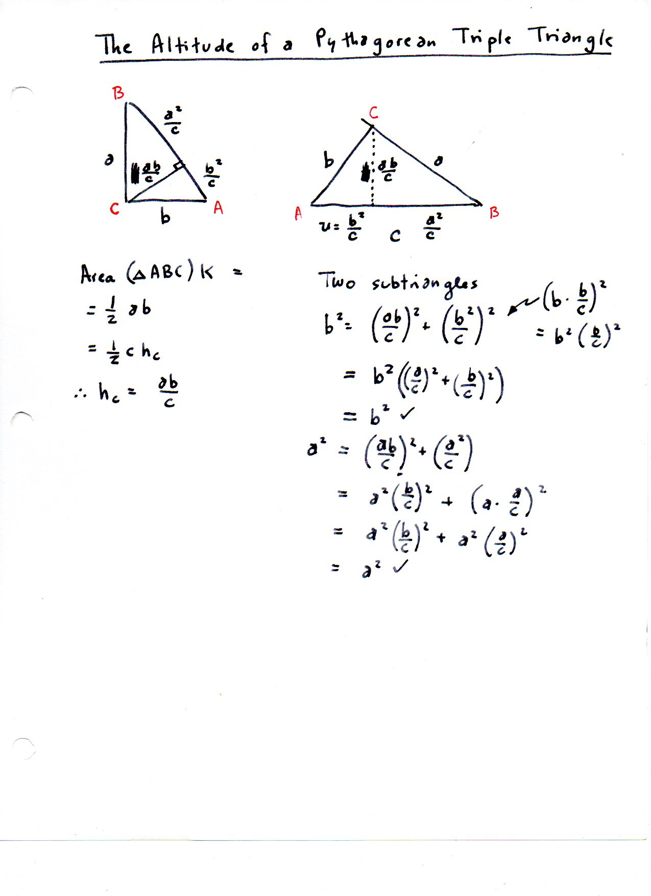
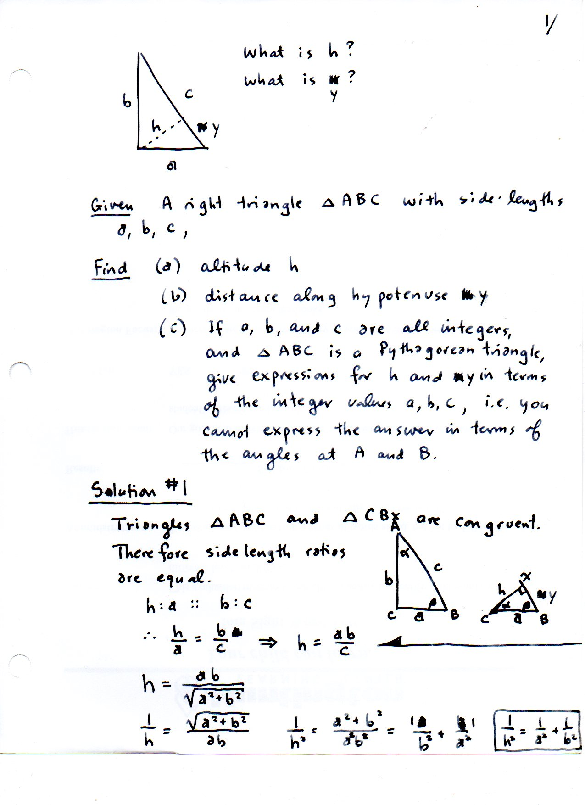
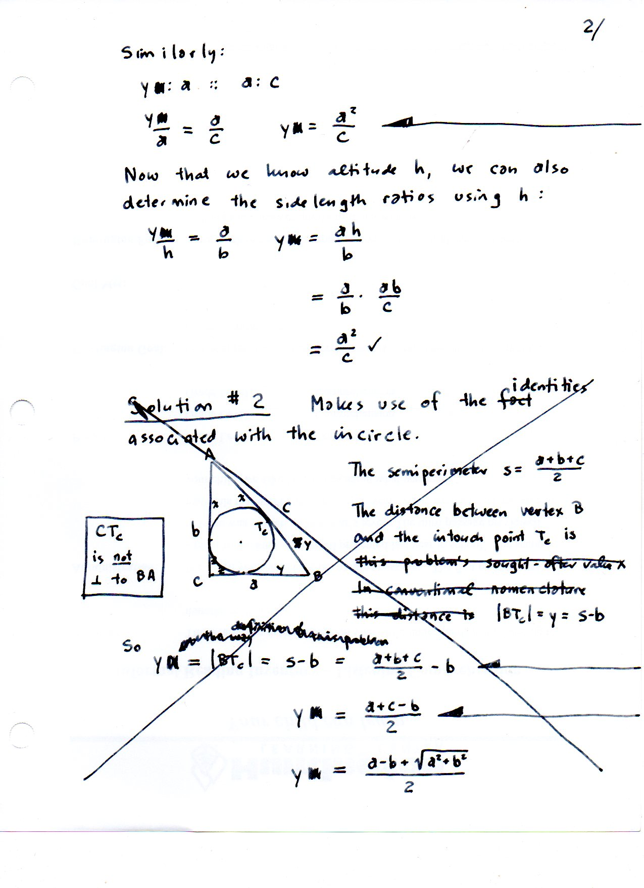
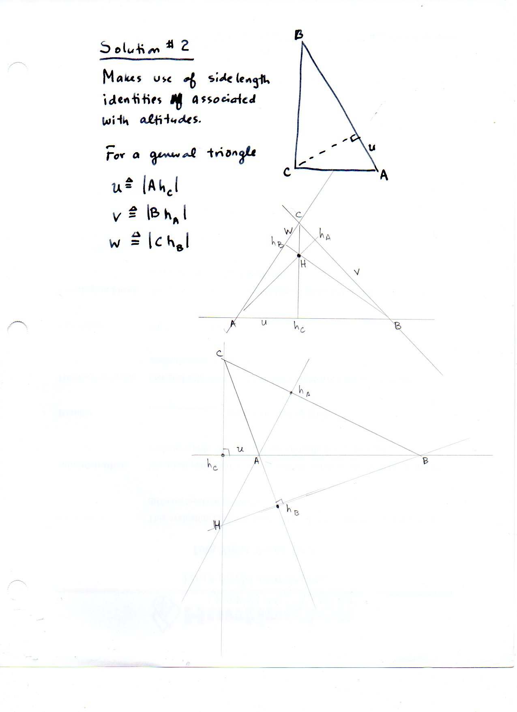

=======================================================
F.42 Altitude of a Pythagorean Triple Triangle — Folios
=======================================================

Archival manuscript scans and diplomatic transcriptions from :person:`seelig`'s
notebooks for **F.42 (Altitude of a Pythagorean Triple Triangle)** (:cite:`SeeligNotebooks`).

Folio 0267 (Page 1 of 4): Altitude of a Pythagorean Triple Triangle (001)
-------------------------------------------------------------------------

.. folio:: 0267

   Folio ``0267`` (original scan ``0267.jpg``) from ``resources/seelig/42_pythagorean-triples``.

**Diplomatic Mathematical & Geometric Transcription**

**Diplomatic Transcription — Folio 0267** (``0267.jpg``, Sheet 1 of 4):

Derives :math:`h_c = ab/c`, the Inverse Pythagorean Theorem :math:`h_c^{-2} = a^{-2} + b^{-2}`, and the hypotenuse segments :math:`u = b^2/c, y = a^2/c`.

.. math::

   h_c = \frac{a b}{c}, \qquad \frac{1}{h_c^2} = \frac{1}{a^2} + \frac{1}{b^2}, \qquad u = \frac{b^2}{c},\; y = \frac{a^2}{c},\; h_c^2 = u y

.. admonition:: Editorial & Symbolic Notes

   Archival scan ``0267.jpg`` from Fred W. Seelig's notebook dossier on **F.42 Altitude of a Pythagorean Triple Triangle** (Page 1 of 4). Companion OpenDocument worksheet(s): ``Pythagorean Triples``, ``Right Triangle``, ``Altitudes``. Classical Euclidean foundations: :ref:`I.47`, :ref:`VI.8`. Kimberling *Encyclopedia of Triangle Centers* loci: :ref:`X(1)`, :ref:`X(4)`, :ref:`X(7)`.

Folio 0268 (Page 2 of 4): Rational Evaluation on Primitive Triples (002)
------------------------------------------------------------------------

.. folio:: 0268

   Folio ``0268`` (original scan ``0268.jpg``) from ``resources/seelig/42_pythagorean-triples``.

**Diplomatic Mathematical & Geometric Transcription**

**Diplomatic Transcription — Folio 0268** (``0268.jpg``, Sheet 2 of 4):

Evaluates :math:`h_c, u, y` on :math:`(3,4,5)\mapsto (12/5, 9/5, 16/5)` and :math:`(5,12,13)\mapsto (60/13, 25/13, 144/13)`.

.. math::

   |A T_C| = s - a \neq u = \frac{b^2}{c} \quad (a \neq b), \qquad K = (s - a)(s - b) = \frac{a b}{2}

.. admonition:: Editorial & Symbolic Notes

   Archival scan ``0268.jpg`` from Fred W. Seelig's notebook dossier on **F.42 Altitude of a Pythagorean Triple Triangle** (Page 2 of 4). Companion OpenDocument worksheet(s): ``Pythagorean Triples``, ``Right Triangle``, ``Altitudes``. Classical Euclidean foundations: :ref:`I.47`, :ref:`VI.8`. Kimberling *Encyclopedia of Triangle Centers* loci: :ref:`X(1)`, :ref:`X(4)`, :ref:`X(7)`.

Folio 0269 (Page 3 of 4): Self-Corrected Fallacy Box: CT_c vs. Altitude CH_c (003)
----------------------------------------------------------------------------------

.. folio:: 0269

   Folio ``0269`` (original scan ``0269.jpg``) from ``resources/seelig/42_pythagorean-triples``.

**Diplomatic Mathematical & Geometric Transcription**

**Diplomatic Transcription — Folio 0269** (``0269.jpg``, Sheet 3 of 4):

Proves that the incircle touchpoint :math:`T_C` (:math:`|AT_C| = s-a`) is distinct from the altitude foot :math:`H_C` (:math:`|AH_C| = b^2/c`), boxing the warning *'CT_c is not \perp to BA'*.

.. math::

   h_c = \frac{a b}{c}, \qquad \frac{1}{h_c^2} = \frac{1}{a^2} + \frac{1}{b^2}, \qquad u = \frac{b^2}{c},\; y = \frac{a^2}{c},\; h_c^2 = u y

.. admonition:: Editorial & Symbolic Notes

   Archival scan ``0269.jpg`` from Fred W. Seelig's notebook dossier on **F.42 Altitude of a Pythagorean Triple Triangle** (Page 3 of 4). Companion OpenDocument worksheet(s): ``Pythagorean Triples``, ``Right Triangle``, ``Altitudes``. Classical Euclidean foundations: :ref:`I.47`, :ref:`VI.8`. Kimberling *Encyclopedia of Triangle Centers* loci: :ref:`X(1)`, :ref:`X(4)`, :ref:`X(7)`.

Folio 0270 (Page 4 of 4): Orthocentric Projection Segments (004)
----------------------------------------------------------------

.. folio:: 0270

   Folio ``0270`` (original scan ``0270.jpg``) from ``resources/seelig/42_pythagorean-triples``.

**Diplomatic Mathematical & Geometric Transcription**

**Diplomatic Transcription — Folio 0270** (``0270.jpg``, Sheet 4 of 4):

Relates the right-triangle altitude segments to the general orthocentric system of an acute/obtuse triangle.

.. math::

   |A T_C| = s - a \neq u = \frac{b^2}{c} \quad (a \neq b), \qquad K = (s - a)(s - b) = \frac{a b}{2}

.. admonition:: Editorial & Symbolic Notes

   Archival scan ``0270.jpg`` from Fred W. Seelig's notebook dossier on **F.42 Altitude of a Pythagorean Triple Triangle** (Page 4 of 4). Companion OpenDocument worksheet(s): ``Pythagorean Triples``, ``Right Triangle``, ``Altitudes``. Classical Euclidean foundations: :ref:`I.47`, :ref:`VI.8`. Kimberling *Encyclopedia of Triangle Centers* loci: :ref:`X(1)`, :ref:`X(4)`, :ref:`X(7)`.
