=============================================
F.43 Radical Axes and Radical Center — Folios
=============================================

Archival manuscript scans and diplomatic transcriptions from :person:`seelig`'s
notebooks for **F.43 (Radical Axes and Radical Center)** (:cite:`SeeligNotebooks`).

Folio 0271 (Page 1 of 11): Two-Circle Radical Axis & Equal Tangents (001)
-------------------------------------------------------------------------

.. folio:: 0271

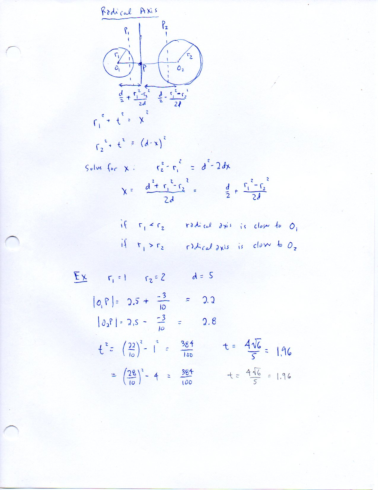

   Folio ``0271`` (original scan ``0271.jpg``) from ``resources/seelig/43_radical-axes``.

**Diplomatic Mathematical & Geometric Transcription**

**Diplomatic Transcription — Folio 0271** (``0271.jpg``, Sheet 1 of 11):

Derives :math:`x = \frac{d}{2} + \frac{r_1^2-r_2^2}{2d}` and tests :math:`r_1=1, r_2=2, d=5 \implies x=2.2, x'=2.8, t = \frac{4\sqrt{6}}{5}`.

.. math::

   x = |O_1 P| = \frac{d}{2} + \frac{r_1^2 - r_2^2}{2 d}, \qquad x' = |O_2 P| = \frac{d}{2} - \frac{r_1^2 - r_2^2}{2 d}, \qquad t^2 = x^2 - r_1^2 = {x'}^2 - r_2^2

.. admonition:: Editorial & Symbolic Notes

   Archival scan ``0271.jpg`` from Fred W. Seelig's notebook dossier on **F.43 Radical Axes and Radical Center** (Page 1 of 11). Companion OpenDocument worksheet(s): ``Radical Axes``, ``Coaxial Circles``. Classical Euclidean foundations: :ref:`II.5`, :ref:`III.36`.

Folio 0272 (Page 2 of 11): Radical Center of Vertex-Altitude Circles — Setup (002, FWS Dec. 8/2014)
---------------------------------------------------------------------------------------------------

.. folio:: 0272

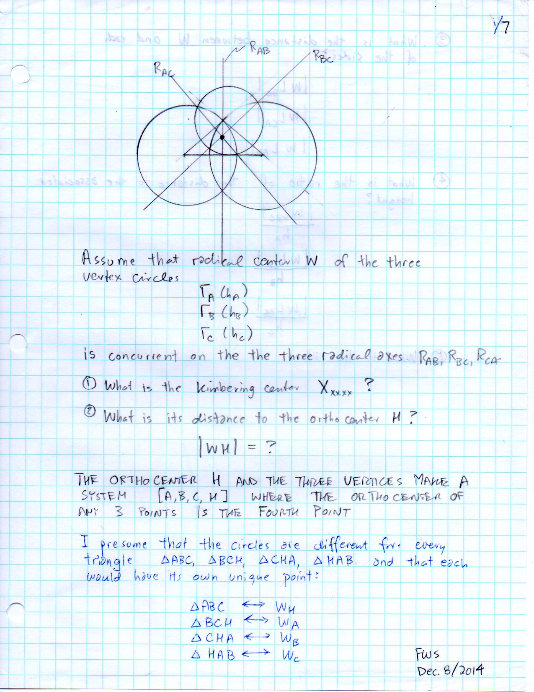

   Folio ``0272`` (original scan ``0272.jpg``) from ``resources/seelig/43_radical-axes``.

**Diplomatic Mathematical & Geometric Transcription**

**Diplomatic Transcription — Folio 0272** (``0272.jpg``, Sheet 2 of 11):

Defines circles :math:`\Gamma_A(h_A), \Gamma_B(h_B), \Gamma_C(h_C)` centered at :math:`A, B, C` with radii equal to the three altitudes.

.. math::

   \Gamma_A(A, h_A),\; \Gamma_B(B, h_B),\; \Gamma_C(C, h_C) \implies \frac{x}{x_0} + \frac{y}{y_0} = 1

.. admonition:: Editorial & Symbolic Notes

   Archival scan ``0272.jpg`` from Fred W. Seelig's notebook dossier on **F.43 Radical Axes and Radical Center** (Page 2 of 11). Companion OpenDocument worksheet(s): ``Radical Axes``, ``Coaxial Circles``. Classical Euclidean foundations: :ref:`II.5`, :ref:`III.36`.

Folio 0273 (Page 3 of 11): Radical Axis of Gamma_A and Gamma_B (003)
--------------------------------------------------------------------

.. folio:: 0273

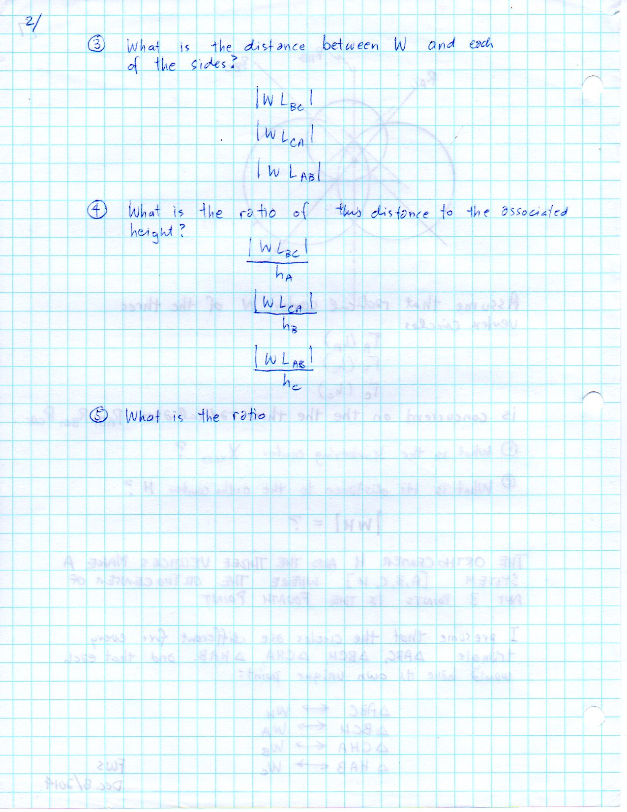

   Folio ``0273`` (original scan ``0273.jpg``) from ``resources/seelig/43_radical-axes``.

**Diplomatic Mathematical & Geometric Transcription**

**Diplomatic Transcription — Folio 0273** (``0273.jpg``, Sheet 3 of 11):

Computes the radical foot along side :math:`c = AB` and writes the perpendicular line equation.

.. math::

   x = |O_1 P| = \frac{d}{2} + \frac{r_1^2 - r_2^2}{2 d}, \qquad x' = |O_2 P| = \frac{d}{2} - \frac{r_1^2 - r_2^2}{2 d}, \qquad t^2 = x^2 - r_1^2 = {x'}^2 - r_2^2

.. admonition:: Editorial & Symbolic Notes

   Archival scan ``0273.jpg`` from Fred W. Seelig's notebook dossier on **F.43 Radical Axes and Radical Center** (Page 3 of 11). Companion OpenDocument worksheet(s): ``Radical Axes``, ``Coaxial Circles``. Classical Euclidean foundations: :ref:`II.5`, :ref:`III.36`.

Folio 0274 (Page 4 of 11): Radical Axis of Gamma_A and Gamma_C in Intercept Form (004)
--------------------------------------------------------------------------------------

.. folio:: 0274

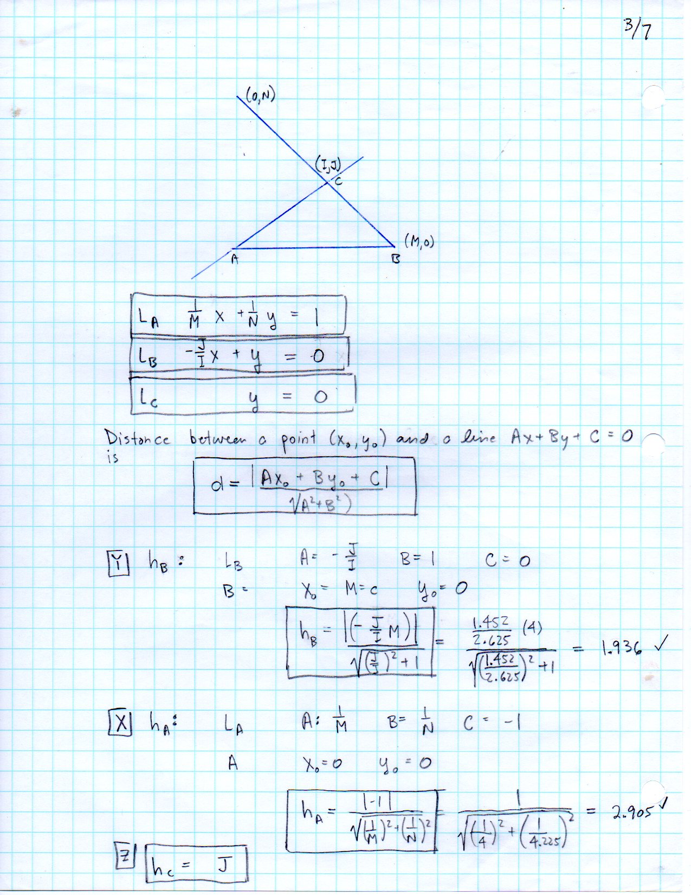

   Folio ``0274`` (original scan ``0274.jpg``) from ``resources/seelig/43_radical-axes``.

**Diplomatic Mathematical & Geometric Transcription**

**Diplomatic Transcription — Folio 0274** (``0274.jpg``, Sheet 4 of 11):

Projects the radical axis of :math:`\Gamma_A` and :math:`\Gamma_C` onto the Cartesian frame of :math:`AB` and derives :math:`x/x_0 + y/y_0 = 1`.

.. math::

   \Gamma_A(A, h_A),\; \Gamma_B(B, h_B),\; \Gamma_C(C, h_C) \implies \frac{x}{x_0} + \frac{y}{y_0} = 1

.. admonition:: Editorial & Symbolic Notes

   Archival scan ``0274.jpg`` from Fred W. Seelig's notebook dossier on **F.43 Radical Axes and Radical Center** (Page 4 of 11). Companion OpenDocument worksheet(s): ``Radical Axes``, ``Coaxial Circles``. Classical Euclidean foundations: :ref:`II.5`, :ref:`III.36`.

Folio 0275 (Page 5 of 11): Radical Axis of Gamma_B and Gamma_C (005)
--------------------------------------------------------------------

.. folio:: 0275

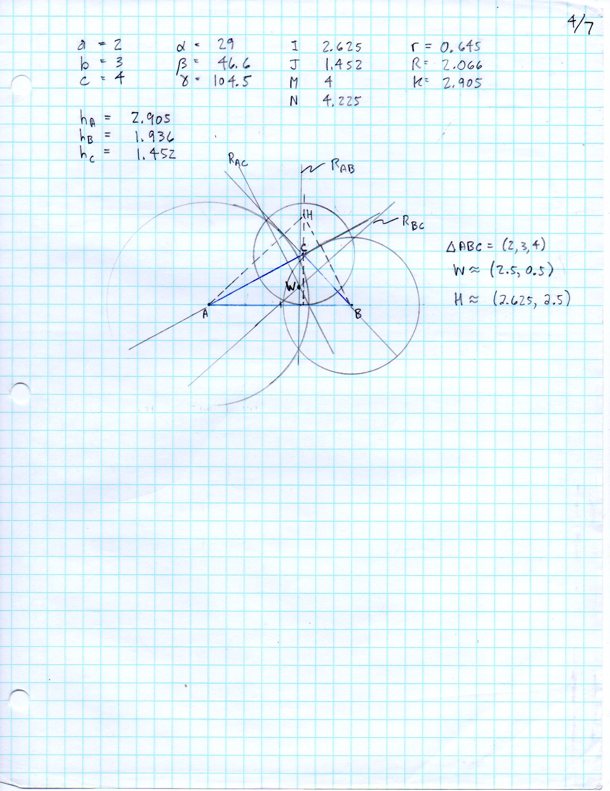

   Folio ``0275`` (original scan ``0275.jpg``) from ``resources/seelig/43_radical-axes``.

**Diplomatic Mathematical & Geometric Transcription**

**Diplomatic Transcription — Folio 0275** (``0275.jpg``, Sheet 5 of 11):

Derives the double-intercept equation for the third radical axis opposite side :math:`a = BC`.

.. math::

   x = |O_1 P| = \frac{d}{2} + \frac{r_1^2 - r_2^2}{2 d}, \qquad x' = |O_2 P| = \frac{d}{2} - \frac{r_1^2 - r_2^2}{2 d}, \qquad t^2 = x^2 - r_1^2 = {x'}^2 - r_2^2

.. admonition:: Editorial & Symbolic Notes

   Archival scan ``0275.jpg`` from Fred W. Seelig's notebook dossier on **F.43 Radical Axes and Radical Center** (Page 5 of 11). Companion OpenDocument worksheet(s): ``Radical Axes``, ``Coaxial Circles``. Classical Euclidean foundations: :ref:`II.5`, :ref:`III.36`.

Folio 0276 (Page 6 of 11): 2x2 Linear System for the Radical Center W (006)
---------------------------------------------------------------------------

.. folio:: 0276

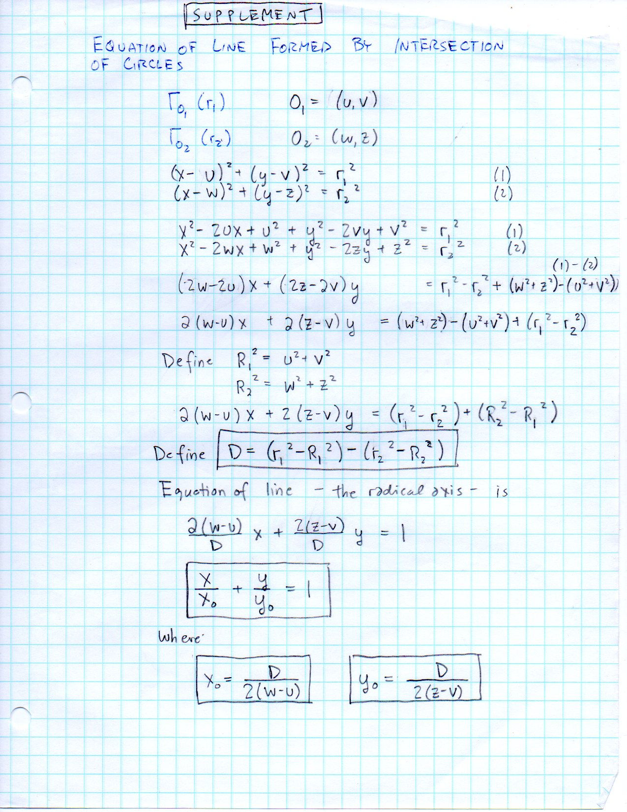

   Folio ``0276`` (original scan ``0276.jpg``) from ``resources/seelig/43_radical-axes``.

**Diplomatic Mathematical & Geometric Transcription**

**Diplomatic Transcription — Folio 0276** (``0276.jpg``, Sheet 6 of 11):

Intersects two radical axes in intercept form to solve for the radical center :math:`W = (W_x, W_y)`.

.. math::

   \Gamma_A(A, h_A),\; \Gamma_B(B, h_B),\; \Gamma_C(C, h_C) \implies \frac{x}{x_0} + \frac{y}{y_0} = 1

.. admonition:: Editorial & Symbolic Notes

   Archival scan ``0276.jpg`` from Fred W. Seelig's notebook dossier on **F.43 Radical Axes and Radical Center** (Page 6 of 11). Companion OpenDocument worksheet(s): ``Radical Axes``, ``Coaxial Circles``. Classical Euclidean foundations: :ref:`II.5`, :ref:`III.36`.

Folio 0277 (Page 7 of 11): Numerical Evaluation on the (2, 3, 4) Triangle — Part 1 (007)
----------------------------------------------------------------------------------------

.. folio:: 0277

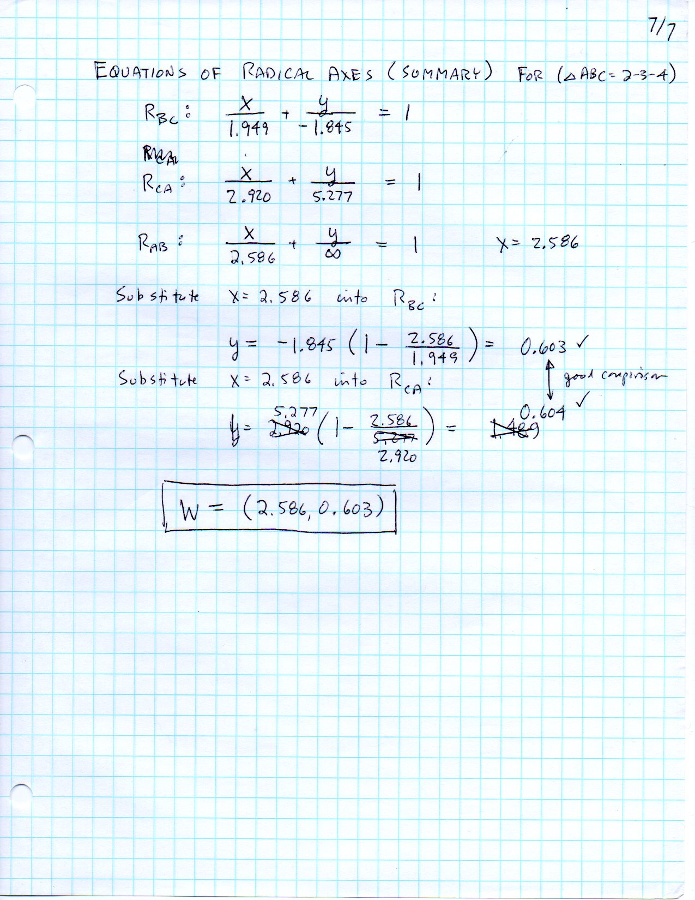

   Folio ``0277`` (original scan ``0277.jpg``) from ``resources/seelig/43_radical-axes``.

**Diplomatic Mathematical & Geometric Transcription**

**Diplomatic Transcription — Folio 0277** (``0277.jpg``, Sheet 7 of 11):

Computes the altitudes :math:`h_A, h_B, h_C` and pairwise radical intercepts of the :math:`(2,3,4)` obtuse triangle.

.. math::

   x = |O_1 P| = \frac{d}{2} + \frac{r_1^2 - r_2^2}{2 d}, \qquad x' = |O_2 P| = \frac{d}{2} - \frac{r_1^2 - r_2^2}{2 d}, \qquad t^2 = x^2 - r_1^2 = {x'}^2 - r_2^2

.. admonition:: Editorial & Symbolic Notes

   Archival scan ``0277.jpg`` from Fred W. Seelig's notebook dossier on **F.43 Radical Axes and Radical Center** (Page 7 of 11). Companion OpenDocument worksheet(s): ``Radical Axes``, ``Coaxial Circles``. Classical Euclidean foundations: :ref:`II.5`, :ref:`III.36`.

Folio 0278 (Page 8 of 11): Numerical Evaluation on the (2, 3, 4) Triangle — Part 2 (008)
----------------------------------------------------------------------------------------

.. folio:: 0278

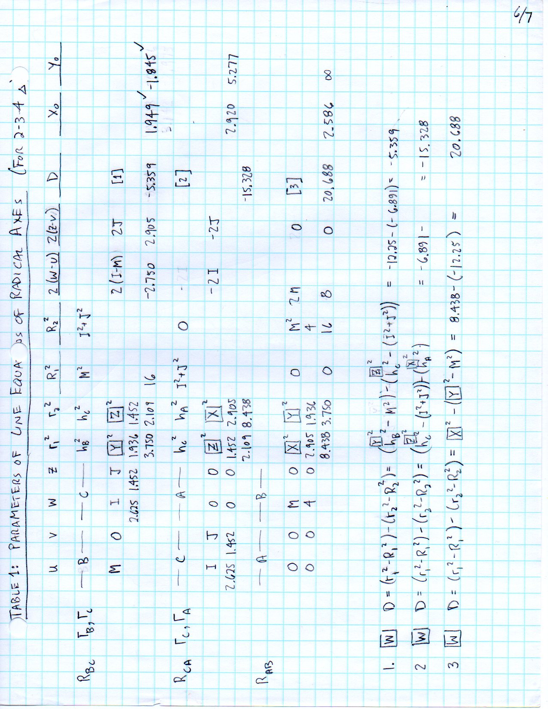

   Folio ``0278`` (original scan ``0278.jpg``) from ``resources/seelig/43_radical-axes``.

**Diplomatic Mathematical & Geometric Transcription**

**Diplomatic Transcription — Folio 0278** (``0278.jpg``, Sheet 8 of 11):

Finds the exact radical center coordinates :math:`W = (2.586, 0.603)` and verifies concurrency of all three radical axes.

.. math::

   \Gamma_A(A, h_A),\; \Gamma_B(B, h_B),\; \Gamma_C(C, h_C) \implies \frac{x}{x_0} + \frac{y}{y_0} = 1

.. admonition:: Editorial & Symbolic Notes

   Archival scan ``0278.jpg`` from Fred W. Seelig's notebook dossier on **F.43 Radical Axes and Radical Center** (Page 8 of 11). Companion OpenDocument worksheet(s): ``Radical Axes``, ``Coaxial Circles``. Classical Euclidean foundations: :ref:`II.5`, :ref:`III.36`.

Folio 0279 (Page 9 of 11): Two-Circle Separation Regimes (009)
--------------------------------------------------------------

.. folio:: 0279

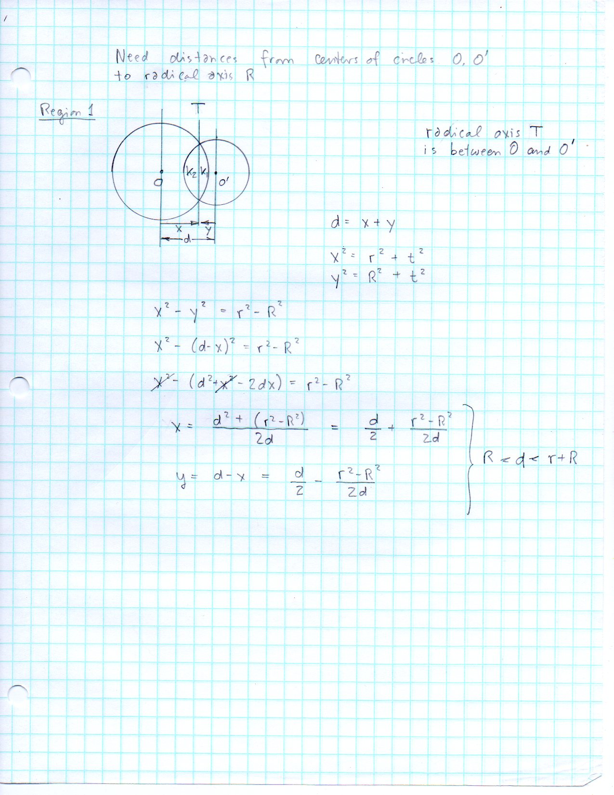

   Folio ``0279`` (original scan ``0279.jpg``) from ``resources/seelig/43_radical-axes``.

**Diplomatic Mathematical & Geometric Transcription**

**Diplomatic Transcription — Folio 0279** (``0279.jpg``, Sheet 9 of 11):

Classifies disjoint, externally tangent, intersecting, internally tangent, and nested circle pairs by comparing :math:`d` with :math:`r_1 \pm r_2`.

.. math::

   x = |O_1 P| = \frac{d}{2} + \frac{r_1^2 - r_2^2}{2 d}, \qquad x' = |O_2 P| = \frac{d}{2} - \frac{r_1^2 - r_2^2}{2 d}, \qquad t^2 = x^2 - r_1^2 = {x'}^2 - r_2^2

.. admonition:: Editorial & Symbolic Notes

   Archival scan ``0279.jpg`` from Fred W. Seelig's notebook dossier on **F.43 Radical Axes and Radical Center** (Page 9 of 11). Companion OpenDocument worksheet(s): ``Radical Axes``, ``Coaxial Circles``. Classical Euclidean foundations: :ref:`II.5`, :ref:`III.36`.

Folio 0280 (Page 10 of 11): Common Chord & Sagitta of Intersecting Circles (010)
--------------------------------------------------------------------------------

.. folio:: 0280

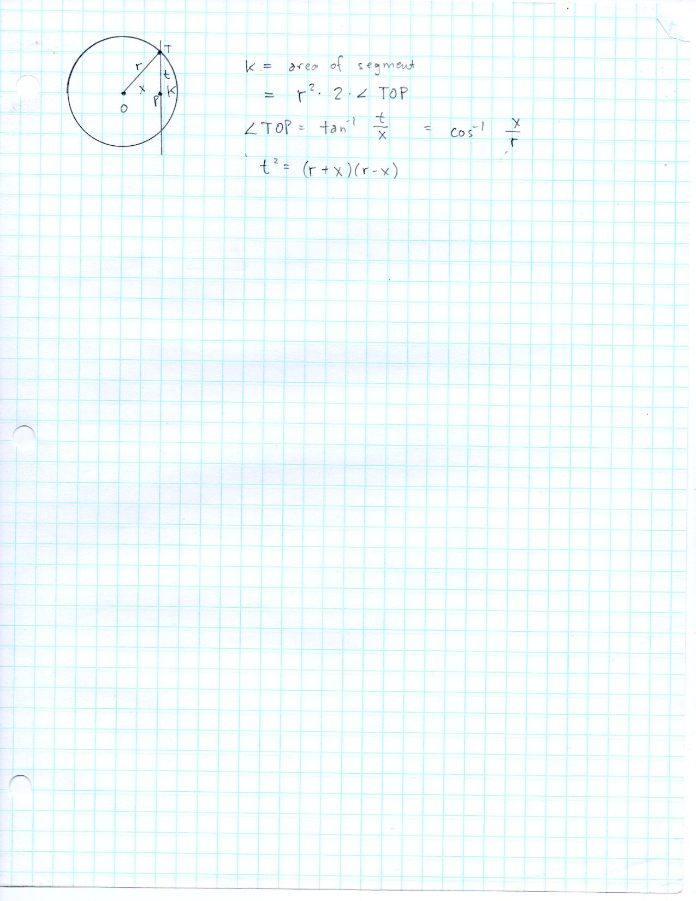

   Folio ``0280`` (original scan ``0280.jpg``) from ``resources/seelig/43_radical-axes``.

**Diplomatic Mathematical & Geometric Transcription**

**Diplomatic Transcription — Folio 0280** (``0280.jpg``, Sheet 10 of 11):

Expresses the common chord length :math:`2y = 2\sqrt{r_1^2 - x^2}` in terms of Heron's radical on :math:`(r_1, r_2, d)`.

.. math::

   \Gamma_A(A, h_A),\; \Gamma_B(B, h_B),\; \Gamma_C(C, h_C) \implies \frac{x}{x_0} + \frac{y}{y_0} = 1

.. admonition:: Editorial & Symbolic Notes

   Archival scan ``0280.jpg`` from Fred W. Seelig's notebook dossier on **F.43 Radical Axes and Radical Center** (Page 10 of 11). Companion OpenDocument worksheet(s): ``Radical Axes``, ``Coaxial Circles``. Classical Euclidean foundations: :ref:`II.5`, :ref:`III.36`.

Folio 0281 (Page 11 of 11): Circular Lens Area Formula (011)
------------------------------------------------------------

.. folio:: 0281

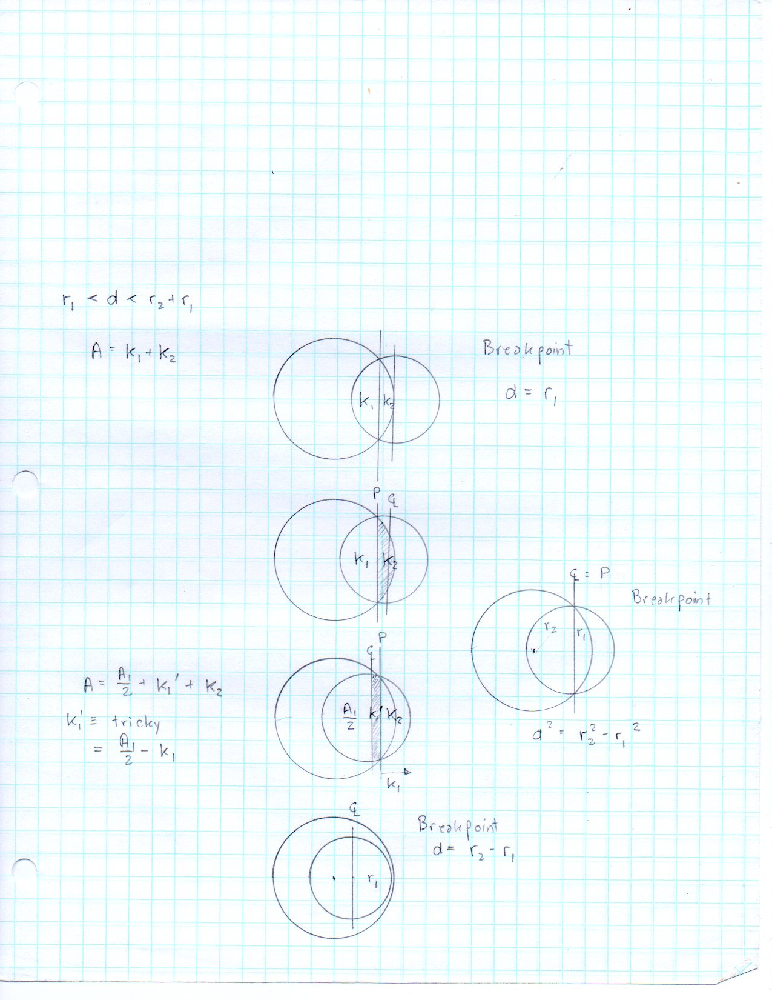

   Folio ``0281`` (original scan ``0281.jpg``) from ``resources/seelig/43_radical-axes``.

**Diplomatic Mathematical & Geometric Transcription**

**Diplomatic Transcription — Folio 0281** (``0281.jpg``, Sheet 11 of 11):

Integrates/sums the two circular sector-minus-triangle segments to obtain the asymmetric lens area.

.. math::

   x = |O_1 P| = \frac{d}{2} + \frac{r_1^2 - r_2^2}{2 d}, \qquad x' = |O_2 P| = \frac{d}{2} - \frac{r_1^2 - r_2^2}{2 d}, \qquad t^2 = x^2 - r_1^2 = {x'}^2 - r_2^2

.. admonition:: Editorial & Symbolic Notes

   Archival scan ``0281.jpg`` from Fred W. Seelig's notebook dossier on **F.43 Radical Axes and Radical Center** (Page 11 of 11). Companion OpenDocument worksheet(s): ``Radical Axes``, ``Coaxial Circles``. Classical Euclidean foundations: :ref:`II.5`, :ref:`III.36`.
