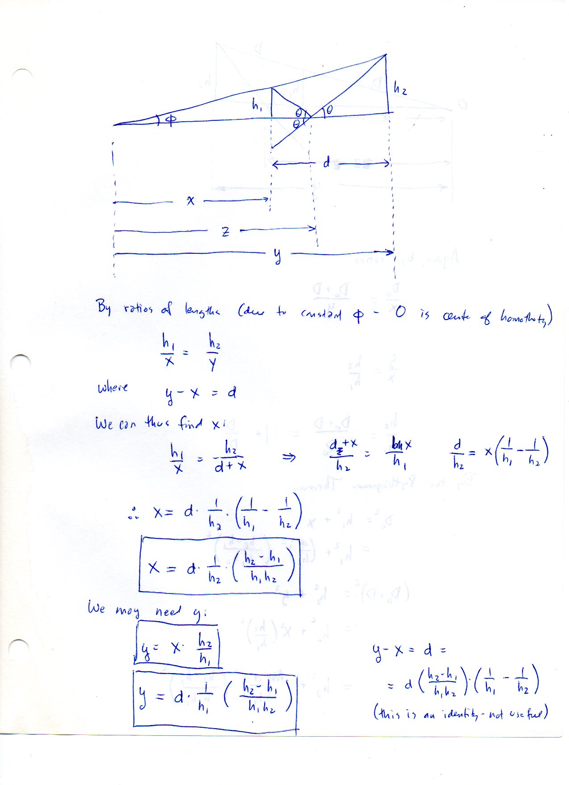
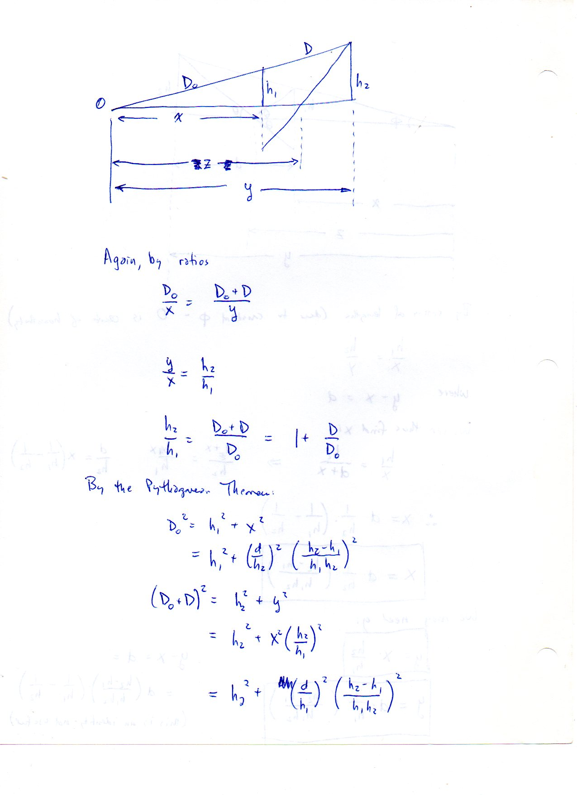
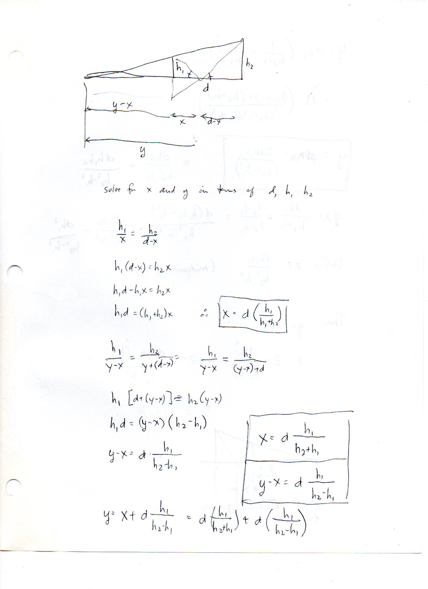
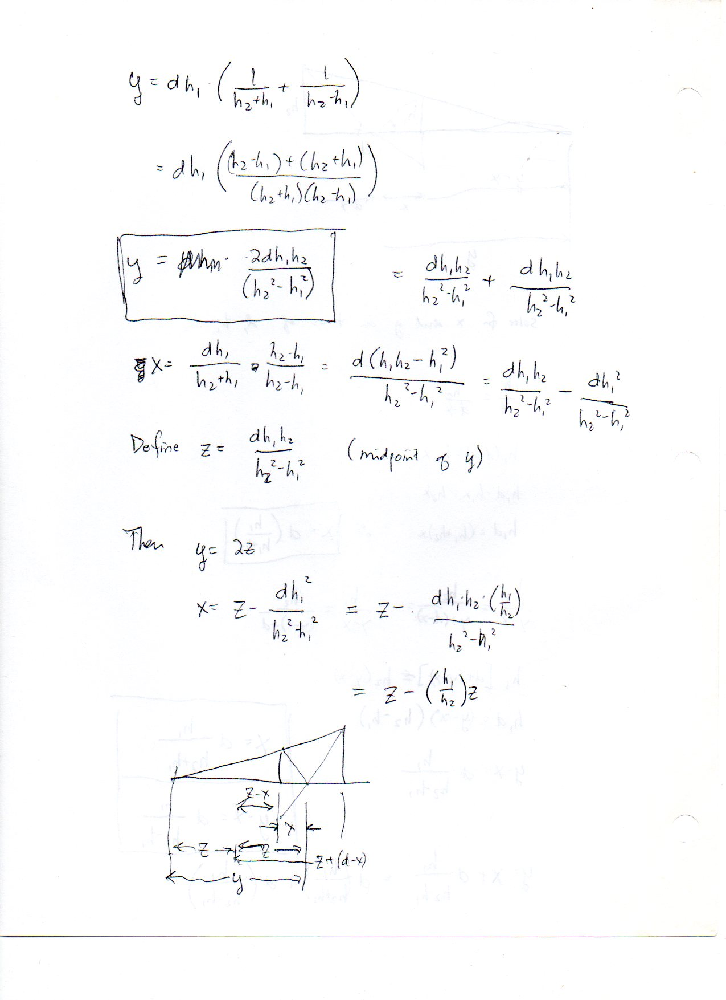
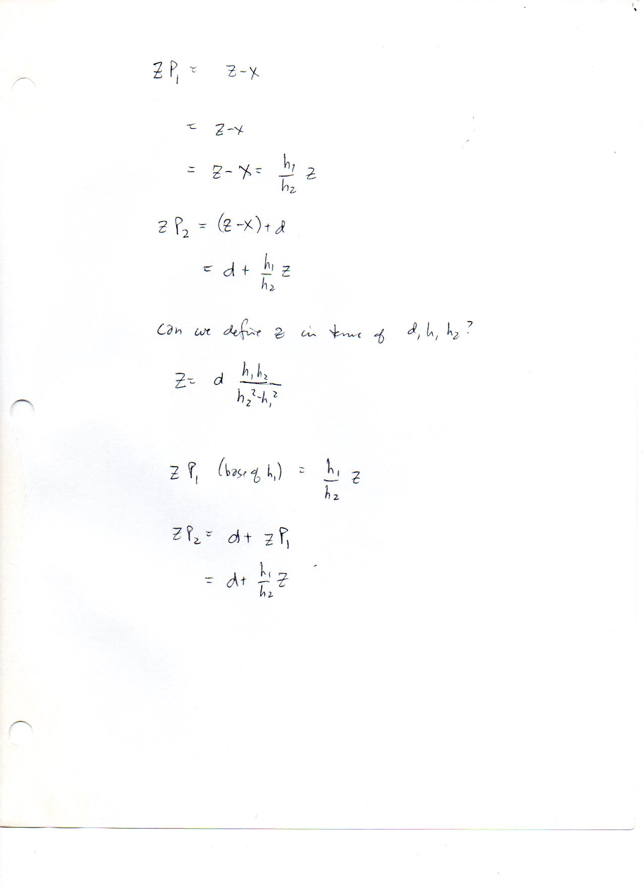

=====================================================
F.44 Homothetic Ratios and Crossed Diagonals — Folios
=====================================================

Archival manuscript scans and diplomatic transcriptions from :person:`seelig`'s
notebooks for **F.44 (Homothetic Ratios and Crossed Diagonals)** (:cite:`SeeligNotebooks`).

Folio 0282 (Page 1 of 5): Homothetic Right Triangles & Crossed Diagonals (001)
------------------------------------------------------------------------------

.. folio:: 0282

   Folio ``0282`` (original scan ``0282.jpg``) from ``resources/seelig/44_ratios``.

**Diplomatic Mathematical & Geometric Transcription**

**Diplomatic Transcription — Folio 0282** (``0282.jpg``, Sheet 1 of 5):

Sets up uprights :math:`h_1, h_2` separated by :math:`d` from apex :math:`O` (angle :math:`\phi`) and derives :math:`x = d h_1/(h_1+h_2)` and :math:`y-x = d h_1/(h_2-h_1)`.

.. math::

   x = d\frac{h_1}{h_1 + h_2}, \qquad y - x = d\frac{h_1}{h_2 - h_1}, \qquad h = \frac{h_1 h_2}{h_1 + h_2}

.. admonition:: Editorial & Symbolic Notes

   Archival scan ``0282.jpg`` from Fred W. Seelig's notebook dossier on **F.44 Homothetic Ratios and Crossed Diagonals** (Page 1 of 5). Companion OpenDocument worksheet(s): ``Centers of Similitude``, ``Harmonic Conjugates``. Classical Euclidean foundations: :ref:`VI.2`, :ref:`VI.4`.

Folio 0283 (Page 2 of 5): Total Span y & Midpoint z Between Similitude Centers (002)
------------------------------------------------------------------------------------

.. folio:: 0283

   Folio ``0283`` (original scan ``0283.jpg``) from ``resources/seelig/44_ratios``.

**Diplomatic Mathematical & Geometric Transcription**

**Diplomatic Transcription — Folio 0283** (``0283.jpg``, Sheet 2 of 5):

Combines :math:`x` and :math:`y-x` to obtain :math:`y = \frac{2dh_1h_2}{h_2^2-h_1^2}` and :math:`z = \frac{dh_1h_2}{h_2^2-h_1^2}`.

.. math::

   y = \frac{2 d h_1 h_2}{h_2^2 - h_1^2}, \qquad z = \frac{y}{2} = \frac{d h_1 h_2}{h_2^2 - h_1^2}

.. admonition:: Editorial & Symbolic Notes

   Archival scan ``0283.jpg`` from Fred W. Seelig's notebook dossier on **F.44 Homothetic Ratios and Crossed Diagonals** (Page 2 of 5). Companion OpenDocument worksheet(s): ``Centers of Similitude``, ``Harmonic Conjugates``. Classical Euclidean foundations: :ref:`VI.2`, :ref:`VI.4`.

Folio 0284 (Page 3 of 5): Crossed-Ladder Height & Harmonic Mean (003)
---------------------------------------------------------------------

.. folio:: 0284

   Folio ``0284`` (original scan ``0284.jpg``) from ``resources/seelig/44_ratios``.

**Diplomatic Mathematical & Geometric Transcription**

**Diplomatic Transcription — Folio 0284** (``0284.jpg``, Sheet 3 of 5):

Shows that the height of the crossed-diagonal intersection is :math:`h = \frac{h_1 h_2}{h_1+h_2} = \frac{1}{2}H(h_1,h_2)`, independent of :math:`d`.

.. math::

   x = d\frac{h_1}{h_1 + h_2}, \qquad y - x = d\frac{h_1}{h_2 - h_1}, \qquad h = \frac{h_1 h_2}{h_1 + h_2}

.. admonition:: Editorial & Symbolic Notes

   Archival scan ``0284.jpg`` from Fred W. Seelig's notebook dossier on **F.44 Homothetic Ratios and Crossed Diagonals** (Page 3 of 5). Companion OpenDocument worksheet(s): ``Centers of Similitude``, ``Harmonic Conjugates``. Classical Euclidean foundations: :ref:`VI.2`, :ref:`VI.4`.

Folio 0285 (Page 4 of 5): Dimensionless Ratio Parameterization k = h_2 / h_1 (004)
----------------------------------------------------------------------------------

.. folio:: 0285

   Folio ``0285`` (original scan ``0285.jpg``) from ``resources/seelig/44_ratios``.

**Diplomatic Mathematical & Geometric Transcription**

**Diplomatic Transcription — Folio 0285** (``0285.jpg``, Sheet 4 of 5):

Divides top and bottom by :math:`h_1^2` to recover the canonical Apollonian formulas :math:`x = d/(k+1), y-x = d/(k-1), z = dk/(k^2-1)`.

.. math::

   y = \frac{2 d h_1 h_2}{h_2^2 - h_1^2}, \qquad z = \frac{y}{2} = \frac{d h_1 h_2}{h_2^2 - h_1^2}

.. admonition:: Editorial & Symbolic Notes

   Archival scan ``0285.jpg`` from Fred W. Seelig's notebook dossier on **F.44 Homothetic Ratios and Crossed Diagonals** (Page 4 of 5). Companion OpenDocument worksheet(s): ``Centers of Similitude``, ``Harmonic Conjugates``. Classical Euclidean foundations: :ref:`VI.2`, :ref:`VI.4`.

Folio 0286 (Page 5 of 5): Numerical & Graphical Verification (005)
------------------------------------------------------------------

.. folio:: 0286

   Folio ``0286`` (original scan ``0286.jpg``) from ``resources/seelig/44_ratios``.

**Diplomatic Mathematical & Geometric Transcription**

**Diplomatic Transcription — Folio 0286** (``0286.jpg``, Sheet 5 of 5):

Tests the formulas on integer height pairs :math:`(h_1, h_2) = (1,2)` and :math:`(2,3)`.

.. math::

   x = d\frac{h_1}{h_1 + h_2}, \qquad y - x = d\frac{h_1}{h_2 - h_1}, \qquad h = \frac{h_1 h_2}{h_1 + h_2}

.. admonition:: Editorial & Symbolic Notes

   Archival scan ``0286.jpg`` from Fred W. Seelig's notebook dossier on **F.44 Homothetic Ratios and Crossed Diagonals** (Page 5 of 5). Companion OpenDocument worksheet(s): ``Centers of Similitude``, ``Harmonic Conjugates``. Classical Euclidean foundations: :ref:`VI.2`, :ref:`VI.4`.
