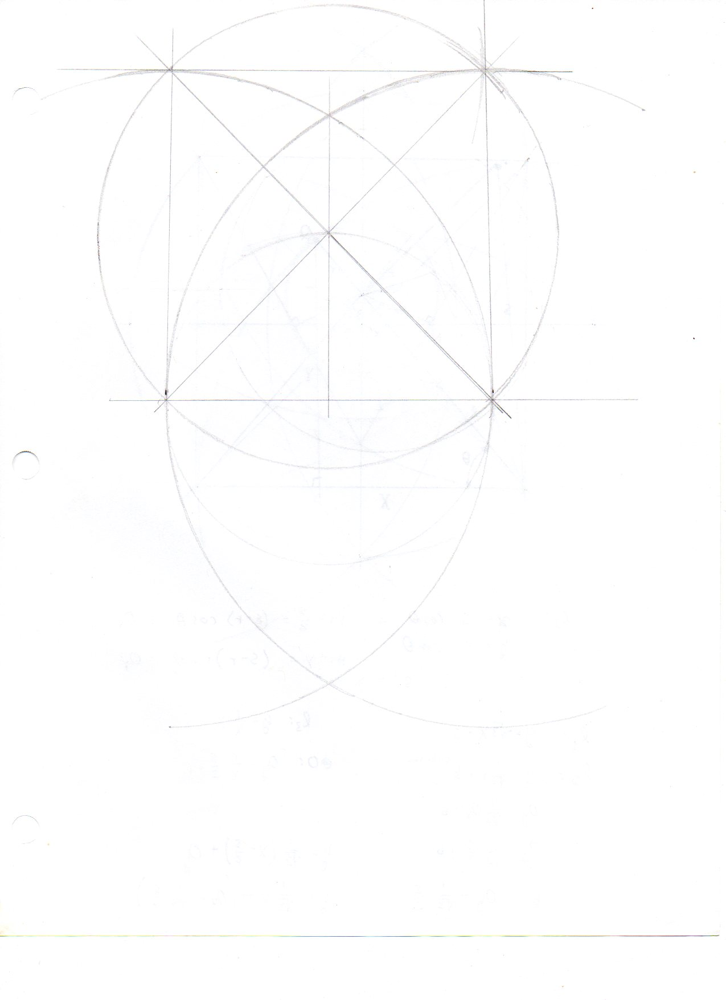
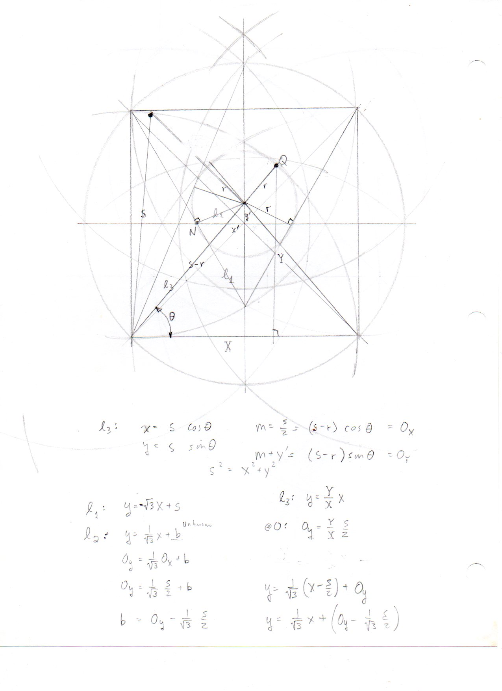
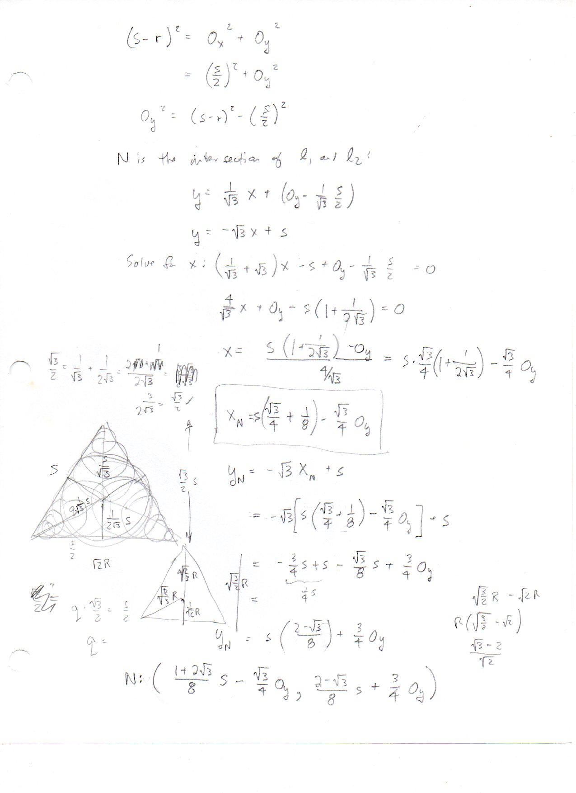
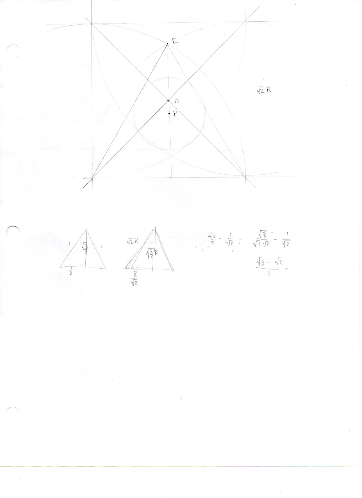
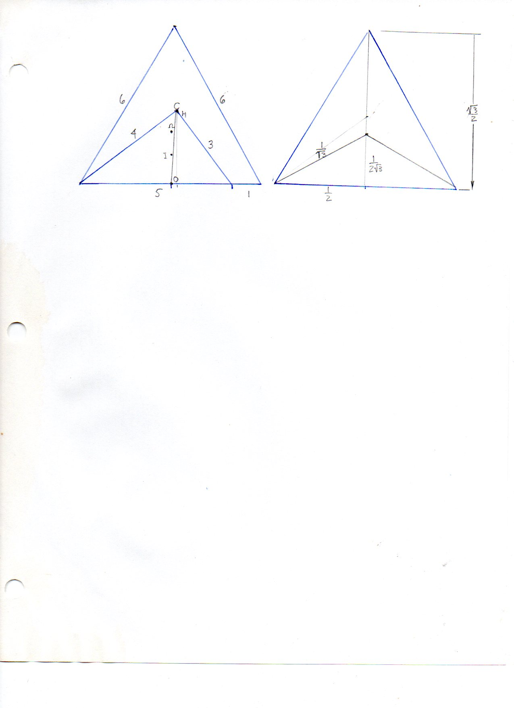
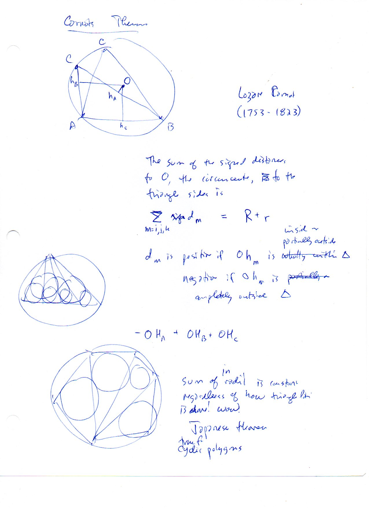

====================================================================
F.45 Squares, Subdivided Lattices, and the Japanese Theorem — Folios
====================================================================

Archival manuscript scans and diplomatic transcriptions from :person:`seelig`'s
notebooks for **F.45 (Squares, Subdivided Lattices, and the Japanese Theorem)** (:cite:`SeeligNotebooks`).

Folio 0287 (Page 1 of 6): Compass Construction of Inscribed Square & Equilateral Triangle (001)
-----------------------------------------------------------------------------------------------

.. folio:: 0287

   Folio ``0287`` (original scan ``0287.jpg``) from ``resources/seelig/45_squares``.

**Diplomatic Mathematical & Geometric Transcription**

**Diplomatic Transcription — Folio 0287** (``0287.jpg``, Sheet 1 of 6):

Inscribes a square of side :math:`\sqrt{2}R` and an equilateral triangle of side :math:`\sqrt{3}R` inside a circle of radius :math:`R`.

.. math::

   s_{\square} = \sqrt{2}\,R, \qquad s_{\triangle} = \sqrt{3}\,R, \qquad OM_A + OM_B + OM_C = R + r

.. admonition:: Editorial & Symbolic Notes

   Archival scan ``0287.jpg`` from Fred W. Seelig's notebook dossier on **F.45 Squares, Subdivided Lattices, and the Japanese Theorem** (Page 1 of 6). Companion OpenDocument worksheet(s): ``Polygon Table``, ``General Reference``. Classical Euclidean foundations: :ref:`IV.6`, :ref:`IV.7`.

Folio 0288 (Page 2 of 6): Line Intersection N Inside a Square — Setup (002)
---------------------------------------------------------------------------

.. folio:: 0288

   Folio ``0288`` (original scan ``0288.jpg``) from ``resources/seelig/45_squares``.

**Diplomatic Mathematical & Geometric Transcription**

**Diplomatic Transcription — Folio 0288** (``0288.jpg``, Sheet 2 of 6):

Sets up a square of side :math:`s` on Cartesian axes and writes the two-intercept equations of intersecting cevians meeting at :math:`N = (X_N, Y_N)`.

.. math::

   X_N = \frac{s \cdot u v}{u + v - u v}, \qquad Y_N = \frac{s \cdot u (1 - v)}{u + v - u v}

.. admonition:: Editorial & Symbolic Notes

   Archival scan ``0288.jpg`` from Fred W. Seelig's notebook dossier on **F.45 Squares, Subdivided Lattices, and the Japanese Theorem** (Page 2 of 6). Companion OpenDocument worksheet(s): ``Polygon Table``, ``General Reference``. Classical Euclidean foundations: :ref:`IV.6`, :ref:`IV.7`.

Folio 0289 (Page 3 of 6): Line Intersection N Inside a Square — Solution (003)
------------------------------------------------------------------------------

.. folio:: 0289

   Folio ``0289`` (original scan ``0289.jpg``) from ``resources/seelig/45_squares``.

**Diplomatic Mathematical & Geometric Transcription**

**Diplomatic Transcription — Folio 0289** (``0289.jpg``, Sheet 3 of 6):

Solves the :math:`2\times 2` linear system for :math:`(X_N, Y_N)` and computes the areas of the four resulting sub-regions.

.. math::

   s_{\square} = \sqrt{2}\,R, \qquad s_{\triangle} = \sqrt{3}\,R, \qquad OM_A + OM_B + OM_C = R + r

.. admonition:: Editorial & Symbolic Notes

   Archival scan ``0289.jpg`` from Fred W. Seelig's notebook dossier on **F.45 Squares, Subdivided Lattices, and the Japanese Theorem** (Page 3 of 6). Companion OpenDocument worksheet(s): ``Polygon Table``, ``General Reference``. Classical Euclidean foundations: :ref:`IV.6`, :ref:`IV.7`.

Folio 0290 (Page 4 of 6): Subdivided Square & Circle Packing Sketch (004)
-------------------------------------------------------------------------

.. folio:: 0290

   Folio ``0290`` (original scan ``0290.jpg``) from ``resources/seelig/45_squares``.

**Diplomatic Mathematical & Geometric Transcription**

**Diplomatic Transcription — Folio 0290** (``0290.jpg``, Sheet 4 of 6):

Sketches nested squares and inscribed circles scaling by powers of :math:`1/\sqrt{2}`.

.. math::

   X_N = \frac{s \cdot u v}{u + v - u v}, \qquad Y_N = \frac{s \cdot u (1 - v)}{u + v - u v}

.. admonition:: Editorial & Symbolic Notes

   Archival scan ``0290.jpg`` from Fred W. Seelig's notebook dossier on **F.45 Squares, Subdivided Lattices, and the Japanese Theorem** (Page 4 of 6). Companion OpenDocument worksheet(s): ``Polygon Table``, ``General Reference``. Classical Euclidean foundations: :ref:`IV.6`, :ref:`IV.7`.

Folio 0291 (Page 5 of 6): Subdivided Equilateral Triangles of Sides 6 and 1 (005)
---------------------------------------------------------------------------------

.. folio:: 0291

   Folio ``0291`` (original scan ``0291.jpg``) from ``resources/seelig/45_squares``.

**Diplomatic Mathematical & Geometric Transcription**

**Diplomatic Transcription — Folio 0291** (``0291.jpg``, Sheet 5 of 6):

Partitions an equilateral triangle of side 6 into 36 unit equilateral triangles and computes sub-triangle altitudes and centroids.

.. math::

   s_{\square} = \sqrt{2}\,R, \qquad s_{\triangle} = \sqrt{3}\,R, \qquad OM_A + OM_B + OM_C = R + r

.. admonition:: Editorial & Symbolic Notes

   Archival scan ``0291.jpg`` from Fred W. Seelig's notebook dossier on **F.45 Squares, Subdivided Lattices, and the Japanese Theorem** (Page 5 of 6). Companion OpenDocument worksheet(s): ``Polygon Table``, ``General Reference``. Classical Euclidean foundations: :ref:`IV.6`, :ref:`IV.7`.

Folio 0292 (Page 6 of 6): Carnot's Theorem & the Japanese Sangaku Theorem (006)
-------------------------------------------------------------------------------

.. folio:: 0292

   Folio ``0292`` (original scan ``0292.jpg``) from ``resources/seelig/45_squares``.

**Diplomatic Mathematical & Geometric Transcription**

**Diplomatic Transcription — Folio 0292** (``0292.jpg``, Sheet 6 of 6):

Recalls :math:`OM_A + OM_B + OM_C = R + r` and explains how summing over a cyclic polygon triangulation proves the invariance of the inradii sum.

.. math::

   X_N = \frac{s \cdot u v}{u + v - u v}, \qquad Y_N = \frac{s \cdot u (1 - v)}{u + v - u v}

.. admonition:: Editorial & Symbolic Notes

   Archival scan ``0292.jpg`` from Fred W. Seelig's notebook dossier on **F.45 Squares, Subdivided Lattices, and the Japanese Theorem** (Page 6 of 6). Companion OpenDocument worksheet(s): ``Polygon Table``, ``General Reference``. Classical Euclidean foundations: :ref:`IV.6`, :ref:`IV.7`.
