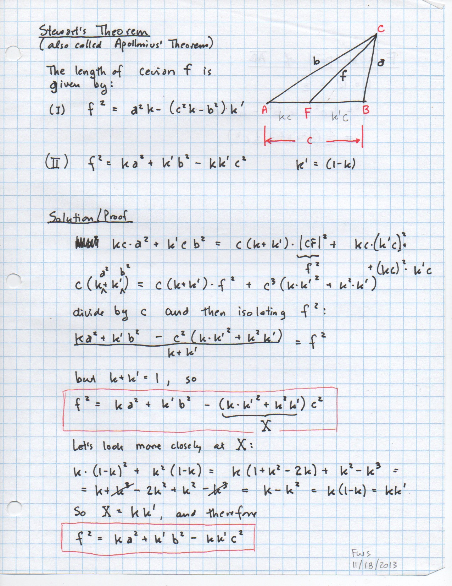
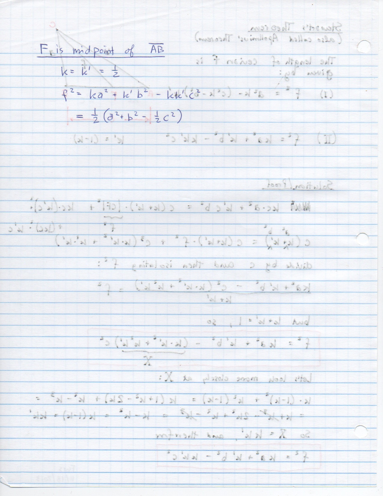

===============================
F.46 Stewart's Theorem — Folios
===============================

Archival manuscript scans and diplomatic transcriptions from :person:`seelig`'s
notebooks for **F.46 (Stewart's Theorem)** (:cite:`SeeligNotebooks`).

Folio 0293 (Page 1 of 2): Stewart's Theorem Proof (stewart-001, FWS 11/18/2013)
-------------------------------------------------------------------------------

.. folio:: 0293

   Folio ``0293`` (original scan ``0293.jpg``) from ``resources/seelig/46_stewarts-theorem``.

**Diplomatic Mathematical & Geometric Transcription**

**Diplomatic Transcription — Folio 0293** (``0293.jpg``, Sheet 1 of 2):

Defines dimensionless base fractions :math:`k, k'` (:math:`k+k'=1`) for cevian :math:`f = |CD|` and eliminates :math:`\cos\theta` between :math:`\triangle ACD` and :math:`\triangle BCD` to prove :math:`f^2 = k a^2 + k' b^2 - k k' c^2`.

.. math::

   f^2 = k a^2 + k' b^2 - k k' c^2 \qquad (k + k' = 1,\; |AD| = k' c,\; |DB| = k c)

.. admonition:: Editorial & Symbolic Notes

   Archival scan ``0293.jpg`` from Fred W. Seelig's notebook dossier on **F.46 Stewart's Theorem** (Page 1 of 2). Companion OpenDocument worksheet(s): ``Stewart's Theorem``, ``Ceva & Menelaus``, ``Centroid``. Classical Euclidean foundations: :ref:`II.12`, :ref:`II.13`. Kimberling *Encyclopedia of Triangle Centers* loci: :ref:`X(2)`.

Folio 0294 (Page 2 of 2): Apollonius's Median Formula as Special Case (stewart-002)
-----------------------------------------------------------------------------------

.. folio:: 0294

   Folio ``0294`` (original scan ``0294.jpg``) from ``resources/seelig/46_stewarts-theorem``.

**Diplomatic Mathematical & Geometric Transcription**

**Diplomatic Transcription — Folio 0294** (``0294.jpg``, Sheet 2 of 2):

Evaluates Stewart's identity at the midpoint :math:`k = k' = 1/2` to obtain :math:`f^2 = \frac{1}{2}(a^2 + b^2 - \frac{1}{2}c^2)`.

.. math::

   k = k' = \frac{1}{2} \implies m_c^2 = \frac{1}{2}\left(a^2 + b^2 - \frac{1}{2}c^2\right) = \frac{2 a^2 + 2 b^2 - c^2}{4}

.. admonition:: Editorial & Symbolic Notes

   Archival scan ``0294.jpg`` from Fred W. Seelig's notebook dossier on **F.46 Stewart's Theorem** (Page 2 of 2). Companion OpenDocument worksheet(s): ``Stewart's Theorem``, ``Ceva & Menelaus``, ``Centroid``. Classical Euclidean foundations: :ref:`II.12`, :ref:`II.13`. Kimberling *Encyclopedia of Triangle Centers* loci: :ref:`X(2)`.
