=========================================
F.47 The UVW Coordinate Triangle — Folios
=========================================

Archival manuscript scans and diplomatic transcriptions from :person:`seelig`'s
notebooks for **F.47 (The UVW Coordinate Triangle)** (:cite:`SeeligNotebooks`).

Folio 0295 (Page 1 of 11): The UVW Triangle — Coordinate & Intercept Setup (001)
--------------------------------------------------------------------------------

.. folio:: 0295

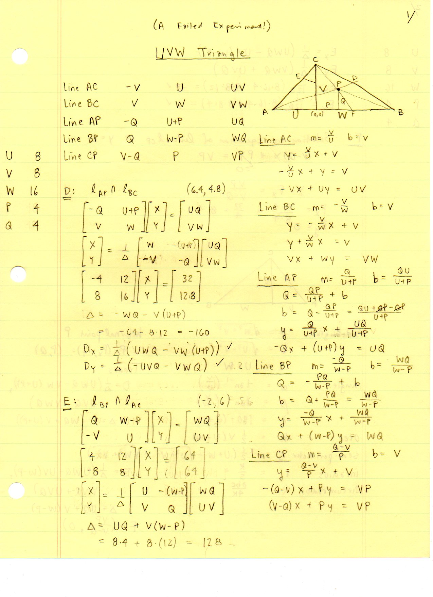

   Folio ``0295`` (original scan ``0295.jpg``) from ``resources/seelig/47_u-v-w``.

**Diplomatic Mathematical & Geometric Transcription**

**Diplomatic Transcription — Folio 0295** (``0295.jpg``, Sheet 1 of 11):

Places :math:`A=(-U,0), B=(W,0), C=(0,V)` around the altitude foot :math:`(0,0)` and writes the intercept equations of sides :math:`AC` and :math:`BC`.

.. math::

   A = (-U, 0), \qquad B = (W, 0), \qquad C = (0, V), \qquad a^2 = V^2 + W^2,\; b^2 = U^2 + V^2,\; c = U + W

.. admonition:: Editorial & Symbolic Notes

   Archival scan ``0295.jpg`` from Fred W. Seelig's notebook dossier on **F.47 The UVW Coordinate Triangle** (Page 1 of 11). Companion OpenDocument worksheet(s): ``UVW Triangle``, ``Ceva & Menelaus``. Classical Euclidean foundations: :ref:`I.47`, :ref:`VI.2`. Kimberling *Encyclopedia of Triangle Centers* loci: :ref:`X(2)`, :ref:`X(4)`.

Folio 0296 (Page 2 of 11): 2x2 Matrix System for Cevian Trace D (002)
---------------------------------------------------------------------

.. folio:: 0296

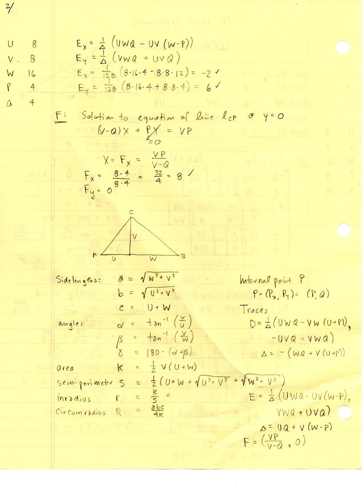

   Folio ``0296`` (original scan ``0296.jpg``) from ``resources/seelig/47_u-v-w``.

**Diplomatic Mathematical & Geometric Transcription**

**Diplomatic Transcription — Folio 0296** (``0296.jpg``, Sheet 2 of 11):

Intersects line :math:`AP` through :math:`P(p,q)` with side :math:`BC` via Cramer's rule to solve for :math:`D = (D_x, D_y)`.

.. math::

   F_x = \frac{p V}{V - q}, \qquad D = \left(\frac{W V (U + p)}{V(U + W) + q W},\; \frac{V q (U + W)}{V(U + W) + q W}\right)

.. admonition:: Editorial & Symbolic Notes

   Archival scan ``0296.jpg`` from Fred W. Seelig's notebook dossier on **F.47 The UVW Coordinate Triangle** (Page 2 of 11). Companion OpenDocument worksheet(s): ``UVW Triangle``, ``Ceva & Menelaus``. Classical Euclidean foundations: :ref:`I.47`, :ref:`VI.2`. Kimberling *Encyclopedia of Triangle Centers* loci: :ref:`X(2)`, :ref:`X(4)`.

Folio 0297 (Page 3 of 11): Heronian Juxtaposition Example (U, V, W) = (5, 12, 16) — Page 1 (003)
------------------------------------------------------------------------------------------------

.. folio:: 0297

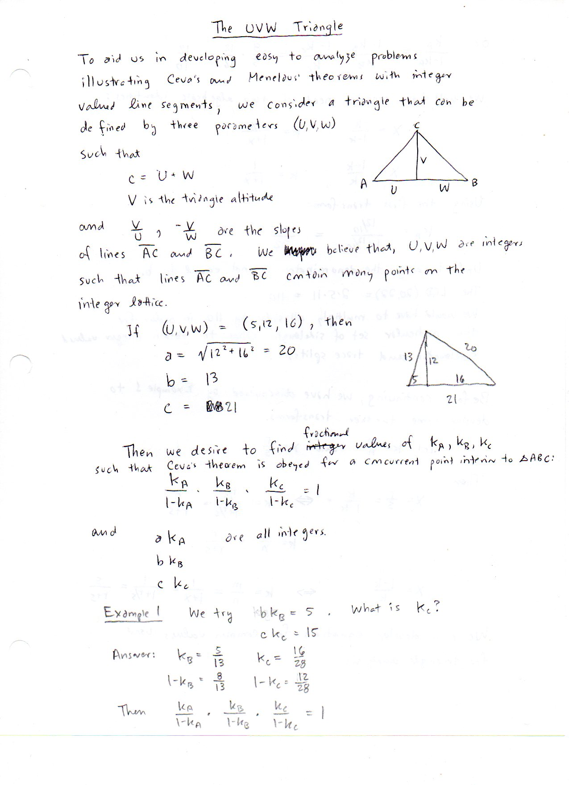

   Folio ``0297`` (original scan ``0297.jpg``) from ``resources/seelig/47_u-v-w``.

**Diplomatic Mathematical & Geometric Transcription**

**Diplomatic Transcription — Folio 0297** (``0297.jpg``, Sheet 3 of 11):

Combines :math:`(5,12,13)` and :math:`(12,16,20)` along shared altitude :math:`V=12` to form the :math:`(20,13,21)` Heronian triangle (:math:`K=126`).

.. math::

   A = (-U, 0), \qquad B = (W, 0), \qquad C = (0, V), \qquad a^2 = V^2 + W^2,\; b^2 = U^2 + V^2,\; c = U + W

.. admonition:: Editorial & Symbolic Notes

   Archival scan ``0297.jpg`` from Fred W. Seelig's notebook dossier on **F.47 The UVW Coordinate Triangle** (Page 3 of 11). Companion OpenDocument worksheet(s): ``UVW Triangle``, ``Ceva & Menelaus``. Classical Euclidean foundations: :ref:`I.47`, :ref:`VI.2`. Kimberling *Encyclopedia of Triangle Centers* loci: :ref:`X(2)`, :ref:`X(4)`.

Folio 0298 (Page 4 of 11): Heronian Juxtaposition Example — Centers & Radii (004)
---------------------------------------------------------------------------------

.. folio:: 0298

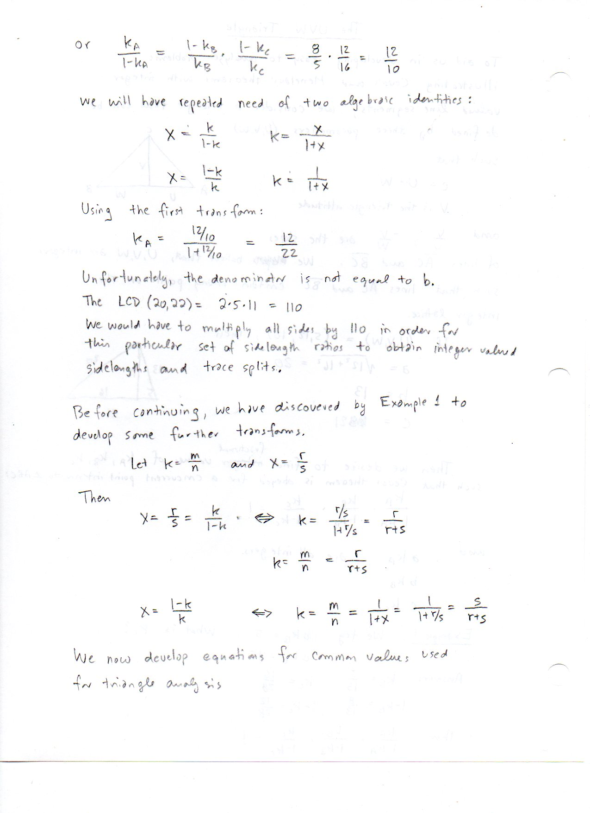

   Folio ``0298`` (original scan ``0298.jpg``) from ``resources/seelig/47_u-v-w``.

**Diplomatic Mathematical & Geometric Transcription**

**Diplomatic Transcription — Folio 0298** (``0298.jpg``, Sheet 4 of 11):

Computes :math:`s=27, r = 14/3, R = 65/6`, and the coordinates of :math:`G, I, O, H` in the :math:`(5,12,16)` UVW frame.

.. math::

   F_x = \frac{p V}{V - q}, \qquad D = \left(\frac{W V (U + p)}{V(U + W) + q W},\; \frac{V q (U + W)}{V(U + W) + q W}\right)

.. admonition:: Editorial & Symbolic Notes

   Archival scan ``0298.jpg`` from Fred W. Seelig's notebook dossier on **F.47 The UVW Coordinate Triangle** (Page 4 of 11). Companion OpenDocument worksheet(s): ``UVW Triangle``, ``Ceva & Menelaus``. Classical Euclidean foundations: :ref:`I.47`, :ref:`VI.2`. Kimberling *Encyclopedia of Triangle Centers* loci: :ref:`X(2)`, :ref:`X(4)`.

Folio 0299 (Page 5 of 11): 2x2 Matrix System for Cevian Trace E (005)
---------------------------------------------------------------------

.. folio:: 0299

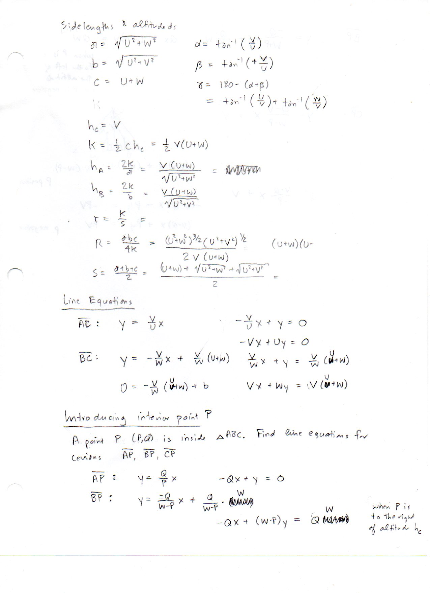

   Folio ``0299`` (original scan ``0299.jpg``) from ``resources/seelig/47_u-v-w``.

**Diplomatic Mathematical & Geometric Transcription**

**Diplomatic Transcription — Folio 0299** (``0299.jpg``, Sheet 5 of 11):

Intersects line :math:`BP` with side :math:`AC` to derive the closed-form coordinates of :math:`E = (E_x, E_y)`.

.. math::

   A = (-U, 0), \qquad B = (W, 0), \qquad C = (0, V), \qquad a^2 = V^2 + W^2,\; b^2 = U^2 + V^2,\; c = U + W

.. admonition:: Editorial & Symbolic Notes

   Archival scan ``0299.jpg`` from Fred W. Seelig's notebook dossier on **F.47 The UVW Coordinate Triangle** (Page 5 of 11). Companion OpenDocument worksheet(s): ``UVW Triangle``, ``Ceva & Menelaus``. Classical Euclidean foundations: :ref:`I.47`, :ref:`VI.2`. Kimberling *Encyclopedia of Triangle Centers* loci: :ref:`X(2)`, :ref:`X(4)`.

Folio 0300 (Page 6 of 11): Cevian Trace F on the Baseline & Ceva Ratios (006)
-----------------------------------------------------------------------------

.. folio:: 0300

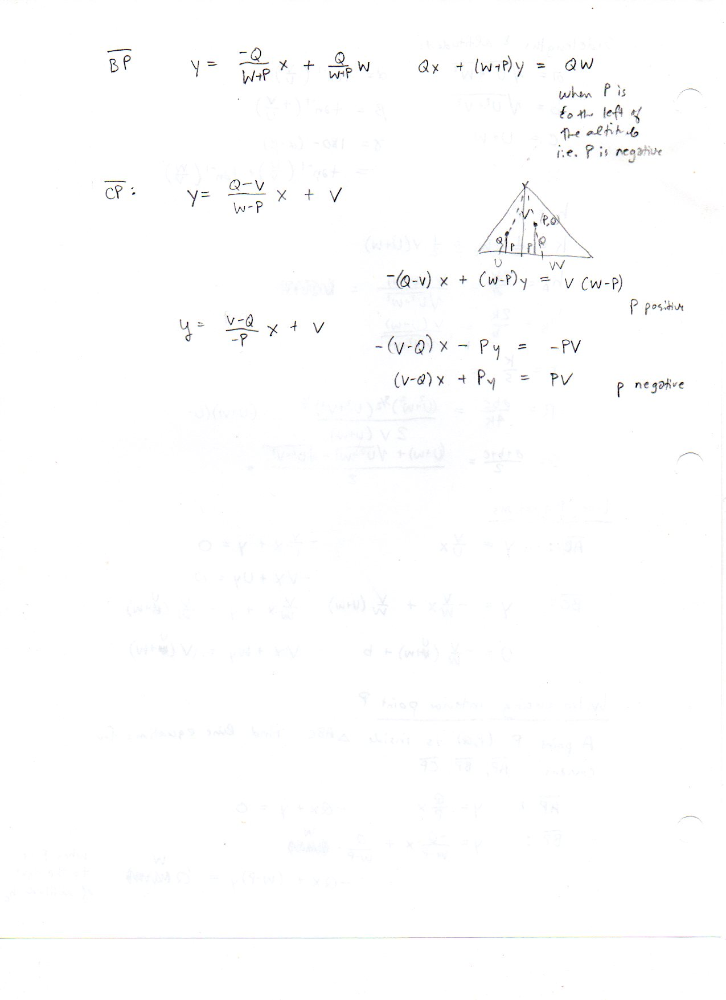

   Folio ``0300`` (original scan ``0300.jpg``) from ``resources/seelig/47_u-v-w``.

**Diplomatic Mathematical & Geometric Transcription**

**Diplomatic Transcription — Folio 0300** (``0300.jpg``, Sheet 6 of 11):

Finds :math:`F = (pV/(V-q), 0)` on the :math:`x`-axis and computes the signed Ceva ratios along all three sides.

.. math::

   F_x = \frac{p V}{V - q}, \qquad D = \left(\frac{W V (U + p)}{V(U + W) + q W},\; \frac{V q (U + W)}{V(U + W) + q W}\right)

.. admonition:: Editorial & Symbolic Notes

   Archival scan ``0300.jpg`` from Fred W. Seelig's notebook dossier on **F.47 The UVW Coordinate Triangle** (Page 6 of 11). Companion OpenDocument worksheet(s): ``UVW Triangle``, ``Ceva & Menelaus``. Classical Euclidean foundations: :ref:`I.47`, :ref:`VI.2`. Kimberling *Encyclopedia of Triangle Centers* loci: :ref:`X(2)`, :ref:`X(4)`.

Folio 0301 (Page 7 of 11): Worked Benchmark (U, V, W, p, q) = (8, 8, 16, 4, 4) — Page 1 (007)
---------------------------------------------------------------------------------------------

.. folio:: 0301

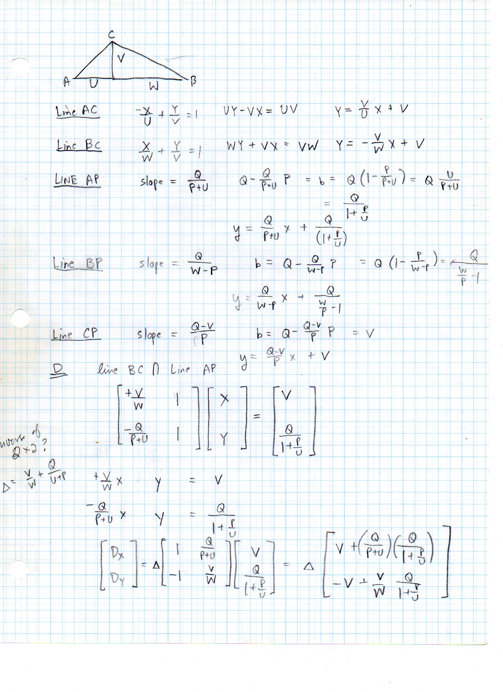

   Folio ``0301`` (original scan ``0301.jpg``) from ``resources/seelig/47_u-v-w``.

**Diplomatic Mathematical & Geometric Transcription**

**Diplomatic Transcription — Folio 0301** (``0301.jpg``, Sheet 7 of 11):

Evaluates the matrix formulas at :math:`U=8, V=8, W=16, P=(4,4)` to obtain :math:`D=(6.4, 4.8), E=(-2, 6), F=(8, 0)`.

.. math::

   A = (-U, 0), \qquad B = (W, 0), \qquad C = (0, V), \qquad a^2 = V^2 + W^2,\; b^2 = U^2 + V^2,\; c = U + W

.. admonition:: Editorial & Symbolic Notes

   Archival scan ``0301.jpg`` from Fred W. Seelig's notebook dossier on **F.47 The UVW Coordinate Triangle** (Page 7 of 11). Companion OpenDocument worksheet(s): ``UVW Triangle``, ``Ceva & Menelaus``. Classical Euclidean foundations: :ref:`I.47`, :ref:`VI.2`. Kimberling *Encyclopedia of Triangle Centers* loci: :ref:`X(2)`, :ref:`X(4)`.

Folio 0302 (Page 8 of 11): Worked Benchmark (8, 8, 16, 4, 4) — Ceva & Menelaus Check (008)
------------------------------------------------------------------------------------------

.. folio:: 0302

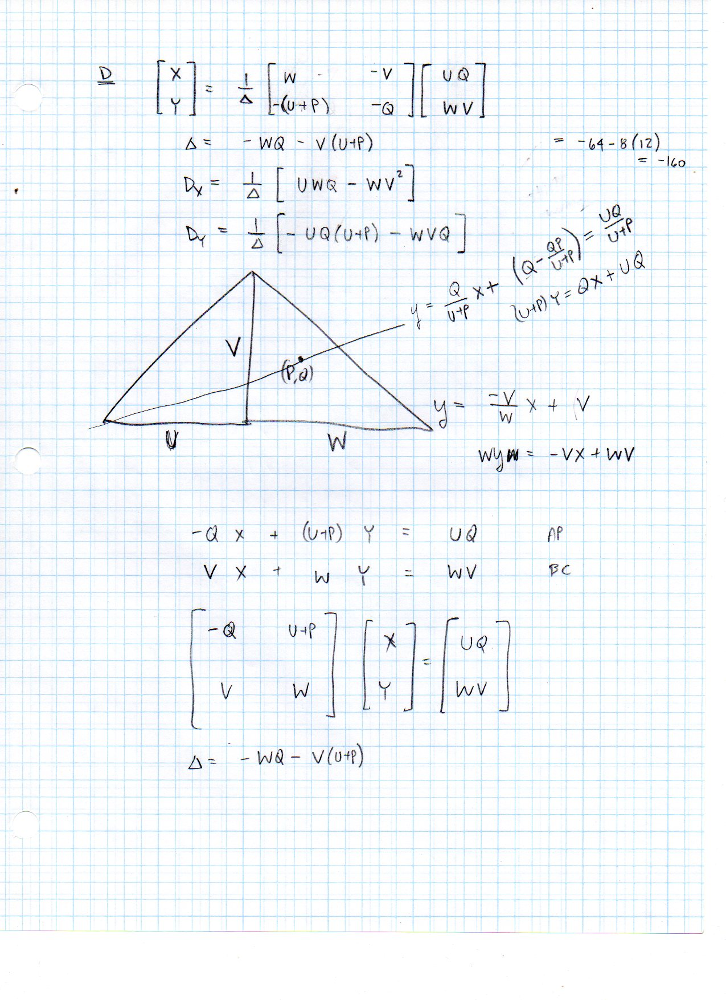

   Folio ``0302`` (original scan ``0302.jpg``) from ``resources/seelig/47_u-v-w``.

**Diplomatic Mathematical & Geometric Transcription**

**Diplomatic Transcription — Folio 0302** (``0302.jpg``, Sheet 8 of 11):

Verifies that the segment ratios determined by :math:`D, E, F` multiply to :math:`1`.

.. math::

   F_x = \frac{p V}{V - q}, \qquad D = \left(\frac{W V (U + p)}{V(U + W) + q W},\; \frac{V q (U + W)}{V(U + W) + q W}\right)

.. admonition:: Editorial & Symbolic Notes

   Archival scan ``0302.jpg`` from Fred W. Seelig's notebook dossier on **F.47 The UVW Coordinate Triangle** (Page 8 of 11). Companion OpenDocument worksheet(s): ``UVW Triangle``, ``Ceva & Menelaus``. Classical Euclidean foundations: :ref:`I.47`, :ref:`VI.2`. Kimberling *Encyclopedia of Triangle Centers* loci: :ref:`X(2)`, :ref:`X(4)`.

Folio 0303 (Page 9 of 11): Barycentric Conversion in the UVW Frame (009)
------------------------------------------------------------------------

.. folio:: 0303

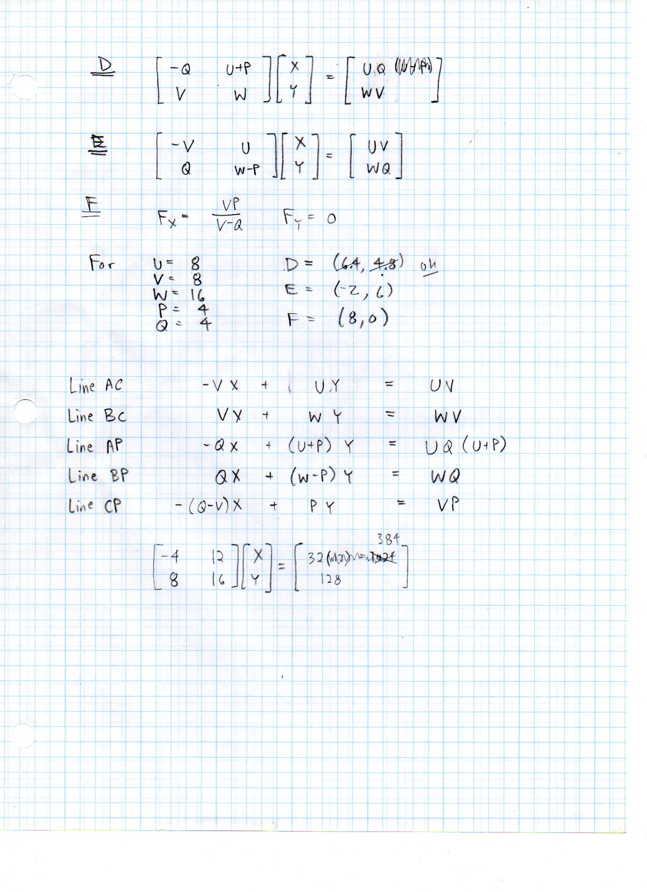

   Folio ``0303`` (original scan ``0303.jpg``) from ``resources/seelig/47_u-v-w``.

**Diplomatic Mathematical & Geometric Transcription**

**Diplomatic Transcription — Folio 0303** (``0303.jpg``, Sheet 9 of 11):

Expresses the normalized barycentric coordinates :math:`(\lambda_A, \lambda_B, \lambda_C)` of :math:`P(p,q)` in terms of :math:`U, V, W`.

.. math::

   A = (-U, 0), \qquad B = (W, 0), \qquad C = (0, V), \qquad a^2 = V^2 + W^2,\; b^2 = U^2 + V^2,\; c = U + W

.. admonition:: Editorial & Symbolic Notes

   Archival scan ``0303.jpg`` from Fred W. Seelig's notebook dossier on **F.47 The UVW Coordinate Triangle** (Page 9 of 11). Companion OpenDocument worksheet(s): ``UVW Triangle``, ``Ceva & Menelaus``. Classical Euclidean foundations: :ref:`I.47`, :ref:`VI.2`. Kimberling *Encyclopedia of Triangle Centers* loci: :ref:`X(2)`, :ref:`X(4)`.

Folio 0304 (Page 10 of 11): Inverse Mapping from (a, b, c) to (U, V, W) (010)
-----------------------------------------------------------------------------

.. folio:: 0304

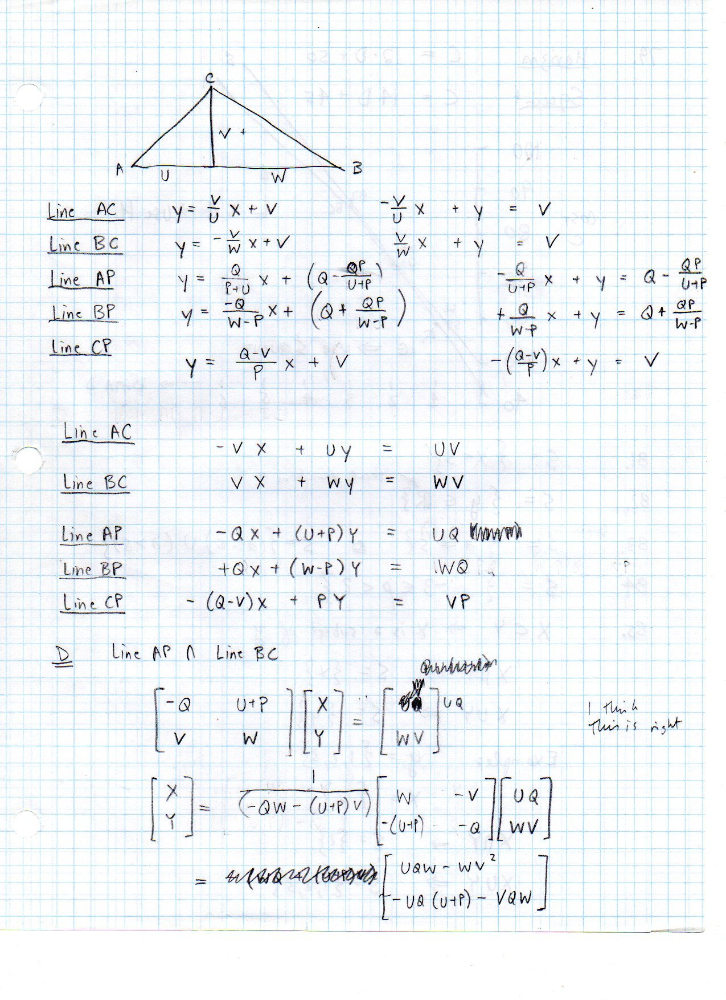

   Folio ``0304`` (original scan ``0304.jpg``) from ``resources/seelig/47_u-v-w``.

**Diplomatic Mathematical & Geometric Transcription**

**Diplomatic Transcription — Folio 0304** (``0304.jpg``, Sheet 10 of 11):

Uses Euclid II.12/II.13 to recover :math:`U = (b^2+c^2-a^2)/(2c), W = (a^2+c^2-b^2)/(2c)`, and :math:`V = 2K/c`.

.. math::

   F_x = \frac{p V}{V - q}, \qquad D = \left(\frac{W V (U + p)}{V(U + W) + q W},\; \frac{V q (U + W)}{V(U + W) + q W}\right)

.. admonition:: Editorial & Symbolic Notes

   Archival scan ``0304.jpg`` from Fred W. Seelig's notebook dossier on **F.47 The UVW Coordinate Triangle** (Page 10 of 11). Companion OpenDocument worksheet(s): ``UVW Triangle``, ``Ceva & Menelaus``. Classical Euclidean foundations: :ref:`I.47`, :ref:`VI.2`. Kimberling *Encyclopedia of Triangle Centers* loci: :ref:`X(2)`, :ref:`X(4)`.

Folio 0305 (Page 11 of 11): Spreadsheet Formula Summary for the UVW Worksheet (011)
-----------------------------------------------------------------------------------

.. folio:: 0305

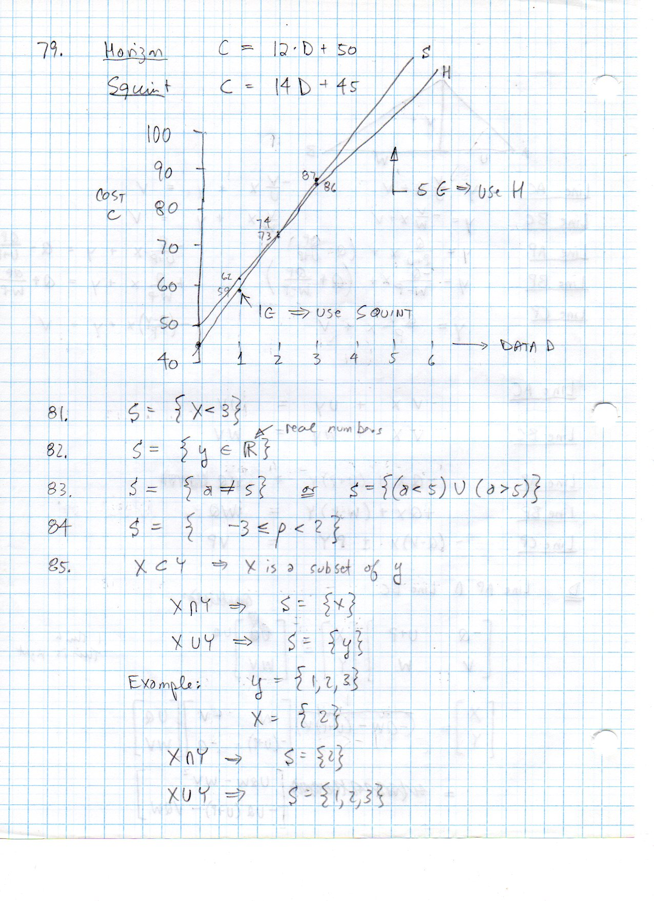

   Folio ``0305`` (original scan ``0305.jpg``) from ``resources/seelig/47_u-v-w``.

**Diplomatic Mathematical & Geometric Transcription**

**Diplomatic Transcription — Folio 0305** (``0305.jpg``, Sheet 11 of 11):

Summarizes the cell formulas implemented in the ``UVW Triangle`` tab of ``Triangles and Circles.ods``.

.. math::

   A = (-U, 0), \qquad B = (W, 0), \qquad C = (0, V), \qquad a^2 = V^2 + W^2,\; b^2 = U^2 + V^2,\; c = U + W

.. admonition:: Editorial & Symbolic Notes

   Archival scan ``0305.jpg`` from Fred W. Seelig's notebook dossier on **F.47 The UVW Coordinate Triangle** (Page 11 of 11). Companion OpenDocument worksheet(s): ``UVW Triangle``, ``Ceva & Menelaus``. Classical Euclidean foundations: :ref:`I.47`, :ref:`VI.2`. Kimberling *Encyclopedia of Triangle Centers* loci: :ref:`X(2)`, :ref:`X(4)`.
