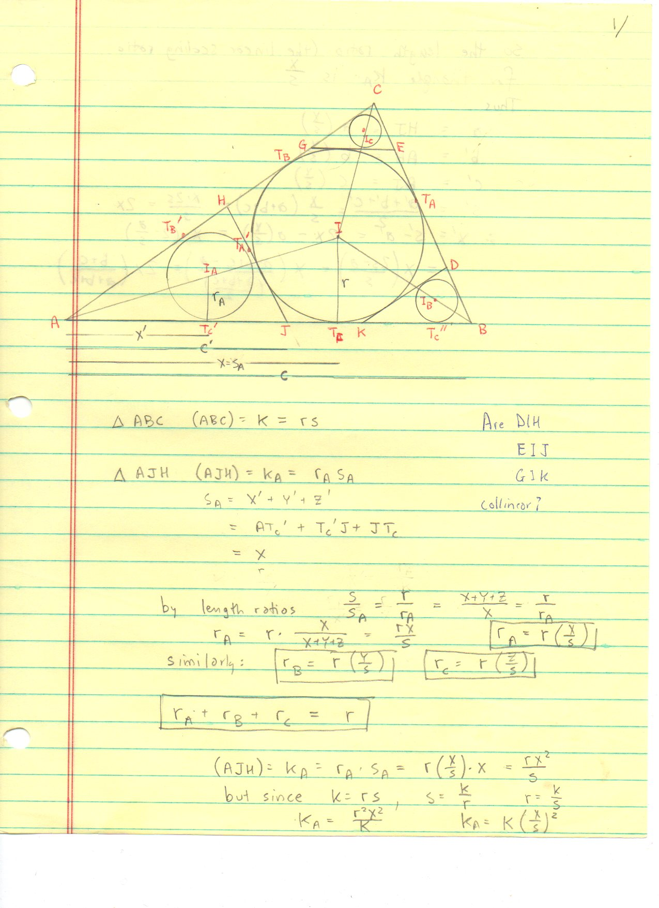
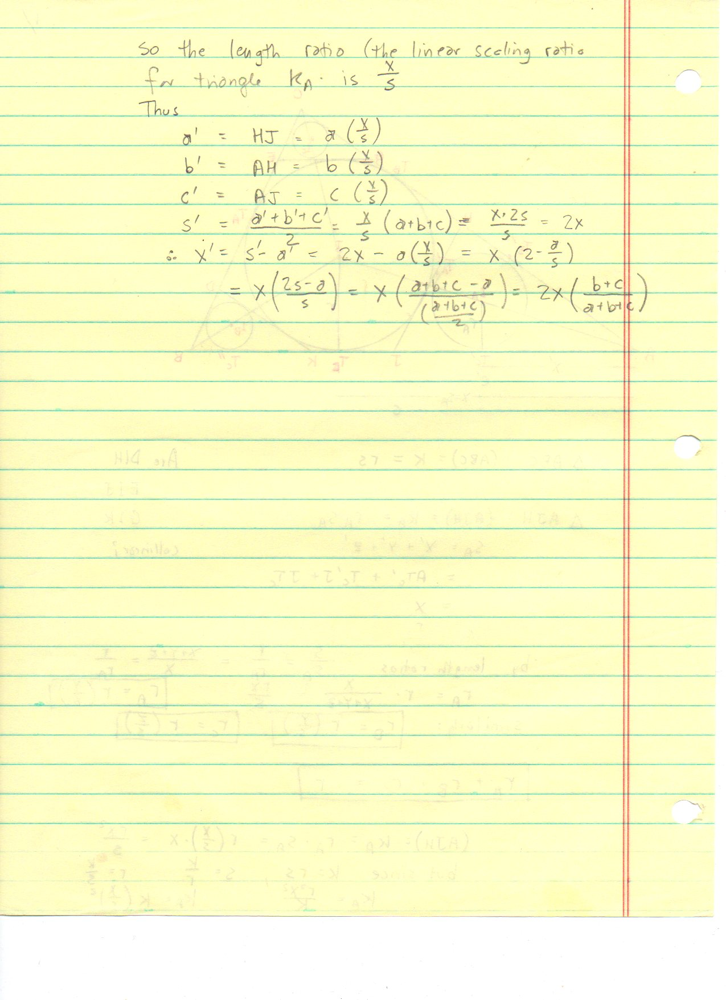
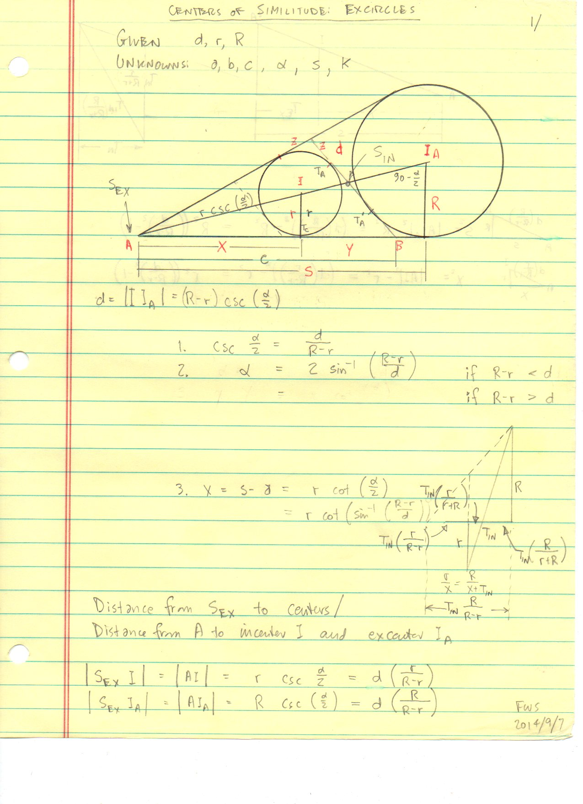
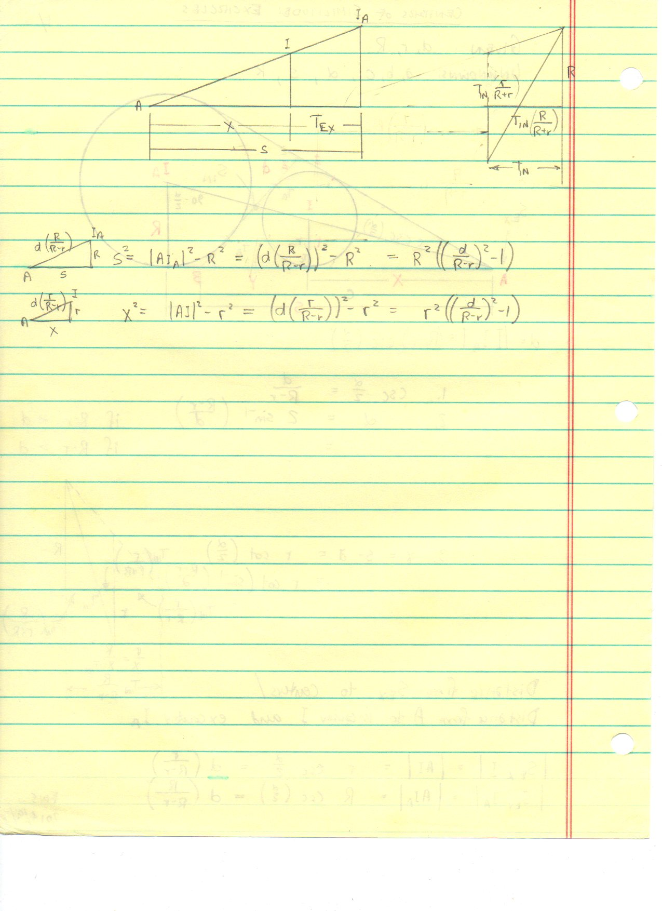
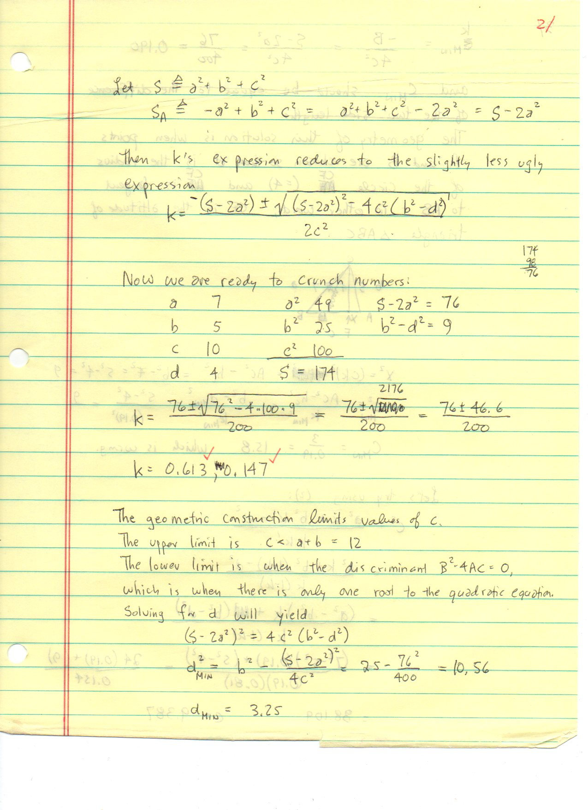
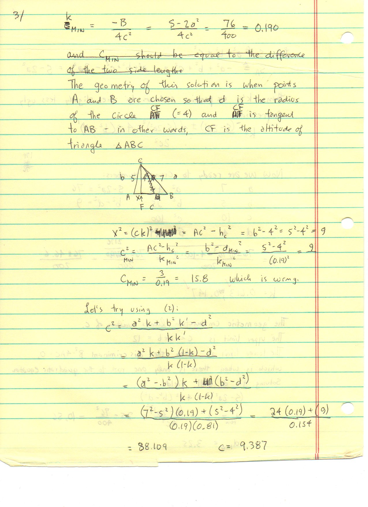
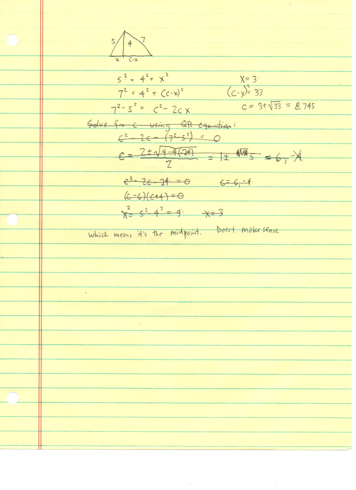
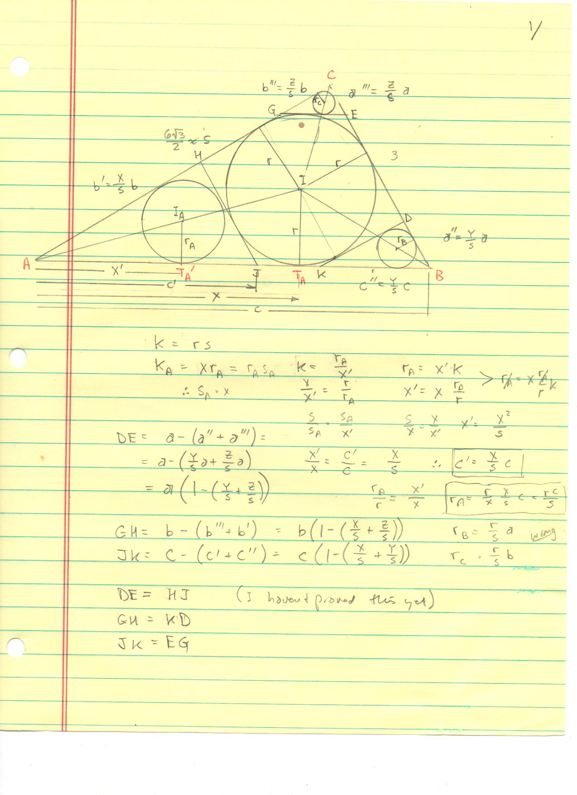
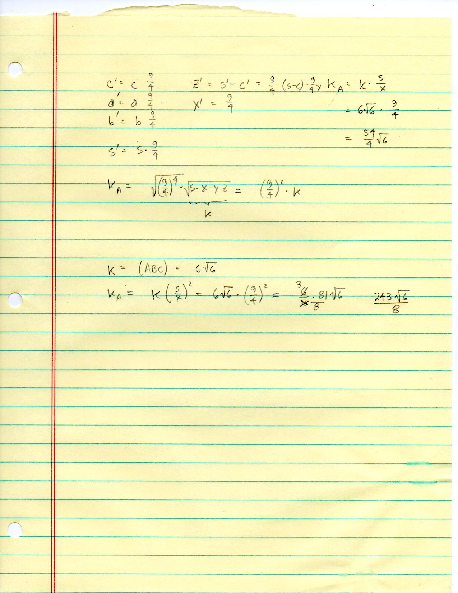

=========================================================================
F.48 Verisimilitude, Corner Subtriangles, and Excircle Homothety — Folios
=========================================================================

Archival manuscript scans and diplomatic transcriptions from :person:`seelig`'s
notebooks for **F.48 (Verisimilitude, Corner Subtriangles, and Excircle Homothety)** (:cite:`SeeligNotebooks`).

Folio 0306 (Page 1 of 9): Corner Subtriangles Tangent to the Incircle — Semiperimeter s_A = x (001)
---------------------------------------------------------------------------------------------------

.. folio:: 0306

   Folio ``0306`` (original scan ``0306.jpg``) from ``resources/seelig/48_verisimilitude``.

**Diplomatic Mathematical & Geometric Transcription**

**Diplomatic Transcription — Folio 0306** (``0306.jpg``, Sheet 1 of 9):

Proves by equal tangent segments that the corner subtriangle cut off at vertex :math:`A` by a tangent to the incircle parallel to :math:`BC` has semiperimeter :math:`s_A = s - a = x`.

.. math::

   s_A = x = s - a, \qquad r_A = r\frac{x}{s}, \qquad K_A = K\left(\frac{x}{s}\right)^2, \qquad r_A + r_B + r_C = r\frac{x + y + z}{s} = r

.. admonition:: Editorial & Symbolic Notes

   Archival scan ``0306.jpg`` from Fred W. Seelig's notebook dossier on **F.48 Verisimilitude, Corner Subtriangles, and Excircle Homothety** (Page 1 of 9). Companion OpenDocument worksheet(s): ``Centers of Similitude``, ``Incircle-Incenter``, ``Stewart's Theorem``. Classical Euclidean foundations: :ref:`IV.4`, :ref:`VI.4`. Kimberling *Encyclopedia of Triangle Centers* loci: :ref:`X(1)`, :ref:`X(55)`, :ref:`X(56)`.

Folio 0307 (Page 2 of 9): Inradii Sum Identity r_A + r_B + r_C = r (002)
------------------------------------------------------------------------

.. folio:: 0307

   Folio ``0307`` (original scan ``0307.jpg``) from ``resources/seelig/48_verisimilitude``.

**Diplomatic Mathematical & Geometric Transcription**

**Diplomatic Transcription — Folio 0307** (``0307.jpg``, Sheet 2 of 9):

Uses homothety ratio :math:`x/s` to derive :math:`r_A = r(x/s), K_A = K(x/s)^2`, and :math:`r_A + r_B + r_C = r(x+y+z)/s = r`.

.. math::

   |AI| = |II_A|\frac{r}{r_a - r}, \qquad |AI_A| = |II_A|\frac{r_a}{r_a - r}, \qquad c^2 k^2 - (c^2 + a^2 - b^2) k + (a^2 - d^2) = 0

.. admonition:: Editorial & Symbolic Notes

   Archival scan ``0307.jpg`` from Fred W. Seelig's notebook dossier on **F.48 Verisimilitude, Corner Subtriangles, and Excircle Homothety** (Page 2 of 9). Companion OpenDocument worksheet(s): ``Centers of Similitude``, ``Incircle-Incenter``, ``Stewart's Theorem``. Classical Euclidean foundations: :ref:`IV.4`, :ref:`VI.4`. Kimberling *Encyclopedia of Triangle Centers* loci: :ref:`X(1)`, :ref:`X(55)`, :ref:`X(56)`.

Folio 0308 (Page 3 of 9): Infinite Chain of Tangential Corner Incircles (003)
-----------------------------------------------------------------------------

.. folio:: 0308

   Folio ``0308`` (original scan ``0308.jpg``) from ``resources/seelig/48_verisimilitude``.

**Diplomatic Mathematical & Geometric Transcription**

**Diplomatic Transcription — Folio 0308** (``0308.jpg``, Sheet 3 of 9):

Sums the geometric series of nested incircles marching into vertex :math:`A` with ratio :math:`\rho_A = (1 - \sin(\alpha/2))/(1 + \sin(\alpha/2))`.

.. math::

   s_A = x = s - a, \qquad r_A = r\frac{x}{s}, \qquad K_A = K\left(\frac{x}{s}\right)^2, \qquad r_A + r_B + r_C = r\frac{x + y + z}{s} = r

.. admonition:: Editorial & Symbolic Notes

   Archival scan ``0308.jpg`` from Fred W. Seelig's notebook dossier on **F.48 Verisimilitude, Corner Subtriangles, and Excircle Homothety** (Page 3 of 9). Companion OpenDocument worksheet(s): ``Centers of Similitude``, ``Incircle-Incenter``, ``Stewart's Theorem``. Classical Euclidean foundations: :ref:`IV.4`, :ref:`VI.4`. Kimberling *Encyclopedia of Triangle Centers* loci: :ref:`X(1)`, :ref:`X(55)`, :ref:`X(56)`.

Folio 0309 (Page 4 of 9): Numerical Evaluation on the (5, 6, 7) Triangle (004)
------------------------------------------------------------------------------

.. folio:: 0309

   Folio ``0309`` (original scan ``0309.jpg``) from ``resources/seelig/48_verisimilitude``.

**Diplomatic Mathematical & Geometric Transcription**

**Diplomatic Transcription — Folio 0309** (``0309.jpg``, Sheet 4 of 9):

Evaluates :math:`x/s = 4/9, y/s = 3/9, z/s = 2/9` and checks :math:`r_A + r_B + r_C = r` and :math:`K_A + K_B + K_C = \frac{29}{81}K`.

.. math::

   |AI| = |II_A|\frac{r}{r_a - r}, \qquad |AI_A| = |II_A|\frac{r_a}{r_a - r}, \qquad c^2 k^2 - (c^2 + a^2 - b^2) k + (a^2 - d^2) = 0

.. admonition:: Editorial & Symbolic Notes

   Archival scan ``0309.jpg`` from Fred W. Seelig's notebook dossier on **F.48 Verisimilitude, Corner Subtriangles, and Excircle Homothety** (Page 4 of 9). Companion OpenDocument worksheet(s): ``Centers of Similitude``, ``Incircle-Incenter``, ``Stewart's Theorem``. Classical Euclidean foundations: :ref:`IV.4`, :ref:`VI.4`. Kimberling *Encyclopedia of Triangle Centers* loci: :ref:`X(1)`, :ref:`X(55)`, :ref:`X(56)`.

Folio 0310 (Page 5 of 9): Centers of Similitude: Excircles — Part 1 (005, FWS 2014/9/7)
---------------------------------------------------------------------------------------

.. folio:: 0310

   Folio ``0310`` (original scan ``0310.jpg``) from ``resources/seelig/48_verisimilitude``.

**Diplomatic Mathematical & Geometric Transcription**

**Diplomatic Transcription — Folio 0310** (``0310.jpg``, Sheet 5 of 9):

Models vertex :math:`A` and the internal/external touchpoint harmonic conjugates along line :math:`AI I_A` for the incircle and :math:`A`-excircle.

.. math::

   s_A = x = s - a, \qquad r_A = r\frac{x}{s}, \qquad K_A = K\left(\frac{x}{s}\right)^2, \qquad r_A + r_B + r_C = r\frac{x + y + z}{s} = r

.. admonition:: Editorial & Symbolic Notes

   Archival scan ``0310.jpg`` from Fred W. Seelig's notebook dossier on **F.48 Verisimilitude, Corner Subtriangles, and Excircle Homothety** (Page 5 of 9). Companion OpenDocument worksheet(s): ``Centers of Similitude``, ``Incircle-Incenter``, ``Stewart's Theorem``. Classical Euclidean foundations: :ref:`IV.4`, :ref:`VI.4`. Kimberling *Encyclopedia of Triangle Centers* loci: :ref:`X(1)`, :ref:`X(55)`, :ref:`X(56)`.

Folio 0311 (Page 6 of 9): Centers of Similitude: Excircles — Part 2 (006)
-------------------------------------------------------------------------

.. folio:: 0311

   Folio ``0311`` (original scan ``0311.jpg``) from ``resources/seelig/48_verisimilitude``.

**Diplomatic Mathematical & Geometric Transcription**

**Diplomatic Transcription — Folio 0311** (``0311.jpg``, Sheet 6 of 9):

Derives :math:`|AI| = d\frac{r}{R-r}` and :math:`|AI_A| = d\frac{R}{R-r}` (where :math:`R = r_a` is the exradius and :math:`d = |II_A|`).

.. math::

   |AI| = |II_A|\frac{r}{r_a - r}, \qquad |AI_A| = |II_A|\frac{r_a}{r_a - r}, \qquad c^2 k^2 - (c^2 + a^2 - b^2) k + (a^2 - d^2) = 0

.. admonition:: Editorial & Symbolic Notes

   Archival scan ``0311.jpg`` from Fred W. Seelig's notebook dossier on **F.48 Verisimilitude, Corner Subtriangles, and Excircle Homothety** (Page 6 of 9). Companion OpenDocument worksheet(s): ``Centers of Similitude``, ``Incircle-Incenter``, ``Stewart's Theorem``. Classical Euclidean foundations: :ref:`IV.4`, :ref:`VI.4`. Kimberling *Encyclopedia of Triangle Centers* loci: :ref:`X(1)`, :ref:`X(55)`, :ref:`X(56)`.

Folio 0312 (Page 7 of 9): Inverse Stewart Problem: Finding k for Given Cevian Length d (007)
--------------------------------------------------------------------------------------------

.. folio:: 0312

   Folio ``0312`` (original scan ``0312.jpg``) from ``resources/seelig/48_verisimilitude``.

**Diplomatic Mathematical & Geometric Transcription**

**Diplomatic Transcription — Folio 0312** (``0312.jpg``, Sheet 7 of 9):

Rearranges Stewart's theorem into the quadratic :math:`c^2 k^2 - (c^2+a^2-b^2)k + (a^2-d^2) = 0`.

.. math::

   s_A = x = s - a, \qquad r_A = r\frac{x}{s}, \qquad K_A = K\left(\frac{x}{s}\right)^2, \qquad r_A + r_B + r_C = r\frac{x + y + z}{s} = r

.. admonition:: Editorial & Symbolic Notes

   Archival scan ``0312.jpg`` from Fred W. Seelig's notebook dossier on **F.48 Verisimilitude, Corner Subtriangles, and Excircle Homothety** (Page 7 of 9). Companion OpenDocument worksheet(s): ``Centers of Similitude``, ``Incircle-Incenter``, ``Stewart's Theorem``. Classical Euclidean foundations: :ref:`IV.4`, :ref:`VI.4`. Kimberling *Encyclopedia of Triangle Centers* loci: :ref:`X(1)`, :ref:`X(55)`, :ref:`X(56)`.

Folio 0313 (Page 8 of 9): Worked Quadratic Example (a, b, c, d) = (7, 5, 10, 4) (008)
-------------------------------------------------------------------------------------

.. folio:: 0313

   Folio ``0313`` (original scan ``0313.jpg``) from ``resources/seelig/48_verisimilitude``.

**Diplomatic Mathematical & Geometric Transcription**

**Diplomatic Transcription — Folio 0313** (``0313.jpg``, Sheet 8 of 9):

Solves for the two base division ratios :math:`k = 0.613` and :math:`k = 0.147` at which a cevian of length :math:`d=4` meets base :math:`c=10`.

.. math::

   |AI| = |II_A|\frac{r}{r_a - r}, \qquad |AI_A| = |II_A|\frac{r_a}{r_a - r}, \qquad c^2 k^2 - (c^2 + a^2 - b^2) k + (a^2 - d^2) = 0

.. admonition:: Editorial & Symbolic Notes

   Archival scan ``0313.jpg`` from Fred W. Seelig's notebook dossier on **F.48 Verisimilitude, Corner Subtriangles, and Excircle Homothety** (Page 8 of 9). Companion OpenDocument worksheet(s): ``Centers of Similitude``, ``Incircle-Incenter``, ``Stewart's Theorem``. Classical Euclidean foundations: :ref:`IV.4`, :ref:`VI.4`. Kimberling *Encyclopedia of Triangle Centers* loci: :ref:`X(1)`, :ref:`X(55)`, :ref:`X(56)`.

Folio 0314 (Page 9 of 9): Discriminant & Minimum Cevian Length d_min = h_c (009)
--------------------------------------------------------------------------------

.. folio:: 0314

   Folio ``0314`` (original scan ``0314.jpg``) from ``resources/seelig/48_verisimilitude``.

**Diplomatic Mathematical & Geometric Transcription**

**Diplomatic Transcription — Folio 0314** (``0314.jpg``, Sheet 9 of 9):

Shows that the quadratic discriminant vanishes precisely when :math:`d = d_{\min} = h_c \approx 3.25` (the perpendicular altitude).

.. math::

   s_A = x = s - a, \qquad r_A = r\frac{x}{s}, \qquad K_A = K\left(\frac{x}{s}\right)^2, \qquad r_A + r_B + r_C = r\frac{x + y + z}{s} = r

.. admonition:: Editorial & Symbolic Notes

   Archival scan ``0314.jpg`` from Fred W. Seelig's notebook dossier on **F.48 Verisimilitude, Corner Subtriangles, and Excircle Homothety** (Page 9 of 9). Companion OpenDocument worksheet(s): ``Centers of Similitude``, ``Incircle-Incenter``, ``Stewart's Theorem``. Classical Euclidean foundations: :ref:`IV.4`, :ref:`VI.4`. Kimberling *Encyclopedia of Triangle Centers* loci: :ref:`X(1)`, :ref:`X(55)`, :ref:`X(56)`.
