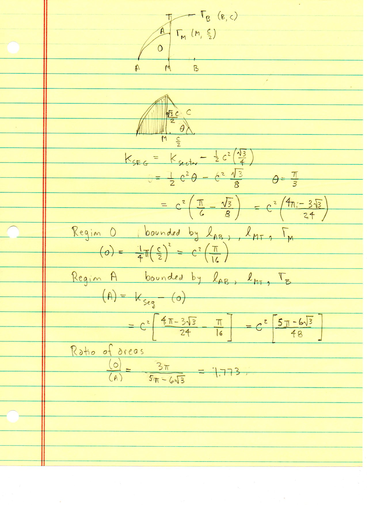
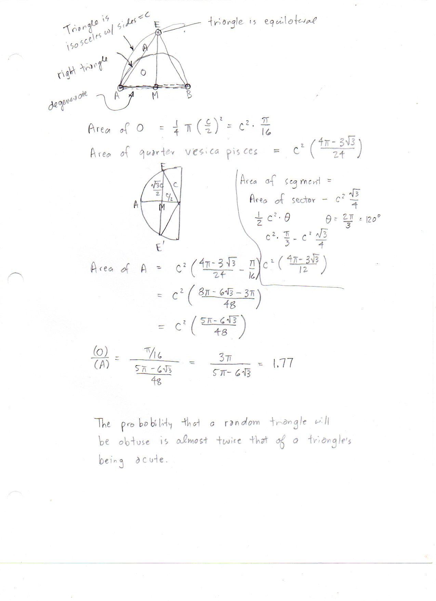
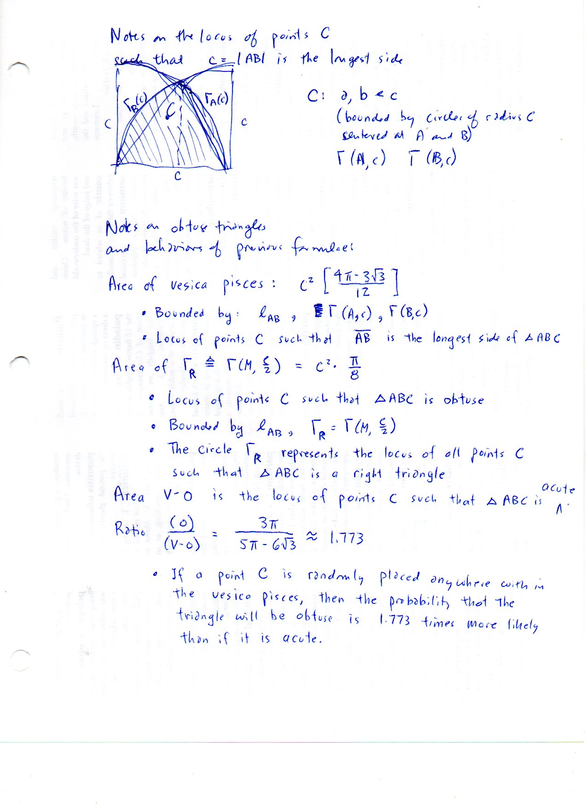

========================================================
F.49 Vesica Piscis and Acute-Obtuse Probability — Folios
========================================================

Archival manuscript scans and diplomatic transcriptions from :person:`seelig`'s
notebooks for **F.49 (Vesica Piscis and Acute-Obtuse Probability)** (:cite:`SeeligNotebooks`).

Folio 0315 (Page 1 of 3): Locus of Longest-Side Triangles in the Vesica Piscis (001)
------------------------------------------------------------------------------------

.. folio:: 0315

   Folio ``0315`` (original scan ``0315.jpg``) from ``resources/seelig/49_vesica-pisces``.

**Diplomatic Mathematical & Geometric Transcription**

**Diplomatic Transcription — Folio 0315** (``0315.jpg``, Sheet 1 of 3):

Identifies the region where :math:`|AC| \le c` and :math:`|BC| \le c` with the vesica piscis on :math:`AB` and computes the quarter-vesica area :math:`c^2\frac{4\pi-3\sqrt{3}}{24}`.

.. math::

   (O) + (A) = c^2\left(\frac{\pi}{6} - \frac{\sqrt{3}}{8}\right) = c^2\frac{4\pi - 3\sqrt{3}}{24}, \qquad (O) = \frac{1}{4}\pi\left(\frac{c}{2}\right)^2 = c^2\frac{\pi}{16}

.. admonition:: Editorial & Symbolic Notes

   Archival scan ``0315.jpg`` from Fred W. Seelig's notebook dossier on **F.49 Vesica Piscis and Acute-Obtuse Probability** (Page 1 of 3). Companion OpenDocument worksheet(s): ``Monte Carlo``, ``General Reference``. Classical Euclidean foundations: :ref:`I.1`, :ref:`III.31`.

Folio 0316 (Page 2 of 3): Thales Semicircle Partition into Obtuse (O) & Acute (A) Regions (002)
-----------------------------------------------------------------------------------------------

.. folio:: 0316

   Folio ``0316`` (original scan ``0316.jpg``) from ``resources/seelig/49_vesica-pisces``.

**Diplomatic Mathematical & Geometric Transcription**

**Diplomatic Transcription — Folio 0316** (``0316.jpg``, Sheet 2 of 3):

Uses the semicircle of radius :math:`c/2` on diameter :math:`AB` to separate obtuse triangles :math:`(O) = c^2\pi/16` from acute triangles :math:`(A) = c^2\frac{5\pi-6\sqrt{3}}{48}`.

.. math::

   (A) = c^2\frac{5\pi - 6\sqrt{3}}{48}, \qquad \frac{(O)}{(A)} = \frac{3\pi}{5\pi - 6\sqrt{3}} \approx 1.7731

.. admonition:: Editorial & Symbolic Notes

   Archival scan ``0316.jpg`` from Fred W. Seelig's notebook dossier on **F.49 Vesica Piscis and Acute-Obtuse Probability** (Page 2 of 3). Companion OpenDocument worksheet(s): ``Monte Carlo``, ``General Reference``. Classical Euclidean foundations: :ref:`I.1`, :ref:`III.31`.

Folio 0317 (Page 3 of 3): Exact Obtuse-to-Acute Probability Ratio (003)
-----------------------------------------------------------------------

.. folio:: 0317

   Folio ``0317`` (original scan ``0317.jpg``) from ``resources/seelig/49_vesica-pisces``.

**Diplomatic Mathematical & Geometric Transcription**

**Diplomatic Transcription — Folio 0317** (``0317.jpg``, Sheet 3 of 3):

Evaluates :math:`(O)/(A) = \frac{3\pi}{5\pi-6\sqrt{3}} \approx 1.773` and compares with the empirical counts in the Monte Carlo spreadsheet.

.. math::

   (O) + (A) = c^2\left(\frac{\pi}{6} - \frac{\sqrt{3}}{8}\right) = c^2\frac{4\pi - 3\sqrt{3}}{24}, \qquad (O) = \frac{1}{4}\pi\left(\frac{c}{2}\right)^2 = c^2\frac{\pi}{16}

.. admonition:: Editorial & Symbolic Notes

   Archival scan ``0317.jpg`` from Fred W. Seelig's notebook dossier on **F.49 Vesica Piscis and Acute-Obtuse Probability** (Page 3 of 3). Companion OpenDocument worksheet(s): ``Monte Carlo``, ``General Reference``. Classical Euclidean foundations: :ref:`I.1`, :ref:`III.31`.
